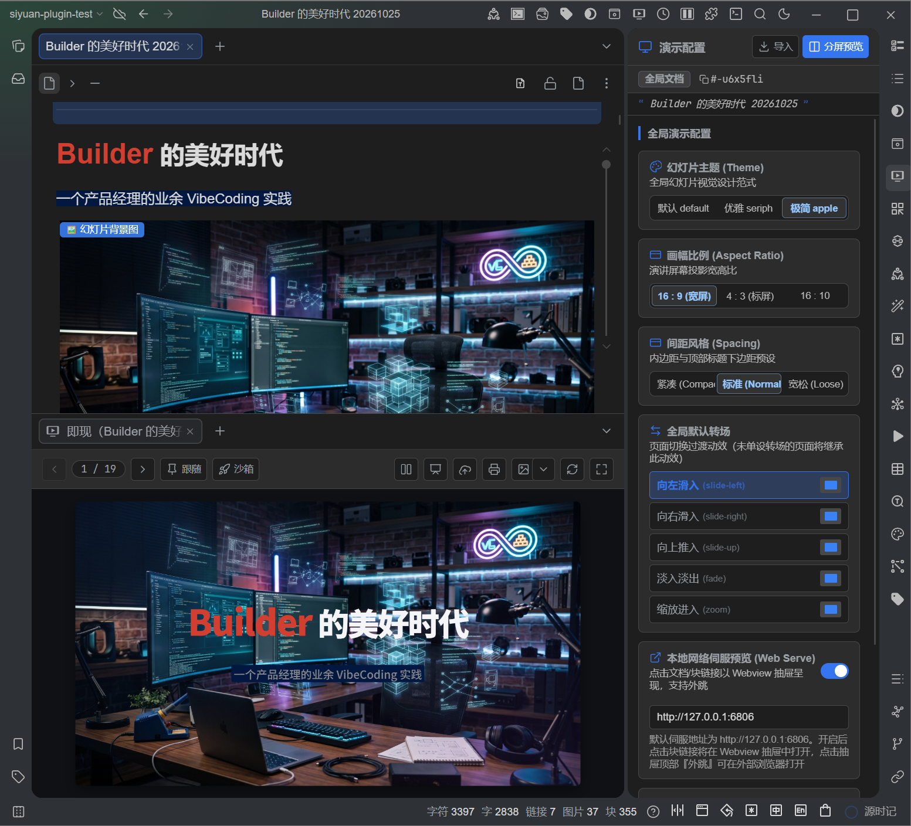
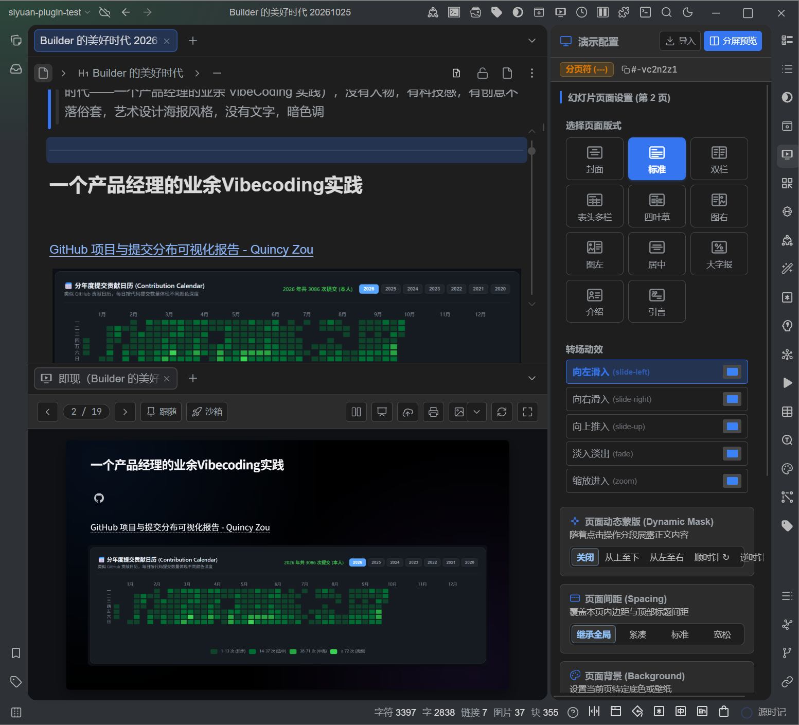
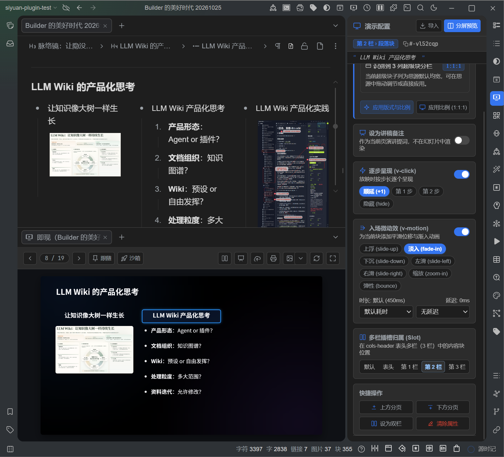
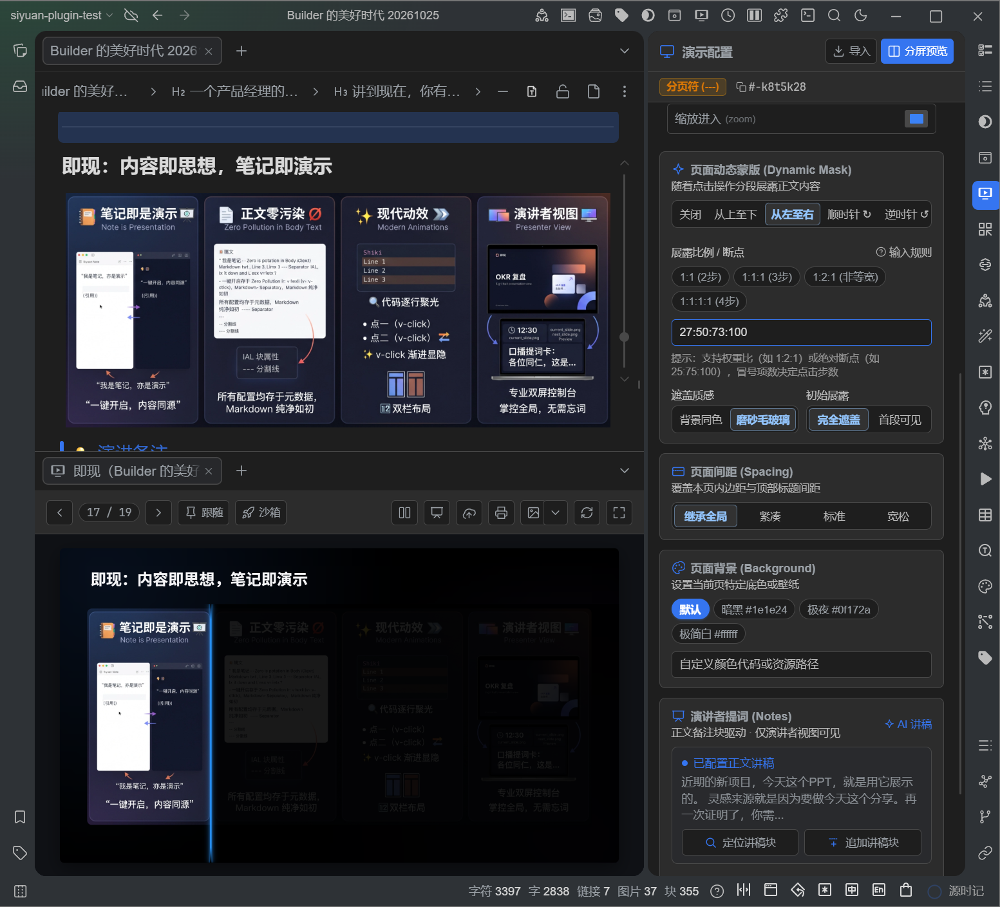
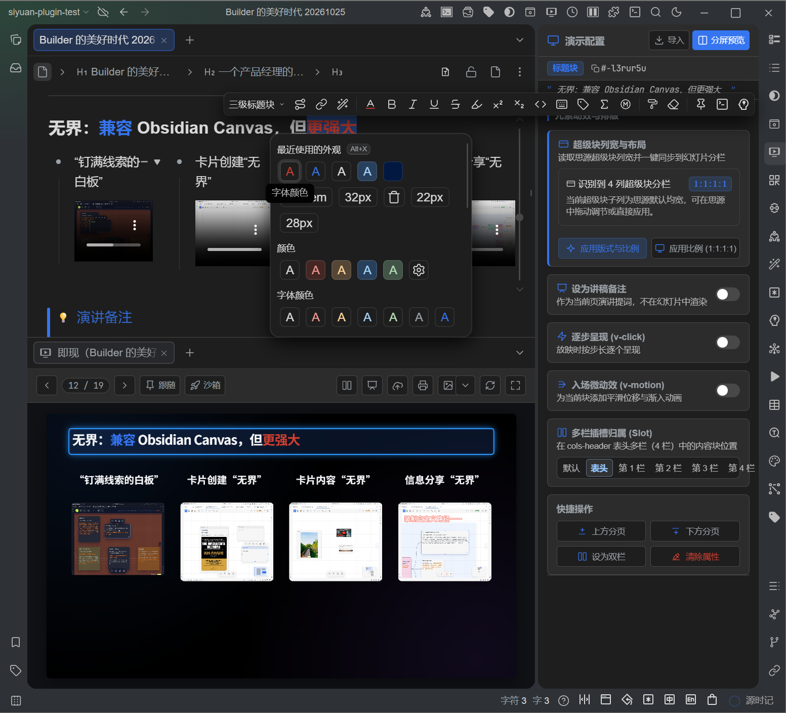
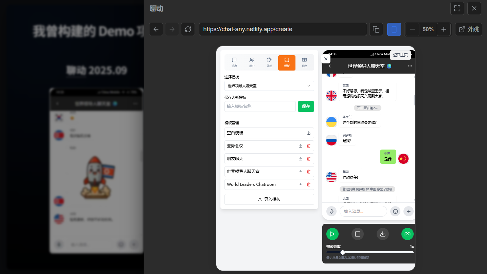
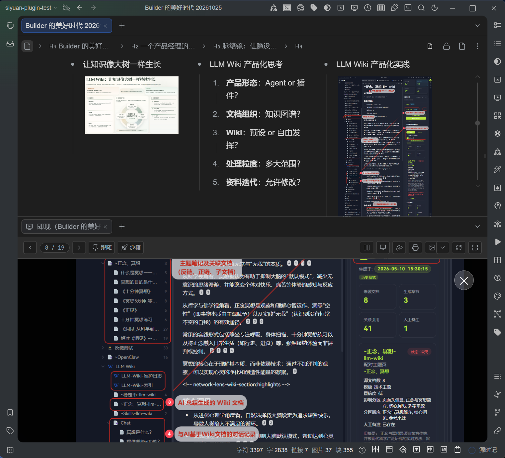
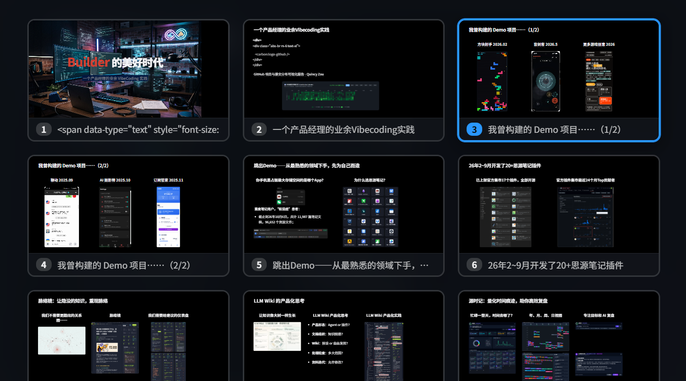
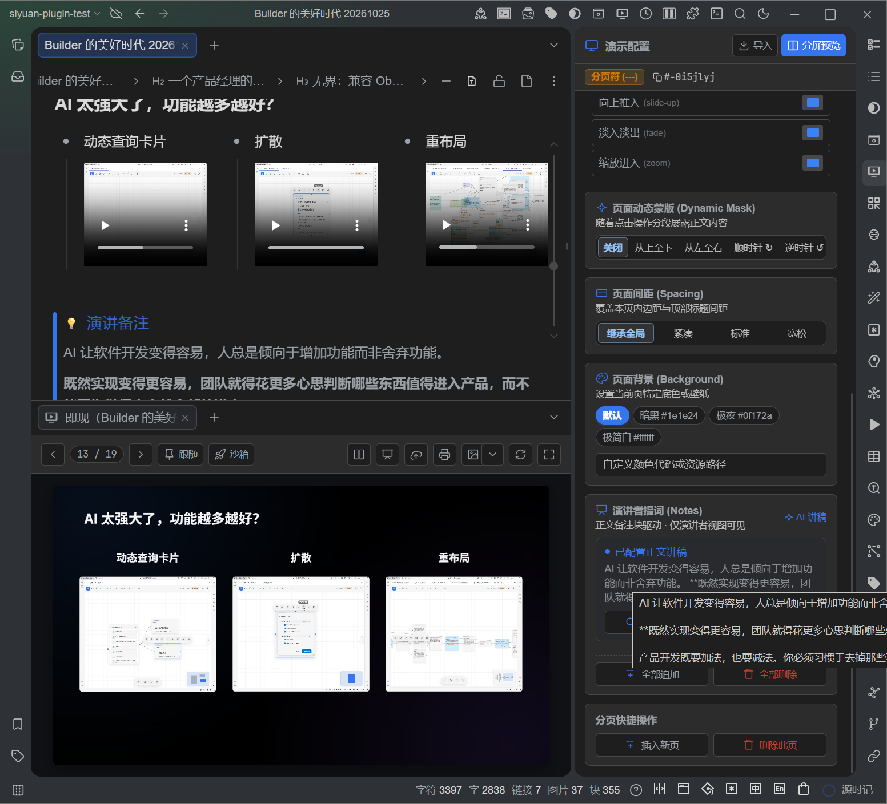
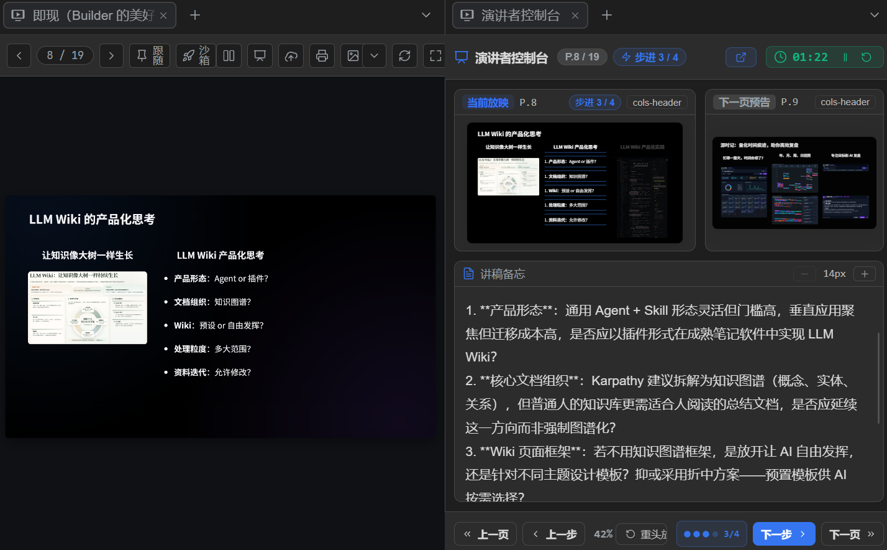

# 当美化胶片的PPT Skills大受欢迎，我却选择让朴素文档与“PPT”合二为一

[📖 详细使用指南](./docs/USER-GUIDE.zh-CN.md) | [📖 User Guide (EN)](./docs/USER-GUIDE.md) | [📦 更新日志 (Changelog)](./CHANGELOG.md)

> 内容即思想，笔记即演示。
>
> 让演讲回归内容，让思想即刻呈现。

---

美化胶片的PPT Skill在开源社区和职场人群大受欢迎，行业大神们的PPT却依旧保持简洁朴素。美化有其价值，但交流分享需要一条摩擦更低的途径。而日常演示分享最大的痛，莫过于"内容搬运"这一时间黑洞——把现成文档摘录进PPT重排，还要与文档割裂维护。

“即现”插件让朴素文档与现代演示合二为一，是一次让演示回归传递观点本意的尝试：零依赖、零污染、写完即讲，同时提供媲美传统PPT甚至更胜一筹的专业演示效果。如果说文档是根，那么演示只是它某一次的绽放，散场后内容沉淀回知识库，成为下次分享的起点。愿我们都能从无谓的胶片内卷中解脱出来，把时间留给思考，让思想自由流动。

---

## 楔子：为什么 PPT Skill 大受欢迎，而大神们的 PPT 都那么简单？

在 GitHub 和各大开源社区里，PPT 制作与胶片美化类的 Skill 正在以不可思议的速度蹿红。如果你经常关注开源热点，大概会发现这几乎是除了 Awesome 类热点信息汇总项目之外，目前最容易斩获成千上万颗 Star 的赛道。

各种各样的提示词和自动化工作流层出不穷，核心卖点无一例外是：帮你自动提炼演讲大纲、一键生成排版模板、调用绘图模型批量配图，把原本朴素单调的文字装扮成令人眼花缭乱的精美胶片。但大家做 PPT 的初衷，难道不是为了高效传递想法与沟通信息吗？

平时参加一些行业峰会，那些在领域内深耕多年的技术专家和学术带头人的分享胶片都很朴实无华，基本就是几行要点文字。我感觉使用 skill 花费大量 token 和时间修改 PPT，是一种本末倒置。

但后来我想明白了，这是因为不同场合的交流诉求不同。在职场的很多汇报场景里，雕琢 PPT 往往是向上争取资源与好评价的手段。大家花费海量精力去美化胶片，本质上是在用自己的时间为决策者降低阅读门槛，以此展现工作态度并精准传递诉求。在这种情境下，能帮忙分担美化工作量的 Skill 自然有很高的实用价值。

而在技术分享、行业大会等场合，关键是传播思想而不是汇报工作，听众的期望也不同，更有效的手段是提供干货、传递理念。专家们的胶片之所以朴素，恰恰是因为他们的功夫都花在了思想本身。

那么，在团队技术交流、日常方案评审以及个人知识分享这些平等交流的场合，除了 PPT Skill，还有没有更好的提效方法？

‍

## 内容搬运是演示准备中最大的时间黑洞

在我看来，日常分享最大的不便，是我们不得不花费很大的精力准备 PPT。大多数情况下，当我们有内容需要分享时，手头已经有了一份记录工作成果、分析技术方案的现成文档。但为了更好的分享效果，我们不得不花费几个小时，把文档内容摘录复制到 PPT 里重新排版。更麻烦的是，这份 PPT 很难跟文档一起同步维护，当工作进展有更新、技术方案有变更时，再次分享就得把搬运、排版的过程重来一遍。

我们苦于制作 PPT，很多时候其实并不讨厌分享，主要是不想承受这种被工具割裂的无谓内耗。如果我们在写下工作笔记的那一刻，文档本身就能直接作为一份的演示文稿来展示，那该有多好？

带着“让文档直接做演示”的念头，我开始在开源世界里寻找现有的轮子。

调研一圈下来，在众多基于 Markdown 的现代演示工具中，由 Vue 核心团队成员 Anthony Fu 发起的 **Slidev** 迅速进入了我的视野。不得不说，Slidev 代表了现代演示工具的高水准：基于 Vue 3 和 Vite 构建，不仅支持在幻灯片里直接嵌入可交互的图表和组件，还自带优雅的原子化样式引擎；内置的 Shiki 语法高亮能做到单行代码选区平滑聚焦；还有开箱即用的逐步动效与双屏演讲者视图。几乎把技术人对演示文稿的美好想象都变成了现实。

当时我心里一热，打算直接把 Slidev 以套壳形式整体打包进日常写作使用的思源笔记软件。但随着对它的深入研究，两个非常现实的难题挡在了面前：其一，Slidev 是面向开发者设计的，运行时需要安装 Node.js、npm 依赖并手动启动本地终端服务，这估计能让九成普通用户望而却步。其二，为了实现演示动画效果，需要在 Markdown 文档中插入大量类似 ​`
 Hey! 
` 的配置代码，会对日常阅读正文造成严重污染，同时纯代码的配置方式也是一道很高的使用门槛。

反复思考之后，我最终放弃了简单集成的方案，选择在思源笔记中重启炉灶，重新设计和开发了一款演示插件——**即现（siyuan-live-slides）”，寓意为：“让演讲回归内容，让思想即刻显现”。**

‍

## “即现”的破局之道：内容即思想，文档即演示

要让朴素文档与现代“PPT”合为一体，绝不仅仅是做个简单的全屏阅读器，更需要从底层解决内容沉淀与演示表现之间的冲突。在构思“即现”的过程中，我考虑了四个维度的核心设计，希望能在不牺牲笔记纯净度的前提下，为用户带来比肩专业发布会的演示体验。

### 一、文档即演示，免搬运、零污染

在过去，很多工具之所以难以普及，往往是因为环境太复杂或者对笔记侵入过深。“即现”从第一行代码开始，就把“零门槛”和“零污染”作为设计底线。

#### 1. 零依赖、免装环境，开箱即用

Slidev 类极客演示工具需要使用者在电脑里装一整套 Node.js 和包管理依赖，稍有版本不兼容就弹出一堆报错，十分劝退。“即现”彻底终结了这种繁琐，它内置了轻量 Web 渲染引擎，在思源笔记下载启用插件后，演示功能立即就绪。

#### 2. 一条分割线开启放映，写完即讲

你不再需要把文档内容机械的复制到其他地方，只要在需要分页的位置敲入一条 ​`---` 水平分割线，内容分页就随之完成。在侧边面板里简单点选排版，便能一键进入大屏放映状态，真正实现“写完即讲”。

#### 3. 内容与演示实时联动，双向即刻同步

以往我们演示幻灯片，最怕现场遇到听众提建议需要修改。这时往往要退出全屏，在 PPT 软件里找到那一页修改，然后再切回放映，整个节奏瞬间被打断。

“即现”实现了双向实时的深度联动：

- **光标智能跟随**：当你在上方的笔记编辑器里移动光标，下方的演示分屏会自动翻到对应的幻灯片，并且聚焦高亮当前段落。
- **反向精准定位**：在演示画面里点击任意一段文字、列表项或图片，上方的笔记编辑器就会平滑滚动，对齐到对应的段落。
- **会议边讲边改**：现场汇报收到反馈，随手在笔记中补充修订，下方的演示画面即时热更新。

#### 4. 块属性记录元数据，正文零污染

借助思源笔记的块级存储和自定义块属性机制，我把所有版式选择、入场动效、转场过渡等演示配置信息，全部保存在每个块的属性字典中。这意味着，你的文档正文不包含任何杂乱的宏代码和长串注释，在阅读以及导出为标准 Markdown 时，文档始终保持纯净整洁。笔记在平时是一篇优雅的文章，在需要时又是一套灵动的胶片，两种形态互不干扰。

### 二、友好的可视化配置，快速呈现不一样的“PPT”

“即现”在侧栏打造了一套直观的可视化配置面板，你不必死记硬背任何排版语法，动动鼠标就能调出专业级的视觉呈现。

#### 1. 九宫格版式与页面转场

光标停留在分页分割线上时，右侧面板会自动呈现直观的九宫格版式选择：

- **多样化版式库**：内置了演示封面、标准正文、双栏对比、自适应两到六栏的表头多栏、四象限田字矩阵、图左图右，以及专门用于强调核心数字或结论的大字报版式。
- **自定义分栏比例**：不仅支持随心调整双栏与图文布局比例，还能直接一键读取思源超级块的拖拽列宽。
- **丝滑转场动效**：向左平滑滑入、优雅淡入淡出等现代转场效果一应俱全，让翻页过程自然流畅。

#### 2. 渐进显隐与入场微动效，牢牢牵引听众视线

做过演讲的朋友大概都有体会，如果你一翻页就把整页的四五条观点全部摊在大屏上，台下的听众往往一目十行抢先看完了结论，不再专心听你当下的讲解。

“即现”支持针对列表项、正文段落甚至多栏内的独立组件单独配置渐进弹出步长。随着你的演讲节奏轻轻敲击翻页键，要点会逐项浮现。配合内置的上浮、淡入、缩放与微弹跳等灵动微动效，既能牢牢掌控听众的视线焦点，又为原本质朴的文字增添了一份精致感。

#### 3. 动态蒙版动画，AI 生图与数据推演的绝佳搭档

在如今的大模型时代，很多人喜欢用 AI 生成一些极具视觉冲击力的宽幅概念图或全景架构图。如果直接把一张大图全盘托出，听众很容易被海量细节淹没。

为此，“即现”提供动态蒙版遮罩：

- 支持**从左至右**、**从上至下**以及独特的**时钟走时（四步环形展露）** 动画。
- 当你讲解复杂的业务演进或技术流转时，画面会随着叙事层层揭开面纱，呈现出引人入胜的视觉悬念与逻辑推演过程。

#### 4. 笔记样式智能映射，所见即所得

在思源笔记里排版时的标题大小、文字高亮色彩与横向超级块，会被插件自动映射为大屏演示的视觉元素。笔记怎么写，放映画面就怎么自然呈现。

### 三、沉浸式演示效果，让观众始终不出戏

一场优秀的演讲，最忌讳的便是频繁跳出放映画面。技术演示和产品汇报中经常需要展示在线文档或交互原型，最怕跳出全屏切换浏览器，暴露桌面隐私还打断节奏。

“即现”通过一系列精细的场景设计，构建了一个让观众从始至终沉浸其中的演示环境。

#### 1. 内置轻量 Web 沙箱，操作 Demo 无需切屏

“即现”内置了轻量 Web 沙箱：点击幻灯片中的外部网页链接，右侧即刻滑出内置速览抽屉，支持缩放调节，还能一键切换桌面、手机视图模拟移动端响应式页面；演示中引用的本地 HTML 交互文件也可以直接原位渲染展示。测试完成按下 Esc 键，抽屉瞬间收起，回到当前幻灯片继续讲解，观众注意力始终凝聚在演示本身。

#### 2. 图片无损放大，复杂架构图细节尽显

技术分享里最常见的就是各种庞大的系统架构图、数据流转图或全景表格。受限于幻灯片画幅，这些大图一旦缩成全屏尺寸，文字和箭头往往缩成一团看不清。

在“即现”放映状态下，点击任意图片就能立刻呼出全屏高清灯箱。你可以直接通过鼠标滚轮进行平滑缩放，按住鼠标任意拖拽平移，双击即可迅速复位。无论是多么密密麻麻的接口图谱，台下每一位听众都能看的清清楚楚。

#### 3. 全局缩略图总览与秒级跳页，从容掌控现场互动

演讲进入问答交流环节时，经常会遇到听众提问：“请问刚才第五页提到的那个性能指标具体是多少？”

现场互动或答辩被问到前面的内容时，无需一页页倒退。按下 O 键呼出全局缩略图总览墙，网格化展示所有页面的真实排版，点击任意卡片瞬间直达；也可以直接键入目标页码，按下回车立刻跳页，从容应对现场互动。

### 四、专业的演讲者双屏视图，无惧忘词

演讲现场最让人紧张的，莫过于突然忘词、超时或者无法预备下一张幻灯片会讲到什么。“即现”把发布会级别的专业控场体验，完整的搬进了思源笔记。

#### 1. 内嵌提词备注，演示资产一体化沉淀

你不再需要额外打印纸质讲稿，也不用把提示词记在手机备忘录里。在“即现”中，每一页幻灯片下方都配备了专属的演讲提词卡区域。这里记录的口播引导和补充数据，只会呈现在演讲者的私有屏幕上。演示画面、演讲提词与笔记知识库在同一篇思源文档中融为一体，真正实现了演示资产的集中沉淀。

#### 2. AI 智能分页与提词生成，长文十分钟成稿

“即现”还集成了 AI 进一步为演示准备提效。点击「AI 智能分页」，AI 根据文章层级逻辑自动在最合适的位置插入分页线并推荐版式；点击「AI 提词生成」，AI 自动提炼当前页的核心论点与逻辑衔接，生成通俗易懂的口播引导词。十分钟之内，一篇沉睡在知识库中的长文，就能转化为一份高水平的演讲稿。

#### 3. 专业双屏控制台，告别忘词与超时尴尬

按下 P 键启动双屏演讲者控制台。放映画面可弹出为标准的 16:9 独立窗口，外接投影仪或在腾讯会议、Zoom 中单独共享，控制台则留在自己的笔记本主屏上。主屏顶部集成系统时钟与演讲用时计时，防止超时；除了当前画面，还提供下一页预告与半透明剧透预览，让演讲者对下一拍内容心中有数；大字号口播提词卡支持实时调整字号，站在讲台上也能轻松扫读，彻底告别忘词尴尬。

‍

## 上手体验：如何用五分钟开启你的第一次极简演示？

一款好工具，关键还是要看用起来是否顺手。“即现”可从官方插件集市下载安装，或将 package.zip 压缩包解压到思源笔记的插件目录（​`...\data\plugins\siyuan-live-slides`），并在设置菜单里开启，就能即刻体验这套演示流程。

上手只需要三步（[📖 详细使用指南](./docs/USER-GUIDE.zh-CN.md) ）：

1. **开启分屏与配置面板**：打开思源笔记中的任意文档，点击顶栏右上角的“分屏预览”图标，文档正下方会即刻展开分屏预览窗口，右侧则自动唤起配置面板。点击文档标题可以配置演示主题等整体属性。
2. **插入分页与点选版式**：在需要分页的内容处敲入一条 ​`---` 水平分割线，光标移至分割线，右侧面板便会展示九宫格版式供你点选；你也可以顺手在提词框里写两句演讲要点，或者点击“AI 提词”帮你想好口播话术。
3. **配置渐进动效与放映**：光标停留在列表项、段落或代码块时，面板自动切换至元素动效卡片，点击「逐步出现」配置步长。接着点击「全屏」按钮即可进入沉浸式全屏放映。

‍

## 愿演示回归本意，让思想自由流动

在开发"即现"的过程中，我反复在想一个问题：演示工具的价值到底是什么？

也许很多人跟我一样，对PPT这个东西多少有点复杂的感情。一方面，它确实是职场沟通中不可替代的利器；另一方面，无休止的美化内卷也让不少人心生厌倦。但这些普遍的疲惫与抗拒，病根往往不在工具本身。我们常常在不知不觉中把大把时间花在雕琢细节上，当页面的装饰越来越繁复，内容本身的思考往往被挤到了角落。

其实无论朴素还是华丽，好演示都有一条共同的标准：让听众更快理解、更准确记住你想传递的观点。工具应该隐入幕后，观众看到的应该是观点本身。

我开发“即现”，就是想把演示工具藏进文档里。文档是知识沉淀的根，演示不过是它某一次的绽放。过去我们常把知识点内容拆成文档和PPT两份资产，各自维护，各自腐化；现在它们可以重新合为一体，讲完之后演示内容沉淀回知识库，成为下一次分享的起点。知识不再为一场汇报而临时拼装，也不会在散场后无处安放。

当然，这并不意味着美化没有价值。在职场汇报和客户宣讲里，精致本身就是一种认真态度的信号，该花的功夫还是要花。我反对的只是在思想交流的场合，把宝贵的准备时间花在与内容无关的形式上。

让朴素文档与现代演示合二为一，对我来说像是一种对简单与纯粹的回归。我打心底里希望，借助这样一种尝试，能让演示文稿摆脱形式主义的恶名，回归到它最初的使命。

愿我们都能从无谓的胶片内卷中解脱出来，把时间留给思考，让思想自由流动。

