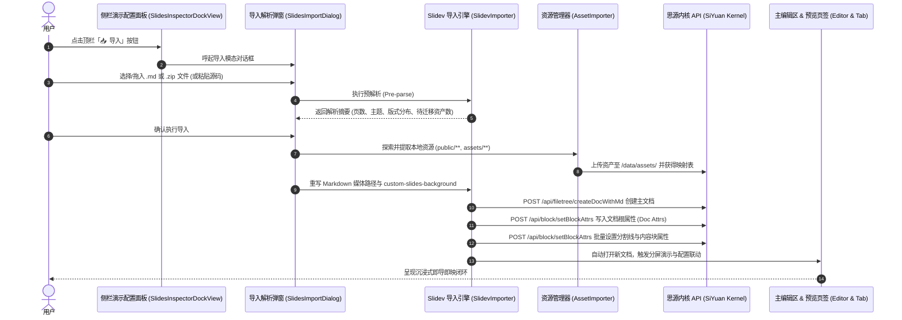

# Slidev 演示文档导入方案与架构设计规范

> 状态：**已交付**（`slides-importer.ts` + `frontmatter-parser.ts` + `html-cleaner.ts` + `asset-importer.ts` 管线，UI 编排见 `useSlidesImport.ts`；实现随 RF-013 / RF-015 进一步解耦，模块映射见 [project-structure](./project-structure.md)）

## 1. 需求背景与设计目标

Slidev 是一款面向开发者的基于 Markdown 的下一代演示文稿工具。随着思源笔记在个人知识库和结构化文档管理中的深入应用，用户期望将网络上分享或团队协同产出的 Slidev 演示文档快速引入思源笔记，实现：
1. **笔记化沉浸阅读与双链管理**：将演示文稿的内容转换为思源笔记的标准内容块，融入知识图谱；
2. **演示属性无损继承与放映**：将 Slidev 中的全局演示配置、单页版式与转场、动效与演讲者提词无缝提取并挂载为思源块的自定义属性（`custom-slides-*`）；
3. **即导即映即调闭环**：在侧栏演示配置面板顶栏提供一键「📥 导入」入口，导入完成后自动在主编辑区打开新文档，并联动开启下方分屏演示预览与右侧演示配置面板。

---

## 2. Slidev 演示文稿分享形态分析

结合 Slidev 官方项目结构规范与 `slidev-templates` 社区开源实践，主流的 Slidev 演示分发方式如下：

| 分享方式 | 核心载荷 | 优缺点对比 | 在思源笔记中的适配策略 |
| :--- | :--- | :--- | :--- |
| **完整工程 Zip / Git 仓库** *(推荐)* | `slides.md` + `public/` + `components/` + `package.json` | 完整包含图片素材、样式与多文件引用；需解包解析 | **优先支持**。解包提取 `slides.md`，内联展开 `src: ./pages/*.md`，批量上传 `public/` 资源至思源资产库并重写路径。 |
| **单文件 Markdown (`slides.md`)** | 纯文本 Markdown（含 Headmatter 与各页 Frontmatter） | 极度轻便，便于复制粘贴；本地外部图片易缺失 | **原生支持**。通过文件选择或源码直接粘贴导入；桌面端自动探测同级资源目录，网络图片支持一键转存。 |
| **静态 Web SPA 部署** | 构建产物 `index.html` + JS/WASM bundle | 适合只读在线放映；源码被压缩固化，不可二次编辑 | 不作为导入源，但可通过沙箱 iframe 直接嵌入浏览。 |
| **PDF / PPTX 导出版** | 只读二进制讲义 | 通用阅读；丢失动画、组件与块级编辑能力 | 终端交付物，不可反向逆转为思源可编辑笔记。 |

---

## 3. 架构设计与数据流向

### 3.1 总体架构链路



---

## 4. 真实模板验证与 5 大 Gap 应对策略

针对 `D:\MyCodingProjects\slidev-templates` 中的 `editorial-grid`、`paper-lab`、`terminal-ink`、`neko-style` 模板进行了仿真测试验证，结果证明方案完全可行。针对测试中发现的 5 大差异点，制定了针对性应对策略：

### Gap 1: 自定义 Vue SFC 组件 (如 `<SpotlightQuestion>`)
- **差异**：思源主编辑区是基于 Lute 的富文本块编辑器，无法在笔记内容流中直接挂载外部 Vue 3 单文件组件及其实时状态。
- **应对**：在思源笔记主编辑区以优雅降级呈现为原生 HTML 块，完整保留标签与属性；在下方分屏演示沙箱或 Slidev CLI DevServer 中完成原生渲染。

### Gap 2: 内嵌 `<style>` 局部/全局样式标签
- **差异**：`editorial-grid` 等模板在正文尾部内嵌了控制 CSS 变量与网格布局的 `<style>` 标签，若直接裸露插入思源 DOM 树，可能会污染思源宿主界面的 UI 主题。
- **应对**：导入器自动识别正文尾部的独立 `<style>` 块，将其转存至文档根属性 `custom-slides-custom-css` 中，并在沙箱编译与导出时重新动态注入沙箱，既保证放映 100% 还原，又彻底避免污染思源笔记。

### Gap 3: UnoCSS 属性模式与原子类在笔记区的显示
- **差异**：模板大量使用 `<div px-14 flex items-center>` 等 UnoCSS 属性语法，在思源笔记普通编辑区不加载 UnoCSS 运行时。
- **应对**：严格保持标签原样属性，确立“笔记区侧重结构化内容梳理，分屏区负责像素级版式渲染”的分工定位。

### Gap 4: 模板特有的非标准 Frontmatter 扩展字段 (如 `glowSeed`, `sectionNumber`)
- **差异**：即现演示 协议内置常量仅覆盖通用属性。
- **应对**：采用**开放属性策略**，凡未在内置预定义字典中的 Frontmatter 键，统一加前缀 `custom-slides-<key>` 写入对应块属性；编译导出时剥离前缀还原，做到无损互转（Round-trip Lossless）。

### Gap 5: YAML 复杂类型（多行折叠字符串与行内注释过滤）
- **差异**：`title: 'Project Aurora' # TODO: replace` 或 `info: | \n ...`。
- **应对**：导入器内置健壮轻量 YAML 清洗逻辑，自动剥离引号外的行内 `#` 注释，合规支持多行管道符折叠文本。

---

## 5. 核心模块与映射规范

### 5.1 属性映射字典规范

```typescript
// 文档全局级属性 (Document Scope -> 文档根 Block)
export const ATTR_DOC_THEME = "custom-slides-theme"
export const ATTR_DOC_ASPECT_RATIO = "custom-slides-aspect-ratio"
export const ATTR_DOC_HIGHLIGHTER = "custom-slides-highlighter"
export const ATTR_DOC_DEFAULT_TRANSITION = "custom-slides-default-transition"
export const ATTR_DOC_COLOR_SCHEMA = "custom-slides-color-schema"

// 幻灯片页面级属性 (Page Scope -> 对应的 --- 水平分割线 Block)
export const ATTR_PAGE_LAYOUT = "custom-slides-layout"
export const ATTR_PAGE_TRANSITION = "custom-slides-transition"
export const ATTR_PAGE_BACKGROUND = "custom-slides-background"
export const ATTR_PAGE_CLASS = "custom-slides-class"
export const ATTR_PAGE_NOTES = "custom-slides-notes"

// 元素动效级属性 (Element Scope -> 内容 Block)
export const ATTR_ELEM_CLICK = "custom-slides-click"
export const ATTR_ELEM_SHIKI_LINES = "custom-slides-shiki-lines"
export const ATTR_ELEM_SLOT = "custom-slides-slot"
```

### 5.2 清洗与转换规则
1. **分页符转换**：每个 Slidev `---` 分页标记转换为思源水平分割线块（`type: "tb"`），对应页面的 Frontmatter 属性写入该分割线。
2. **演讲者备注**：匹配 `<!-- notes -->`（排除 TODO），提取文本写入对应页分割线的 `custom-slides-notes` 属性，并从正文完全剥离。
3. **渐进动画**：`<v-click>` 提取为块属性 `custom-slides-click="+1"`，剥离外层包裹标签。
4. **代码高亮**：````lang {1-3|5}```` 剥离行标，并将行标写入代码块属性 `custom-slides-shiki-lines="1-3|5"`。
5. **分栏插槽**：`::right::` 转换为后继块属性 `custom-slides-slot="right"`，并清除标记符。

---

## 6. 实施路线图

1. **Phase 1**：核心解析引擎 `src/compiler/slides-importer.ts` 开发与单元测试；
2. **Phase 2**：资源探索与重写器 `src/compiler/asset-importer.ts` 开发与单元测试；
3. **Phase 3**：UI 导入弹窗 `src/ui/components/SlidesImportDialog.vue` 与侧栏入口 `SlidesInspectorDockView.vue` 改造；
4. **Phase 4**：思源内核全链路串联与端到端自动化测试验证。
