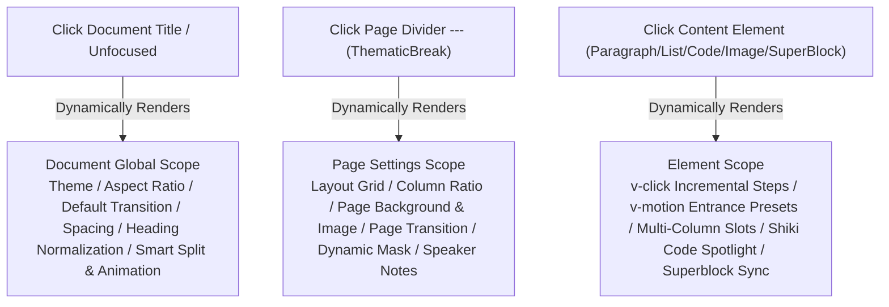

# SiYuan Live Slides User Guide

Welcome to **SiYuan Live Slides**, the modern presentation plugin built natively for SiYuan Note! It integrates the powerful  presentation framework deeply into your daily note-taking workflow, delivering **zero markdown syntax pollution, intuitive sidebar inspector sync, modern frontend animations, and millisecond bidirectional coordination**.

---

## 1. Core Mental Model: Select to Configure, Zero Markdown Pollution

Traditional presentation plugins often force users to clutter their notes with messy YAML frontmatter or custom code blocks, significantly compromising note readability and long-term value.

**SiYuan Live Slides stores all presentation metadata cleanly inside SiYuan's native Block Attributes (Block IAL)**, keeping your notes 100% clean. The presentation inspector dock (`SlidesInspectorDockView`) on the right features **intelligent context awareness** — wherever your cursor focuses, the inspector dynamically switches to the matching configuration scope:

The status banner at the top of the inspector panel always indicates your current target object (e.g. `[Document Root]`, `[Page Divider: Slide 3]`, `[Code Block]`). All changes are **persisted instantly and reflected live in the preview sandbox with zero latency**.

---

## 2. Four-Step Practical Guide to Building a Presentation

You can turn any standard note into a polished, professional slide deck in minutes following four intuitive steps: Configure Global Aesthetics ➔ Split Pages & Choose Layouts ➔ Fine-tune Element Animations ➔ Launch Live Presentation.

### Step 1: Global Document Configuration (Click Document Title / Root)

In the SiYuan editor, **click the document title** or click anywhere in the top-level empty space. The right dock automatically displays the **Global Presentation Configuration**:

1. **Presentation Theme**:
   - Choose from tailored visual paradigms: `default` (clean and modern blue palette), `seriph` (elegant academic serif typography), or `apple-basic` (minimalist, high-contrast monochrome aesthetic).
2. **Presentation Background**:
   - Pick from curated light, dark, or soft gradient swatches;
   - Or enter any custom hex color (e.g., `#1a1a2e`), CSS gradient, or local SiYuan asset path (e.g., `assets/...`).
3. **Aspect Ratio**:
   - Switch effortlessly between `16:9` (modern widescreen displays/projectors), `4:3` (traditional standard projectors), and `16:10` (laptop displays).
4. **Spacing Style & Heading Normalization**:
   - **Spacing Style**: choose between Compact, Normal (recommended default), and Loose to govern global slide padding and line height;
   - **Normalize Heading Sizes** (under Advanced Settings): automatically balances SiYuan's default heading hierarchy for optimal projector legibility.
5. **Default Transition**:
   - Specify the global slide transition inherited by all pages (e.g. `fade`, `slide-left`, `slide-up`, `zoom`).
6. **Global Smart Actions**:
   - **Smart Split**: automatically analyzes document outline depth and paragraph lengths to insert `---` dividers and infer suitable slide layouts;
   - **Smart Animation**: applies incremental step-by-step (`v-click`) reveals across all body elements with one click;
   - **Add Speaker Notes Blocks**: identifies existing talking points or inserts dedicated speaker note blocks for empty slides.

---

### Step 2: Page Splitting & Layout Customization (Click Divider `---`)

Typing `---` followed by `Enter` inserts a horizontal divider into your note. In SiYuan Live Slides, each `---` acts as the beginning and control center of a slide page.

**Click any `---` divider line** to instantly open **Slide Page Settings** in the right dock:

1. **Slide Layout Picker**:
   - Select a layout by clicking its thumbnail:
     - **Standard (`default`)**: classic header and content flow;
     - **Cover (`cover`)**: centered prominent title and subtitle for opening slides or section intros;
     - **Multi-Column (`cols-header`)**: full-width top header over adaptive 2 to 6 columns (with a toggle to disable the top header for classic column alignment);
     - **Clover Matrix (`clover`)**: 2×2 quadrant grid ideal for SWOT analysis, product matrices, or comparisons;
     - **Timeline (`timeline`)**: vertical milestone layout for roadmaps and chronological events;
     - **Image & Text (`image-left` / `image-right`)**: left-image or right-image layouts designed for visual explainers;
     - **Fact Highlight (`fact`)**: oversized numerical metrics and summary text for milestone achievements;
     - **Quote (`quote`)**: prominent centered quote with author attribution;
     - **Presenter Intro (`intro`)**: rounded portrait/avatar on the left with personal bio and credentials on the right;
     - **Center (`center`)**: centered content presentation.
2. **Multi-Column Ratios & Superblock Width Auto-Detection**:
   - Multi-column layouts offer ratio quick-chips (`1:1`, `1:2`, `2:1`);
   - If the current slide contains a SiYuan horizontal superblock, the dock **automatically detects the superblock column ratio** (e.g. `35:65`) and provides a one-click **"Apply Superblock Layout & Ratio"** action.
3. **Page Background & Image**:
   - Override the global presentation background for the current page;
   - Provide custom images or portrait avatars for Image-Text and Intro layouts.
4. **Page Transition Override**:
   - Customize transition animations for specific slides (e.g., zoom in on a milestone page while keeping fade for the rest).
5. **Dynamic Page Mask (Progressive Spotlight Reveal)**:
   - Apply a progressive reveal mask over slides with detailed diagrams or step lists;
   - **Direction**: top-to-bottom (`down`), left-to-right (`right`), or rotational clock sweeps (`clockwise ↻` / `counter-clockwise ↺`);
   - **Reveal Ratios**: configure weighted ratios (`1:1:1`) or percentage breakpoints (`25:75:100`) — each press of `Space` reveals the next segment;
   - **Style & Initial State**: choose between a solid background-colored mask or frosted blur glass; start fully hidden or with the first segment pre-revealed.
6. **Speaker Notes**:
   - Enter private talking points visible only on the presenter console;
   - Use the **"AI Notes"** button to summarize key talking points via SiYuan's native AI interface.

---

### Step 3: Element Animations & Fine-Tuning (Click Body Elements)

**Click any content block in your slide** (heading, paragraph, list item, code block, quote, image, or superblock) to access **Element Scope Configuration**:

1. **Incremental Step Reveal (`v-click`)**:
   - Toggle the switch to reveal the block progressively during presentation playback;
   - Fine-tune step scheduling: choose sequential reveal (`+1`), explicit step number, or set the element to hide at a given step;
   - If the element is inside a column or superblock, an inheritance indicator clarifies its parent state.
2. **Entrance Motion (`v-motion`) & Live Preview Stage**:
   - Smoothly animate elements as they appear;
   - Pick from polished entrance presets: **Slide Up (`slide-up`)**, **Fade In (`fade-in`)**, **Slide Down (`slide-down`)**, **Slide Left (`slide-left`)**, **Slide Right (`slide-right`)**, **Zoom In (`zoom-in`)**, or **Bounce (`bounce`)**;
   - Fine-tune animation duration and delay;
   - **Live Preview Stage**: a persistent live stage at the top of the dock lets you preview animation physics instantly with the "Replay" button without switching tabs.
3. **Multi-Column Slot Allocation**:
   - In multi-column or clover layouts, assign any block to `default`, `left`, `right`, `header`, or specific numbered column slots using segmented chips.
4. **Superblock Sync**:
   - Selecting a multi-column superblock displays its exact column widths and provides a one-click action to sync layout and ratio.
5. **Code Blocks: Height Capping & Shiki Line Spotlight**:
   - Selecting a code block reveals dedicated developer options:
   - **Max Height Limit**: presets like `240px`, `320px`, `400px`, or `50%` with smooth internal scrolling to prevent long code snippets from breaking slide bounds;
   - **Shiki Line Spotlight**: specify line ranges (e.g., `1-3|5|all`) to dynamically highlight code lines step by step while dimming surrounding lines during playback.
6. **Image & Video Roles**:
   - Switch images between standard content, slide background image, or left/right layout illustrations;
   - Video elements feature toggles for player controls, autoplay, loop, and mute.
7. **Quick Actions**:
   - Insert dividers above or below the active block;
   - **Set as Speaker Note**: marks the current block as a private speaker note (hidden from presentation slides, displayed on presenter screens);
   - **Clear Attributes**: strips all presentation-related IAL attributes from the block.

---

### Step 4: Presentation & Live Dual-Screen Delivery

Once configured, enjoy seamless preview and presenting capabilities:

#### 1. Bottom Split Live Preview (`SlidesPreviewTab`)
- Press `Alt+P` (`⌥P` on macOS) or click the split preview icon on the dock header to open the wide preview tab underneath the editor;
- **Bidirectional Millisecond Cursor Tracking**:
  - **Forward**: moving the cursor in your note automatically navigates the preview to the corresponding slide and highlights the active element;
  - **Reverse**: clicking any element in the preview scrolls and selects the source block in the SiYuan editor;
- **📌 Pin Toggle**: click the pin icon in the preview toolbar to lock the preview to the current document even when you navigate to other reference notes in the main editor.

#### 2. Immersive Peek: In-Place Link Preview
Clicking links inside running presentations will never forcibly break your presentation flow. Instead, links open in an **immersive side drawer**:
- **SiYuan Documents & Block References**: rendered in-place using a real Protyle editor (requires enabling local web serve in global settings);
- **External Web Links**: rendered in an embedded Webview with forward/back navigation, reload, and desktop/mobile viewport toggle;
- **Local HTML Files**: loaded directly inside the drawer for interactive charts and web demos;
- Press `Esc` or click the backdrop to dismiss the drawer and resume presenting immediately.

#### 3. Professional Dual-Screen Presenter Mode
When presenting with an external display or projector, press `Alt+M` or hit `P` during playback to open the standalone presenter console:
- **Cross-Window Broadcast Sync**: drag the presentation preview tab to your extended display (press `F` for fullscreen) while keeping the presenter console on your laptop screen. Slides sync across windows via `BroadcastChannel` in milliseconds;
- **Current + Next Slide Preview**: monitor the active slide alongside an upcoming preview to anticipate topic transitions;
- **Presentation Timer**: count up elapsed time with pause and reset controls;
- **Speaker Notes**: displays formatted notes with `A-` / `A+` live font scaling.

---

## 3. Keyboard Shortcuts Reference

### Editor Shortcuts

| Shortcut | Description | Scenario |
| :--- | :--- | :--- |
| `Alt+P` / `⌥P` | Open / refresh bottom split preview | Anytime while composing notes |
| `Alt+M` / `⌥M` | Open dual-screen Presenter Mode console | Rehearsing or presenting on external screens |

### Presentation Playback Shortcuts (Split Preview / Fullscreen)

| Key / Gesture | Description |
| :--- | :--- |
| `→` / `↓` / `Space` / `PageDown` / **Wheel Down** | Next slide or advance next `v-click` step |
| `←` / `↑` / `PageUp` / **Wheel Up** | Previous slide or revert step |
| **Digits + `Enter`** | Jump directly to slide number (jump badge appears in lower-left corner) |
| `O` | Toggle thumbnail Overview Wall; click any slide to jump |
| `F` | Toggle immersive fullscreen mode |
| `P` | Open Presenter Mode console |
| `Esc` | Exit fullscreen / close overview / dismiss Peek drawer |

