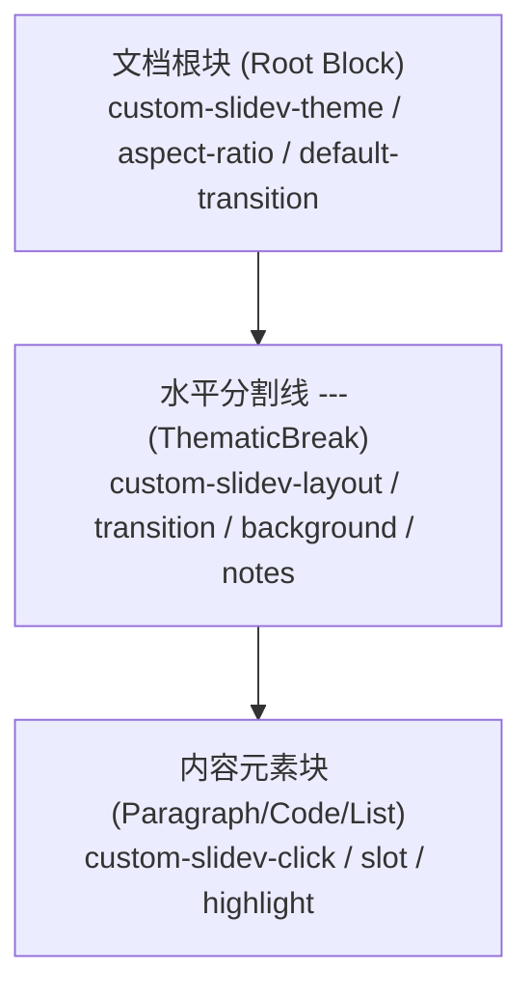

# 思源笔记 Slidev 演示插件用户使用指南

欢迎使用 **SiYuan Slidev** 演示插件！本项目为思源笔记量身打造，将现代前端最流行的演示框架 **Slidev** 深度整合至思源笔记工作流中，带来**“正文零污染、现代前端动效、毫秒级双向联动、分层双轨协同”**的极致演示体验。

---

## 1. 核心设计理念：三层作用域与正文零污染

传统幻灯片插件往往强迫用户在笔记正文中手写混杂的 Frontmatter 语法或自定义代码块，严重破坏笔记的可读性与沉淀价值。本插件采用思源底层的原生**块属性（Block IAL）**机制，将演示元数据与正文内容完全解耦：

1. **文档根块**：存储全局演示配置（主题：`default` / `seriph` / `apple-basic`，画幅比例：`16/9` / `4/3`，默认转场效果等）；
2. **水平分割线 (`---`)**：在正文中充当天然分页符，同时承载该页的独有属性（版式 `layout`、独立转场 `transition`、背景图/色 `background`、演讲备注 `notes`）；
3. **内容块**：纯粹的正文段落、标题、代码块、列表项，通过块属性承载单步动效（`v-click: +1`）、双栏插槽（`slot: right`）。正文始终保持纯净排版！

---

## 2. 快速上手

### 2.1 启动与实时预览

- **快捷键**：按下 `Alt+P`（Mac 为 `⌥P`）即可立即对当前文档编译并在右侧 Dock 面板中打开演示沙箱；
- **顶栏图标**：点击思源顶栏右侧的放映图标（类似幻灯片播放按钮）可一键编译放映；
- **实时热重载**：在思源笔记中打字、增删块时，插件内置 150ms 增量防抖调度器，右侧预览无感热重载更新。

### 2.2 常用快捷键一览

| 快捷键 | 功能说明 | 适用场景 |
| :--- | :--- | :--- |
| `Alt+P` / `⌥P` | 放映当前文档 / 重新编译演示文稿 | 编辑正文时随时呼出 Dock 预览 |
| `Alt+M` / `⌥M` | 打开双屏演讲者独立控制台 (Presenter Mode) | 外接投影仪或分屏演讲时呼出提词器 |
| `方向键 ← / →` / `空格` | 演示沙箱向前 / 向后翻页（或步进动效） | 演示放映中操作 |
| `F` | 演示沙箱全屏放映 | 演示放映中操作 |
| `P` | 在演示沙箱中快捷打开演讲者控制台 | 演示放映中操作 |

---

## 3. 可视化交互功能

为了让用户告别枯燥的手敲属性键值，插件提供专精可视化交互组件：

### 3.1 水平分割线悬浮气泡（`QuickDividerPopover`）
在思源正文中直接鼠标**点击任何一条水平分割线 (`---`)**，分割线上方将自动弹出半透明交互气泡：
- **九宫格版式切换**：点击图标一键切换 `cover` (封面)、`default` (标准)、`two-cols` (双栏)、`fact` (大字报)、`center` (居中)；
- **动态转场下拉**：悬停时微缩动画实时预览 `slide-left`、`fade`、`slide-up`、`zoom` 等转场动效；
- **背景设置**：直观输入颜色或背景图；
- **演讲备忘录**：点击可直接录入当前页的独享口播提词。

### 3.2 块标上下文菜单与动效浮动条（`ElementAnimBar`）
- 点击任意内容块左侧的思源块标，在菜单中选择 **“Slidev 元素设置”** -> **“✨ 打开动效与排版浮动条”**；
- 浮动条提供 `[逐步出现 +1]`、`[放入右栏 ::right::]` 等快捷按钮，无需手动敲代码。

### 3.3 大纲缩略图与检查器（`SlideInspector`）
在右侧 Dock 面板下方，点击工具栏的 📑 图标可展开卡片大纲视图，直观查看所有幻灯片缩略卡片并快速跳转。

---

## 4. 毫秒级双向光标跟随联动

本插件实现了双向双轨的毫秒级光标对齐：
- **正向跟随**：在思源笔记正文中移动光标或点击某一段落时，右侧 Dock 幻灯片在毫秒级内自动翻转至对应的幻灯页面并高亮当前块；
- **反向定位**：在右侧幻灯片沙箱中点击任意元素，思源笔记左侧编辑器自动平滑滚动至对应的思源块并施加高亮选中。

---

## 5. 块引用展开与思源 AI Agent 协同

### 5.1 动态块引用展开
当正文中引用了其他笔记 `((block-id))` 时，插件编译期通过 SQL 自动递归检索被引用块的内容，并在幻灯片中生成精美带引用角标的内联卡片，确保知识复用与展示一体化。

### 5.2 思源 AI Agent 智能赋能
在思源命令面板中呼出 AI 命令：
- **`Slidev AI: 智能大纲断页建议与自动分页`**：长篇笔记一键分析，根据标题与篇幅智能推荐并在合适位置自动插入 `---` 分割线并赋予合适版式；
- **`Slidev AI: 自动为当前文档生成演讲者提词卡 (Notes)`**：调用思源内核 AI 接口，提取各页要点自动撰写口播提词卡，写入 `custom-slidev-notes`。

---

## 6. 双屏专业演讲者视图 (Presenter Mode)

在正式汇报场景下，按下 `Alt+M` 或点击 Dock 顶栏的 🎤 图标，即可弹出独立的演讲者控制台窗口：
- **双向信道**：基于 `BroadcastChannel` 与沙箱保持毫秒级双向同步；
- **当前与预告**：左侧同时呈现当前大屏幕画面与下一页即将来临的内容预览；
- **演讲计时器**：支持暂停、重置与计时提醒；
- **口播提词**：右侧展示当前页提词卡，并支持 `A-` / `A+` 实时调节字号大小，适应远距离讲台阅读；
- **重头放映与进度**：底栏显示演说进度百分比，一键重置放映。

---

## 7. 全渠道离线导出

在 Dock 面板工具栏提供一键导出工具：
1. **导出离线单文件 HTML (`📥`)**：
   - 生成 100% 独立的单文件 HTML 演示包，无需安装 Node.js 或任何服务器；
   - 本地 `assets/...` 图片自动转为 Base64 内联打包；
   - 自带全套全屏放映与键盘翻页交互控制。
2. **导出高保真 PDF 讲义 (`🖨️`)**：
   - 采用专业打印排版 CSS，支持 16:9、4:3、A4 横屏等打印画幅；
   - 自动包含演讲者备注与页码角标；
   - 针对浏览器打印引擎启用色彩保真 (`-webkit-print-color-adjust: exact`)。

---

## 8. Pro 模式：本地 Slidev CLI 桥接

对于前端极客与高级开发者，插件支持无缝过渡至官方 Slidev CLI 生态：
- **`Slidev Pro: 导出 Slidev 标准 slides.md 文档 (下载到本地)`**：将当前思源笔记完整转换为标准的 Slidev 官方 Markdown 文件，保留所有全局与页面级 Frontmatter、双栏插槽与 HTML 注释演讲者提词；
- **`Slidev Pro: 同步 slides.md 至思源工作空间存储目录`**：直接通过内核 API 写入 `/data/storage/petal/siyuan-slidev/slides.md`；
- **`Slidev Pro: 检测本地 Slidev CLI DevServer 状态`**：探测本地 `localhost:3030` 运行状态。

---

## 9. 与「属性管家」（siyuan-property-manager）深度协同

本插件与「属性管家」插件深度配合：
- 可以在命令面板执行 **“Slidev 协同: 复制 Slidev 预设属性模板至剪贴板”**，将标准的双栏、封面、金句、大字报模板一键粘贴导入属性管家；
- 支持在命令面板执行 **“Slidev 协同: 统计全库转场效果分布”** 与 **“Slidev 协同: 批量替换全库淡入淡出转场为滑动”**，实现全库幻灯片资产的批量治理与统一重构。
