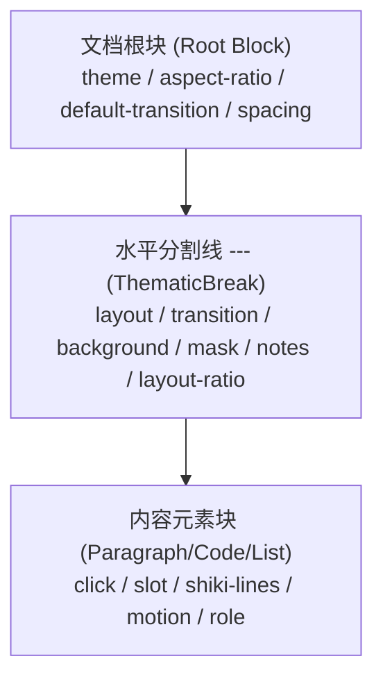

# 思源笔记即现插件用户使用指南

> 最近刷新：2026-10-26（对齐 v0.9.0 之后的全部用户可见能力）

欢迎使用 **SiYuan Live Slides** 演示插件！本项目为思源笔记量身打造，将现代前端最流行的演示框架 **Slidev** 深度整合至思源笔记工作流中，带来**"正文零污染、现代前端动效、毫秒级双向联动、分层双轨协同"**的极致演示体验。

---

## 1. 核心设计理念：三层作用域与正文零污染

传统幻灯片插件往往强迫用户在笔记正文中手写混杂的 Frontmatter 语法或自定义代码块，严重破坏笔记的可读性与沉淀价值。本插件采用思源底层的原生**块属性（Block IAL）**机制，将演示元数据与正文内容完全解耦：

1. **文档根块**：存储全局演示配置（主题：`default` / `seriph` / `apple-basic`，画幅比例：`16/9` / `4/3` / `16/10`，默认转场、全局间距风格等）；
2. **水平分割线 (`---`)**：在正文中充当天然分页符，同时承载该页的独有属性（版式 `layout`、独立转场 `transition`、背景 `background`、动态蒙版 `mask`、分栏比例 `layout-ratio`、演讲备注 `notes`）；
3. **内容块**：纯粹的正文段落、标题、代码块、列表项，通过块属性承载单步动效（`v-click`）、入场微动效（`v-motion`）、双栏插槽（`slot`）、代码逐行聚光（`shiki-lines`）。正文始终保持纯净排版！

完整属性字典详见 [技术规格定义](./技术规格定义.md)。

---

## 2. 快速上手

### 2.1 启动与实时预览

- **快捷键**：按下 `Alt+P`（Mac 为 `⌥P`）即可在当前文档正下方开启宽屏独立分屏预览页签（`SlidesPreviewTab`），高度可自由拖动；
- **顶栏图标**：点击思源顶栏右侧的放映图标一键开启下方分屏预览并触发编译；
- **实时热重载**：在思源笔记中打字、增删块时，插件内置增量防抖调度器，下方预览无感热重载更新；
- **预览页签标题即现**：页签标题实时显示「文档名 · 当前页码」，随编辑的文档切换自动联动，无需等待编译完成；
- **右侧配置面板**：右侧 Dock 专职作为演示配置中心，随编辑光标实时呈现当前块的演示属性与快捷动作；
- **编译零打扰**：预览页签与右侧面板全部关闭时，编译请求自动暂停，不再产生任何内核开销。

### 2.2 常用快捷键一览

编辑器快捷键：

| 快捷键 | 功能说明 | 适用场景 |
| :--- | :--- | :--- |
| `Alt+P` / `⌥P` | 在文档下方开启分屏演示预览 / 重新编译 | 编辑正文时随时呼出下方分屏预览 |
| `Alt+M` / `⌥M` | 打开双屏演讲者控制台页签 (Presenter Mode) | 外接投影仪或分屏演讲时呼出提词器 |

放映中快捷键（分屏预览 / 全屏放映 / 离线导出 HTML 通用）：

| 快捷键 / 操作 | 功能说明 |
| :--- | :--- |
| `→` / `↓` / `空格` / `PageDown` / **鼠标滚轮下滚** | 下一页或步进 `v-click` 动效 |
| `←` / `↑` / `PageUp` / **鼠标滚轮上滚** | 上一页或回退动效 |
| **数字键 + `回车`** | 直接跳转到指定页（输入时左下角出现跳页角标，`Esc` 取消，无效页码会提示） |
| `O` | 呼出缩略图总览墙，点击任意缩略图（或键盘焦点选择）直接跳页；再按 `O` / `Esc` 关闭 |
| `F` | 全屏放映 |
| `P` | 快捷打开演讲者控制台 |
| `Esc` | 关闭总览 / 取消跳页输入 / 退出全屏 |

---

## 3. 现代化演示交互界面

### 3.1 下方分屏独立预览页签（`SlidesPreviewTab`）
通过 `Alt+P` 或顶栏图标在文档正下方开启宽屏分屏页签：
- **宽屏舒适视野**：位于主编辑区下方，高度可自由拖曳调节；
- **📌 Pin 图钉锁定文档**：默认跟随上方编辑的文档自动切换与重绘；锁定后，即使上方切换查阅其他参考笔记，下方预览依然稳定停留在目标文档；
- **全功能控制条**：上一页/下一页、当前页码徽章、📑 大纲缩略抽屉、🎤 双屏演讲者视图、📥 导出单文件 HTML、🖨️ 导出 PDF、🔄 刷新、⛶ 全屏，以及沙箱 / Pro 双引擎切换入口；
- **沉浸速览 (Peek)**：放映中点击幻灯片内的链接不跳离放映（详见第 6 节）。

### 3.2 右侧演示配置与操作面板（`SlidesInspectorDockView`）
所有设置集中在右侧 Dock 面板，随光标上下文动态切换：
- **选中普通内容块（段落/标题/列表/代码等）**：
  - ✨ **逐步出现**：`v-click` 开关与微调步长；
  - 🎬 **入场微动效**：一键循环切换 `slide-up` / `fade-in` / `zoom-in` / `bounce` 预设（`v-motion`）；
  - ▥ **分栏插槽归属**：`默认` / `左栏` / `右栏` / 表头多栏的 `表头` / `栏 1~3`；
  - 🔍 **代码逐行聚光**：Shiki Lines 预设芯片与输入框（如 `1-3|5|7-10`）；
  - 快捷动作：上/下方插入分页符、一键设为双栏对比、清空本块演示属性等。
- **选中分页符（水平分割线 `---`）**：显示当前页 Frontmatter 设置：
  - **版式九宫格**：封面 / 标准 / 双栏 / **表头多栏**（顶部通栏标题 + 自适应 2~N 栏）/ **四叶草**（2×2 田字型四象限）/ 图左 / 图右 / 居中 / 大字报 / 介绍 / 引言；
  - **分栏比例**：双栏 / 图文 / 表头多栏版式支持自定义比例（如 `1:2`），并支持从超级块列宽一键自动识别同步；
  - **动态蒙版**：方向（向下 `down` / 向右 `right`）、分段比例预设（权重 `1:1:1` 或累计断点）、样式（实色 / 毛玻璃）、初始态（遮盖 / 展露），放映时随翻页与点击**分段展露**，适合逐步揭示图片重点区域（详见第 7 节）；
  - **转场动效**单选、**页面背景**设定、**演讲者提词**（Notes 录入与 🤖 AI 智能提炼）；
  - 快捷动作：在此后插入新页、删除分页符。
- **选中文档根或未聚焦块**：显示全局演示配置：
  - 主题预设（默认 / 优雅 seriph / 极简 apple-basic）、画幅比例、全局默认转场；
  - **间距风格**：紧凑 / 标准 / 宽松三档，一键调节全篇留白；
  - **全局标题大小规范化**：一键统一全篇各级标题尺寸，修复思源与 Slidev 排版差异；
  - 全局演示操作与 AI 工具箱。
- **所见即所得**：面板调整属性即时保存并自动同步更新下方分屏预览，光标移到哪，面板就聚焦到哪。

---

## 4. 毫秒级双向光标跟随联动

本插件实现了双向双轨的毫秒级光标对齐：
- **正向跟随**：在思源笔记正文中移动光标或点击某一段落时，下方分屏预览在毫秒级内自动翻转至对应的幻灯页面并高亮当前块，同时右侧配置面板即时同步显示该块属性；
- **反向定位**：在下方分屏预览沙箱中点击任意元素，思源笔记上方编辑器自动平滑滚动至对应的思源块并施加高亮选中。

---

## 5. 块引用展开与思源 AI Agent 协同

### 5.1 动态块引用展开
当正文中引用了其他笔记 `((block-id))` 时，插件编译期通过 SQL 自动检索被引用块的内容，并在幻灯片中生成精美带引用角标的内联卡片，确保知识复用与展示一体化。

### 5.2 思源 AI Agent 智能赋能
在思源命令面板中呼出 AI 命令：
- **`Slidev AI: 智能大纲断页建议与自动分页`**：长篇笔记一键分析，根据标题与篇幅智能推荐并在合适位置自动插入 `---` 分割线并赋予合适版式；
- **`Slidev AI: 自动为当前文档生成演讲者提词卡 (Notes)`**：调用思源内核 AI 接口，提取各页要点自动撰写口播提词卡，失败自动平滑降级到启发式规则。

---

## 6. 沉浸速览 (Peek)：放映中链接原位打开

放映演示时，点击幻灯片中的链接不再跳离放映现场，而是在**右侧沉浸抽屉**中原位速览：

- **思源文档 / 块引用链接**：以 Protyle 编辑器原位渲染对应思源内容（需在全局设置中开启「本地网络伺服预览」）；
- **外部网页链接**：以内置 Webview 微浏览器打开，支持前进 / 后退 / 刷新、缩放、**桌面与移动端视图切换**（可模拟手机访问响应式页面）、错误重试；
- **演示内本地 HTML 链接**：直接在抽屉中原位渲染本地 HTML 页面，适合携带交互式图表或小型网页 Demo；
- **公司内网代理环境**：自动适配系统代理会话，外网链接不再恒空白；
- **SPA 单页站点友好**：站内跳页不强制重载 Webview，避免无 SPA fallback 的站点跳页变 404；
- 按 `Esc` 或点击遮罩即可关闭抽屉，立即回到放映现场。

---

## 7. 页面动态蒙版与分段展露

为图片背景页提供的「聚光灯」能力：在页面分割线上配置 `custom-slides-mask` 后，放映时页面会被一层方向性蒙版覆盖，随翻页与点击**逐段展露**，引导观众视线聚焦重点：

- **方向**：`down` 自上而下 / `right` 自左而右；
- **分段比例**：支持权重比（`1:1`、`1:2:1`）或累计百分比断点（`25:75:100`），面板提供常用预设芯片；
- **样式**：`solid` 实色遮罩 / `blur` 毛玻璃（GPU 合成层加速，支持贴边覆盖）；
- **初始态**：`hidden` 初始全遮盖（逐步揭示）/ `revealed` 初始全展露（逐步遮盖）。

---

## 8. 双屏专业演讲者视图 (Presenter Mode)

在正式汇报场景下，按下 `Alt+M`、点击 Dock 顶栏的 🎤 图标或放映画面内按 `P`，即可在思源右侧栏打开演讲者控制台页签：
- **双通道同步**：同窗口时经宿主桥接直连（与配置面板同一数据通路），控制台与大屏分居两个思源窗口时自动切换 `BroadcastChannel` 跨窗口广播，翻页毫秒级联动；
- **当前与预告**：左侧同时呈现当前大屏幕画面与下一页即将来临的内容预览；
- **演讲计时器**：支持暂停、重置与计时提醒；
- **口播提词**：右侧展示当前页提词卡，支持 `A-` / `A+` 实时调节字号；
- **讲稿批量管理**：在右侧面板支持讲稿块的**批量追加**与**批量删除**，长讲稿维护不再逐条操作；
- **重头放映与进度**：底栏显示演说进度百分比，一键重置放映。

**双屏放映操作步骤**（外接投影仪 / 扩展显示器）：
1. 在思源主窗口打开「演示预览」页签（`Alt+P`）并确认幻灯片已渲染；
2. 右键预览页签 →「**移动到新窗口**」（或直接把页签拖出思源窗口边界），将新窗口拖到扩展显示器；
3. 在扩展显示器的放映画面内按 `F` 全屏，即为大屏放映端；
4. 演讲者控制台页签留在笔记本屏的思源主窗口，翻页按钮 / 方向键 / 空格 / 滚轮均可驱动大屏；
5. 大屏窗口会依据页签记忆的文档自动恢复数据，主窗口编辑内容后大屏亦实时刷新。

---

## 9. 全渠道离线导出

在 Dock 面板工具栏提供一键导出工具：
1. **导出离线单文件 HTML (`📥`)**：
   - 生成 100% 独立的单文件 HTML 演示包，无需安装 Node.js 或任何服务器；
   - 本地 `assets/...` 图片自动转为 Base64 内联打包；
   - 自带与分屏预览一致的完整播放器：键盘 / 滚轮翻页、**数字+回车跳页**、**`O` 键缩略图总览**、图片视频灯箱放大；
2. **导出高保真 PDF 讲义 (`🖨️`)**：
   - 采用专业打印排版 CSS，支持 16:9、4:3、A4 横屏等打印画幅；
   - 自动包含演讲者备注与页码角标；
   - 针对浏览器打印引擎启用色彩保真 (`-webkit-print-color-adjust: exact`)。

---

## 10. Slidev 外部演示文稿一键导入与全自动解析

插件提供了从外部导入标准 Slidev 演示文档的完整流程，帮助您快速将现有的 Slidev 项目迁移至思源笔记中：

- **一键入口与多格式支持**：点击右侧演示配置面板顶部的「📥 导入」按钮（或命令面板），弹出交互式导入对话框。支持上传本地 `.md` 文件、Slidev 项目 `.zip` 压缩包，亦可直接粘贴源码；
- **智能预检统计**：导入前对话框会自动解析并展示演示文稿的总页数、主题样式、版式分布、讲师提词数以及包含的图片/静态资产总数；
- **静态资产解包与重写**：`.zip` 导入时自动解包图片与媒体文件，安全存储至思源 `assets/` 资产库并自动重写路径；
- **HTML 展示容器智能剥离**：针对外部模板常见的 HTML 展示容器（命令行窗口、时间线、日志面板、对比网格等），可自动转换为干净美观的思源原生 Markdown 块；
- **自动联动放映**：导入完成后自动创建演示文档、注入块属性并开启下方分屏实时放映。

---

## 11. Pro 模式：本地 Slidev CLI 桥接与系统隔离

对于前端极客与高级开发者，插件支持无缝过渡至官方 Slidev CLI 生态：
- **系统级工作区隔离**：Pro 模式的编译与临时工作区隔离至系统临时目录，杜绝思源内核锁冲突与脏文件残留；插件会自动探测本机 Node.js 与 Slidev CLI 环境；
- **`Slidev Pro: 导出 Slidev 标准 slides.md 文档 (下载到本地)`**：将当前思源笔记完整转换为标准 Slidev Markdown，保留全部 Frontmatter、插槽指令与 HTML 注释演讲者提词；
- **`Slidev Pro: 同步 slides.md 至思源工作空间存储目录`**：直接通过内核 API 写入工作空间，保障编译与渲染隔离；
- **`Slidev Pro: 检测本地 Slidev CLI DevServer 状态`**：探测本地 `localhost:3030` 运行状态。

环境配置详解见 [Pro 模式系统配置与用户指南](./思源笔记即现插件%20(siyuan-live-slides)%20Pro%20模式系统配置与用户指南.md)。

---

## 12. 与「属性管家」（siyuan-property-manager）深度协同

本插件与「属性管家」插件深度配合：
- 在命令面板执行 **"Slidev 协同: 复制 Slidev 预设属性模板至剪贴板"**，将标准的双栏、封面、金句、大字报模板一键粘贴导入属性管家；
- 支持在命令面板执行 **"Slidev 协同: 统计全库转场效果分布"** 与 **"Slidev 协同: 批量替换全库淡入淡出转场为滑动"**，实现全库幻灯片资产的批量治理与统一重构。

---

## 13. 完整命令清单（命令面板检索 "Slidev"）

| 命令 | 说明 |
| :--- | :--- |
| `Slidev: 放映当前文档幻灯片` | 开启下方分屏预览 |
| `Slidev: 初始化当前文档演示属性` | 为当前文档注入全局演示属性 |
| `Slidev: 打开双屏演讲者控制台 (Presenter Mode)` | 呼出提词器视窗 |
| `Slidev AI: 智能大纲断页建议与自动分页` | AI 长文智能分页 |
| `Slidev AI: 自动为当前文档生成演讲者提词卡 (Notes)` | AI 口播词提炼 |
| `Slidev 协同: 复制 Slidev 预设属性模板至剪贴板` | 属性管家模板导入 |
| `Slidev 协同: 统计全库转场效果分布` | 全库转场资产盘点 |
| `Slidev 协同: 批量替换全库淡入淡出转场为滑动` | 全库转场批量重构 |
| `Slidev Pro: 导出 Slidev 标准 slides.md 文档 (下载到本地)` | 标准 Slidev 工程导出 |
| `Slidev Pro: 同步 slides.md 至思源工作空间存储目录` | 工作空间直写 |
| `Slidev Pro: 检测本地 Slidev CLI DevServer 状态 (localhost:3030)` | Pro 引擎探活 |
