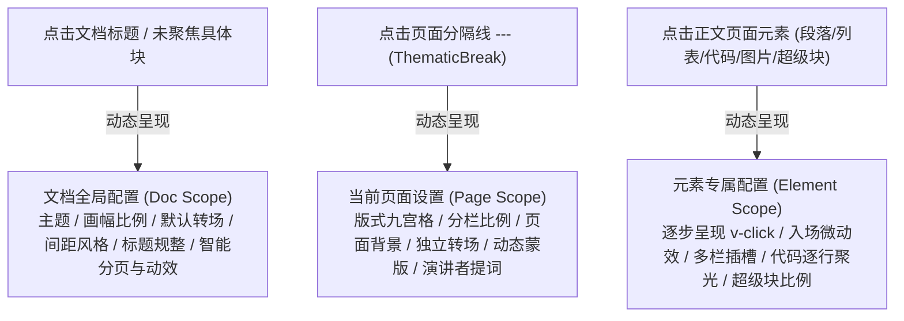

# 思源笔记即现插件用户使用指南

欢迎使用 **即现（SiYuan Live Slides）** 演示插件！本项目将现代前端演示框架深度整合至思源笔记工作流中，带来**"正文零语法污染、直观侧栏联动、现代前端动效、即时双向同步"**的流畅演示制作与放映体验。

---

## 1. 核心交互机制：选择即配置，正文零污染

传统幻灯片插件往往强迫用户在笔记正文中手写繁琐的 Frontmatter 语法或自定义代码块，严重破坏笔记的可读性与沉淀价值。

**即现插件采用思源笔记原生块属性（Block IAL）存储全部演示元数据**，正文内容始终保持 100% 纯净。同时，右侧演示配置面板（`SlidesInspectorDockView`）具备**智能上下文感知**能力，光标点到哪里，侧栏就自动切换为哪一层的配置项：

无论你在文档的何处移动光标，侧栏顶部的**状态指示条**都会精准标识当前作用对象（例如 `[文档根块]`、`[分页线: 第 3 页]`、`[代码块]`），所有修改**所见即所得、实时自动保存**，并在演示预览中毫秒级生效。

---

## 2. 演示制作四步实操指引

通过“选中文档标题 ➔ 插入并配置分页线 ➔ 微调正文元素动效 ➔ 开启放映与演讲”的直观步骤，无需任何代码经验，即可在几分钟内将一篇工作笔记转变为专业演讲幻灯片。

### 第一步：文档全局配置（点击文档标题 ）

在思源编辑器中**点击文档标题**，或在文档顶层空白区域单击，右侧配置面板即进入**「全局演示配置」**界面：

1. **幻灯片主题（Theme）**：
   - 提供多种精美视觉范式：`default`（现代清爽蓝调）、`seriph`（典雅学术衬线风格）、`apple-basic`（极简通透黑白美学），一键切换全篇气质。
2. **演示背景（Background）**：
   - 支持从预设色板中快速选取浅色、深色、微渐变底色；
   - 亦可直接在输入框填入自定义十六进制色值（如 `#1a1a2e`）、CSS 渐变表达式，或思源本地资源路径（如 `assets/...`）。
3. **画幅比例（Aspect Ratio）**：
   - 支持 `16:9`（主流宽屏投影/显示器）、`4:3`（传统标屏投影仪）、`16:10`（笔记本屏幕比例）一键切换。
4. **间距风格（Spacing）与标题规范化**：
   - **间距风格**：提供「紧凑」、「标准」（推荐默认）、「宽松」三档预设，全局协调内衬边距与行间距；
   - **全局标题大小规范化**（位于高级设置）：思源默认标题尺寸通常偏小，点击后自动规范化全篇多级标题比例，令大屏投影更加清晰醒目。
5. **全局默认转场（Default Transition）**：
   - 设定未单独配置转场的页面所继承的默认切换过渡（如 `fade` 淡入淡出、`slide-left` 向左滑入、`slide-up` 向上滑入等）。
6. **演示全局核心动作**：
   - **智能分页**：长篇笔记无需手动逐页切割，点击后智能分析文本大纲结构与段落篇幅，自动在合适位置插入 `---` 分页线并推断合适版式；
   - **智能动效**：一键为全篇各页的正文后续内容块配置顺延逐步呈现动效；
   - **增加讲稿块**：识别文档中现有的备忘内容并为空白页自动生成专属讲稿块。

---

### 第二步：划分页面与版式定制（点击页面分隔线 `---`）

在思源正文中输入 `---` 并回车，即可生成一条水平分割线。在演示体系中，每一条 `---` 就是一页幻灯片的起点与配置中心。

**光标点击任意一条 `---` 分页线**，右侧面板立即切换为**「幻灯片页面设置」**：

1. **页面版式九宫格（Layout Picker）**：
   - 单击预设图示直观指定本页排版方式：
     - **标准内容页（`default`）**：经典的标题加正文流动排版；
     - **封面页（`cover`）**：居中大标题与副标题，适合演说开场与章节导读；
     - **多栏布局（`cols-header`）**：上方通栏大标题，下方自适应 2~6 栏排版（支持勾选关闭通栏标题，退回传统双栏）；
     - **四叶草田字格（`clover`）**：2×2 四象限矩阵，适合商业模型（如 SWOT 分析）、象限对比；
     - **时间线（`timeline`）**：垂直时间轴版式，展示历程与演进节点；
     - **图文混排（`image-left` / `image-right`）**：左图右文或右图左文，专为图解阐释打造；
     - **大字报数据（`fact`）**：醒目巨型数值与统计摘要，用于突出核心成果；
     - **金句引述（`quote`）**：优雅的大字居中引语与作者出处；
     - **演讲者介绍（`intro`）**：左侧圆角形象头像/配图，右侧个人履历与要点；
     - **居中强调（`center`）**：全页面居中陈列。
2. **多栏比例调节与超级块一键读取**：
   - 选择分栏版式后，面板提供 `1:1`、`1:2`、`2:1` 等快捷比例芯片；
   - 若当前页正文包含横向超级块，侧栏会**自动识别超级块的列宽比值**（如 `35:65`），提供**「设为分栏」**或**「读取超级块比例」**按钮，点击即刻精准复刻排版。
3. **页面独立背景与配图**：
   - 可针对本页单独指定不同于全局的背景；
   - 在图文版式或介绍版式下，可通过芯片或路径输入框直接设定配图或头像。
4. **单页专属转场过渡**：
   - 独立覆盖该页的转场动画（如将全篇淡入中的特定重点页设为缩放 `zoom` 或滑入 `slide-left`）。
5. **页面动态蒙版（Dynamic Mask，聚光灯逐步展露）**：
   - 为带有复杂图表或长列表的页面开启聚焦蒙版；
   - **方向**：支持「从上至下」、「从左至右」，以及特色的「顺时针 ↻」和「逆时针 ↺」时钟走时旋转展露；
   - **展露比例**：支持权重比（如 `1:1:1`）或断点百分比（如 `25:75:100`），放映时每敲一次空格即逐步揭开一段内容；
   - **质感与初始态**：可选择背景同色遮罩或磨砂毛玻璃质感，初始状态支持全遮盖或首段可见。
6. **演讲者提词卡（Notes）**：
   - 在面板录入仅演讲者可见的口播重点；
   - 支持点击「AI 提词」调用思源 AI 接口自动提炼本页讲稿要点；
   - 亦可点击「增加讲稿块」在正文中直接插入专用讲稿备注块。

---

### 第三步：精细化元素动效与排版（点击正文页面元素）

**点击幻灯片正文中的任意具体块**（标题、段落、列表项、代码块、引述、图片、超级块），右侧面板立刻切换为**「元素专属配置」**：

1. **逐步呈现（`v-click`）**：
   - 开启右上角微型开关后，该块将在放映中进入分步点击呈现流程；
   - 支持微调步长：选择「顺延 (+1)」（随点击依次浮现）、「指定第 N 步」，或设为特定步骤「隐藏」；
   - 若该元素隶属于多栏或超级块，未单独配置时会清晰提示继承状态。
2. **入场微动效（`v-motion`）与即时试播舞台**：
   - 开启后，元素在出现时将伴随现代前端平滑过渡；
   - 提供丰富的视觉预设：**上浮飞入（`slide-up`）**、**淡入（`fade-in`）**、**下落（`slide-down`）**、**从左飞入（`slide-left`）**、**从右飞入（`slide-right`）**、**缩放展露（`zoom-in`）**、**轻微弹跳（`bounce`）**；
   - 支持滑块精确微调动效耗时（`duration`）与入场延迟（`delay`）；
   - **即时试播舞台**：面板顶部常驻微动效试播视口，调节参数时无需切换到放映页签，在面板中点击「重播」即可毫秒级预览动效质感。
3. **多栏插槽归属（Slot）**：
   - 在多栏（`two-cols`、`cols-header`）或四叶草版式下，可通过分段按钮直接将当前块指定放入：`默认`、`左栏`、`右栏`、`通栏表头` 或指定的分栏卡槽中。
4. **超级块专属：列宽比例与布局一键同步**：
   - 选中包含多列的思源超级块时，面板自动高亮显示超级块列宽比例（如 `1:1` 或自定义拉伸比例）；
   - 提供「一键应用版式与比例」动作，瞬间将页面切换为对应多栏并锁定列宽比。
5. **代码块专属：限高与逐行聚光高亮（`Shiki Lines`）**：
   - 选中代码块时，自动呈现代码高级设置：
   - **代码块限高**：提供 `240px`、`320px`、`400px`、`50%` 等预设，超出高度自动启用平滑滚动条，防止长代码撑爆幻灯片；
   - **逐行聚光高亮**：输入行号切片（例如 `1-3|5|all`），放映时代码块将根据点击步进，逐次将特定行高亮并暗化其余代码行，讲解复杂算法或源码时清晰易懂。
6. **图片与视频专属配置**：
   - **图片角色**：一键切换为普通内容、全页背景图、图左配图或图右配图；
   - **视频播放设置**：一键开关播放器控制条、自动播放、循环播放与静音模式。
7. **快捷动作组**：
   - 提供「上方分页」、「下方分页」按钮；
   - **设为讲稿备注**：一键将当前块标记为提词备注，放映时从正文隐藏，仅在演讲者视图中呈现；
   - **清除属性**：一键清除当前块的所有演示扩展属性，恢复干净纯文本。

---

### 第四步：启动放映与双屏演说

配置完成后，即可随时展开实时预览与正式演讲：

#### 1. 下方独立分屏预览（`SlidesPreviewTab`）
- 按下快捷键 `Alt+P`（Mac 为 `⌥P`）或点击面板顶栏「分屏预览」按钮，在编辑器下方展开宽屏预览页签；
- **毫秒级双向光标跟随**：
  - **正向跟随**：在思源笔记正文中移动光标时，下方预览毫秒级自动翻转至对应页面并聚焦当前块；
  - **反向定位**：在预览沙箱中点击任意元素，思源编辑器自动平滑滚动并高亮选中对应的思源原生块；
- **📌 Pin 图钉锁定**：点击预览工具条的图钉图标后，即使主编辑区切换查阅其他参考笔记，下方预览依然稳稳锁定在目标演示文档。

#### 2. 沉浸速览（Peek）：放映中链接原位打开
在全屏放映或分屏预览中，点击幻灯片内部的链接不再强行跳出放映画面，而是在**右侧沉浸抽屉**中原位打开：
- **思源文档 / 块引用链接**：以真实 Protyle 编辑器原位渲染对应内容（需在全局设置中开启本地网络伺服预览）；
- **外部网页链接**：内置 Webview 微浏览器呈现，支持前进/后退/刷新，并支持切换桌面端与移动端模拟视图；
- **本地 HTML 页面链接**：直接在抽屉中加载本地 HTML，适合嵌入交互式图表或前端 Demo；
- 按 `Esc` 键或点击遮罩瞬间关闭抽屉，继续流畅演讲。

#### 3. 专业双屏演讲者视图（Presenter Mode）
在正式汇报、外接投影仪或会议室投屏场景下，按下 `Alt+M`、点击面板演讲者图标或放映中按下 `P` 键，即可开启独立演讲者控制台：
- **跨窗口无感广播**：支持将主预览页签拖拽至扩展大屏幕（按 `F` 全屏），笔记本屏幕保留演讲者控制台，二者通过 `BroadcastChannel` 毫秒级同步翻页；
- **当前画面与下一页预告**：左侧并列展示当前大屏幕画面与下一张幻灯片内容，从容掌控节奏；
- **专属演讲计时器**：支持正计时、暂停与一键重置；
- **口播提词卡**：右侧展示当前页的演讲备注，支持 `A-` / `A+` 实时缩放字号。

---

## 3. 常用快捷键速查

### 编辑器快捷键

| 快捷键 | 功能说明 | 适用场景 |
| :--- | :--- | :--- |
| `Alt+P` / `⌥P` | 打开/刷新下方分屏演示预览 | 随时验证排版与动效 |
| `Alt+M` / `⌥M` | 打开双屏演讲者控制台 (Presenter Mode) | 外接投影仪或演说彩排 |

### 放映中快捷键（分屏预览 / 独立全屏窗口通用）

| 按键 / 操作 | 功能说明 |
| :--- | :--- |
| `→` / `↓` / `空格` / `PageDown` / **鼠标滚轮下滚** | 下一页，或步进下一个 `v-click` 动效 |
| `←` / `↑` / `PageUp` / **鼠标滚轮上滚** | 上一页，或回退上一个动效 |
| **数字键 + `回车`** | 输入数字后回车，直接跳转至指定页（左下角弹出跳页角标） |
| `O` | 呼出缩略图总览墙（Overview），点击任意缩略图直接跳页 |
| `F` | 切换沉浸式全屏放映 |
| `P` | 快捷呼出双屏演讲者控制台 |
| `Esc` | 退出全屏 / 关闭缩略图总览 / 关闭 Peek 链接速览抽屉 |

## 
