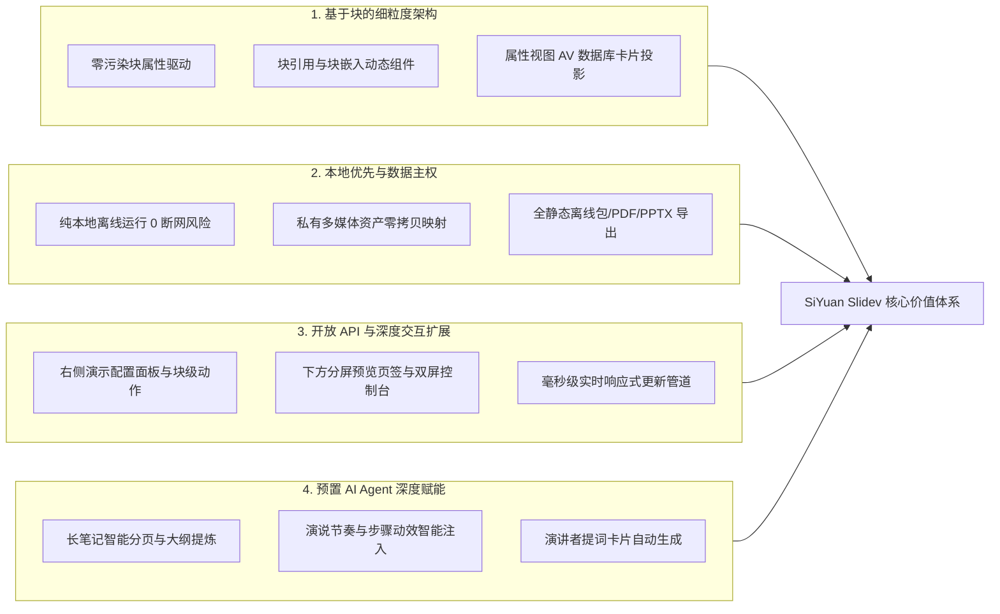

# 关键特性规划、使用场景与用户价值深度设计

---

## 1. 深度依托思源笔记核心优势的四大能力支柱

与通用型 Markdown 演示工具或竞品插件不同，**SiYuan Slidev** 将深度融合思源笔记四大底层壁垒，形成不可替代的体验优势：



### 1.1 支柱一：基于块的细粒度架构（Block-level Architecture）
1. **零污染属性隔离**：
   通过思源系统的 IAL 属性字典，所有针对演示的精细配置（转场动效、渐进序列、布局样式、演讲备注）全部与 Markdown 正文解耦，实现“纯净文本阅读，丰富演示属性”。
2. **块引用（Block Ref）与块嵌入（Block Embed）动态渲染**：
   在编写演讲稿时，讲师无需反复复制粘贴。直接输入 `((块ID))` 引用知识库中的核心概念、实验结论或代码片段。当原始笔记更新时，演讲稿自动实时同步，告别版本脱节。
3. **属性视图（Attribute View / AV 数据库）动态投影**：
   支持将思源 3.8+ 内置的属性视图表格或看板直接转换为幻灯片中的结构化卡片或对比表格，数据一处管理，全端展示。

### 1.2 支柱二：本地优先与数据隐私（Local-First & Data Sovereignty）
1. **绝对离线可用**：
   插件完全基于本地内核与本地静态服务运行，即使在无网络环境的涉密汇报、出差机舱或闭门学术会议中，也能 100% 稳定流畅投影。
2. **内聚的资产管理**：
   无缝兼容 `data/assets/` 下的本地图片、音视频文件，无需配置繁琐的外部图床，保护知识隐私。
3. **多格式独立交付**：
   一键将演讲稿打包为单文件静态网页（Single-file HTML SPA）、高分辨率 PDF 讲义或 PPTX 格式，脱离思源环境亦可随时外发交付。

### 1.3 支柱三：开放 API 与深度交互生态（Extensible Open API）
1. **专职右侧演示配置面板（Slidev Inspector Dock）**：
   右侧面板随光标移动智能识别当前块类型（内容块、分页符 `---`、全局文档），直接展示版式选择芯片、转场动画、逐步出现微调步长、双栏插槽与快捷操作按钮；彻底免去正文悬浮气泡干扰，且不侵入原生块菜单。
2. **多模态布局与多屏演讲者视图**：
   - **下方独立分屏预览模式**：利用思源原生 `addTab` + `openTab` 在当前文档正下方开启宽屏水平分屏预览（`SlidevPreviewTab`），支持 📌 Pin 图钉锁定文档，一边打字，一边观察排版；
   - **双屏演讲者模式（Presenter Mode）**：外接投影仪或大屏显示全屏幻灯片，笔记本主屏幕显示包含“当前幻灯片、下一页预告、计时器、富文本口播提词卡片”的专业演讲者视图。

### 1.4 支柱四：预置 AI Agent 深度赋能（AI-Powered Slides Workflow）
充分复用思源笔记内置或配置的 AI 能力，打造“AI 演讲副驾驶”：
1. **智能大纲重构与长文分页**：
   对于一篇数万字的深度调研笔记，用户只需右键点击“AI 辅助转演示稿”，AI 自动分析层级结构，智能在关键逻辑转折处打上 `custom-slidev-slide` 分页属性与合适的 `layout` 布局。
2. **智能动效与节奏注入**：
   AI 识别文本逻辑关系（递进、对比、因果），自动为列表项、关键结论块配置精细的 `v-click` 渐进显示与高亮强调，令演示生动自然。
3. **演讲者口播提词卡（Speaker Notes）自动提炼**：
   AI 提炼段落的核心信息点与过渡引言，自动写入该页的 `custom-slidev-notes` 属性中，帮助演讲者掌控现场节奏。

---

## 2. 五大典型使用场景深度剖析

| 场景分类 | 核心痛点 | SiYuan Slidev 解决方案 | 带来的用户价值 |
| :--- | :--- | :--- | :--- |
| **场景一：技术分享与架构演练** | 粘贴代码格式混乱；无法逐步分段讲解代码；架构图繁多缺乏递进 | 借助 Slidev 内置的 Shiki 语法高亮，通过块属性直接设定逐行聚光灯（`highlightLines`）；利用 Mermaid 块配合 `v-click` 逐步画出架构演进图 | 演示如丝般顺滑，技术讲解充满掌控感；代码完全来自真实笔记库 |
| **场景二：学术汇报与课题研讨** | 公式排版繁重；结论多来自多篇关联笔记；演讲时容易遗忘要点 | 原生 KaTeX 公式渲染；直接使用思源块引用（Block Ref）动态抓取论文实验数据；AI 自动生成口播提词并投射至演讲者屏幕 | 零重复劳动，研究笔记与汇报 PPT 同源同步，数据严谨不可被篡改 |
| **场景三：日常工作汇报与 OKR 复盘** | 做 PPT 极度耗费排版时间；正文文字太多台下听众读不过来 | 支持一键应用优雅主题；自动将思源属性视图（AV）转为美观的数据对比卡片；分步点击展示业务完成项 | 5 分钟完成高颜值工作周报/月报制作，回归汇报本质 |
| **场景四：产品原型与前端交互演示** | 传统 PPT 只能放死板截图，无法体现真实交互 | 直接在幻灯片中插入 Vue 3 交互组件（计数器、动态表单、可折叠面板、3D 模型） | 颠覆传统幻灯片表现形式，沉浸式展示软件原型与交互逻辑 |
| **场景五：边讲边记的研讨工作流** | 演讲现场收到听众反馈，传统 PPT 无法现场修改并实时同步 | 开启双向联动模式：上方笔记随手记下听众建议，下方分屏或外接投影画面毫秒级动态更新呈现修正结果 | 打破“演示完毕再整理笔记”的割裂鸿沟，实现演讲与知识共创的实时闭环 |

---

## 3. 用户价值与核心差异化优势矩阵

```mermaid
quadrantChart
    title 演示插件“表现力”与“笔记友好度”四象限分布
    x-axis 低笔记友好度 (正文污染严重) --> 高笔记友好度 (正文零污染/元数据解耦)
    y-axis 传统静态表现力 --> 现代交互与前端级表现力
    quadrant-1 完美终极形态 (SiYuan Slidev)
    quadrant-2 极客但毁笔记 (Obsidian Adv Slides)
    quadrant-3 简陋且局限 (传统 Iframe 壳)
    quadrant-4 纯净但表现弱 (Obsidian Marp / Joplin Slides)
    "Obsidian Adv Slides": [0.25, 0.65]
    "Obsidian Marp": [0.75, 0.35]
    "Joplin Slides": [0.8, 0.2]
    "外部 Slidev 壳": [0.3, 0.85]
    "SiYuan Slidev (本案)": [0.92, 0.95]
```

### 3.1 核心差异化价值提炼

1. **“免整理”的生产力飞跃**：
   传统流程需要“在思源写笔记 -> 打开 PowerPoint 重新复制排版 -> 导出 PPT”。使用本插件后，**笔记即是演示**，省去 80% 重复排版时间。
2. **“真纯净”的长期资产沉淀**：
   无论为幻灯片配置了多么炫酷的飞入、旋转、淡入淡出动效，思源笔记正文依然干干净净。在知识库检索、移动端阅读或导出为标准 Markdown 时没有任何奇怪的垃圾代码。
3. **“零门槛”享受现代前端动效红利**：
   普通用户无需学习 Vue、CSS、UnoCSS，通过思源块标可视化菜单即可一键施活动态效果；资深开发者亦可开启 Pro 模式，尽情挥洒 Vue SFC 与前端组件的无限潜力。
