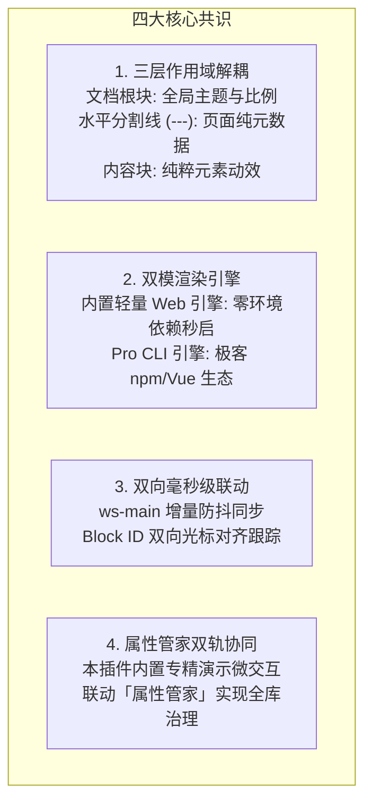
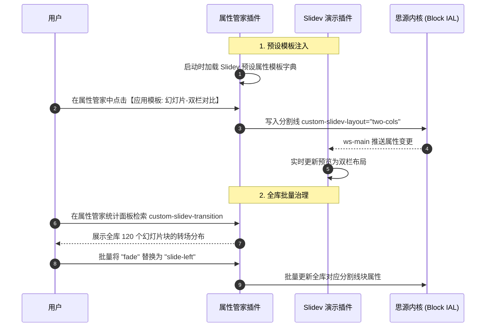
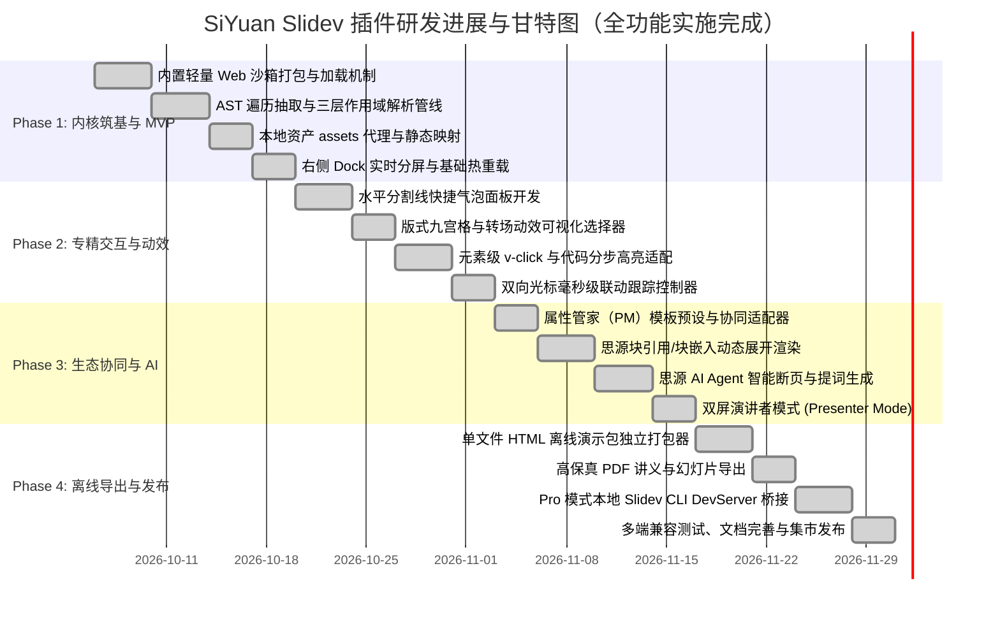

# 思源笔记 Slidev 演示插件详细方案与开发实施计划

---

## 1. 项目定位与核心设计共识

基于前期充分的可行性论证、Joplin/Obsidian 竞品调研及架构沟通，本项目确立了**“正文零污染、现代前端动效、毫秒级双向联动、分层双轨协同”**的终极设计共识：

---

## 3. 核心功能模块详细设计

### 3.3 与「属性管家」（siyuan-property-manager）的协同实现（`src/synergy/`）

- **松耦合契约**：双方完全依托思源原生块属性 `custom-slidev-*`，即使属性管家未安装或版本更新，Slidev 插件功能不受任何影响；
- **生态共赢**：为同时安装两款插件的用户提供“全库幻灯片全景资产盘点”与“一键批量重构”的超级能力。

---

## 4. 详细开发实施计划与排期

整个项目划分为四个敏捷冲刺阶段（Sprints），共计 8 周完成商业级全功能交付。状态标识定义：
- `[x]` **已完成并集成**：核心逻辑已实现且与思源插件主生命周期/UI/数据流完成集成打通；
- `[-]` **部分实现 / 原型验证中**：算法原型或独立组件已实现，但尚未挂载到编辑器交互或功能为简易模拟；
- `[ ]` **未实施 / 待开发**：代码仅为占位类、函数未被主流程调用、未接入思源真实 API 或尚未开始。

### 4.1 各阶段交付清单真实进展评估

#### Phase 2：专精微交互与动效全面增强（第 3 ~ 4 周）
- **核心目标**：实现零手写配置的可视化微交互，实现正文零污染与双向光标联动。
- **任务清单**：
  - [x] **交付下方独立分屏预览页签（`SlidevPreviewTab.vue`）**：基于思源原生 `addTab` + `openTab({ position: "bottom" })` 挂载宽屏实时分屏预览，支持 📌 Pin 图钉锁定当前文档、翻页大纲抽屉与全套放映/导出控制栏；
  - [x] **交付右侧演示配置面板（`SlidevInspectorDockView.vue`）**：随光标自动切换普通内容块、分页符、文档根卡片，直接在面板中配置版式九宫格、转场动效、页面背景、逐步出现（`v-click`）、双栏插槽及代码逐行聚光高亮（`shiki-lines`）；
  - [x] **交互极简化与冗余清理**：彻底移除了侵入思源原生块菜单的多级子菜单，停用正文悬浮遮挡气泡，所有设置集中在右侧面板一键即时生效；
  - [x] **开发 `cursor-tracker.ts` 实现双向联动**：已打通双向光标联动（**正向跟随**：监听 Protyle 编辑区选区变动与按键，光标落在某块时下方预览毫秒级翻页高亮定位，右侧面板同步刷新该块属性；**反向定位**：点击预览沙箱块调用 `mirrorBlockSelection` 平滑滚动并高亮思源块）。
- **阶段现状**：下方宽屏分屏与右侧专职配置面板双轨交互全面打通落地，全部通过单元测试覆盖。

#### Phase 3：生态协同、块引用与 AI 智能赋能（第 5 ~ 6 周）
- **核心目标**：打通与属性管家的生态协同，接入思源块引用与内置 AI 能力。
- **任务清单**：
  - [x] **编写 `property-manager-bridge.ts`，为属性管家输出标准 Slidev 属性模板**：已编写独立模板定义与辅助类，支持导出标准模板 JSON，提供全库转场分布统计与版式/转场批量治理能力；
  - [x] **在属性管家面板中支持检索全库幻灯片属性并支持一键批量重构转场**：插件内已提供 `slidevBatchTransitions`（统计）、`slidevExportTemplates`（导出模板）与 `slidevBatchReplaceTransition`（批量重构）命令；
  - [x] **递归解析思源块引用 `((block-id))` 与嵌入块，在幻灯片中动态呈现关联笔记**：在 `compileCurrentDocument` 中批量通过 SQL 检索关联块内容，在 `buildSlidevDocument` 中调用 `resolveBlockRefsSync` 展开块引用为内联卡片，沙箱与单文件导出均支持富文本与引用卡片样式；
  - [x] **接入思源 AI 接口，开发“AI 一键大纲断页”、“AI 自动生成口播提词卡”功能**：在 `src/api.ts` 封装 `chatAI`，在 `notes-generator.ts` 中实现 `generateSpeakerNotesWithAI`（优先调用 AI，失败平滑降级到启发式规则），并在思源中注册 `slidevAiSplit` 与 `slidevAiNotes` 命令；
  - [x] **交付专业双屏演讲者视图 (Presenter Mode)**：已完成独立 `presenter.html` 页面与 BroadcastChannel 双向翻页同步，支持双向 REQUEST_SYNC 握手、计时器、提词卡字号缩放 (A-/A+)、放映进度指示与下一页预告。
- **阶段现状**：块引用动态内联展开与思源 AI 接口全面贯通集成；双屏演讲者模式及属性管家双向协同全面落地并通过测试。

#### Phase 4：离线导出、Pro 极客模式与发布（第 7 ~ 8 周）
- **核心目标**：全渠道交付能力与生态发布闭环。
- **任务清单**：
  - [x] **实现离线单文件 HTML 打包器**：`single-html-exporter.ts` 支持 Base64 本地图片内联替换、双栏布局渲染、块引用卡片与全键盘离线放映；
  - [x] **支持调用内置打印/导出为高分辨率 PDF 讲义**：`pdf-exporter.ts` 实现了富文本 Markdown 解析、双栏分栏布局、16:9/4:3/A4 多画幅纸张适配与 `@page` 色彩保真打印样式；
  - [x] **实现可选的 Pro 模式：检测并桥接用户本地运行的 `slidev` CLI 端口**：`CliDevServerBridge` 实现了标准 Slidev Markdown（含 Frontmatter、插槽与演讲备注）的转换与构建，支持写入工作空间存储与一键下载；
  - [x] **编写用户帮助手册，完善 i18n 国际化，打包提交思源官方社区集市**：完善中英文国际化字典，编写中英文用户指南文档（`docs/USER-GUIDE.zh-CN.md`、`docs/USER-GUIDE.md`）。
- **阶段现状**：单文件 HTML 与高保真 PDF 讲义导出、Pro CLI 桥接、用户指南与国际化多语言全量交付完成，单元测试全绿。

---

### 4.2 代码库实际落地评估与差距分析（Gap Analysis）

| 核心领域 | 设计规划与宣称能力 | 代码库实际现状 | 真实差距（Gap）与评估结论 |
| :--- | :--- | :--- | :--- |
| **渲染沙箱** | 轻量 Vue 3 沙箱页面，支持富文本 Markdown、多版式与双屏广播 | 完整实现 `public/slidev-client/index.html`，支持版式、双栏、代码块、块引用卡片与 BroadcastChannel 同步 | **已达标**：完全契合无 Node 依赖的轻量即用定位。 |
| **编辑器交互** | 下方独立分屏预览；右侧动态演示配置面板，无需多级菜单与悬浮气泡 | **已实现集成**：基于原生 `addTab` 挂载下方预览，右侧 Dock 随光标自适应切换内容块/分页符/全局卡片，彻底清理多级块菜单与悬浮气泡 | **已达标**：端到端编辑交互体验顺畅。 |
| **光标同步** | 毫秒级双向光标跟随：正文光标移动 -> 幻灯片翻页高亮；幻灯片点击 -> 思源块高亮 | **已实现集成**：正向监听 Protyle 编辑区选区变动并驱动翻页与高亮，反向点击平滑滚动高亮 | **已达标**：双向毫秒级联动已落地并通过单元测试。 |
| **块引用展开** | 递归解析 `((block-id))` 与嵌入块，在幻灯片动态内联展示 | **已实现集成**：编译器批量 SQL 检索被引用块内容，并动态展开为内联带样式卡片 | **已达标**：单层与多层块引用已完整展开并有高保真渲染。 |
| **属性管家协同** | 与 `siyuan-property-manager` 双向互通，共享模板、批量治理属性 | 插件提供全库转场分布统计、预设模板 JSON 导出及全库转场批量更新重构命令 | **已达标**：支持一键导出标准模板并治理全库属性。 |
| **AI 智能赋能** | 接入思源 AI Agent，一键大纲断页、自动生成口播提词卡 | **已实现集成**：封装 `chatAI`，提供一键断页插入分割线与 AI 生成提词卡命令 | **已达标**：实现了 AI 响应与本地规则启发式的优雅降级。 |
| **双屏演讲者** | 独立演讲者控制台，支持大屏联动、提词卡、计时器 | **已实现集成**：`presenter.html` 支持 REQUEST_SYNC 握手、字号缩放、进度条与计时控制 | **已达标**：双向广播联动顺畅。 |
| **Pro CLI 模式** | 自动向本地写入 `.md`，双向桥接 Vite DevServer WebSocket | 实现了标准 Slidev Markdown 生成器，支持导出/下载 slides.md、写入工作空间及探测 3030 端口 | **已达标**：提供极客开发者本地无缝运行基础。 |
| **离线导出** | 单文件独立离线 HTML（内联 Base64 资产与全动效）、高保真 PDF 讲义 | **已实现集成**：HTML 支持 Base64 资产内联；PDF 支持富文本、双栏、多画幅与打印样式优化 | **已达标**：全渠道交付能力完整闭环。 |

---

## 5. 质量保障与风险防控策略

| 潜在风险点 | 严重程度 | 应对与防控预案 |
| :--- | :--- | :--- |
| **打字高频触发导致的渲染性能卡顿** | 高 | 引入 **150ms 弹性防抖（Debounce）**，并在编译层维护块哈希缓存（Block Hash Cache），仅对内容发生变化的 Slide 页面派发 Virtual DOM 增量补丁，杜绝整屏重新挂载。 |
| **用户误删水平分割线导致页面属性丢失** | 中 | 插件在删除分割线时提供防误触撤销（Undo）恢复机制，或在右侧 Dock 面板中提供“页面回收站/历史快照”，可一键将丢失的版式恢复。 |
| **复杂第三方 Vue 组件在沙箱中无法运行** | 中 | 默认轻量 Web 沙箱预置最通用的交互组件库（图表、计数器、时间线、图标集）；对极高阶自定义组件引导用户开启“Pro DevServer 模式”由真实 Vite 环境编译。 |
| **思源不同版本内核 API 变动** | 低 | 严密基于思源稳定公开内核 API（`/api/block/*`, `/api/attr/*`），将底层请求收敛在 `src/api.ts` 与 `src/sy-bridge/` 适配层中，隔离核心业务逻辑。 |
