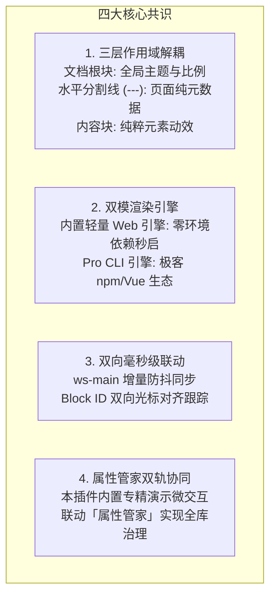
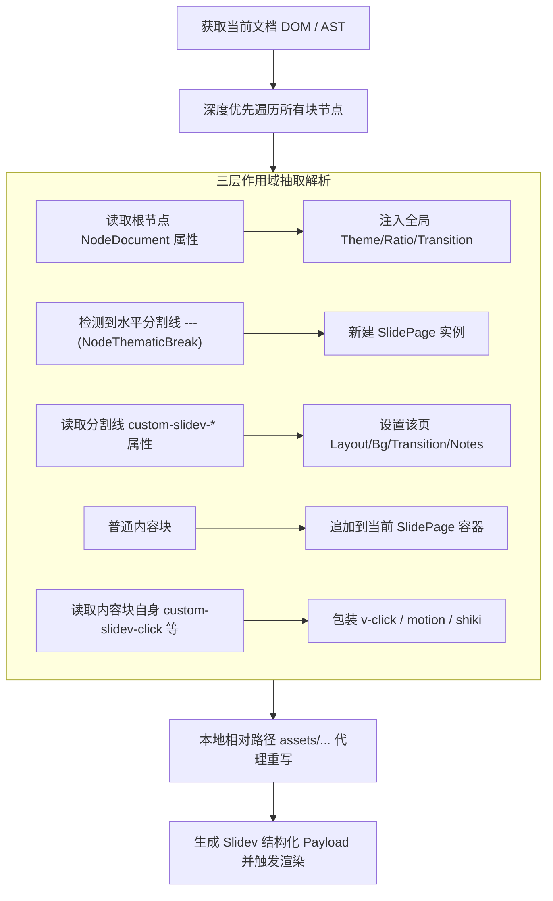
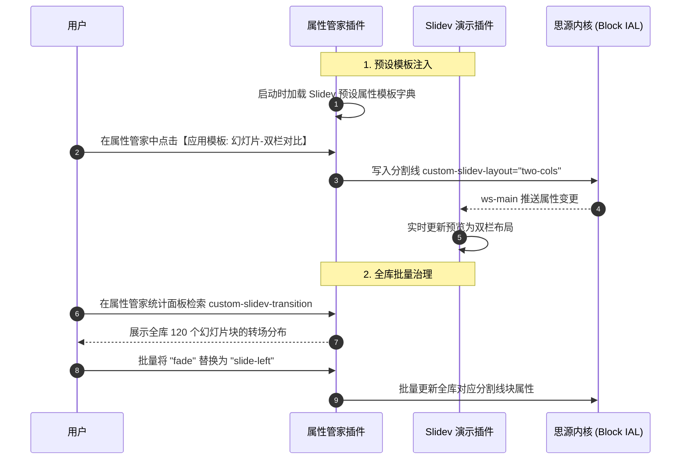
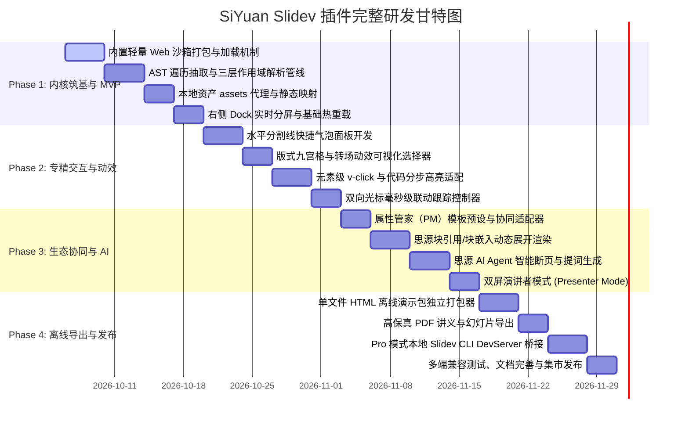

# 思源笔记 Slidev 演示插件详细方案与开发实施计划

---

## 1. 项目定位与核心设计共识

基于前期充分的可行性论证、Joplin/Obsidian 竞品调研及架构沟通，本项目确立了**“正文零污染、现代前端动效、毫秒级双向联动、分层双轨协同”**的终极设计共识：



---

## 2. 插件代码架构与工程目录规划

在现有的 `siyuan-slidev` 插件工程模板（Vite + TypeScript + Vue 3）基础上，规划如下模块化目录结构：

```text
d:/MyCodingProjects/siyuan-slidev/
├── docs/                               # 详细方案与设计文档库
├── public/                             # 静态资源与内置 Slidev Client 核心沙箱包
│   └── slidev-client/                  # 预编译的 Slidev Client 独立静态运行时
│       ├── index.html                  # 演示沙箱入口
│       └── assets/                     # Vue3, UnoCSS, Shiki WebWorker 预编译包
├── src/
│   ├── api.ts                          # 思源官方 Kernel REST API 封装
│   ├── index.ts                        # 插件入口类（生命周期、菜单注册、Dock 挂载）
│   ├── compiler/                       # AST 编译与数据转换核心
│   │   ├── ast-crawler.ts              # 思源块语法树遍历与抽取
│   │   ├── scope-mapper.ts             # 三层作用域属性解析（文档/分割线/元素）
│   │   ├── slidev-ast-builder.ts       # 构建 Slidev 虚拟 Slides AST
│   │   └── assets-rewriter.ts          # 本地 assets/... 相对路径代理重写器
│   ├── engine/                         # 演示渲染引擎控制器
│   │   ├── engine-manager.ts           # 双模引擎调度器（Web 沙箱 / Pro CLI）
│   │   ├── web-sandbox-bridge.ts       # postMessage 容器通信管道
│   │   └── cli-devserver-bridge.ts     # 外部 Vite DevServer WebSocket 桥接
│   ├── sync/                           # 实时联动与光标跟踪中枢
│   │   ├── cursor-tracker.ts           # 编辑器光标监听与 Block ID 寻址
│   │   ├── debounce-controller.ts      # ws-main 事务流 150ms 增量防抖控制
│   │   └── selection-mirror.ts         # 幻灯片反向定位思源块
│   ├── ui/                             # 专精演示交互 UI 组件库 (Vue 3)
│   │   ├── components/
│   │   │   ├── QuickDividerPopover.vue # 水平分割线悬浮气泡（九宫格版式/动效预览）
│   │   │   ├── ElementAnimBar.vue      # 元素级 v-click / 高亮快捷浮动条
│   │   │   ├── SlideInspector.vue      # 右侧 Dock 幻灯片页面卡片检查器
│   │   │   ├── LayoutPicker.vue        # 可视化版式九宫格选择器
│   │   │   ├── TransitionSelector.vue  # 悬停带 CSS 动效播放的转场选择器
│   │   │   └── GlobalConfigModal.vue   # 文档全局演示配置模态框
│   │   └── dock/
│   │       └── SlidevDockView.vue      # 右侧 Dock 实时预览主面板
│   ├── synergy/                        # 生态协同模块
│   │   ├── property-manager-bridge.ts  # 属性管家（siyuan-property-manager）深度适配器
│   │   └── preset-templates.ts         # 预设 Slidev 属性模板字典
│   ├── ai/                             # 思源预置 AI Agent 协同
│   │   ├── auto-splitter.ts            # 长笔记智能分析与自动插入分割线
│   │   ├── auto-animator.ts            # 论点与列表项智能注入 v-click
│   │   └── notes-generator.ts          # 演讲者口播提词卡提炼生成器
│   ├── export/                         # 导出流水线
│   │   ├── single-html-exporter.ts     # 单文件独立离线 HTML 打包器
│   │   └── pdf-exporter.ts             # 高保真 PDF 讲义导出
│   └── types/                          # 全局 TypeScript 类型定义
│       ├── slidev-protocol.d.ts        # 块属性协议字典定义
│       └── ipc-messages.d.ts           # 跨容器通讯消息契约
```

---

## 3. 核心功能模块详细设计

### 3.1 AST 编译与作用域映射管线（`src/compiler/`）



### 3.2 专精微交互 UI 设计（`src/ui/`）

为降低用户配置门槛，避免手敲代码与枯燥的键值对，插件打造专门针对演示场景的可视化交互：

1. **水平分割线快捷气泡（`QuickDividerPopover.vue`）**：
   - 交互触发：用户鼠标悬停或点击文档中的 `---` 水平分割线时，在分割线正上方弹出紧凑半透明气泡工具条；
   - 核心组件：
     - **版式九宫格**：以图标直观展示（封面、双栏、重点居中、大字报、单栏），点击一键切换并写入 `custom-slidev-layout`；
     - **动态转场下拉**：鼠标在下拉选项上悬停时，选项旁实时以 1 秒微缩动画预览转场效果（fade、slide-left、slide-up、zoom）；
     - **背景选择器**：支持一键选用思源资源库图片或渐变拾色器；
     - **演讲提词按钮**：点击呼出当前页独享的演讲者备忘录（Notes）输入框。
2. **元素级动效浮动条（`ElementAnimBar.vue`）**：
   - 监听编辑器选中文本或点击块标事件；
   - 提供极简按钮：`[逐步出现 +1]`、`[代码聚光]`、`[飞入动效]`；
   - 点击后自动将计算出的步数写入该块的 `custom-slidev-click`。
3. **右侧 Dock 幻灯片检查器（`SlideInspector.vue`）**：
   - 在右侧分屏预览下方，以卡片大纲呈现每页预览，支持拖拽重排分页分割线。

### 3.3 与「属性管家」（siyuan-property-manager）的协同实现（`src/synergy/`）



- **松耦合契约**：双方完全依托思源原生块属性 `custom-slidev-*`，即使属性管家未安装或版本更新，Slidev 插件功能不受任何影响；
- **生态共赢**：为同时安装两款插件的用户提供“全库幻灯片全景资产盘点”与“一键批量重构”的超级能力。

---

## 4. 详细开发实施计划与排期（8 周冲刺路线）

整个项目划分为四个敏捷冲刺阶段（Sprints），共计 8 周完成商业级全功能交付：



### 4.1 各阶段交付清单与验收标准

#### Phase 1：内核筑基与 MVP 验证（第 1 ~ 2 周）
- **核心目标**：跑通纯前端沙箱，实现“编辑笔记，右侧 Dock 毫秒级显示 Slidev 演示稿”。
- **任务清单**：
  - [x] 搭建 `public/slidev-client` 预编译静态沙箱，集成 Vue 3 运行时与 Slidev 核心排版组件；
  - [x] 实现 `src/compiler/scope-mapper.ts`，识别文档根块与 `---` 分割线，生成初始虚拟 SlideInfo；
  - [x] 实现本地图片 `assets/...` 的绝对代理路径重写；
  - [x] 完成思源右侧 Dock 栏的嵌入，基于 `postMessage` 建立单向增量同步。
- **验收标准**：在思源中输入两段文字并用 `---` 隔开，右侧 Dock 能实时无报错呈现两页幻灯片，图片可正常显示。

#### Phase 2：专精微交互与动效全面增强（第 3 ~ 4 周）
- **核心目标**：实现零手写配置的可视化微交互，实现正文零污染与双向光标联动。
- **任务清单**：
  - [x] 开发 `QuickDividerPopover.vue`，实现点击 `---` 弹出气泡；
  - [x] 实现九宫格版式选择器与悬停播放 CSS 动画的转场选择器；
  - [x] 适配段落/列表项的 `v-click` 逐步出现指令，适配代码块逐行聚光高亮；
  - [x] 开发 `cursor-tracker.ts`：左侧光标移至某段落，右侧幻灯片毫秒级翻页并光晕定位；点击右侧幻灯片反向聚焦思源块。
- **验收标准**：小白用户全程无需手动输入任何属性代码，仅靠鼠标点击即可配出双栏对比、逐行渐进呈现的高颜值动画幻灯片，打字流畅无卡顿。

#### Phase 3：生态协同、块引用与 AI 智能赋能（第 5 ~ 6 周）
- **核心目标**：打通与属性管家的生态协同，接入思源块引用与内置 AI 能力。
- **任务清单**：
  - [x] 编写 `property-manager-bridge.ts`，为属性管家输出标准 Slidev 属性模板；
  - [x] 在属性管家面板中支持检索全库幻灯片属性并支持一键批量重构转场；
  - [x] 递归解析思源块引用 `((block-id))` 与嵌入块，在幻灯片中动态呈现关联笔记；
  - [x] 接入思源 AI 接口，开发“AI 一键大纲断页”、“AI 自动生成口播提词卡”功能；
  - [x] 交付专业双屏演讲者视图（包含计时器、下一页缩略图、提词面板）。
- **验收标准**：一键唤醒 AI 能将万字长文智能分割为结构化幻灯片；属性管家可全库盘点演示资产；双屏投影稳定可靠。

#### Phase 4：离线导出、Pro 极客模式与发布（第 7 ~ 8 周）
- **核心目标**：全渠道交付能力与生态发布闭环。
- **任务清单**：
  - [ ] 实现离线单文件 HTML 打包器（将脚本、样式、本地图片 Base64 一键内联），支持无网脱机播放；
  - [ ] 支持调用内置打印/导出为高分辨率 PDF 讲义；
  - [ ] 实现可选的 Pro 模式：检测并桥接用户本地运行的 `slidev` CLI 端口；
  - [ ] 编写用户帮助手册，完善 i18n 国际化，打包提交思源官方社区集市。
- **验收标准**：导出的单文件 HTML 可以在任何未安装思源笔记的电脑/手机浏览器中完美放映；插件通过思源官方代码规范检查。

---

## 5. 质量保障与风险防控策略

| 潜在风险点 | 严重程度 | 应对与防控预案 |
| :--- | :--- | :--- |
| **打字高频触发导致的渲染性能卡顿** | 高 | 引入 **150ms 弹性防抖（Debounce）**，并在编译层维护块哈希缓存（Block Hash Cache），仅对内容发生变化的 Slide 页面派发 Virtual DOM 增量补丁，杜绝整屏重新挂载。 |
| **用户误删水平分割线导致页面属性丢失** | 中 | 插件在删除分割线时提供防误触撤销（Undo）恢复机制，或在右侧 Dock 面板中提供“页面回收站/历史快照”，可一键将丢失的版式恢复。 |
| **复杂第三方 Vue 组件在沙箱中无法运行** | 中 | 默认轻量 Web 沙箱预置最通用的交互组件库（图表、计数器、时间线、图标集）；对极高阶自定义组件引导用户开启“Pro DevServer 模式”由真实 Vite 环境编译。 |
| **思源不同版本内核 API 变动** | 低 | 严密基于思源稳定公开内核 API（`/api/block/*`, `/api/attr/*`），将底层请求收敛在 `src/api.ts` 与 `src/sy-bridge/` 适配层中，隔离核心业务逻辑。 |
