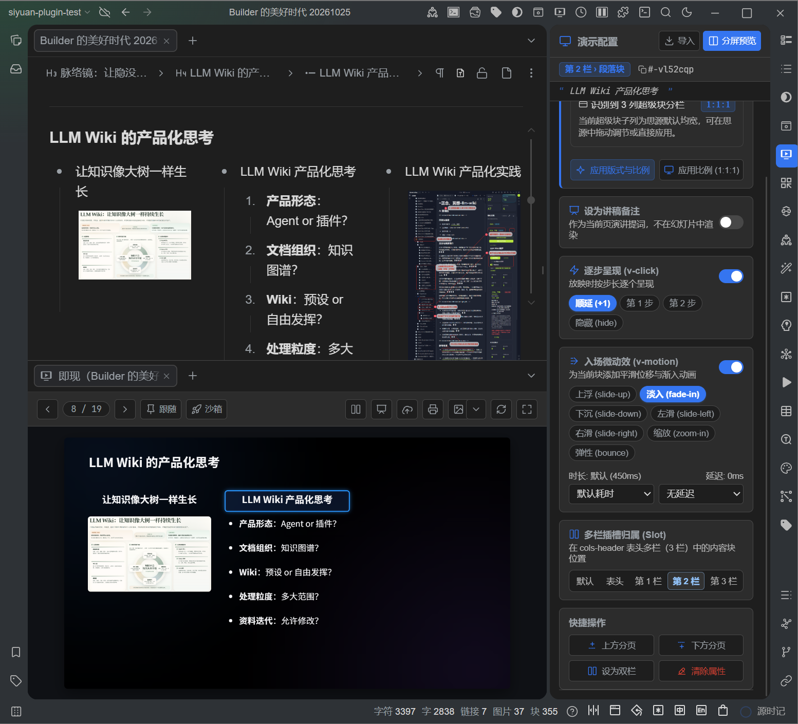
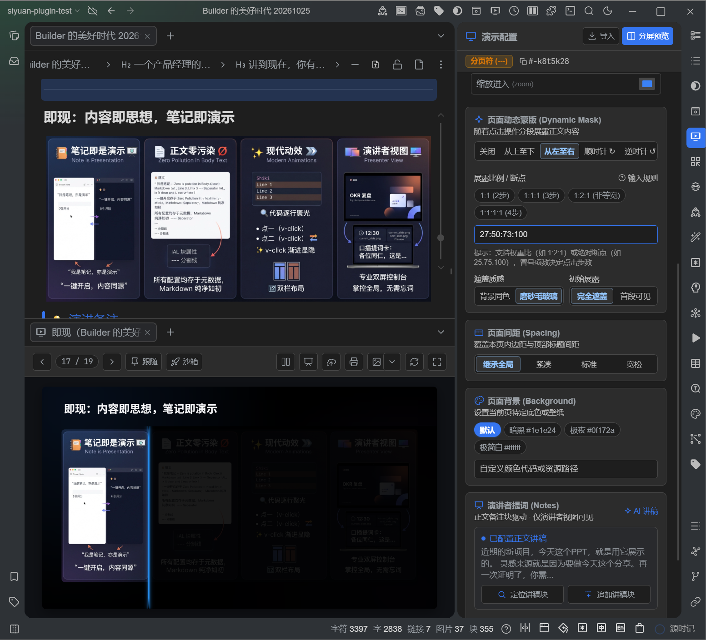
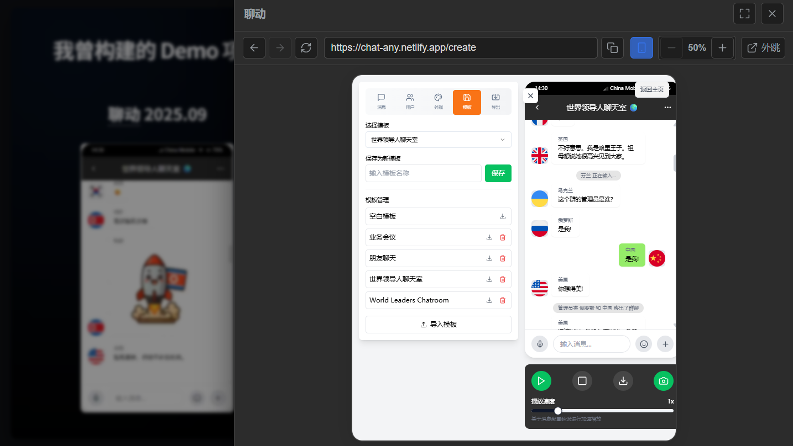
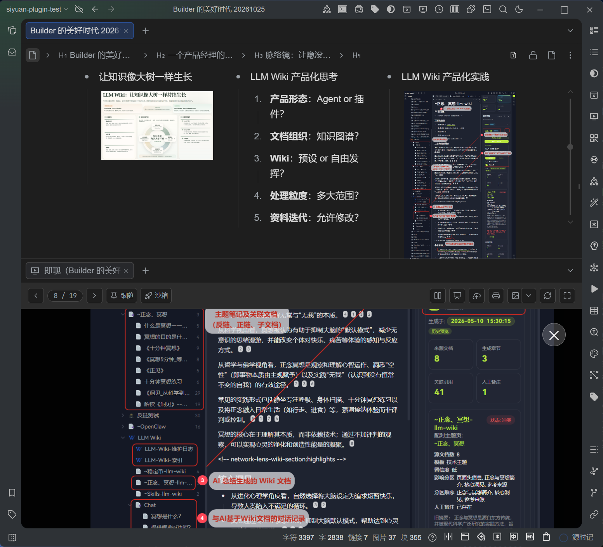
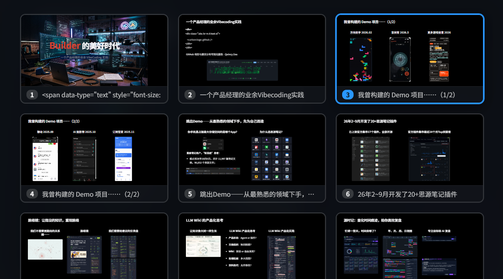

# 即现 · 文档即演示
{: custom-slides-layout="cover" custom-slides-transition="fade" }

## 专为思源笔记打造的一体化现代演示引擎

免搬运 · 零污染 · 毫秒联动 · 开箱即讲

让演讲回归内容，让思想即刻显现


{: custom-slides-role="background" }

> [!NOTE] 💡 演讲备注
> 欢迎大家！今天为大家介绍“即现（SiYuan Live Slides）”。
> 即现不是又一个笨重复杂的排版工具，它让思源笔记本身成为演示文稿，让知识沉淀与现场表达合二为一。
> 口号：内容即思想，文档即演示。
{: custom-slides-note="true"}

---
{: custom-slides-layout="quote" custom-slides-transition="slide-left" }

让演讲回归内容，让思想即刻显现。

演示工具应当隐入幕后，观众关注的应是观点本身。
文档是知识沉淀的根，演示不过是它某一次的绽放。

—— 《即现 · 破局之道》
{: custom-slides-role="author" }

> [!NOTE] 💡 演讲备注
> 引言定调：很多人苦于制作 PPT，其实并不讨厌分享，而是厌倦了被工具割裂的无谓内耗。
> 我们的核心主张：文档就是演示，无需在不同工具之间辗转腾挪。
{: custom-slides-note="true"}

---
{: custom-slides-layout="center" custom-slides-transition="slide-up" }

# 内容明明都在文档里，为什么还要再搬一遍？

> 每次分享前，摘录、复制、重新排版，几个小时在胶片调整中无声蒸发……
> 方案一旦变更，PPT 与笔记便永远差了一拍，陷入双份维护的泥潭。

> [!NOTE] 💡 演讲备注
> 抛出核心痛点引发共鸣：大家是否有过这样的经历？好不容易写好了详尽的技术方案文档，为了分享又得重新做一份 PPT。
> 这种割裂不仅消耗精力，还导致知识资产的腐化。
{: custom-slides-note="true"}

---
{: custom-slides-layout="two-cols" custom-slides-layout-ratio="1:1" custom-slides-transition="slide-left" }

### 传统演示准备之痛

- **二次搬运黑洞**：内容从笔记复制到 PPT，重复排版吞噬创作时间
- **双份维护割裂**：方案一改胶片重做，演示与文档永远步调不一
- **正文语法污染**：传统插件要求在正文插入海量特殊宏与注释标记
- **环境配置门槛**：现代代码类工具动辄依赖 Node.js 与终端命令行

### 即现的一体化破局

- **免搬运文档即讲**：原生一条 `---` 分割线，写完瞬间开启大屏放映
- **双向毫秒级联动**：编辑器改动即时热更新，光标与画面实时互锁
- **原生块属性存储**：所有版式动效全存思源 IAL，正文 100% 纯净
- **0 依赖开箱即用**：内置轻量 Web 沙箱，思源集市一键启用免装环境
{: custom-slides-slot="right" }

> [!NOTE] 💡 演讲备注
> 左右对比：左边是大家饱受折磨的传统困境，右边是即现给出的系统性解答。
> 重点强调“正文零污染”与“0 依赖开箱即用”这两大核心底线。
{: custom-slides-note="true"}

---
{: custom-slides-layout="fact" custom-slides-transition="fade" }

# 核心效能突破：从繁琐到极致

* 0：外部环境依赖，免装 Node/CLI 开箱即用
* 100%：Markdown 正文纯净度，配置全存块属性
* 10ms：双向联动响应，光标跟随与热更新无感延迟
* 11种：原生专业版式，九宫格点选所见即所得

> [!NOTE] 💡 演讲备注
> 四个硬核数据指标：0 依赖、100% 纯净、10 毫秒极速联动、11 种专业版式。
> 这里也展示了即现独家的大字报（fact）自适应多指标发光看板效果。
{: custom-slides-note="true"}

---
{: custom-slides-layout="cols-header" custom-slides-layout-ratio="1:1:1:1" custom-slides-transition="slide-left" }

# “即现”四大核心设计维度

### 01 文档即演示
- 原生 `---` 分割线即分页
- 思源 IAL 存储演示元数据
- 导出 Markdown 纯净整洁
- 笔记是唯一真实数据源
{: custom-slides-slot="col-1" }

### 02 可视化轻排版
- 九宫格直观点选页面版式
- `v-click` 逐步渐进显隐
- 四种灵动入场微动效
- 动态蒙版分步悬念展开
{: custom-slides-slot="col-2" }

### 03 沉浸式控全场
- 内置 Web 沙箱速览抽屉
- 操作 Demo 与外链无需切屏
- 图片灯箱 1~5 倍无损缩放
- `O` 键全景缩略图秒级跳页
{: custom-slides-slot="col-3" }

### 04 双屏专业导播
- `P` 键独立 16:9 双屏放映
- 真实时钟与演讲用时计时
- 大字号防忘词口播提词卡
- 下一页预告与半透明剧透
{: custom-slides-slot="col-4" }

> [!NOTE] 💡 演讲备注
> 通览即现的四大功能支柱：免搬运、可视化、沉浸感、专业控场。
> 接下来我们将结合实际演示，逐一展开其中的高光特性。
{: custom-slides-note="true"}

---
{: custom-slides-layout="image-left" custom-slides-image="./assets/image-20261108235341-omnpqgg.png" custom-slides-layout-ratio="55:45" custom-slides-transition="slide-left" }

## 双向毫秒级联动，边讲边改

上方是笔记编辑器，下方是幻灯片放映，中间没有任何距离。

- **光标智能跟随**：笔记光标移动到哪段，放映画面毫秒级翻到对应页并高亮聚焦
- **反向精准定位**：点击放映画面的任意元素，编辑器瞬间平滑滚动对齐源笔记块
- **会议现场边讲边改**：汇报中收到修改意见，随手在笔记修订，放映即时热更新
- **📌 Pin 窗口锁定**：查阅其他参考笔记时锁定放映，画面纹丝不动，避免现场慌乱

> [!NOTE] 💡 演讲备注
> 介绍双向联动特性：光标移动跟随、点击画面反向定位源块、现场即时修笔记热更新。
> 特别提一下 Pin 锁定：开会时临时翻看其他参考文档，观众屏幕上的 PPT 不会跟着乱跑。
{: custom-slides-note="true"}

---
{: custom-slides-layout="image-right" custom-slides-image="./assets/image-20261108214019-ykso065.png" custom-slides-layout-ratio="50:50" custom-slides-transition="slide-left" }

## 九宫格点选，版式即点即得

无需死记硬背任何排版语法，侧栏可视化检查器动动鼠标即可调出专业质感。

- **11 种专业版式点选**：封面、标准、双栏、表头多栏、四叶草、图左/图右、大字报、时间线、引言、介绍、居中
- **自由定制分栏比例**：`1:1`、`1:2`、`2:1` 预设一键生效，支持一键读取超级块拖拽列宽
- **丝滑页面转场**：向左平滑滑入、优雅淡入淡出、向上推移，翻页自然流畅
- **笔记排版智能映射**：标题大小、调色板颜色、横向超级块自然转换为大屏演示排版

> [!NOTE] 💡 演讲备注
> 介绍九宫格版式面板：光标停在分割线，面板即刻呈现所有版式图标。
> 点一下换版式，点一下换转场，所见即所得。
{: custom-slides-note="true"}

---
{: custom-slides-layout="default" custom-slides-transition="fade" }

## 渐进显隐与入场微动效，牢牢牵引注意力

演讲的节奏，就是敲击翻页键的节奏。通过渐进显隐，避免听众提前阅读整页内容。

- ✨ **步长灵活掌控**：支持对列表项、正文段落及栏内组件设置逐步呈现（`v-click`）步长
{: custom-slides-click="+1" custom-slides-motion='{"preset":"slide-up"}' }
- 🚀 **四种灵动微动效**：内置上浮（`slide-up`）、淡入（`fade-in`）、缩放（`zoom-in`）与微弹跳（`bounce`）
{: custom-slides-click="+1" custom-slides-motion='{"preset":"fade-in"}' }
- 🎯 **组件级独立调度**：超级块内的不同子卡片可按节奏错峰出场，多栏论述层次分明
{: custom-slides-click="+1" custom-slides-motion='{"preset":"zoom-in"}' }
- 💡 **告别文字平铺**：让每个核心观点带着视觉重力登场，紧紧锁住全场目光
{: custom-slides-click="+1" custom-slides-motion='{"preset":"bounce"}' }



> [!NOTE] 💡 演讲备注
> 本页实际演示 v-click 逐步呈现与四种入场微动效。
> 随着翻页键敲击，每一行列表项依次带着微动效浮现。
{: custom-slides-note="true"}

---
{: custom-slides-layout="default" custom-slides-mask="right" custom-slides-mask-ratio="1:1:1" custom-slides-transition="slide-left" }

## 动态蒙版动画：AI 生图与数据推演的绝佳搭档

面对 AI 生成的宽幅概念图或全景架构图，直接呈现容易让听众迷失在海量细节中。

- 🌊 **从左至右 / 从上至下**：随讲解节奏逐步推开视口，如卷轴般缓缓展开
- ⏱️ **时钟走时（四步环形）**：顺时针/逆时针四步揭幕，完美契合四阶段业务流转与循环演进
- 🎭 **营造视觉悬念**：层层剥开技术面纱，让推演过程充满引人入胜的叙事节奏



> [!NOTE] 💡 演讲备注
> 动态蒙版是即现极具创意的特性：它能把一张大图遮住，按照讲解步调逐块揭开。
> 讲第一阶段开四分之一，讲第二阶段开一半，悬念感拉满。
{: custom-slides-note="true"}

---
{: custom-slides-layout="default" custom-slides-transition="fade" }

## Shiki 代码逐行聚光，极客讲透架构逻辑

内置现代化 Shiki 语法高亮引擎，支持预设光束聚光行区间，翻页时平滑推移。

```typescript
// 思源 Live Slides 双向联动与 AST 编译核心管道
export function compileSlidePage(rawBlock: ISiYuanBlockNode): ISlidesPage {
  const layout = rawBlock.ial["custom-slides-layout"] || "default";
  const transition = rawBlock.ial["custom-slides-transition"] || "slide-left";
  
  // 递归解析块引用与超级块子节点
  const resolvedBlocks = resolveBlocks(rawBlock.children);
  
  // 将思源块 IAL 转换为原子化呈现属性，保证正文 100% 零代码污染
  return buildVirtualSlidePage({ layout, transition, blocks: resolvedBlocks });
}
```
{: custom-slides-shiki-lines="1-3|5-7|9-11" }

> 翻页时，聚光行区间自动从 `1-3` 行推移至 `5-7` 行与 `9-11` 行，非高亮代码柔和变暗，听众视线始终聚焦在当前阐述的函数与逻辑分支。

> [!NOTE] 💡 演讲备注
> 技术分享代码是重头戏。以前贴代码截图，观众不知道看哪一行。
> 即现支持 Shiki 逐行聚光，敲翻页键，高亮行平滑移动，讲到哪行亮哪行。
{: custom-slides-note="true"}

---
{: custom-slides-layout="two-cols" custom-slides-layout-ratio="48:52" custom-slides-transition="slide-left" }

### 实操 Demo 原位演练，告别频繁切屏

- **点击外链原位滑出**：放映中点击任意网页链接，右侧即刻滑出微型浏览器速览抽屉
- **体验真实链接**：[思源笔记官方社区](https://b3log.org/siyuan/) · [即现演示文档](https://github.com/famotime/siyuan-live-slides)
- **自由缩放与响应式**：支持 50%~250% 视口无级缩放，一键切换**桌面/手机视图**
- **本地原型直接渲染**：本地 HTML 交互原型或思源内部文档原位内联加载
- **`Esc` 键瞬间收起**：测试完毕轻按 Esc 返回当前页继续开讲，不暴露桌面隐私


{: custom-slides-slot="right" }

> [!NOTE] 💡 演讲备注
> 传统演示中展示 Demo 最怕退出 PPT 切去 Chrome，容易弹出微信消息暴露隐私。
> 即现内置微型浏览器，点链接直接从右边滑出抽屉，按 Esc 瞬间收起，观众全程沉浸。
{: custom-slides-note="true"}

---
{: custom-slides-layout="two-cols" custom-slides-layout-ratio="50:50" custom-slides-transition="slide-left" }

### 🔍 全屏图片无损灯箱

- 点击任意图片即刻呼出全屏高清灯箱
- 鼠标滚轮以光标为中心 **1~5 倍自由缩放**
- 按住鼠标任意拖拽平移，双击快速复位
- 超大架构图与密集报表微小细节一览无余



### 🗺️ 全景缩略图与极速跳页

- 按 **`O` 键** 呼出全景缩略图总览墙，点击直达
- 直接键入数字页码（如 `8`）按回车瞬间抵达
- 滚轮翻页内置智能防抖与局部滚动优先
- 答辩与现场问答从容应对，绝无狼狈倒页


{: custom-slides-slot="right" }

> [!NOTE] 💡 演讲备注
> 控场利器：图片灯箱可以放大看清每个架构细节；
> 观众提问第 5 页内容时，按下 O 键呼出全景缩略图墙一键直达，不用疯狂倒页。
{: custom-slides-note="true"}

---
{: custom-slides-layout="image-right" custom-slides-image="./assets/image-20261108221959-iufa1t4.png" custom-slides-layout-ratio="48:52" custom-slides-transition="slide-left" }

## 按 P，开启专业演讲者双屏导播间

把发布会级别的现场掌控力，完整搬进思源笔记。

- **独立 16:9 窗口一键弹出**：放映画面单独弹出，外接投影仪或在腾讯会议/Zoom/钉钉中单独共享
- **双显时钟与用时胶囊**：集成系统真实时间与演讲累计用时，节奏一目了然，防止超时
- **当前画面与下一页预告**：同步显示当前放映帧与下一页等比缩略图，动画步进清晰可见
- **半透明“剧透预览”**：对下一拍内容心中有数，语调衔接从容自然
- **大字号口播提词卡**：`A-`/`A+` 实时调整字号，站立讲台也能轻松扫读，告别忘词

> [!NOTE] 💡 演讲备注
> 按 P 呼出双屏导播台：观众只看独立放映窗口，演讲者看时钟、提词卡和下一页剧透。
> 提词卡字号随时可以放大，站在讲台上不用弯腰凑近看屏幕。
{: custom-slides-note="true"}

---
{: custom-slides-layout="image-left" custom-slides-image="./assets/image-20261108221742-r0sd74i.png" custom-slides-layout-ratio="50:50" custom-slides-transition="slide-left" }

## AI 智能分页与提词，长文十分钟成稿

沉睡在知识库里的万字调研笔记，只需十分钟就能蜕变为高水平演讲稿。

- 🤖 **AI 智能分页**：深度解析长文逻辑层级，自动在最佳位置插入分页线并推荐专业版式
- 🎙️ **AI 口播提词**：自动提炼每页核心论点与转折过渡，生成通俗易懂的口播引导词
- 📚 **知识资产合一**：演示画面、口播提词与原笔记共生共存，一体化沉淀永不失效
- ⚡ **十倍提效**：读书笔记、复盘总结、立项方案，快速登台分享

> [!NOTE] 💡 演讲备注
> AI 赋予文档新的生命力：智能分页省去了手工拆分的麻烦，智能提词帮你打好草稿。
> 以前准备一场分享要折腾一天，现在十分钟准备就绪。
{: custom-slides-note="true"}

---
{: custom-slides-layout="timeline" custom-slides-transition="slide-left" }

# 四步极简上手：从笔记到专业放映

- **开启分屏**：点击右上角「即现演示」图标，分屏放映与配置面板即刻就绪
- **插入分页**：输入一条原生分割线 `---`，九宫格点选页面版式与转场
- **配置动效**：光标停在要点行，点选 `v-click` 渐进显隐步长与入场微动效
- **从容放映**：按 `F` 全屏沉浸放映，或按 `P` 开启双屏导播控制台从容开讲

> [!NOTE] 💡 演讲备注
> 时间线版式（timeline）：四个节点水平展开，带数字圆圈与连接线。
> 总结四步流程：开分屏、插分页、配动效、按 F/P 放映。
{: custom-slides-note="true"}

---
{: custom-slides-layout="clover" custom-slides-transition="slide-up" }

# 为平等交流的四大核心场合而生

### 行业峰会与技术大会
大字报震撼破局、动态蒙版叙事推演、Shiki 代码逐行聚光，干货层层递进，惊艳全场。
{: custom-slides-slot="col-1" }

### 团队日常方案评审
边讲边改，现场反馈随手修进笔记，放映画面即时热更新，散会即定稿，省去会后整理。
{: custom-slides-slot="col-2" }

### 项目立项与答辩质询
按下 `O` 键全景缩略图瞬间直达任意页面，搭配图片无损灯箱，从容化解任何深度提问。
{: custom-slides-slot="col-3" }

### 个人知识沉淀与复盘
笔记即是演讲稿，日常写作即是演练；演示配置存在块属性中，知识资产永不割裂腐化。
{: custom-slides-slot="col-4" }

> [!NOTE] 💡 演讲备注
> 四叶草版式（clover）：2x2 四象限田字矩阵。
> 阐述四个主要使用场景，呼应开头“为平等交流而生”的论断。
{: custom-slides-note="true"}

---
{: custom-slides-layout="intro" custom-slides-image="./assets/icon-20261110195525-nht0z2k.png" custom-slides-transition="slide-left" }

# 即现 · 创作团队
## 让演讲回归内容，让思想即刻显现

- **项目定位**：思源笔记生态首款组件化、零污染、免搬运现代化演示引擎
- **技术栈架构**：基于 Vue 3、TypeScript 与 Vite 构建，深度融合思源 IAL 块级生态
- **设计准则**：坚持 0 环境门槛、100% 正文纯净、双向实时联动与发布会级专业控场
- **开源协议**：遵循 MIT 许可证完全开源，欢迎全球开源社区共同建设

> [!NOTE] 💡 演讲备注
> 人物/团队介绍版式（intro）：左侧圆形图标徽章，右侧详细介绍。
> 强调我们的开源理念与纯粹追求。
{: custom-slides-note="true"}

---
{: custom-slides-layout="cols-header" custom-slides-layout-ratio="1:1:1" custom-slides-transition="fade" }

# 全渠道离线交付：演示资产自由流转

### 📦 独立单文件 HTML
- 运行时、排版样式、幻灯片数据与本地图片全部内联 Base64 打包
- 任意断网或未安装思源笔记的电脑，双击浏览器即刻全屏流畅放映
- 完整保留快捷键、缩略图画廊总览与图片灯箱交互
{: custom-slides-slot="col-1" }

### 📄 高清横版 PDF 讲义
- 专为 16:9 / 4:3 横版画幅深度优化的打印渲染管道（`@page`）
- 各版式严格对齐，文字不溢出、不裁切、不重叠
- 适合课件分发、答辩归档与离线高清打印
{: custom-slides-slot="col-2" }

### 🖼️ 逐页高清图片包
- 支持将整套幻灯片逐页导出为 PNG 高清图片压缩包
- 或仅导出当前页单张精美大图
- 便于快速分享至微信、企微、飞书或社交媒体
{: custom-slides-slot="col-3" }

> [!NOTE] 💡 演讲备注
> 介绍离线分发方案：讲完了怎么发给别人？
> 单文件 HTML 发过去，对方没装思源双击也能播；PDF 适合打印归档；图片包便于手机分享。
{: custom-slides-note="true"}

---
{: custom-slides-layout="cover" custom-slides-transition="fade" }

# 愿 PPT 摆脱恶名，愿演示回归本意

## 内容即思想 · 文档即演示

即现 · SiYuan Live Slides · MIT 开源

下一篇笔记，就是下一场演示。


{: custom-slides-role="background" }

> [!NOTE] 💡 演讲备注
> 结语：愿我们都能从无谓的胶片内卷中解脱出来，把时间留给思考，让思想自由流动。
> 谢谢大家！欢迎在思源笔记中开启你的第一场极简演示。
{: custom-slides-note="true"}
