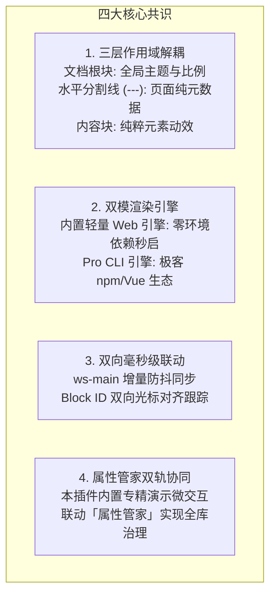
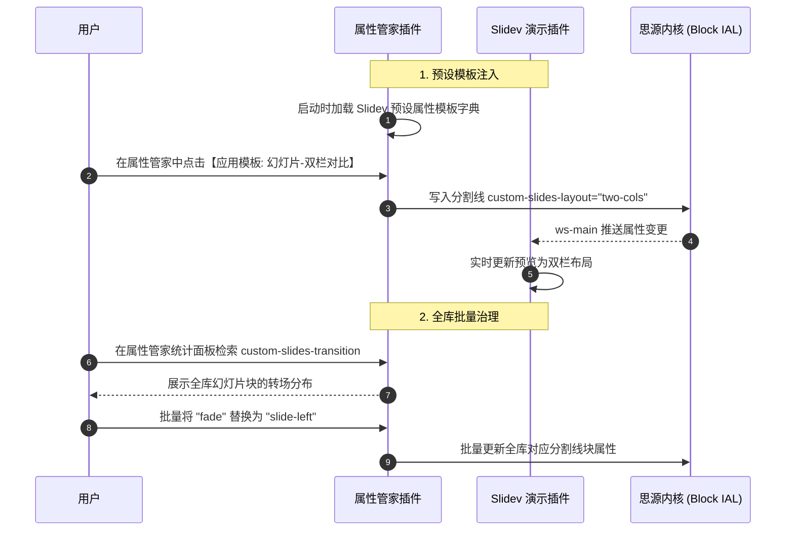

# 思源笔记即现插件：详细方案、实施进展与下一步研发计划

> 最近刷新：2026-10-26（对齐 v0.9.0 之后至 `6d091df` 的全部交付；工程测试基线 67 套件 / 608 项全绿）
> 工程结构与模块映射见 [project-structure](./project-structure.md)；重构全量日志见 [refactor-plan](./refactor-plan.md)。

---

## 1. 项目定位与核心设计共识

基于前期充分的可行性论证、Joplin/Obsidian 竞品调研及架构沟通，本项目确立了**"正文零污染、现代前端动效、毫秒级双向联动、分层双轨协同"**的终极设计共识：



---

## 2. 块属性协议字典与架构设计

插件统一采用具有命名空间隔离的 `custom-slides-*` 块属性字典（完整 30 项常量定义见 [技术规格定义](./技术规格定义.md)，与 `src/types/slides-protocol.ts` 逐一对齐），按作用域划分为：

1. **文档全局级（Document Scope）**：`theme`、`aspect-ratio`、`highlighter`、`default-transition`、`color-schema`、`spacing`；
2. **幻灯片页面级（Page Scope）**：`slide`、`layout`、`transition`、`background`、`image`、`notes`、`class`、`spacing`、`layout-ratio`、`mask` / `mask-ratio` / `mask-style` / `mask-initial`；
3. **元素动效级（Element Scope）**：`click`、`motion`、`shiki-lines`、`slot`、`note`、`role`、`max-height` 与视频四项（`autoplay` / `loop` / `muted` / `controls`）。

### 与「属性管家」（siyuan-property-manager）的协同架构（`src/synergy/`）



- **松耦合契约**：双方完全依托思源原生块属性 `custom-slides-*`，即使属性管家未安装或版本更新，Slidev 插件功能不受任何影响；
- **生态共赢**：为同时安装两款插件的用户提供"全库幻灯片全景资产盘点"与"一键批量重构"的能力。

---

## 3. 实施进展总览

状态标识：`[x]` 已完成并集成；`[-]` 部分实现；`[ ]` 未实施。

### 3.1 基础能力（已全部闭环）

- [x] **三层作用域块属性协议与编译管线**：`document-compiler.ts` 编排 AST 检索、IAL 解析、动态块引用与沙箱推送；`scope-mapper.ts` / `directive-wrapper.ts` 完成属性到 Frontmatter 与 `v-click` / `v-motion` / Shiki 指令的双向转换；
- [x] **分屏实时预览与毫秒级双向光标联动**：`SlidesPreviewTab` + `cursor-tracker` / `selection-mirror` 双向跟随；预览页签标题即现并与文档切换联动；
- [x] **右侧 Inspector 配置面板**：页面 / 块 / 全局三大子面板 + Actions 三领域模块（属性持久化 / 备注与 AI / 版式与元素指令），覆写属性三级查找工厂；
- [x] **版式体系**：封面 / 标准 / 双栏 / 表头多栏（`cols-header`，含组件级逐步呈现与级联防倒置调度）/ 四叶草（2×2 田字象限）/ 图左 / 图右 / 居中 / 大字报 / 介绍 / 引言；分栏自定义比例与超级块列宽自动识别；全局标题大小规范化；思源内置调色板与行内样式注入；间距风格三档；
- [x] **动效体系**：块级 `v-click` 步进（含表头多栏内组件级逐步呈现）、`v-motion` 入场微动效（slide-up / fade-in / zoom-in / bounce 预设循环）、Shiki 代码逐行聚光、页面动态蒙版分段展露（GPU 合成层毛玻璃）；
- [x] **放映交互**：键盘（方向键/空格/滚轮）、数字+回车直接跳页、`O` 键缩略图总览点选跳页、全屏、双屏演讲者视图（BroadcastChannel 同步、计时器、字号调节、讲稿批量追加/删除）；
- [x] **沉浸速览 (Peek) 子系统**：演示内外链、思源文档 Protyle 原位、本地 HTML 三类速览抽屉；桌面/移动端视口模拟、内网代理适配、SPA 站点跳页免重载；
- [x] **AI 赋能**：智能大纲断页建议（`auto-splitter.ts`）、AI 口播提词卡生成（`notes-generator.ts`，失败平滑降级启发式规则）；
- [x] **属性管家协同**：预设模板字典一键复制、全库转场分布统计、全库淡入淡出转场批量替换；
- [x] **离线导出**：单文件 HTML（Base64 资产内联 + 完整播放器：滚轮/跳页/总览/灯箱）与 16:9 / 4:3 / A4 高保真 PDF 讲义；
- [x] **外部 Slidev 项目导入**：`.md` / `.zip` / 粘贴源码三通道，预检统计、资产解包重写、HTML 展示容器智能剥离、导入后自动联动放映；
- [x] **Pro 模式**：标准 `slides.md` 导出与工作空间同步、本地 DevServer 探测、环境自动检测与临时工作区隔离。

### 3.2 工程质量（2026-10-06 ~ 10-25 三轮重构闭环）

- [x] **Phase 1 (RF-001~RF-010)**：编译编排、Inspector 面板、导入清洗、导出渲染等核心模块解耦；
- [x] **Phase 2 (RF-011~RF-015)**：PDF 样式、富列表渲染、YAML 解析、超级块扫描、导入弹窗业务解耦；
- [x] **Phase 3 (RF-016~RF-020)**：Inspector Actions 三领域分层、Dock 覆写查询收敛、离线播放器运行时 9 分节拆分（快照基线字节级一致）、预览页签标题服务、内核 API 死代码清理（`api.ts` 62 → 16 个在用导出，删除 `kernel.ts`）；
- [x] **编译链路性能治理**：消除编辑器事务驱动的编译放大与积压、逐容器/逐光标 N+1 内核往返，引入编译消费者门闩（预览与 Dock 全关闭时内核请求归零）、索引异步落库与排序键修正；
- [x] **测试基线**：67 个测试套件 / 608 项用例全绿，`npm run typecheck` 0 错误，`npm run build` 产物仅 `index.js`。

### 3.3 版本里程碑

| 版本 | 日期 | 主题 |
| :--- | :--- | :--- |
| v0.8.0 | 2026-10-06 | 表头多栏版式体系、分栏比例自定义、讲稿批量管理 |
| v0.9.0 | 2026-10-07 | 四叶草布局、播放器滚轮翻页与控制条优化 |
| （当前） | 2026-10-25 | 沉浸速览本地 HTML 与代理适配、动态蒙版分段展露、数字跳页与缩略图总览、Phase 3 重构闭环 |

---

## 4. 真实差距与未完成项剖析（Gap Analysis，2026-10-26 复核）

| 序号 | 差距领域 | 期望 | 代码库实际现状 | 影响面与严重度 |
| :---: | :--- | :--- | :--- | :--- |
| **1** | **KaTeX 公式与 Mermaid 图表真实渲染** | 对 KaTeX 公式与 Mermaid 图表进行预处理与真实排版 | `$formula$` 仍以 `<em>` 斜体降级呈现（`markdown-renderer.ts`），**未引入 KaTeX 排版引擎**；**Mermaid 未做识别与渲染** | **中高**：含复杂数学公式或流程图的文档无法保真展示。 |
| **2** | **块嵌入 (`{{select}}`) 与递归块引用展开** | 识别 `NodeBlockQueryEmbed` 并递归展开深层块树 | 仅通过 SQL 检索 `((id))` 块引用文本，未处理嵌入块、未递归展开 | **中**：嵌入查询块内容缺失。 |
| **3** | **PPTX 可编辑导出** | 基于 `pptxgenjs` 生成可编辑 `.pptx` | 未接入，无相关代码 | **低（P2）**：已有单文件 HTML 与 PDF 双通道兜底。 |
| **4** | **Pro 模式本地 DevServer 的纯前端环境限制** | 桌面端一键拉起官方 DevServer | 桌面端已具备 Node 子进程托管、端口分配与健康探活（`process-manager.ts` / `workspace-scaffolder.ts`）；纯浏览器/移动端仍无法 spawn 子进程，依赖用户本地预启动 CLI | **低**：已具备检测与降级提醒，向导 UI 可再优化。 |

> 已消除的历史差距（供对照）：`custom-slides-motion` 动效闭环（UI 预设循环 + 沙箱渲染 + 导出管线均已支持）；`custom-slides-class` / `highlighter` / `color-schema` 面板可视化配置；编译 N+1 与请求放大性能问题。

---

## 5. 下一步开发实施计划（Sprints & Milestones）

### Sprint A：核心渲染补齐（P0）

- [ ] **Task A.1：集成 KaTeX 轻量公式渲染引擎**
  - 在内置沙箱与 `markdown-renderer.ts` 引入 KaTeX 预编译 bundle，解析行内 `$...$` 与块级 `$$...$$` 生成矢量排版；
  - 单文件 HTML 与 PDF 导出同步内联 KaTeX 样式与字体。
- [ ] **Task A.2：集成 Mermaid 流程图与时序图渲染**
  - 编译器识别 ```` ```mermaid ```` 代码块并标记为图表节点；
  - 沙箱加载 Mermaid.js 实现流程图 / 时序图即时渲染，导出端同步支持。

### Sprint B：深层数据融合（P1）

- [ ] **Task B.1：块嵌入与递归块引用展开**
  - `block-ref-resolver.ts` 增加 `{{select ...}}` 嵌入块识别，接入 `/api/block/getBlockKramdown` 递归展开；
  - 增加嵌入块数据溯源与刷新监听。

### Sprint C：生态交付（P2）

- [ ] **Task C.1：PPTX 可编辑幻灯片导出**：接入 `pptxgenjs`，基于 `ISlidesVirtualPage` 模型一键生成可编辑 `.pptx`；
- [ ] **Task C.2：Pro 模式 DevServer 引导向导优化**：一键复制终端命令、实时探活自动连入；
- [ ] **Task C.3：社区主题预置与集市上架**：预置热门开源 Slidev 主题样式，更新版本号至 v1.0.0 并提交思源官方集市。

### 观察项（不排期）

- `SlidesPreviewTab.vue` (820 行) 与 `WebviewPeekDrawer.vue` (961 行) 体量偏大但内聚良好，待功能稳定后评估是否进一步拆分；
- 表头多栏 / 蒙版 / 速览等新特性待真实演讲场景反馈后再迭代交互细节。
