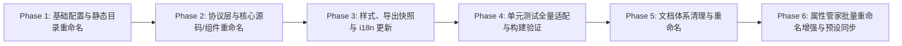

# 插件重命名（`siyuan-live-slides`）与全链路重构分析及实施计划

> **文档状态**：待评审确认  
> **适用仓库**：`siyuan-live-slides`（原 `siyuan-slidev`） & 协同插件 `siyuan-property-manager`（属性管家）  
> **核心策略**：零历史兼容包袱、彻底清理旧名称痕迹、通过属性管家（`siyuan-property-manager`）通用批量重命名能力完成少量测试文档迁移。

---

## 一、背景与总体目标

本项目正式名称由 `siyuan-slidev` 更名为 **`siyuan-live-slides`**。鉴于插件尚未正式公开发布，仅存在少量内部测试文档，本次重构遵循**“一步到位、零冗余兼容代码”**原则：

1. **插件标识与品牌全面焕新**：
   - 插件包名 / 仓库名：`siyuan-slidev` $\rightarrow$ **`siyuan-live-slides`**
   - 中文展示名：保持 **“即现”**（全称“即现演示” / “思源笔记即现演示插件”）
   - 英文展示名：`SiyuanSlidev` $\rightarrow$ **`Live Slides`**（全称 `SiYuan Live Slides`）
2. **自定义块属性（IAL）命名空间彻底切换**：
   - 所有块级、分页级、文档级属性前缀由 `custom-slidev-*` 统一改为 **`custom-slides-*`**（短属性名由 `slidev-*` 统一改为 **`slides-*`**）。
   - 插件源码内**不保留**任何 `custom-slidev-*` 回退读取或历史迁移代码。
3. **运行时、文件名、符号与样式彻底去 `slidev` 化（保留外部生态协议边界）**：
   - 静态目录、源码文件名、Vue 组件名、TypeScript 类型接口、BroadcastChannel / postMessage 通信标识、思源 Dock/Tab 类型、CSS 类名与变量全部切换为 `slides` 命名空间。
   - **严格区分“插件自身”与“外部 Slidev 生态”**：凡指代本插件自身的文案、类名与配置一律使用“即现 / Live Slides / `slides`”；凡指代外部官方 Slidev CLI、导出/导入标准 Slidev `.md` 语法或 Pro 模式桥接协议的，保留 `Slidev` 专有名词与底层协议兼容。
4. **存量测试文档通过 `siyuan-property-manager`（属性管家）迁移**：
   - 在 `D:\MyCodingProjects\siyuan-property-manager` 的**“笔记本自定义属性统计”**面板中补齐**单属性名重命名**与**按前缀批量替换属性名**（如 `custom-slidev-` $\rightarrow$ `custom-slides-`）能力，并同步更新属性管家内置的即现演示预设模板。

---

## 二、品牌文案与技术协议边界规范

为防止全局机械替换破坏外部工具链兼容性，特明确以下“改”与“留”的边界准则：

| 场景分类 | 处置原则 | 变更前示例 | 变更后标准 |
| :--- | :--- | :--- | :--- |
| **插件自身标识與目录** | **必须替换** | `siyuan-slidev`、`public/slidev-client` | `siyuan-live-slides`、`public/slides-client` |
| **插件中英文 UI 名称** | **必须替换** | `Slidev 演示配置`、`SiyuanSlidev` | `即现演示配置`、`Live Slides` |
| **块属性（IAL）与短键名** | **必须替换** | `custom-slidev-layout`、`slidev-layout` | `custom-slides-layout`、`slides-layout` |
| **内部类名 / CSS 变量 / IPC** | **必须替换** | `.spm-slidev-*`、`--slidev-font-sans`、`siyuan-slidev-sync` | `.spm-slides-*`、`--slides-font-sans`、`siyuan-slides-sync` |
| **源码文件 / 组件 / TS 接口** | **必须替换** | `SlidevPreviewTab.vue`、`ISlidevPageMeta` | `SlidesPreviewTab.vue`、`ISlidesPageMeta` |
| **外部 Slidev 生态互操作文案** | **保留 `Slidev`** | `导入 Slidev 演示文档 (.md / .zip)`、`Pro 模式: 桥接本地 Slidev CLI` | **保持不变**（准确反映与外部 Slidev 生态的互操作关系） |
| **Pro 模式生成的官方 Slidev 协议** | **保留官方协议** | `@slidev/cli`、Vue 布局模板内的 `.slidev-layout`、`--slidev-theme-primary`、`target: "slidev"` | **保持不变**（由外部 `@slidev/cli` 渲染引擎及官方嵌入式通信协议决定） |

---

## 三、`siyuan-live-slides` 全链路变更详细清单

### 3.1 项目元数据、构建脚本与 GitHub 配置

| 文件路径 | 具体变更项 | 变更前 | 变更后 |
| :--- | :--- | :--- | :--- |
| `plugin.json` | `name` | `"siyuan-slidev"` | `"siyuan-live-slides"` |
| `plugin.json` | `url` | `"https://github.com/famotime/siyuan-slidev"` | `"https://github.com/famotime/siyuan-live-slides"` |
| `plugin.json` | `displayName.default` / `en` | `"SiyuanSlidev"` | `"Live Slides"` |
| `plugin.json` | `displayName.zh-CN` | `"即现"` | `"即现"`（保持不变） |
| `plugin.json` | `description.en` | `"Block-based Slidev presentation plugin..."` | `"Block-based live presentation plugin for SiYuan Note..."` |
| `plugin.json` | `keywords` | `["slidev", "presentation", ...]` | `["live-slides", "slides", "slidev", "presentation", ...]` |
| `package.json` | `name` | `"siyuan-slidev"` | `"siyuan-live-slides"` |
| `package.json` | `homepage` / `repository` | `famotime/siyuan-slidev` | `famotime/siyuan-live-slides` |
| `vite.config.ts` | 开发环境本地插件同步路径 | `"D:/SiYuan_data/data/plugins/siyuan-slidev"` | `"D:/SiYuan_data/data/plugins/siyuan-live-slides"` |
| `vite.config.ts` | 静态资源拷贝目标 | `src: "./public/slidev-client/**"`, `dest: "./slidev-client/"` | `src: "./public/slides-client/**"`, `dest: "./slides-client/"` |
| `scripts/worktree.mjs` | 控制台 Banner 与示例分支名 | `SiYuan Slidev — Git Worktree...`、`feat/slidev-importer` | `SiYuan Live Slides — Git Worktree...`、`feat/slides-importer` |
| `.github/workflows/release.yml` | 工作流检查 | 使用通用 `package.zip` 与 `CHANGELOG.md` | 无需改逻辑；GitHub 仓库重命名后自动生效 |

> [!IMPORTANT]
> **GitHub 与本地环境外部操作提示**：
> 1. 在 GitHub 仓库 Settings 中将仓库名由 `famotime/siyuan-slidev` 改为 `famotime/siyuan-live-slides`。
> 2. 本地执行 `git remote set-url origin https://github.com/famotime/siyuan-live-slides.git` 更新远程地址。
> 3. 本地思源笔记插件目录 `D:/SiYuan_data/data/plugins/siyuan-slidev` 建议删除或重命名为 `siyuan-live-slides`。

---

### 3.2 自定义块属性（IAL）字典全量迁移（`custom-slidev-*` $\rightarrow$ `custom-slides-*`）

核心协议文件 `src/types/slides-protocol.ts`（原 `slidev-protocol.ts`）及各编译器、同步器、UI 组件中的全部自定义属性键名统一替换如下：

#### （1）文档级属性（绑定于文档根块 `NodeDocument`）

| 常量名 | 旧属性名（废弃） | 新属性名 | 用途说明 |
| :--- | :--- | :--- | :--- |
| `ATTR_DOC_THEME` | `custom-slidev-theme` | `custom-slides-theme` | 全局演示主题 |
| `ATTR_DOC_ASPECT_RATIO` | `custom-slidev-aspect-ratio` | `custom-slides-aspect-ratio` | 画布宽高比（如 `16/9`） |
| `ATTR_DOC_TRANSITION` | `custom-slidev-default-transition` | `custom-slides-default-transition` | 全局默认转场动画 |
| `ATTR_DOC_DRAWINGS` | `custom-slidev-drawings` | `custom-slides-drawings` | 画笔标注开关 |
| `ATTR_DOC_PAGINATION` | `custom-slidev-pagination` | `custom-slides-pagination` | 全局页码显示控制 |
| `ATTR_DOC_SPACING` | `custom-slidev-spacing` | `custom-slides-spacing` | 全局排版间距档位 |
| `ATTR_DOC_FONT_SANS` | `custom-slidev-font-sans` | `custom-slides-font-sans` | 正文字体族 |
| `ATTR_DOC_FONT_MONO` | `custom-slidev-font-mono` | `custom-slides-font-mono` | 代码等宽字体族 |
| `ATTR_DOC_TITLE_SIZE` | `custom-slidev-title-size` | `custom-slides-title-size` | 标题字号缩放 |
| `ATTR_DOC_BODY_SIZE` | `custom-slidev-body-size` | `custom-slides-body-size` | 正文字号缩放 |
| `ATTR_DOC_COLOR_PRIMARY` | `custom-slidev-color-primary` | `custom-slides-color-primary` | 主题强调色覆盖 |
| `ATTR_DOC_COLOR_BG` | `custom-slidev-color-bg` | `custom-slides-color-bg` | 幻灯片背景色覆盖 |
| `ATTR_DOC_COLOR_TEXT` | `custom-slidev-color-text` | `custom-slides-color-text` | 正文文字颜色覆盖 |
| `ATTR_DOC_CUSTOM_CSS` | `custom-slidev-custom-css` | `custom-slides-custom-css` | 全局自定义 CSS 规则 |

#### （2）单页级属性（绑定于分页符 `---`、章节标题块或首块）

| 常量名 | 旧属性名（废弃） | 新属性名 | 用途说明 |
| :--- | :--- | :--- | :--- |
| `ATTR_PAGE_LAYOUT` | `custom-slidev-layout` | `custom-slides-layout` | 单页布局模式 |
| `ATTR_PAGE_TRANSITION` | `custom-slidev-transition` | `custom-slides-transition` | 单页转场动画 |
| `ATTR_PAGE_BG` | `custom-slidev-background` | `custom-slides-background` | 单页背景图/色 |
| `ATTR_PAGE_BG_OPACITY` | `custom-slidev-bg-opacity` | `custom-slides-bg-opacity` | 背景遮罩透明度 |
| `ATTR_PAGE_CLASS` | `custom-slidev-class` | `custom-slides-class` | 单页附加 CSS 类 |
| `ATTR_PAGE_CLICKS` | `custom-slidev-clicks` | `custom-slides-clicks` | 单页显式总步数覆盖 |
| `ATTR_PAGE_SPACING` | `custom-slidev-page-spacing` | `custom-slides-page-spacing` | 单页独立排版间距覆盖 |
| `ATTR_PAGE_NOTES` | `custom-slidev-notes` | `custom-slides-notes` | 分页符携带的演讲者备注 |

#### （3）块级与元素级属性（绑定于普通内容块、列表项、代码块、媒体块）

| 常量名 / 属性用途 | 旧属性名（废弃） | 新属性名 | 涉及核心模块 |
| :--- | :--- | :--- | :--- |
| `ATTR_ELEM_CLICK` | `custom-slidev-click` | `custom-slides-click` | `slides-protocol.ts`、`scope-mapper.ts` |
| `ATTR_ELEM_MOTION` | `custom-slidev-motion` | `custom-slides-motion` | `slides-protocol.ts`、`directive-wrapper.ts` |
| `ATTR_ELEM_SLOT` | `custom-slidev-slot` | `custom-slides-slot` | `slides-protocol.ts`、`list-column-scanner.ts` |
| `ATTR_ELEM_ROLE` | `custom-slidev-role` | `custom-slides-role` | `slides-protocol.ts`、`scope-mapper.ts` |
| `ATTR_ELEM_LINES` | `custom-slidev-lines` | `custom-slides-lines` | `slides-protocol.ts`、`directive-wrapper.ts` |
| `ATTR_ELEM_LIST_FORMAT` | `custom-slidev-list-format` | `custom-slides-list-format` | `slides-protocol.ts`、`visual-list-renderer.ts` |
| `ATTR_ELEM_MASK` | `custom-slidev-mask` | `custom-slides-mask` | `slides-protocol.ts`、`directive-wrapper.ts` |
| `ATTR_VIDEO_AUTOPLAY` | `custom-slidev-autoplay` | `custom-slides-autoplay` | `slides-protocol.ts`、`markdown-renderer.ts` |
| `ATTR_VIDEO_LOOP` | `custom-slidev-loop` | `custom-slides-loop` | `slides-protocol.ts`、`markdown-renderer.ts` |
| `ATTR_VIDEO_MUTED` | `custom-slidev-muted` | `custom-slides-muted` | `slides-protocol.ts`、`markdown-renderer.ts` |
| 演讲者备注块标记 | `custom-slidev-note="true"` | `custom-slides-note="true"` | `scope-mapper.ts`、`slides-importer.ts`、`command-registry.ts`、`useInspectorActions.ts` |
| 外部代码切片引用路径 | `custom-slidev-src` | `custom-slides-src` | `slides-importer.ts`、`asset-importer.ts` |
| 通用前置过滤与透传 | `startsWith("custom-slidev-")` | `startsWith("custom-slides-")` | `scope-mapper.ts`、`dom-attr-sync.ts`、`slides-importer.ts` |
| 短属性名映射兼容 | `slidev-note` / `slidev-role` / `slidev-background` / `slidev-layout` / `slidev-click` / `slidev-clicks` | `slides-note` / `slides-role` / `slides-background` / `slides-layout` / `slides-click` / `slides-clicks` | `scope-mapper.ts`、`preset-templates.ts` |
| 编辑器内视觉徽章选择器 | `[custom-slidev-layout]` 等 | `[custom-slides-layout]` 等 | `src/index.scss` |

---

### 3.3 运行时标识、存储路径、通信信道与 UI 组件注册标识

| 类别 | 所在文件 | 变更前 | 变更后 |
| :--- | :--- | :--- | :--- |
| **配置文件名** | `src/settings.ts` | `'slidev-config.json'` | `'slides-config.json'` |
| **SVG 图标 ID** | `src/index.ts`, `command-registry.ts`, `SlidesPreviewTab.vue` | `id="iconSlidev"` / `icon: "iconSlidev"` | `id="iconSlides"` / `icon: "iconSlides"` |
| **Dock / Tab 类型** | `src/index.ts` | `DOCK_TYPE = "slidev-dock"` `TAB_TYPE = "slidev-preview-tab"` `PRESENTER_TAB_TYPE = "slidev-presenter-tab"` | `DOCK_TYPE = "slides-dock"` `TAB_TYPE = "slides-preview-tab"` `PRESENTER_TAB_TYPE = "slides-presenter-tab"` |
| **顶栏按钮 ID** | `src/index.ts` | `id: "slidev-topbar-play"` | `id: "slides-topbar-play"` |
| **内部自定义事件** | `src/index.ts`, `command-registry.ts`, `SlidesInspectorDockView.vue` | `"slidev:request-compile"` `"slidev:block-clicked"` | `"slides:request-compile"` `"slides:block-clicked"` |
| **Web 沙箱静态路径** | `src/index.ts`, `SlidesPreviewTab.vue`, `image-exporter.ts` | `"/plugins/siyuan-slidev/slidev-client/index.html"` | `"/plugins/siyuan-live-slides/slides-client/index.html"` |
| **大屏弹窗句柄名** | `src/index.ts` | `"SlidevBigScreenWindow"` | `"SlidesBigScreenWindow"` |
| **Petal 存储路径** | `command-registry.ts`, `cli-devserver-bridge.ts`, `workspace-scaffolder.ts` | `"/data/storage/petal/siyuan-slidev/slides.md"` `"/data/storage/petal/siyuan-slidev/pro-workspace"` | `"/data/storage/petal/siyuan-live-slides/slides.md"` `"/data/storage/petal/siyuan-live-slides/pro-workspace"` |
| **Pro 临时工作区目录** | `src/engine/runtime-node.ts`, `workspace-scaffolder.ts` | `"siyuan-slidev-pro"` `"siyuan-slidev-pro-workspace"` | `"siyuan-live-slides-pro"` `"siyuan-live-slides-pro-workspace"` |
| **BroadcastChannel** | `src/main.ts`, `SlidesPresenterTab.vue`, `public/slides-client/*.html` | `'siyuan-slidev-sync'` | `'siyuan-slides-sync'` |
| **IPC Message Source** | `src/types/ipc-messages.ts`, `web-sandbox-bridge.ts`, `workspace-scaffolder.ts`, `public/slides-client/index.html` | `"siyuan-slidev-host"` `"siyuan-slidev-client"` | `"siyuan-slides-host"` `"siyuan-slides-client"` |
| **属性管家深链标记** | `src/synergy/property-manager-bridge.ts` | `source: "siyuan-slidev"` | `source: "siyuan-live-slides"` |

---

### 3.4 目录、源码文件、组件与 TypeScript 符号重命名

#### （1）静态目录与源码/测试文件重命名对照表

| 原路径 | 新路径 | 说明 |
| :--- | :--- | :--- |
| `public/slidev-client/` | `public/slides-client/` | 内置零依赖 Web 演示沙箱静态目录（含 `index.html`、`presenter.html`） |
| `src/types/slidev-protocol.ts` | `src/types/slides-protocol.ts` | 核心数据协议与块属性字典 |
| `src/compiler/slidev-ast-builder.ts` | `src/compiler/slides-ast-builder.ts` | AST 构建器 |
| `src/compiler/slidev-importer.ts` | `src/compiler/slides-importer.ts` | 外部 Slidev Markdown 逆向解析与导入器 |
| `src/engine/native-slidev-bridge.ts` | `src/engine/native-slides-bridge.ts` | 本地 Slidev CLI 嵌入式通信桥 |
| `src/ui/components/SlidevIcon.vue` | `src/ui/components/SlidesIcon.vue` | 图标组件 |
| `src/ui/components/SlidevImportDialog.vue` | `src/ui/components/SlidesImportDialog.vue` | 导入弹窗组件 |
| `src/ui/components/useSlidevImport.ts` | `src/ui/components/useSlidesImport.ts` | 导入流程 Composable |
| `src/ui/dock/SlidevInspectorDockView.vue` | `src/ui/dock/SlidesInspectorDockView.vue` | 右侧属性检查器 Dock 主视图 |
| `src/ui/tab/SlidevPresenterTab.vue` | `src/ui/tab/SlidesPresenterTab.vue` | 演讲者控制台 Tab 视图 |
| `src/ui/tab/SlidevPreviewTab.vue` | `src/ui/tab/SlidesPreviewTab.vue` | 分屏实时预览 Tab 视图 |
| `tests/native-slidev-bridge.test.ts` | `tests/native-slides-bridge.test.ts` | 对应单元测试文件重命名 |
| `tests/slidev-client-scripts.test.ts` | `tests/slides-client-scripts.test.ts` | 对应单元测试文件重命名 |
| `tests/use-slidev-import.test.ts` | `tests/use-slides-import.test.ts` | 对应单元测试文件重命名 |

#### （2）主要导出类、接口、常量与函数重命名对照表

| 原符号名 | 新符号名 | 所在模块 |
| :--- | :--- | :--- |
| `SiyuanSlidevPlugin` | `SiyuanLiveSlidesPlugin` | `src/index.ts` |
| `ICON_SLIDEV_SVG` | `ICON_SLIDES_SVG` | `src/index.ts` |
| `SlidevGlobalSettings` | `SlidesGlobalSettings` | `src/settings.ts` |
| `ISlidevGlobalConfig` / `ISlidevPageMeta` / `ISlidevElementDirective` / `ISlidevSlideBlock` / `ISlidevPresentation` / `SlidevSpacingLevel` / `SlidevMaskType` | `ISlidesGlobalConfig` / `ISlidesPageMeta` / `ISlidesElementDirective` / `ISlidesSlideBlock` / `ISlidesPresentation` / `SlidesSpacingLevel` / `SlidesMaskType` | `src/types/slides-protocol.ts` |
| `buildSlidevAst` | `buildSlidesAst` | `src/compiler/slides-ast-builder.ts` |
| `parseSlidevPresentation` / `ISlidevImportedSlide` / `ISlidevImportResult` | `parseSlidesPresentation` / `ISlidesImportedSlide` / `ISlidesImportResult` | `src/compiler/slides-importer.ts` |
| `useSlidevImport` | `useSlidesImport` | `src/ui/components/useSlidesImport.ts` |
| `NativeSlidevBridge` | `NativeSlidesBridge` | `src/engine/native-slides-bridge.ts` |
| `SLIDEV_PRESET_TEMPLATES` / `getSlidevPresetTemplates` | `SLIDES_PRESET_TEMPLATES` / `getSlidesPresetTemplates` | `src/synergy/preset-templates.ts` |
| `SlidevIconName` | `SlidesIconName` | `src/ui/components/SlidesIcon.vue` |

---

### 3.5 CSS 样式类名、Data 属性与 CSS 变量重命名

| 作用范围 | 变更前 | 变更后 | 涉及文件 |
| :--- | :--- | :--- | :--- |
| **UI 面板与检查器类名** | `.spm-slidev-*`（如 `.spm-slidev-dock`、`.spm-slidev-tab-root`、`.spm-slidev-presenter-root`、`.spm-slidev-import-*`、`.spm-slidev-peek-*`） | `.spm-slides-*`（如 `.spm-slides-dock`、`.spm-slides-tab-root`、`.spm-slides-presenter-root`、`.spm-slides-import-*`、`.spm-slides-peek-*`） | `src/index.scss`、`src/ui/**/*.vue`、`src/plugin/command-registry.ts` |
| **图标组件类名** | `.slidev-icon` | `.slides-icon` | `src/ui/components/SlidesIcon.vue`、`src/index.scss` |
| **主题样式与 Data 属性** | `.slidev-theme-${id}` `data-slidev-theme` `data-slidev-spacing` `--slidev-font-sans` / `--slidev-font-mono` `--slidev-title-size` / `--slidev-body-size` `--slidev-color-primary` / `--slidev-color-bg` / `--slidev-color-text` | `.slides-theme-${id}` `data-slides-theme` `data-slides-spacing` `--slides-font-sans` / `--slides-font-mono` `--slides-title-size` / `--slides-body-size` `--slides-color-primary` / `--slides-color-bg` / `--slides-color-text` | `src/compiler/theme-styles-generator.ts`、`public/slides-client/index.html`、`src/export/standalone-template-styles.ts`、`src/export/standalone-client-runtime.ts`、`src/export/pdf-template-styles.ts`、`src/export/single-html-exporter.ts`、`src/export/pdf-exporter.ts` |
| **编译器生成的内容辅助类** | `.slidev-page-first-heading-block` `data-slidev-first-heading` `.slidev-col-first-heading-block` `data-slidev-col-first-heading` `.slidev-ref-tag` / `.slidev-block-ref` `.slidev-motion-*` / `.slidev-mask-*` | `.slides-page-first-heading-block` `data-slides-first-heading` `.slides-col-first-heading-block` `data-slides-col-first-heading` `.slides-ref-tag` / `.slides-block-ref` `.slides-motion-*` / `.slides-mask-*` | `src/compiler/directive-wrapper.ts`、`src/compiler/block-ref-resolver.ts`、`src/export/markdown-renderer.ts`、`src/export/slide-layout-renderer.ts`、`src/export/standalone-template-styles.ts`、`src/export/pdf-template-styles.ts`、`public/slides-client/index.html` |

> [!WARNING]
> **切勿误改的 Pro 模式专属选择器**：
> - `src/engine/workspace-scaffolder.ts` 中生成的 Vue 布局组件（`COLS_HEADER_LAYOUT_VUE`、`THREE_COLS_HEADER_LAYOUT_VUE`、`CLOVER_LAYOUT_VUE`）内的 `.slidev-layout` 是官方 `@slidev/cli` 主题引擎规定的根容器类名，**必须保留为 `.slidev-layout`**。
> - `src/engine/cli-devserver-bridge.ts` 中 `buildStandardSlidevMarkdown()` 为官方 Slidev CLI 生成的 `--slidev-theme-primary` 与 `.slidev-layout` CSS 变量/选择器**必须保留**，以保证 Pro 模式下官方主题正常着色。
> - `tests/standalone-runtime-sections.test.ts` 包含对独立 HTML 导出样式与客户端脚本的精确快照比对（`toMatchInlineSnapshot`），在修改完 `standalone-template-styles.ts` 与 `standalone-client-runtime.ts` 后，需同步更新该测试文件中的快照基线。

---

### 3.6 国际化（i18n）与 UI 交互文案更新

1. **`src/i18n/zh_CN.json`**：
   - 将指代本插件自身的 `"Slidev"` 统一改为 **`"即现"`** 或 **`"即现演示"`**：
     - `"title": "即现演示"`
     - `"openPreview": "打开即现分屏实时预览"`
     - `"toggleInspector": "打开/关闭 即现属性检查器"`
     - `"compileCurrentDoc": "重新编译当前文档到即现演示"`
     - `"emptyStateTitle": "即现幻灯片配置"`
     - `"settings.title": "即现演示引擎全局设置"`
     - `"commands.*"` 中指代插件动作的描述统一由 `Slidev` 改为 `即现`
   - 保留指代外部生态的描述：
     - `"engineModePro": "Pro 模式: 桥接本地 Slidev CLI"`
     - `"importSlidevDoc": "导入 Slidev 演示文档 (.md / .zip)"`
     - `"exportMarkdown": "导出标准 Slidev Markdown"`
2. **`src/i18n/en_US.json`**：
   - 将指代本插件自身的 `"Slidev"` 统一改为 **`"Live Slides"`**：
     - `"title": "Live Slides"`
     - `"openPreview": "Open Live Slides Split-Screen Preview"`
     - `"toggleInspector": "Toggle Live Slides Property Inspector"`
     - `"compileCurrentDoc": "Recompile Current Document to Live Slides"`
     - `"emptyStateTitle": "Live Slides Configuration"`
     - `"settings.title": "Live Slides Global Settings"`

---

### 3.7 文档体系清理与重命名清单

#### （1）根目录与核心规范文档更新
- `README.md` / `README_zh_CN.md`：更新仓库名、安装说明、架构图、块属性前缀说明（`custom-slides-*`）、特性介绍。
- `AGENTS.md`：更新项目概览、模块文件路径对照（`slides-*.ts` / `Slides*.vue`）、块属性前缀（`custom-slides-*`）及测试说明。
- `docs/README.md`、`docs/USER-GUIDE.md`、`docs/USER-GUIDE.zh-CN.md`、`docs/project-structure.md`、`docs/技术规格定义.md`：全量同步新插件名 `siyuan-live-slides`、属性前缀 `custom-slides-*` 与最新文件结构。

#### （2）`docs/` 目录下设计文档重命名与内容修订

| 原文件名 | 新文件名 | 内容处置 |
| :--- | :--- | :--- |
| `docs/SiYuan Slidev Pro 模式系统配置与用户指南.md` | `docs/思源笔记即现演示插件 (siyuan-live-slides) Pro 模式系统配置与用户指南.md` | 重命名并更新文中插件路径与属性名 |
| `docs/思源笔记 Slidev 块级双模插件：统一工程实施蓝图（终极整合版）.md` | `docs/思源笔记即现演示插件 (siyuan-live-slides)：统一工程实施蓝图（终极整合版）.md` | 重命名并更新文中 `siyuan-slidev` 与 `custom-slidev-*` |
| `docs/思源笔记 Slidev 插件与属性管家 (siyuan-property-manager) 协同联动实施方案.md` | `docs/思源笔记即现演示插件 (siyuan-live-slides) 与属性管家协同联动实施方案.md` | 重命名并更新文中属性前缀与模板键名 |
| `docs/思源笔记 Slidev 演示插件：全链路实现方案与详细任务清单.md` | `docs/思源笔记即现演示插件 (siyuan-live-slides)：全链路实现方案与详细任务清单.md` | 重命名并更新文中插件标识与属性名 |
| `docs/思源笔记 Slidev 演示插件：高阶工程细节与边界补完方案.md` | `docs/思源笔记即现演示插件 (siyuan-live-slides)：高阶工程细节与边界补完方案.md` | 重命名并更新文中插件标识与属性名 |
| `docs/思源笔记集成 Slidev 深度可行性研究与架构设计报告.md` | `docs/思源笔记即现演示插件 (siyuan-live-slides) 深度可行性研究与架构设计报告.md` | 重命名并更新文中插件标识与属性名 |
| `docs/其他补充细节.md`、`docs/外部Slidev项目逆向导入思源笔记全链路设计方案.md` 等其余插件文档 | 文件名保持不变 | 将文中涉及本插件的 `siyuan-slidev`、`custom-slidev-*` 全部更新为 `siyuan-live-slides`、`custom-slides-*` |
| `docs/Slidev项目文件结构.md`、`docs/Slidev 演示文稿运行与效果查看实战指南（基于 Slidev 仓库示例）.md` | **文件名与内容保持不变** | 纯外部官方 Slidev 框架调研参考资料，不改动 |

---

## 四、存量测试文档属性迁移方案（基于 `siyuan-property-manager` 属性管家）

### 4.1 方案设计背景

经过对 `D:\MyCodingProjects\siyuan-property-manager` 源码的核查：
1. 属性管家的 `SchemaManager.vue`（元数据定义管理）虽已具备单属性重命名函数 `rewriteAttrKeyOnBlocks(oldKey, newKey)`，但仅限已登记到 Schema 的属性。
2. 属性管家的 **`NotebookAttrStats.vue`（统计 $\rightarrow$ 笔记本自定义属性统计）** 能够直接扫描笔记本或全工作空间中所有实际存在的 `custom-*` 属性，但目前仅支持**修改属性值**（`batchEditAttr`）和**清空属性**（`batchDeleteAttr`），**缺少直接修改属性名（Key）及按前缀批量重命名属性名的功能**。
3. 此外，思源笔记内核 API `/api/attr/setBlockAttrs` 在接收 `{ [newKey]: val, [oldKey]: "" }` 时，会自动更新块 DOM 与 `.sy` 文档中的 IAL（包括标题块、分割线 `---`、列表项、代码块以及带有 `{: custom-slidev-note="true"}` 的演讲者备注块）。

因此，在 `siyuan-property-manager` 中补齐**“单属性名重命名”**与**“按前缀批量替换属性名”**，不仅能一键完成本次 `custom-slidev-*` $\rightarrow$ `custom-slides-*` 的测试文档迁移，还能作为属性管家的核心通用能力长期沉淀。

---

### 4.2 `siyuan-property-manager` 改造清单

#### （1）底层数据与批量执行层：`src/composables/useNotebookAttrStats.ts`
- **新增 `batchRenameAttrKey(boxId: string, oldAttrName: string, newAttrName: string)`**：
  1. 规范化校验：确保 `oldAttrName` 与 `newAttrName` 均以 `custom-` 开头（若用户输入不含 `custom-` 则自动补齐），且新旧名称不同、合法（匹配 `/^custom-[a-zA-Z0-9_-]+$/`）。
  2. 通过 SQL 查询目标笔记本（或全工作空间）下所有持有 `oldAttrName` 的块 ID（突破单次分页限制，循环或上限拉取全部匹配 `block_id`）。
  3. 逐块调用 `getBlockAttrs(blockId)` 获取原属性值 `val`，再调用 `setBlockAttrs(blockId, { [newAttrName]: val, [oldAttrName]: "" })` 原地完成属性键迁移。
  4. 返回成功迁移的块数量，并触发统计列表刷新与撤销栈记录。
- **新增 `batchReplaceAttrKeyPrefix(boxId: string, oldPrefix: string, newPrefix: string)`**：
  1. 扫描当前统计结果 `attrSummaryList` 中所有以 `oldPrefix`（如 `custom-slidev-` 或 `slidev-`）开头的属性项。
  2. 逐个计算新属性名 `newAttrName`，依次调用 `batchRenameAttrKey` 完成全量替换，汇总迁移的属性种类数与受影响块总数。

#### （2）视图交互层：`src/components/NotebookAttrStats.vue`
- **功能点 A：单属性卡片头部增加「重命名属性名」按钮**：
  - 在每个属性卡片右上角操作区（紧邻“删除该属性”按钮旁）新增**“重命名属性名 (Rename Key)”**编辑按钮与内联输入框（或轻量弹窗），支持将该卡片对应的 `custom-xxx` 键名一键改为新键名。
- **功能点 B：顶部工具栏增加「批量替换属性名前缀」操作**：
  - 在 `NotebookAttrStats.vue` 的筛选/批量操作工具栏中新增**“前缀重命名”**按钮，展开后提供：
    - 原前缀输入（例如：`slidev-` 或 `custom-slidev-`）
    - 新前缀输入（例如：`slides-` 或 `custom-slides-`）
    - 实时预览当前笔记本下匹配到的属性个数与涉及块总数（如匹配到 `slidev-layout`、`slidev-theme` 等 $N$ 项属性，共 $M$ 个块），点击确认后一键完成批量迁移。

#### （3）预设模板与国际化同步：`src/constants/presetTemplates.ts` & `src/i18n/*.json`
- 将 `src/constants/presetTemplates.ts` 中的 `SLIDEV_PRESET_TEMPLATES` 重命名为 `SLIDES_PRESET_TEMPLATES`（保留别名导出以防内部引用报错），将其中的预设模板 ID 与属性键名全部由 `slidev-*` 更新为 **`slides-*`**（如 `slides-layout`、`slides-transition`、`slides-background`、`slides-click`、`slides-theme` 等）。
- 更新 `src/i18n/zh_CN.json` 与 `src/i18n/en_US.json` 中的预设模板文案及新增的“重命名属性名 / 批量前缀重命名”国际化词条。

---

### 4.3 存量测试文档迁移操作步骤

完成上述修改并构建两个插件后，按以下步骤即可在 1 分钟内完成所有测试文档迁移：
1. 打开思源笔记，进入**属性管家 (`siyuan-property-manager`)** $\rightarrow$ **统计** $\rightarrow$ **笔记本自定义属性统计**。
2. 选择存放演示测试文档的笔记本（或选择“全部笔记本”）。
3. 点击工具栏中的**“前缀重命名”**，输入原前缀 `slidev-`、新前缀 `slides-`，预览无误后点击**执行替换**（思源内核会自动处理所有文档块、分页块、列表项及备注块上的 `custom-slidev-*` $\rightarrow$ `custom-slides-*`）。
4. 如属性管家已导入旧版即现预设模板，可在属性管家 **Schema 定义管理** 中重新一键导入最新的“即现演示 (`slides-*`)”预设模板。

---

## 五、分阶段实施计划（Execution Phases）

为确保大规模重命名过程零遗漏、零回归，确认本方案后将按以下 6 个阶段有序执行：

### Phase 1：项目元数据、构建配置与静态目录重命名
- 修改 `plugin.json`、`package.json`、`vite.config.ts`、`scripts/worktree.mjs`。
- 将 `public/slidev-client/` 移动并重命名为 `public/slides-client/`，更新内部 `index.html` 与 `presenter.html` 中的 `BroadcastChannel`、`postMessage` 标识、CSS 变量与主题类名。

### Phase 2：核心协议、源码文件、Vue 组件与块属性全链路替换
- 重命名 `src/` 下 10 个包含 `slidev` 的 `.ts` / `.vue` 文件为 `slides` 命名。
- 更新 `src/types/slides-protocol.ts` 中全部 `ATTR_*` 常量（`custom-slides-*`）及 `ISlides*` 接口定义。
- 更新 `src/compiler/`、`src/sync/`、`src/engine/`、`src/plugin/`、`src/synergy/`、`src/ui/` 下所有模块的文件引用、属性字符串、事件名、路径与符号。
- 严格核对 `workspace-scaffolder.ts`、`cli-devserver-bridge.ts`、`native-slides-bridge.ts` 中与外部 `@slidev/cli` 对接的保留边界。

### Phase 3：CSS 类名、导出管道与国际化词条更新
- 更新 `src/index.scss`、`src/compiler/theme-styles-generator.ts`、`src/export/*` 中的 `.spm-slides-*`、`.slides-*`、`--slides-*`、`data-slides-*`。
- 更新 `src/i18n/zh_CN.json` 与 `src/i18n/en_US.json`。

### Phase 4：测试套件适配、快照更新与构建验证
- 重命名 `tests/` 下 3 个测试文件，更新全部 67 个测试套件中的导入路径、断言属性名（`custom-slides-*`）、事件名与类名。
- 更新 `tests/standalone-runtime-sections.test.ts` 的内联快照基线。
- 执行 `npm run typecheck`、`npm test`、`npm run build`，确保 67 个测试套件 608+ 用例 100% 通过且 `package.zip` 构建正常。

### Phase 5：文档体系重命名与全量更新
- 更新 `README.md`、`README_zh_CN.md`、`AGENTS.md`。
- 重命名 `docs/` 下 6 篇面向本插件的设计/指南文档，并更新 `docs/` 下所有文档中的旧名称与旧属性前缀。

### Phase 6：`siyuan-property-manager` 属性名重命名能力开发与验证
- 在 `D:\MyCodingProjects\siyuan-property-manager` 中实现 `batchRenameAttrKey` 与 `batchReplaceAttrKeyPrefix`。
- 在 `NotebookAttrStats.vue` 中接入单属性键重命名与按前缀批量重命名 UI。
- 更新 `presetTemplates.ts` 与国际化文件，执行 `siyuan-property-manager` 的类型检查、测试与构建验证。
