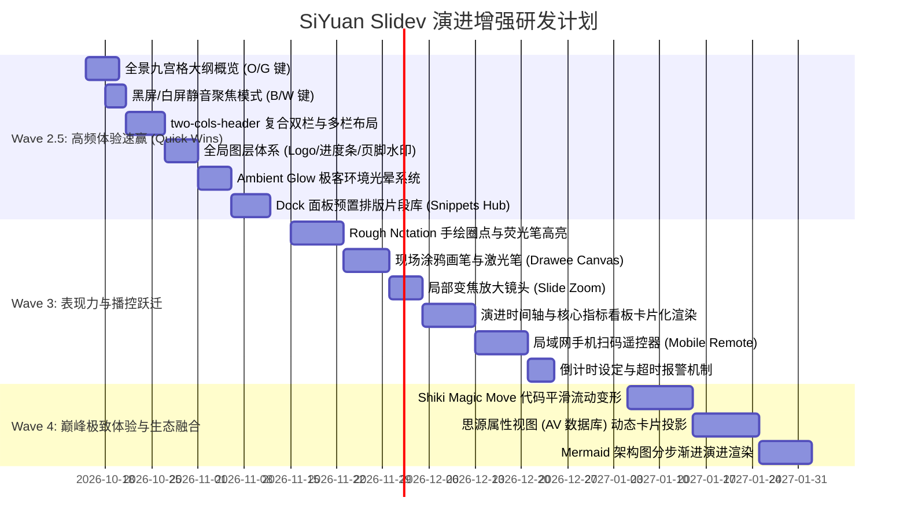

# 基于 Slidev 与 Slidev-Templates 源码生态的演示能力差距分析与高频特性集成演进指南

---

## 1. 执行摘要与背景梳理 (Executive Summary)

### 1.1 评测基准与分析目标
本分析深度对照了两个核心源码仓库：
1. **`D:\MyCodingProjects\slidev`**：Slidev 核心框架源码（Parser 解析器、Client 运行时、Compiler 管道、内置组件库与放映播控系统）。
2. **`D:\MyCodingProjects\slidev-templates`**：Slidev 现代生产级模版生态库（包含 `neko-style` 深度打磨的高水准技术演讲系统、`paper-lab` 学术研究模版、`editorial-grid` 叙事提案模版、`terminal-ink` 终端系统模版及组件目录 `COMPONENT-CATALOG.md`、页面范式 `PAGE-PATTERNS.md`、片段集 `snippets/`）。

对照标的为本插件项目 **SiYuan Slidev (`d:\MyCodingProjects\siyuan-slidev`)** 当前的研发进展。目标是精准识别**要实现专业、惊艳、高说服力的优秀演示效果，还有哪些常用、高频的操作、版式、动效与设置尚未被集成**，并给出具体使用场景和工程级落地开发建议。

### 1.2 当前本插件项目的开发进展基线
截至当前版本，`siyuan-slidev` 已经构建了非常坚实的技术底座与架构雏形：
- ✅ **基于思源 IAL 的零污染元数据架构**：将所有版式、动画、备注、高亮等元数据解耦存储于思源块属性（`custom-slidev-*`）与水平分割线中，保障 Markdown 正文纯净。
- ✅ **现代化双重视图交互**：
  - **下方独立分屏预览页签 (`SlidevPreviewTab`)**：支持 📌 Pin 图钉锁定文档、缩略图抽屉、全屏放映、快捷导出与双向光标跟随联动。
  - **右侧演示配置面板 (`SlidevInspectorDockView`)**：情境感知切换内容块、分页符、文档全局根属性，支持一键配置 `v-click`、`layout`、`shikiLines` 等。
- ✅ **AST 编译管道与双模渲染引擎**：
  - 编译器支持分割线切页、思源本地资源代理路径重写（`assets-rewriter.ts`）、块引用深度递归解析（`block-ref-resolver.ts`）。
  - 双模引擎：0 依赖内置轻量 Web 沙箱 + 极客 Pro 模式本地 Slidev CLI (端口 3030) 桥接。
- ✅ **双屏演讲者视窗与离线导出**：
  - 独立双屏讲师视窗（`presenter.html`），基于 `BroadcastChannel` 毫秒级广播同步。
  - 单文件独立 HTML SPA 与高分辨率 PDF 讲义导出。
- ✅ **思源生态协同与 AI 赋能**：
  - 与「属性管家 (siyuan-property-manager)」模板字典打通。
  - 预置长文自动分页、智能提词 Notes 生成与递进动画注入。

### 1.3 核心问题诊断：为什么仍有“演示表现力与操作体验”差距？
虽然底层管线已跑通，但从**真实演讲者（Presenter）与听众（Audience）的体验视角**审视，当前版本仍存在以下体验断层：
1. **视觉表现层仍显单薄**：目前渲染仅支持基础标题、段落、代码和图片，缺少 Slidev 标志性的 **Shiki Magic Move 代码平滑流动**、**Rough Notation 手绘荧光圈点**、**Ambient Glow 极客光晕氛围**，页面视觉容易陷入平淡。
2. **版式布局仍显单调**：目前仅支持 `cover`, `default`, `two-cols`, `fact` 四种基础版式。高频刚需如 `two-cols-header`（带表头的双栏）、`cols-3`（三栏对比）、`image-left/right`（沉浸式图文）尚未支持。
3. **缺少高频业务表达组件**：在技术分享与述职汇报中，纯文字罗列难以抓住眼球。`slidev-templates` 中的**演进路线图（Roadmap Pipeline）**、**核心指标卡片（Stats Row）**、**问题对冲对比（Problem vs Solution）**等生产级模式尚未在思源中沉淀为“一键套用片段”。
4. **现场播控与交互能力未充分释放**：缺少演讲时至关重要的**全景大纲平铺跳转（Grid Overview / `O` 键）**、**黑屏/白屏静音聚焦（`B`/`W` 键）**、**现场画笔/激光笔涂鸦（Drawee Canvas）**以及**手机扫码遥控翻页器**。

---

## 2. 核心差距全景矩阵与雷达评估 (Comprehensive Capability Matrix)

下表全面对照 Slidev 核心能力、`slidev-templates` 模版实践与当前插件进展，明确优先级与影响度：

| 评估维度 | 核心功能 / 设置项 | Slidev / 模版现状 | siyuan-slidev 现状 | 用户痛点与影响 | 建议优先级 |
| :--- | :--- | :--- | :--- | :--- | :---: |
| **动效表现力** | **Shiki Magic Move** 代码平滑形变 | 官方内置 `<ShikiMagicMove>`，跨步平滑飞行动画 | 仅支持单块静态行高亮 `{1-3\|5}` | 代码重构与演进讲解时生硬跳变，缺乏视觉冲击力 | **P1** |
| **动效表现力** | **Rough Notation** 手绘风圈点高亮 | 内置 `<v-mark>`，支持圈出、下划线、荧光笔 | 仅有元素整体 fade/slide 显隐 | 无法在段落内精准强调某个关键词、数据或图表局部 | **P0** |
| **动效表现力** | **现场涂鸦画笔与激光笔** | 内置 Drawee Canvas，快捷键唤出画笔/光斑 | 无涂鸦图层 | 现场互动无法随手勾画演算，缺少引导听众视线的激光笔 | **P1** |
| **动效表现力** | **Ambient Glow 极客环境光晕** | `neko-style` 核心设计语言，动态渐变光晕与噪点 | 仅纯色或静态单张图片背景 | 暗色演讲页面死黑沉闷，缺少科技发布会级的高级质感 | **P0** |
| **动效表现力** | **局部变焦放大镜头 (Zoom)** | 官方支持 `Alt+Click` 局部放大居中 | 仅等比视口缩放 | 架构图、复杂流程图细节无法临时放大给观众看清 | **P2** |
| **版式与栅格** | **高阶复合双栏与多栏布局** | 原生 `two-cols-header`, `cols-3`, `grid` | 仅支持无表头的两栏左右切分 | 极为高频的“上方标题说明 + 下方左右对照”无法直接排版 | **P0** |
| **版式与栅格** | **沉浸式全屏图文排版** | 原生 `image-left`, `image-right`, `image` | 需手动在正文插图片 | 案例介绍、产品截图缺乏大画幅无边框沉浸感 | **P1** |
| **版式与栅格** | **全局图层体系 (Global Layers)** | 原生 `global-top`, `global-bottom` 挂载页眉页脚 | 页面各自孤立，无全局图层 | 缺少全局常驻 Logo、章节导航、总进度条、机密水印 | **P0** |
| **业务表达组件** | **演进路线图与管道流程** | `neko-style` 的 `StackedFlowPipeline` 等 | 无对应组件映射 | 架构演进、业务发布 Roadmap 只能排成普通列表 | **P1** |
| **业务表达组件** | **核心指标与数据大字报** | `neko-style` 的 `StatsRow`, `FeatureIconGrid` | 仅有 `fact` 大字报版式 | 无法整齐排列多个带量级标签的关键指标与图标卡片 | **P1** |
| **业务表达组件** | **问题 vs 方案对比模式** | `ProblemSolutionSplit`, `Bad-vs-Good` | 依赖用户自行写文字 | 架构方案选型或复盘会缺少左右视觉对冲结构 | **P1** |
| **业务表达组件** | **Dock 面板片段库 (Snippets Hub)** | `neko-style/snippets` 丰富 Markdown 模版 | 仅能插入单个空分割线 | 用户不知道如何组合块属性搭出高级页面，上手门槛高 | **P0** |
| **播控与演讲** | **全景九宫格大纲概览 (`O`/`G` 键)** | 原生网格平铺视图，键盘挑选跳页 | 仅有侧边/抽屉缩略图 | 答疑时无法一秒在全屏视野找到对应幻灯片并跳回 | **P0** |
| **播控与演讲** | **黑屏 / 白屏静音聚焦 (`B`/`W` 键)** | 国际演讲标准快捷键，一键切黑/切白 | 未监听快捷键 | 演讲中途脱稿互动或黑板演算时，无法切断大屏干扰 | **P0** |
| **播控与演讲** | **局域网手机扫码遥控器** | 原生 `--remote` 扫码遥控 | 仅支持同一机器双屏 | 演讲者必须站在电脑前敲键盘，无法拿手机全场走动巡回 | **P1** |
| **播控与演讲** | **限时演说倒计时与超时报警** | 演讲者视图支持目标时长与颜色预警 | 仅简单正向累加计时器 | 会议严格限时时容易超时，缺乏剩余时间感知 | **P1** |
| **思源原生融合** | **属性视图 (AV 数据库) 投影** | N/A (思源独有) | 未转译 AV 块，显示简陋 | 思源强大的数据库表格与看板无法直接呈现在幻灯片中 | **P1** |
| **思源原生融合** | **Mermaid 图表渐进高亮演进** | 原生支持 Mermaid，可配 `v-click` 样式 | 静态渲染 Mermaid | 复杂架构图一次性抛给观众难以消化，缺乏逐步演进 | **P1** |

---

## 3. 缺失常用、高频操作与设置的深度剖析及开发建议

---

### 维度一：动效与视觉表现力——让演讲生动传神

#### 3.1 Rough Notation (手绘风圈点高亮与荧光笔批注)
- **原生对标**：Slidev 内置组件 `<v-mark type="circle|box|underline|highlight|strike-through" color="red">`，基于开源 `rough-notation` 库。
- **思源使用场景与痛点**：
  在学术答辩、技术汇报中，讲师通常需要强调段落中的**某个数字、关键结论短语、代码中的某个变量或表格单元格**。当前插件只能通过 `v-click` 让整行文字淡入淡出，无法在同一行文字内实现“讲到这里时，红色手绘圆圈缓缓圈住重点”或“黄色荧光笔刷刷划过”。
- **零污染块属性/语法映射设计**：
  - **方案 A（行内标记增强）**：思源自带“加粗”、“高亮”与“下划线”。可在右侧 Dock 面板提供“手绘标记”小工具，选中文字后为其添加自定义 span 标记或类名，例如 `<span data-slidev-mark="circle" data-slidev-color="red" data-slidev-step="1">关键指标</span>`。
  - **方案 B（块级快速属性）**：在整个内容块上挂载属性 `custom-slidev-mark="underline:#f59e0b:1"`（类型:颜色:步数），自动对块内的重点内容或首句施加手绘效果。
- **开发建议与代码级落地**：
  1. 在 `public/slidev-client/assets/` 引入轻量级 `rough-notation.min.js`（体积仅 ~3KB）。
  2. 扩展客户端 `renderBlockHtml()`，将 `data-slidev-mark` 解析并生成标注宿主元素。
  3. 在 Vue 客户端的 `currentStep` 步进监听中：
     ```js
     import { annotate } from 'rough-notation';
     // 当 currentStep 变动时，查找满足要求的元素并触发渲染
     document.querySelectorAll(`[data-slidev-mark][data-slidev-step="${currentStep.value}"]`).forEach(el => {
       const type = el.getAttribute('data-slidev-mark') || 'circle';
       const color = el.getAttribute('data-slidev-color') || '#ef4444';
       const annotation = annotate(el, { type, color, strokeWidth: 2, padding: 4 });
       annotation.show();
     });
     ```

#### 3.2 Shiki Magic Move (代码平滑流动变形动画)
- **原生对标**：Slidev 内置组件 `<ShikiMagicMove>`，由 Anthony Fu 打造。当切换幻灯片或逐步演示代码重构时，相同的代码行/标识符会流畅飞向新位置，变更部分渐变淡入淡出。
- **思源使用场景与痛点**：
  技术分享的“高光时刻”往往是展示架构重构、API 迭代或算法优化（例如从 Callback 写法重构成 Async/Await，或从 Monolith 配置演进为微服务配置）。传统幻灯片只能整页突变切换，听众根本看不清改了哪里；有了 Magic Move，听众视线能自然跟随变量流动。
- **零污染块属性设计**：
  在相连的两页中的代码块，或者同一页中带有步骤的代码块，配置属性：
  - 前一个代码块：`custom-slidev-magic-move="src-1"`
  - 后一个代码块：`custom-slidev-magic-move="target-1"`
- **开发建议与代码级落地**：
  1. 在内置沙箱中引入 `shiki-magic-move` 的 Web Component 或轻量渲染器。
  2. 编译器 `slidev-ast-builder.ts` 识别连续代码块的 `custom-slidev-magic-move` 标记，生成对应结构：
     ```html
     <ShikiMagicMove :oldCode="codeA" :newCode="codeB" :step="currentStep" />
     ```
  3. 在沙箱轻量模式下，若不引入庞大 AST 计算器，可先做“行级平滑重排补间（FLIP 行动画）”作为轻量平替，而在 Pro 模式下直接启用原生完整 Shiki Magic Move。

#### 3.3 现场涂鸦画笔、发光激光笔与白板 (Drawee Canvas / Drawing)
- **原生对标**：Slidev 内置 Drawee 画笔系统，按快捷键唤出底部浮动涂鸦条（画笔、马克笔、箭头、直线、矩形、橡皮擦、清空），支持激光笔聚光追踪。
- **思源使用场景与痛点**：
  现场答疑或授课互动时，演讲者需要即兴在幻灯片上写批注、画箭头连线，甚至切出一块空白区域演算。没有画笔的幻灯片就像隔着玻璃演讲，极具距离感。
- **开发建议与代码级落地**：
  1. 在 `slide-viewport` 最上层叠加一层绝对定位的 `<canvas id="slidev-drawing-canvas">`。
  2. 快捷键与播控条：
     - 点击画笔图标或按快捷键 `Ctrl+D` 激活绘图模式，光标变为画笔形状，底部弹出微型调色盘（红/黄/蓝/绿、粗细、清空）。
     - 支持**激光笔模式（Laser Pointer）**：按下 `L` 键，鼠标指针变为带有柔和外发光的红色光斑，并在移动时带有微弱的拖尾粒子，极其适合大屏投影引导注意力。
  3. 笔迹保存机制：绘图数据按 `currentPageIndex` 作为 Key 保存在内存或通过 `postMessage` 回传保存至该页分割线的 `custom-slidev-drawings` 属性中，翻回该页时笔迹自动重绘。

#### 3.4 Ambient Glow 极客环境光晕与质感系统
- **原生对标**：`slidev-templates/neko-style` 的核心设计语言。其不仅有纯黑，还拥有极其细腻的动态渐变环境光晕（`glow: top|center|radial`，`glowSeed: 200`）以及微噪点暗纹（Grid / Dot / Noise）。
- **思源使用场景与痛点**：
  技术会议、架构设计、AI 主题汇报中，普通的纯黑 `#121214` 背景容易显得压抑、死板；若直接放花哨背景图又会严重干扰文字阅读。动态光晕在保持背景深邃的同时，为标题和卡片提供自然的舞台聚光灯感。
- **零污染块属性设计**：
  - 页面级属性：`custom-slidev-glow="center"`（取值：`none` \| `top` \| `center` \| `bottom` \| `radial`）。
  - 页面级属性：`custom-slidev-glow-color="violet"`（取值：`blue` \| `violet` \| `cyan` \| `emerald` \| `amber`）。
- **开发建议与代码级落地**：
  1. 在客户端 CSS 中利用纯 GPU 加速的伪元素实现光晕：
     ```css
     .glow-center::before {
       content: "";
       position: absolute;
       top: 20%;
       left: 50%;
       transform: translate(-50%, -50%);
       width: 600px;
       height: 350px;
       background: radial-gradient(circle, var(--glow-color, rgba(99, 102, 241, 0.18)) 0%, transparent 70%);
       filter: blur(80px);
       pointer-events: none;
       z-index: 0;
     }
     ```
  2. 右侧 Dock 面板在用户配置页面属性时，增加“✨ 氛围光晕”卡片选择器，提供 6 种预设色调，一键为当前页注入高级科技感。

#### 3.5 局部变焦放大镜头 (Slide Zoom & Focus Lens)
- **原生对标**：Slidev 支持全局与局部双指/快捷键变焦。
- **思源使用场景与痛点**：
  当幻灯片上展示了一张非常庞大的复杂系统架构图、全景时序图，或者是一段 20 行的关键配置代码时，由于屏幕尺寸限制，文字可能偏小。讲师在讲解某一个微服务模块时，希望鼠标移过去点击即可平滑局部放大 2.5 倍，讲完复原。
- **开发建议与代码级落地**：
  1. 在客户端监听 `Alt + 单击` 或双击图片/代码块。
  2. 记录点击坐标 `(clientX, clientY)`，对当前块或视口应用 CSS 补间动画：
     ```css
     transform: scale(2.2);
     transform-origin: calc(x)% calc(y)%;
     transition: transform 0.3s cubic-bezier(0.16, 1, 0.3, 1);
     ```
  3. 再次单击或按 `Esc` 恢复 1:1 视口。

---

### 维度二：版式丰富度与复杂栅格布局——打破单调垂直流水账

#### 3.6 高阶复合双栏与多栏布局 (`two-cols-header`, `cols-3`, `grid-2x2`)
- **原生对标**：
  - `two-cols-header`：上方一整栏展示大标题与场景介绍，下方自动分为左右双栏；
  - `cols-3` / `cols-4`：等宽三栏/四栏卡片式并列；
  - `grid-2x2`：四象限网格。
- **思源使用场景与痛点**：
  目前插件的 `two-cols` 版式会将整页所有内容强制左右对半开，导致本页的标题也只能缩在左半边，无法像专业 PPT 一样“上方大标题顶天立地，下方左右进行架构优缺点对照”。
- **零污染块属性与插槽设计**：
  - 页面级：`custom-slidev-layout="two-cols-header"`
  - 元素级：`custom-slidev-slot="header"`、`custom-slidev-slot="left"`、`custom-slidev-slot="right"`
  - 拓展版式：`custom-slidev-layout="cols-3"`，子块属性为 `custom-slidev-slot="col-1 | col-2 | col-3"`。
- **开发建议与代码级落地**：
  1. 升级 `slidev-ast-builder.ts` 中的插槽编排逻辑：
     ```ts
     if (page.frontmatter.layout === "two-cols-header") {
       const headerBlocks = page.blocks.filter(b => b.slot === "header");
       const leftBlocks = page.blocks.filter(b => b.slot === "left");
       const rightBlocks = page.blocks.filter(b => b.slot === "right");
       // 组装 markdown 时保留插槽语法糖 ::left:: / ::right::
     }
     ```
  2. 升级客户端 HTML/CSS 栅格模板：
     ```css
     .layout-two-cols-header {
       display: grid;
       grid-template-rows: auto 1fr;
       gap: 20px;
       height: 100%;
     }
     .layout-two-cols-header .content-grid {
       display: grid;
       grid-template-columns: 1fr 1fr;
       gap: 32px;
     }
     ```
  3. 右侧 Dock 面板：选中当前块为 `two-cols-header` 时，为该页内的所有块提供直观的插槽芯片（[顶部标题] [左栏] [右栏]），点击即换栏。

#### 3.7 沉浸式图文排版 (`image-left`, `image-right`, `cover-image`)
- **原生对标**：Slidev 内置 `image-left` 与 `image-right` 版式。半边屏幕铺满大图（无内边距，完全贴合边缘），另半边屏幕呈现文字内容。
- **思源使用场景与痛点**：
  新产品发布、UI 设计稿汇报、客户案例分析时，半屏高清无界图片 + 半屏结构化文案是最经典、最有视觉冲击力的排版。若在普通页面里插图片，图片受限于文章边距，总是缩得很小且四周留白尴尬。
- **零污染块属性设计**：
  - 页面分割线属性：`custom-slidev-layout="image-right"`
  - 页面分割线属性：`custom-slidev-image="assets/preview-2026.png"`（或挂载网络 URL、渐变图）
- **开发建议与代码级落地**：
  在客户端渲染 `layout-image-right` 时，视口划分为 `50% 50%`，右侧容器应用 `background-size: cover; background-position: center;`，实现零边距沉浸排版。

#### 3.8 全局图层体系 (Global Layers: Header, Footer, Progress Bar & Logo)
- **原生对标**：Slidev 的 `global-top.vue` 与 `global-bottom.vue`。
- **思源使用场景与痛点**：
  正规商务汇报、技术峰会或公司内部分享，通常有严苛的规范：
  1. 页面左上角或右上角必须常驻组织/项目 Logo；
  2. 页面底部必须显示微型版权声明与当前所属大章节（Breadcrumb）；
  3. 视口最底部需要有一根随着翻页逐渐延伸的精细**进度条（Progress bar）**；
  4. 涉密项目汇报时，全屏需要打上淡色员工工号水印。
- **零污染文档全局属性字典设计**：
  - `custom-slidev-global-logo="assets/logo.svg"`
  - `custom-slidev-global-footer="© 2026 MyTeam · 架构技术委员会"`
  - `custom-slidev-progress-bar="true"`
  - `custom-slidev-watermark="Confidential · 张三 10086"`
  - 页面级例外控制：`custom-slidev-hide-global="true"`（例如封面 Cover 页自动隐藏页眉页脚与进度条）。
- **开发建议与代码级落地**：
  在 `slide-viewport` 内部构建常驻布局插槽：
  ```html
  <div v-if="!currentSlide.frontmatter.hideGlobal" class="slidev-global-top">
    
  </div>
  <div v-if="config.progressBar" class="slidev-progress-rail">
    <div class="slidev-progress-bar" :style="{ width: (currentPageIndex / totalPages * 100) + '%' }"></div>
  </div>
  ```

---

### 维度三：高频业务演说组件库——借鉴 slidev-templates 设计精髓

在 `slidev-templates`（尤其是 `neko-style/docs/COMPONENT-CATALOG.md` 与 `PAGE-PATTERNS.md`）中，沉淀了 20+ 个极其成熟的高频表达组件。如果要求普通思源用户自己写前端代码是不现实的；**插件的最佳解法是：提供现成的“排版片段模板（Snippets）”与专用渲染器，用户在思源中插入原生结构块，插件自动在幻灯片中升华为高级组件！**

#### 3.9 演进路线图与时间轴卡片 (Roadmap & Progression Pipeline)
- **原生对标**：`neko-style` 的 `RouteProgressionLane` 与 `StackedFlowPipeline`。
- **思源使用场景与痛点**：
  项目立项汇报与年度复盘中，几乎必有“演进时间线（Q1 调研 -> Q2 研发 -> Q3 上线 -> Q4 规模化）”。用户在思源中通常只能写出带有圆点的无序列表，在幻灯片上看起来单调干瘪。
- **零污染与思源原生映射方案**：
  - 在思源中，用户写一个普通的 3~5 项**带编号列表**或**水平排列的引用块**。
  - 为该父列表块设置属性：`custom-slidev-widget="timeline"` 或 `custom-slidev-widget="pipeline"`。
- **开发建议与代码级落地**：
  客户端检测到 `widget="timeline"` 时，不渲染为常规 `<ul>/<li>`，而是将其渲染为横向卡片队列：
  - 每个列表项转为带有小图标、阶段序号 Badge、柔和色调背景的横向卡片；
  - 卡片之间自动插入带有呼吸动效的箭头指示线 `→`；
  - 自动将 `v-click` 分配给每个阶段，按空格键时，时间线节点逐个“点亮”。

#### 3.10 特性网格与核心数据指标看板 (FeatureIconGrid & StatsRow)
- **原生对标**：`neko-style` 的 `FeatureIconGrid`（3 列/4 列图标特性网格）与 `StatsRow`（核心业务指标行，如 `99.99%`、`10x`、`500ms`）。
- **思源使用场景与痛点**：
  做产品发布或性能总结时，最忌讳大段文字。讲师需要展示“3 个核心性能提升指标”或“6 大产品新特性”。
- **零污染与思源原生映射方案**：
  - 用户在思源中创建一个带 3 列的表格，或 3 个段落，段落第一行为大数字，第二行为说明。
  - 标记属性 `custom-slidev-widget="stats"`。
- **开发建议与代码级落地**：
  客户端将其渲染为：
  - 超大粗体字（如 `font-size: 3.5rem; font-weight: 800; color: #38bdf8`）并带有数字渐变色；
  - 下方搭配小号灰色大写字母标签（如 `TRANSACTION THROUGHPUT`）；
  - 卡片附带磨砂玻璃背景（Glassmorphism）与悬浮轻微微动效。

#### 3.11 问题对冲与优劣对比模式 (Problem vs Solution Split / Bad vs Good)
- **原生对标**：`neko-style` 的 `ProblemSolutionSplit`、`ReasonLessonGrid`、`bad-vs-good.md`。
- **思源使用场景与痛点**：
  技术选型汇报、架构方案评审、事故复盘中，最核心的逻辑是“为什么我们要重构？传统做法有什么严重问题？新架构如何解决？”。
- **零污染与思源原生映射方案**：
  - 用户使用 `two-cols` 版式，左栏设置属性 `custom-slidev-tone="danger"`（或在思源中标记红色背景），右栏设置 `custom-slidev-tone="success"`（绿色背景）。
- **开发建议与代码级落地**：
  - 客户端左栏自动渲染红粉色柔光氛围、左侧红条高亮与警告图标 ⚠️，标题标明 `Existing Problems / Bad Pattern`；
  - 右栏自动渲染翠绿色柔光氛围、左侧绿条高亮与对勾图标 ✅，标题标明 `Our Solution / Best Practice`；
  - 支持第一步空格只显示左边的问题，第二步空格再弹出右边的破局方案，戏剧性与说服力瞬间拉满。

#### 3.12 右侧 Dock 面板内置“演说排版片段库（Snippets Hub）”
- **设计初衷**：
  普通笔记用户不是前端专家，记不住复杂的插槽或属性。
- **开发建议与交互设计**：
  1. 在右侧 Dock 面板底部增加一个折叠面板：**「🧩 常用幻灯片片段库 (Snippets)」**。
  2. 预置精选高频片段（直接对标 `slidev-templates/neko-style/snippets`）：
     - 🚀 **产品路线图 (Timeline Roadmap)**：一键在光标后插入带切页的 4 阶段时间轴结构；
     - ⚡ **核心指标看板 (Metrics & Stats)**：一键插入 3 个大数字指标卡片；
     - ⚔️ **优劣势方案对比 (Problem vs Solution)**：一键插入双栏对冲结构；
     - 🏛️ **分层架构图 (System Architecture)**：一键插入预置 Mermaid 架构演进图；
     - 💡 **金句大字报 (Statement Quote)**：一键插入带有半透明双引号的金句结论页；
     - 🙏 **致谢与联系方式 (Closing & Contact)**：一键插入演讲结束页（含社交链接占位与二维码插槽）。
  3. 用户点击任一片段按钮，插件调用思源内核 API `insertBlock`，直接将已经打好 `custom-slidev-*` 属性的一组纯净思源块插入到光标所在处，用户只需像填空题一样替换里面的文字！

---

### 维度四：现场演讲与专业播控体验——讲师级全盘掌控

#### 3.13 全景幻灯片九宫格平铺概览 (Slide Grid Overview / `O` 或 `G` 键)
- **原生对标**：Slidev 原生按 `O`（Overview）或 `G`（Grid）键，整个播放窗口瞬间缩退，呈现所有幻灯片的缩略平铺九宫格，支持方向键移动光标并按回车直接跳页。
- **思源使用场景与痛点**：
  在实际演讲尤其是 Q&A 问答环节，台下观众经常提问：“请问第 3 节讲的那个数据库架构图能倒回去看一下吗？”。如果没有全局网格视图，演讲者只能当着所有观众的面一阵狂按左箭头键倒退 20 次，体验非常业余；使用九宫格视图，一秒即可点选直达。
- **开发建议与代码级落地**：
  1. 监听全局快捷键 `o`、`O`、`g`、`G`。
  2. 触发时，激活客户端全屏覆盖层 `<div class="slidev-grid-overlay">`，采用 CSS Grid 将整篇幻灯片以缩略卡片平铺（每行 4~5 张）：
     ```css
     .slidev-grid-overlay {
       position: fixed; inset: 0; background: rgba(10, 10, 12, 0.92);
       backdrop-filter: blur(12px); z-index: 999;
       display: grid; grid-template-columns: repeat(auto-fill, minmax(220px, 1fr));
       gap: 16px; padding: 32px; overflow-y: auto;
     }
     ```
  3. 点击任意一张卡片或按 Enter，平滑缩放进入该页并关闭覆盖层；按 `Esc` 直接退出概览。

#### 3.14 黑屏与白屏静音聚焦 (`B` / `W` 键)
- **原生对标**：国际专业演讲设备与 Slidev 通用标准。
- **思源使用场景与痛点**：
  在演讲过程中，有时演讲者需要讲一段题外话、发起现场观众举手互动，或者在实物白板上板书。如果大屏幕依然亮着花花绿绿的 PPT，观众的视线会被屏幕持续分散。此时按 `B`（Black）瞬间全黑屏，让聚光灯完全回到演讲者本人身上；互动完毕再按一次 `B` 瞬间恢复。
- **开发建议与代码级落地**：
  1. 客户端维护状态 `screenMuteMode = ref<'none' | 'black' | 'white'>('none')`。
  2. 键盘事件监听：
     - 按 `b` / `B`：在 `'black'` 与 `'none'` 之间切换；
     - 按 `w` / `W`：在 `'white'` 与 `'none'` 之间切换；
     - 处于静音模式时，按空格或任意翻页键均可解除静音。
  3. 视口最上层渲染绝对定位的遮罩层，配合 0.2s 平滑淡入淡出过渡。

#### 3.15 局域网移动端远程遥控器 (Remote Control via QR Code)
- **原生对标**：Slidev 的 `--remote` 模式，在终端或演讲者窗口显示局域网二维码，手机扫码即可作为无线翻页笔并看提词。
- **思源独特优势与使用场景**：
  思源笔记本身就是一个常驻本地的 Go 后端服务器（带有开放的 HTTP API 与 WebSocket 服务）。演讲者完全可以脱离电脑键盘，手持手机在讲台上自由踱步、看提词并翻页。
- **开发建议与代码级落地**：
  1. 插件在加载时，在本地服务注册一个轻量静态路由或通过内网 IP（如 `http://192.168.1.100:6806/plugins/siyuan-slidev/remote.html`）提供移动端遥控页面。
  2. 演讲者视窗（`presenter.html`）右上角显示一个「📱 手机遥控」按钮，点击弹出二维码。
  3. 手机端遥控页面适配移动端大触屏：
     - 屏幕上半部分：超大字号展示当前页与下一页的**口播提词 Notes**；
     - 屏幕下半部分：左右对半分割的两个巨大无障碍触控按钮（`[◀ 上一步]` 与 `[下一步 ▶]`）；
     - 点击时带有手机震动反馈（`navigator.vibrate(40)`），通过 WebSocket 毫秒级向思源主屏幕发送翻页指令。

#### 3.16 限时演说倒计时与超时报警机制 (Countdown & Overtime Warning)
- **原生对标**：Slidev 演讲者模式中的 Timer 倒计时模块。
- **思源使用场景与痛点**：
  在严格限时的技术分享（如 20 分钟 Lightning Talk、15 分钟学术答辩、10 分钟晋升述职）中，只显示“已演讲 08:35”根本不够用，讲师很难在心算还剩多少时间。
- **开发建议与代码级落地**：
  1. 在 `presenter.html` 中提供目标时长输入（默认读取文档属性 `custom-slidev-duration="20"` 或在界面上直接点击加减分钟）。
  2. 计时器显示：
     - 正计时（已进行时间）与**倒计时（剩余时间）**双行呈现；
     - 进度环变色规则：剩余时间 > 30% 显示绿色，剩余时间 < 20% 显示黄色警示，超时后显示醒目的红色闪烁负数（如 `-01:23 OVERTIME`），并轻微呼吸动画提醒讲师收尾。

---

### 维度五：思源笔记特有壁垒能力深度赋能

#### 3.17 思源属性视图 (AV 数据库) 动态投影为幻灯片表格/看板卡片
- **思源独特价值**：
  思源笔记 3.8+ 推出的“属性视图（Attribute View / AV 数据库）”是用户的核心生产力工具，里面沉淀了任务清单、项目里程碑、竞品对比、书籍清单等丰富结构化数据。
- **当前痛点**：
  当前插件遇到 `NodeAttributeView` 块时，由于是思源私有数据库渲染，目前在 Slidev 编译管道中容易丢失或退化为不可读文本。
- **开发建议与代码级落地**：
  1. 编译器拦截 `NodeAttributeView` 块节点，调用思源内核 API 获取该属性视图的视图元数据与当前过滤排序后的行数据。
  2. 自动将其转译为 Slidev 支持的**现代化无边框自适应表格**或**多列看板卡片网格**：
     - 列标题带半透明胶囊背景；
     - 状态列（如“进行中”、“已完成”）自动映射为对应色系的 Pill Badge；
     - 进度条列自动映射为 SVG 进度条。

#### 3.18 Mermaid 架构图的渐进分步演进渲染
- **原生对标**：Slidev 原生结合 Mermaid 图表与 `v-click`。
- **思源使用场景与痛点**：
  当用户画了一个包含 10 个节点、5 步流转的系统架构图时，如果一翻页整张图全部显示，听众视线会彻底迷失。讲师需要的是：第 1 步先出现客户端与网关，第 2 步出现微服务集群，第 3 步出现缓存与主数据库。
- **开发建议与代码级落地**：
  1. 允许在思源 Mermaid 代码块上打上属性 `custom-slidev-clicks="true"`。
  2. 在客户端 Mermaid 渲染后，自动识别带有特定 class（如 `click-1`, `click-2`）的节点或连线，通过 CSS opacity 与 `currentStep` 联动，实现图表的分段动画演示。

---

## 4. 版本迭代规划与工程实施路线图 (Phased Implementation Roadmap)

为了在兼顾工程稳定性的同时快速带来视觉与交互的飞跃，建议将上述新特性划分为三个敏捷迭代波次：



### 各阶段核心交付成果定义：
- **Wave 2.5: 高频体验速赢（1~2 周内可交付，高性价比击穿核心痛点）**
  - 用户按 `O` 键可全屏九宫格选页，按 `B` 键可黑屏；
  - 拥有带表头的双栏布局 `two-cols-header`，整页排版不再别扭；
  - 拥有深邃高级的 Ambient Glow 渐变光晕，暗色演讲不再死板；
  - 右侧面板提供「一键插入片段」，5 秒钟即可搭出高水平排版骨架。
- **Wave 3: 表现力与播控跃迁（3~4 周）**
  - 演讲时可手绘圈出关键词（Rough Notation）；
  - 支持激光笔光斑引导与屏幕自由涂鸦；
  - 手机扫码成为无线翻页器与随身提词器；
  - 常见的时间轴、大数字指标卡片自动美化渲染。
- **Wave 4: 巅峰极致体验与生态融合（4~6 周）**
  - 引入 Shiki Magic Move，代码变形演讲视觉效果达到行业顶尖水平；
  - 深度打通思源 AV 数据库，将数据库即时投影为精美看板。

---

## 5. 架构演进决策守则与工程风险防范

在集成上述高频高级特性时，必须始终恪守本插件的核心原则与边界：

1. **“正文绝对零污染”原则不动摇**：
   无论添加手绘圈点、多栏插槽还是环境光晕，**所有配置必须严格保存在思源块属性（IAL）或页面分割线中**，绝不允许在用户的 Markdown 正文中硬编码侵入式注释或脏标记。当用户导出纯 Markdown 或在手机端阅读时，正文必须依旧纯净完整。
2. **“轻量开箱即用”性能红线**：
   内置沙箱必须维持极速启动（渲染延迟 < 100ms）。对于较为庞大的特性（如完整的 Shiki Magic Move AST 解析、Monaco Editor 运行沙箱），应当采取**分级策略**：沙箱内使用轻量级 CSS 补间/轻量库，而将全功能 AST 级计算委托给本地 Slidev CLI Pro 模式。
3. **向后兼容与平滑降级**：
   新增的块属性（如 `custom-slidev-glow`, `custom-slidev-widget`）在旧版本或不认识该属性的导出器中应当优雅降级（例如 `widget="timeline"` 在不支持的环境下安全回退为标准有序列表），确保用户知识资产永不过期、永不损坏。
