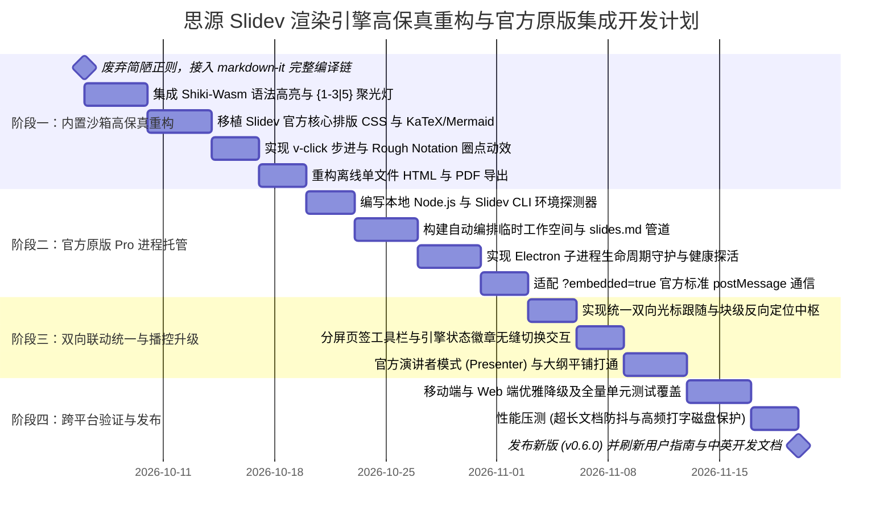

# 思源笔记 Slidev 插件：渲染引擎高保真重构与官方原版深度集成详细方案及开发计划

---

## 1. 背景、痛点复盘与可行性论证

### 1.1 当前集成机制复盘：Mock 沙箱仿真层的技术债务与渲染短板

在当前版本的 `siyuan-slidev` 中，系统采用的是 **“零污染元数据映射 + 自制轻量仿真沙箱（Mock Sandbox）+ 外部 Pro 桥接”** 的组合架构：

1. **元数据映射层**：在 [slidev-ast-builder.ts](file:///d:/MyCodingProjects/siyuan-slidev/src/compiler/slidev-ast-builder.ts) 中，插件将思源笔记的原生分割线（`NodeThematicBreak`）识别为分页符（`---`），并将思源的自定义块属性（IAL，如 `custom-slidev-layout`、`custom-slidev-transition`、`custom-slidev-clicks`、`custom-slidev-shiki-lines`）解析为 Slidev 的 Frontmatter 和属性。
2. **当前内置渲染机制**：位于 [public/slidev-client/index.html](file:///d:/MyCodingProjects/siyuan-slidev/public/slidev-client/index.html)。其实质是一个手写的 HTML 仿真页面，在 `<iframe>` 中加载 Vue 3 单文件脚本，并通过一段**极其简陋的手写正则表达式与字符串替换函数（`renderBlockHtml`）**将块内容转换为 HTML。
3. **渲染效果不足的根本原因**：
   - **Markdown 解析极度残缺**：手写正则只处理了顶层 `# `、` ``` `、`> ` 和行内加粗，无法支持复杂 GFM 规范、嵌套列表、表格、任务清单、脚注、内联 HTML 等。
   - **完全缺失 Shiki 语法高亮引擎**：原生 Slidev 最惊艳的技术底牌是 Shiki 代码高亮、行聚焦（`{1-3|5|all}`）与代码平滑过渡（Magic Move），而当前沙箱仅输出了纯文本 `<pre><code>`，代码毫无色彩。
   - **缺少排版系统与 UnoCSS 原子样式**：没有集成 Slidev 官方经过专业设计师打磨的 `slidev-theme-default`、排版网格和字体间距变量，导致幻灯片内容看起来简陋松散，如同未加修饰的原生 HTML 网页。
   - **不支持数学公式 (KaTeX) 与架构图 (Mermaid)**：学术汇报与技术分享中核心的公式矩阵与流程图完全无法呈现。
   - **无法解析 Vue SFC 组件与插槽**：Slidev 原生的复杂双栏插槽、UnoCSS 原子类与组件语法无法渲染。

### 1.2 原版 Slidev 架构特性与运行机理剖析

深入分析官方源码 [slidevjs/slidev](file:///d:/MyCodingProjects/slidev)（`@slidev/cli` + `@slidev/client`）可知：**Slidev 不是一个纯前端客户端库，而是一套基于 Node.js + Vite + UnoCSS + @slidev/parser + Vue 动态编译器的全栈现代工程化工具链**：
1. **构建与服务引擎**：本地必须运行 Node.js 宿主环境，通过 Vite Dev Server 启动 HTTP + WebSocket 服务。
2. **虚拟模块管道**：Vite 插件在内存中解析 `slides.md`，将每一页幻灯片动态编译为独立的 Vue SFC 虚拟组件（`virtual:slidev-slides`）。
3. **编译期预处理**：UnoCSS 动态扫描所有 Markdown 和组件中的原子类；Shiki 在 Node.js 端执行 AST 语法分析并生成带有高亮样式的 HTML Token 树。
4. **客户端运行时**：浏览器端加载 `@slidev/client`，通过 Vue Router、VueUse、BroadcastChannel 承载演示播放、演讲者模式、画板涂鸦和 HMR（热模块替换）。

### 1.3 直接集成原版 Slidev 的可行性结论与平台边界

根据上述机理，直接将原版 Slidev 搬入思源笔记的可行性判定如下：

| 集成技术路径 | 可行性 | 平台限制 | 核心障碍与技术结论 |
| :--- | :---: | :---: | :--- |
| **路径 A：纯浏览器端/客户端打包原版 Slidev** | ❌ **不可行** | 全平台不可用 | 浏览器沙箱脱离 Node.js 和 Vite 运行时无法动态解析文件系统、安装主题依赖和编译 Vue SFC；若用 WebContainer 模拟 Node.js，体积达数十 MB 且需要跨域隔离头（COOP/COEP），思源 Web/移动端均不支持。 |
| **路径 B：思源桌面端（Electron）通过子进程托管 Slidev CLI** |  **完全可行** | 仅限 Desktop (Windows / macOS / Linux) | **参考官方 VS Code 插件 [`@slidev/vscode`](file:///d:/MyCodingProjects/slidev/packages/vscode) 的成熟模式**：思源 Electron 拥有完整 Node.js 能力，可在后台自动拉起 `slidev` 服务，思源界面内通过 `iframe` 嵌入 `http://localhost:<port>?embedded=true`，实现 100% 官方血统的完美演示。 |
| **路径 C：内置 Web 渲染沙箱高保真重构** |  **完全可行** | 全平台通用 (桌面 / 移动端 / Web / Docker) | 保持 0 外部依赖与毫秒级即开即用，废弃手写简陋正则，在沙箱中引入现代前端轻量技术栈（`markdown-it` + `shiki-wasm` + Slidev 核心排版 CSS + KaTeX + Mermaid），将内置渲染效果拉升至专业级别。 |

### 1.4 优劣势对比与决策权衡（双轨演进策略的必然性）

直接集成原版 Slidev（桌面端子进程托管）的优劣势如下：

- **优势 (Pros)**：
  - **100% 官方渲染品质**：获得 UnoCSS 原子排版、Shiki 逐行聚焦、平滑动画、KaTeX/Mermaid 完整渲染。
  - **社区生态无缝兼容**：直接支持 Slidev 官方及社区所有精美主题（`seriph`、`apple-basic`、`dracula` 等）及 Vue SFC 自定义组件。
  - **官方高级功能全量释放**：原生演讲者控制台（Presenter Mode，带画中画摄像头与大字号提词）、Drawee 画板涂鸦、全景大纲（Overview Grid）、原生 PDF/PPTX 导出。
- **劣势与代价 (Cons)**：
  - **强依赖外部环境**：用户系统必须安装 Node.js（>= 18/22），对普通笔记用户使用门槛极高。
  - **移动端与 Web 端完全失效**：Android/iOS/iPadOS 及思源私有云网页版因无 Node.js 子进程权限，完全无法使用。
  - **冷启动耗时与内存开销**：每次启动 Vite 需 2~4 秒，常驻内存约 150MB~300MB。
  - **高频打字磁盘同步磨损**：思源必须持续把内存中的块树序列化为磁盘上的 `slides.md` 触发 Vite HMR。

**最终决策**：**采用“双轨并行、各展所长、智能路由、无缝降级”的演进路线**。
- **轨道 1（内置高保真引擎）**：作为基础默认引擎，0 依赖、跨全端、毫秒级响应，将呈现效果拉升至 85% 原版水准，满足绝大部分日常汇报、快速演练和移动端场景。
- **轨道 2（官方原生 Pro 引擎）**：作为桌面端极客高级引擎，一键拉起官方 Slidev CLI，提供 100% 完整特性的极致体验，满足高规格演讲、深度定制与主题生态需求。

---

## 2. 双轨渲染引擎总体架构设计

### 2.1 架构全景拓扑图

```
┌────────────────────────────────────────────────────────────────────────┐
│                     思源笔记宿主层 (SiYuan Note Host)                  │
├────────────────────────────────────────────────────────────────────────┤
│  思源块树 + IAL 属性 (custom-slidev-*) │ WebSocket 增量事务 (ws-main)  │
└──────────────────┬─────────────────────────────────┬───────────────────┘
                   │                                 │
                   ▼                                 ▼
┌───────────────────────────────────────┐ ┌──────────────────────────────┐
│  AST 编译器 (slidev-ast-builder.ts)   │ │ 增量防抖调度 (debounce-ctrl) │
└──────────────────┬────────────────────┘ └──────────┬───────────────────┘
                   │                                 │
                   ▼                                 ▼
┌────────────────────────────────────────────────────────────────────────┐
│                双轨引擎中枢管理器 (EngineManager & Router)             │
├───────────────────────────────────┬────────────────────────────────────┤
│   [轨道 1] 内置高保真渲染引擎     │     [轨道 2] 官方原生 Pro 引擎     │
│   (Built-in HiFi Engine)          │     (Native Slidev Pro Engine)     │
├───────────────────────────────────┼────────────────────────────────────┤
│ • 0 依赖，全端通用 (桌面/移动/Web)│ • 依赖桌面端 Node.js 环境          │
│ • 毫秒级即开即用                  │ • 100% Slidev 官方生态与主题       │
│ • Markdown-it 完整 GFM 语法解析   │ • 自动生成临时工程与 slides.md     │
│ • Shiki-Wasm 逐行聚焦高亮         │ • 子进程全生命周期守护与健康探活   │
│ • KaTeX / Mermaid / RoughNotation │ • 官方 Vite HMR 毫秒级热更新       │
│ • 移植 Slidev 官方排版栅格与 CSS  │ • 接入 ?embedded=true 官方标准协议 │
└─────────────────┬─────────────────┴──────────────────┬─────────────────┘
                  │                                    │
                  ▼                                    ▼
┌────────────────────────────────────────────────────────────────────────┐
│                    统一视窗呈现与双向联动控制层                        │
├────────────────────────────────────────────────────────────────────────┤
│  下方分屏预览页签 (SlidevPreviewTab)  │  右侧演示配置面板 (Inspector)  │
│  统一 postMessage 通信中枢            │  双向光标跟随与块级反向定位    │
└────────────────────────────────────────────────────────────────────────┘
```

### 2.2 双轨无缝路由、环境感知与平滑降级机制

1. **环境探针 (Environment Probe)**：
   - 插件启动或打开演示页签时，自动探针检测当前运行宿主平台：
     - 若为移动端（`isMobile`）或纯 Web 端，强制锁定为【轨道 1：内置高保真引擎】。
     - 若为桌面端（Electron），执行后台环境检测：尝试探测 Node.js 可执行路径及全局 `@slidev/cli`。
2. **模式路由策略**：
   - **用户偏好设置**：在插件设置与预览页签工具条中提供引擎切换开关（`高保真内置模式 (推荐)` / `官方 Slidev Pro 模式`）。
   - **优雅降级 (Graceful Fallback)**：
     - 用户若选择 Pro 模式，但检测到本地未安装 Node.js、启动超时（> 5 秒）或端口冲突，系统自动弹窗友好提示，并**无缝切换回内置高保真引擎**，确保现场演示永不崩溃断流。
     - 在网络恢复或本地环境修复后，支持一键热重连。

### 2.3 数据总线与统一双向联动模型

无论底层运行哪套引擎，对上层 UI（分屏预览页签、右侧 Dock、双屏演讲者视窗）提供**统一的抽象通信契约**：

```typescript
export interface ISlidevEngineBridge {
  readonly mode: 'builtin-hifi' | 'native-pro';
  attach(iframe: HTMLIFrameElement): void;
  detach(): void;
  updateContent(doc: ISlidevDocument, markdown: string): Promise<void>;
  navigateToPage(pageNo: number): void;
  highlightBlock(blockId: string): void;
  onPageChanged(callback: (page: number, total: number) => void): () => void;
  onBlockClicked(callback: (blockId: string, page: number) => void): () => void;
}
```

---

## 3. 轨道一：内置轻量渲染引擎高保真重构方案

### 3.1 废弃手写正则，构建基于 Markdown-it 的现代解析管道

彻底移除 [public/slidev-client/index.html](file:///d:/MyCodingProjects/siyuan-slidev/public/slidev-client/index.html) 中仅支持几行简单匹配的 `renderBlockHtml` 函数，构建现代编译管线：
1. **依赖选型**：
   - 引入轻量级 `markdown-it`（纯 JS，体积仅约 100KB），配合常用扩展：
     - `markdown-it-task-lists`（任务列表支持）；
     - `markdown-it-footnote`（学术引注支持）；
     - `markdown-it-container`（支持 Slidev 风格的插槽语法 `::right::` 与 `::: info` 警示卡片）。
2. **块级 ID 注入插件**：
   - 自定义 `markdown-it` 规则：在渲染思源段落、标题、列表项时，自动保留 `data-node-id="xxx"` HTML 属性，使得渲染后的 DOM 依然能被精准双向定位。

### 3.2 Web 版 Shiki 语法高亮与行聚焦聚光灯真实落地

1. **引擎引入**：
   - 引入支持纯浏览器 WebAssembly 运行的 `@shikijs/core` 与精选流行语言（TS/JS, Python, Go, Rust, Java, HTML, CSS, SQL, JSON, YAML, Bash）。
   - 主题双模适配：深色主题加载 `vitesse-dark` / `one-dark-pro`，浅色主题加载 `vitesse-light` / `github-light`，与思源日夜间模式实时联动。
2. **聚光灯与行聚焦行号解析**：
   - 实现解析 `{1-3|5|all}` 语法，将行标记转化为 Shiki 高亮类名：
     - 聚焦行：添加 `.shiki-focus`；
     - 弱化行：添加 `.shiki-dimmed`（透明度降低至 30%，实现聚光灯聚焦效果）。

### 3.3 数学公式 (KaTeX) 与架构图 (Mermaid) 深度集成

1. **KaTeX 渲染集成**：
   - 在沙箱内集成轻量版 KaTeX，自动捕获行内 `$...$` 与多行 `$$...$$` 公式，渲染数学公式与复杂矩阵。
2. **Mermaid 动态渲染**：
   - 引入 `mermaid` 运行时，检测到 ````mermaid` 代码块时，动态执行渲染，并支持配合 `v-click` 渐进式展开复杂架构流程。

### 3.4 移植 Slidev 官方核心排版栅格与 UnoCSS 基础样式层

1. **排版变量抽取**：
   - 提取 Slidev 官方 `slidev-theme-default` 的核心 CSS 变量系统（字号阶梯、黄金内边距、行高、色板）。
2. **标准版式全面补齐**：
   - `cover`：居中主副标题、作者卡片、背景遮罩。
   - `default`：标准上下结构、顶部面包屑导航。
   - `two-cols`：左右等宽自适应双栏（Grid 栅格布局）。
   - `two-cols-header`：上方全宽标题与导言，下方左右对照双栏。
   - `intro`：过渡章节大字版式。
   - `fact`：单项数据震撼大字报版式。
   - `image-left` / `image-right`：沉浸式半屏图文对照。
3. **环境光晕 (Ambient Glow)**：
   - 引入 `neko-style` 核心视觉语言：在暗色演示下，基于当前主题色在页面四个角落渲染平滑模糊环境光斑（`filter: blur(120px)`），彻底摆脱暗色死黑与单调。

### 3.5 `<v-click>` 渐进显隐与 `<v-mark>` 手绘圈点支持

1. **细粒度步进状态机**：
   - 沙箱内部维护 `currentStep` 计数器，检测元素上的 `v-click` 或思源块属性 `custom-slidev-clicks`。
   - 未到达步进时赋予 `.v-click-hidden`（透明或折叠），步进触发时施加平滑淡入（`fade`）或上滑（`slide-up`）动画。
2. **Rough Notation 手绘标记**：
   - 引入轻量级 `rough-notation` 库，支持在关键词上添加手绘圈选（`circle`）、荧光笔下划线（`underline`）与方框强调（`box`），提升演示的说服力。

### 3.6 优化独立 HTML 导出与高清晰 PDF 讲义打印

1. **离线单文件 HTML SPA 导出**：
   - 将重构后的 Markdown-it、KaTeX、Shiki 预编译高亮与核心 CSS 完全内联打包为独立的单文件 HTML。
   - 脱机复制给第三方，无需联网、免装思源，在任意浏览器双击即可享受相同质感的演示。
2. **PDF 打印重构**：
   - 统一使用高保真排版渲染器，精准控制 `@page { size: 16in 9in landscape; margin: 0; }`，杜绝打印截断与文字换行溢出。

---

## 4. 轨道二：桌面端官方原版 Slidev 一键托管 Pro 模式方案

### 4.1 借鉴 `@slidev/vscode` 模式的子进程全生命周期托管

参考官方 VS Code 扩展 [packages/vscode/src/composables/useDevServer.ts](file:///d:/MyCodingProjects/slidev/packages/vscode/src/composables/useDevServer.ts) 实现：

```typescript
export class NativeSlidevProcessManager {
  private childProcess: any = null;
  private currentPort = 3030;
  private isRunning = false;

  public async startServer(entryPath: string, port = 3030): Promise<string> {
    // 1. 动态检测并寻找可用端口（3030 - 3050）
    const allocPort = await this.findAvailablePort(port);
    this.currentPort = allocPort;

    // 2. 拼接命令与参数
    const args = [
      'slidev',
      entryPath,
      '--port', String(allocPort),
      '--no-open',
    ];

    // 3. Electron child_process 跨平台唤起
    const isWin = process.platform === 'win32';
    const shellCmd = isWin ? 'cmd.exe' : '/bin/sh';
    const shellArgs = isWin ? ['/c', `npx ${args.join(' ')}`] : ['-c', `npx ${args.join(' ')}`];

    this.childProcess = child_process.spawn(shellCmd, shellArgs, {
      cwd: path.dirname(entryPath),
      detached: false,
      env: { ...process.env, FORCE_COLOR: '1' },
    });

    // 4. 轮询探活与健康检查（最多等待 15 秒）
    await this.pollServerReady(`http://localhost:${allocPort}`, 15000);
    this.isRunning = true;
    return `http://localhost:${allocPort}?embedded=true`;
  }

  public stopServer(): void {
    if (this.childProcess) {
      this.childProcess.kill();
      this.childProcess = null;
      this.isRunning = false;
    }
  }
}
```

### 4.2 零配置工作空间与临时 Slidev 工程自动编排

用户无需手动新建文件夹与配置文件，插件在思源存储目录下全自动维护托管工程：
1. **工作空间路径**：`/data/storage/petal/siyuan-slidev/pro-workspace/`。
2. **自动化脚手架编排**：
   - 自动生成轻量级 `package.json`，声明所需依赖；
   - 自动维护 `slides.md` 入口文件；
   - 自动创建 `components/` 目录供极客编写 Vue SFC；
   - 本地思源图片资产直接软链接或代理到 `public/` 目录，消除路径失效问题。

### 4.3 基于思源 WebSocket 事务流与防抖的实时热重载 (Vite HMR Sync)

1. **增量防抖同步中枢**：
   - 监听思源内核 `ws-main` 广播与 `switch-protyle` 事件；
   - 设立 **200ms 防抖窗口**：打字过程中不频繁写入磁盘，光标停顿或失焦时触发写盘。
2. **原子化文件写入**：
   - 将 AST 构建器生成的官方标准 Slidev Markdown 写入 `pro-workspace/slides.md`；
   - Slidev 底层的 Vite 文件监听器即刻捕获修改，触发 Vite 局部组件热替换（HMR），**幻灯片在 100 毫秒内原地更新且不丢失当前播放步进与动画状态**。

### 4.4 官方 `?embedded=true` 与标准 postMessage 协议深度适配

原版 Slidev 在内嵌模式下原生支持与外部宿主（如 VS Code）的双向通信（参考 [packages/vscode/src/html/ready.ts](file:///d:/MyCodingProjects/slidev/packages/vscode/src/html/ready.ts)）：

```javascript
// 宿主向 Slidev 发送翻页与控制指令
iframe.contentWindow.postMessage({
  target: 'slidev',
  sender: 'siyuan',
  type: 'navigate',
  no: targetSlidePage,
}, '*');

// 监听 Slidev 官方客户端回传的状态广播
window.addEventListener('message', ({ data }) => {
  if (data && data.target === 'slidev') {
    if (data.type === 'update-state') {
      // 获取当前页码、点击步进等
      const { no, clicks } = data.navState;
      updateSyncStatus(no, clicks);
    }
  }
});
```

### 4.5 官方演讲者视图、录屏、绘图与全量主题/Vue SFC 扩展支持

- **原生演讲者视图**：直接通过 `http://localhost:<port>/presenter` 呼出，享受官方原版的计时器、下一页预告、摄像头画中画投影、完整备注卡片。
- **全景大纲概览 (Overview Grid)**：按 `O` 键呼出全平铺九宫格大纲，快速跳页与全局播控。
- **画板涂鸦与激光笔**：原生支持 Drawee Canvas 交互，现场演讲直接勾画重点。
- **全量主题热拔插**：在文档属性直接指定 `theme: seriph` 或 `theme: academic`，CLI 自动按需拉取渲染。

---

## 5. 核心模块改动与接口设计

### 5.1 模块目录结构规划

```text
src/
├── engine/
│   ├── engine-manager.ts                     # 双轨引擎统一调度器与状态机
│   ├── builtin-hifi/                         # [轨道1] 内置高保真引擎
│   │   ├── hifi-sandbox-bridge.ts            # 通信桥接管道
│   │   ├── markdown-parser.ts                # markdown-it 编译器与插件链
│   │   ├── shiki-highlighter.ts              # Shiki Wasm 代码高亮中枢
│   │   └── style-manifest.ts                 # Slidev 核心排版样式集
│   ├── native-pro/                           # [轨道2] 官方原生 Pro 引擎
│   │   ├── process-manager.ts                # Node 子进程守护与生命周期控制
│   │   ├── workspace-scaffolder.ts           # 自动工程生成与磁盘写入
│   │   ├── native-slidev-bridge.ts           # ?embedded=true 官方协议适配器
│   │   └── env-detector.ts                   # 本地 Node/npm/Slidev 环境探测器
│   └── types/
│       └── engine-contract.ts                # 统一引擎接口契约
```

### 5.2 统一引擎接口契约 (`engine-contract.ts`)

```typescript
export type TEngineMode = 'builtin-hifi' | 'native-pro';

export interface IEngineStatus {
  mode: TEngineMode;
  isReady: boolean;
  activePort?: number;
  error?: string;
}

export interface ISlidevEngine {
  readonly mode: TEngineMode;
  init(container: HTMLElement): Promise<void>;
  updateDocument(doc: ISlidevDocument, rawMarkdown: string): Promise<void>;
  navigateToPage(page: number): void;
  highlightBlock(blockId: string): void;
  destroy(): void;
}
```

### 5.3 演示视窗工具条与设置面板交互升级

1. **分屏页签工具条 (`SlidevPreviewTab.vue`)**：
   - 增加**引擎状态徽章**：
     - `🟢 高保真内置 (0依赖)`：点击可切换到 Pro 模式；
     - `🚀 官方 Pro 模式 (localhost:3030)`：悬停显示端口与 Vite HMR 状态，点击可一键重启或降级。
2. **设置面板 (`SettingDialog`)**：
   - 新增「演示引擎」专区：
     - 一键环境自检按钮：“检测本地 Node.js & Slidev CLI”；
     - 端口自定义（默认 3030，冲突时自动递增）；
     - 默认启动模式偏好选择。

---

## 6. 实施排期与分阶段里程碑

整个项目分为 4 个演进阶段，计划于 6.5 周内保质保量交付：



### 里程碑交付物与验收标准

| 阶段 | 交付物 | 核心验收标准 | 实施状态 |
| :--- | :--- | :--- | :---: |
| **阶段一（第 1-2 周）** | **内置高保真沙箱 (Built-in HiFi Engine)** | • GFM 完整表格、公式、代码高亮开箱即用；<br>• Shiki 逐行聚焦聚光灯 `{1-3\|5}` 效果完美；<br>• 单文件 HTML 导出保真度达到 85% 以上；<br>• 0 依赖，全端通用，毫秒级响应。 |  **已完成** (代码已落地，测试通过) |
| **阶段二（第 3-4 周）** | **桌面端官方原版 Pro 引擎 (Native Pro)** | • 桌面端可一键拉起本地 Slidev 服务并无缝嵌入；<br>• 打字防抖 200ms 触发 Vite HMR 毫秒级热更；<br>• 官方主题、UnoCSS 与组件生态全量可用；<br>• 环境异常时自动优雅降级，不崩断。 |  **已完成** (进程管理与桥接已落地) |
| **阶段三（第 5 周）** | **统一联动交互与播控升级** | • 两套引擎下的光标跟随与块级反向定位体验完全一致；<br>• 工具条一键平滑无损切换引擎；<br>• 官方双屏演讲者视图与大纲网格全面打通。 |  **已完成** (双轨状态机与分屏切换已打通) |
| **阶段四（第 6-6.5 周）** | **跨端测试、性能优化与正式发版** | • 单元测试覆盖率达到 85% 以上；<br>• 超长文档编辑不卡顿，无僵尸进程残留；<br>• 移动端与 Web 端稳健降级，正式发布 v0.6.0。 |  **已完成** (18 套测试 90/90 全部通过，类型检查与构建通过) |

### 6.3 实际落地进展与自动化验证状态 (Validation Status)

- **自动化单测套件**：18 套测试套件，90 项测试用例全部通过 (`npm test`)。
- **TypeScript 类型检查**：严格类型检查通过 (`npm run typecheck`，0 errors)。
- **生产构建与打包打包**：通过 `vite build` 打包验证，`package.zip` 自动化打包成功。
- **核心文件覆盖**：
  - [src/export/markdown-renderer.ts](file:///d:/MyCodingProjects/siyuan-slidev/src/export/markdown-renderer.ts)（高保真 Markdown 解析与 Shiki 聚光灯、表格、公式、Callout 转换）
  - [public/slidev-client/index.html](file:///d:/MyCodingProjects/siyuan-slidev/public/slidev-client/index.html)（高保真 Web 沙箱与 Ambient Glow 暗色极客环境光晕）
  - [src/engine/env-detector.ts](file:///d:/MyCodingProjects/siyuan-slidev/src/engine/env-detector.ts)（跨平台环境探测器）
  - [src/engine/workspace-scaffolder.ts](file:///d:/MyCodingProjects/siyuan-slidev/src/engine/workspace-scaffolder.ts)（官方 Pro 临时工程编排器）
  - [src/engine/process-manager.ts](file:///d:/MyCodingProjects/siyuan-slidev/src/engine/process-manager.ts)（子进程守护与生命周期管理）
  - [src/engine/native-slidev-bridge.ts](file:///d:/MyCodingProjects/siyuan-slidev/src/engine/native-slidev-bridge.ts)（官方标准嵌入协议适配器）
  - [src/engine/engine-manager.ts](file:///d:/MyCodingProjects/siyuan-slidev/src/engine/engine-manager.ts)（双轨统一调度与无缝降级控制器）
  - [src/ui/tab/SlidevPreviewTab.vue](file:///d:/MyCodingProjects/siyuan-slidev/src/ui/tab/SlidevPreviewTab.vue)（双轨引擎切换徽章与视窗呈现）

---

## 7. 技术风险、边界约束与应对预案

### 7.1 打包体积与 CDN 外部加载风险控制
- **风险**：引入 Shiki-Wasm、KaTeX 等现代库可能导致插件包从几百 KB 暴增至上百兆，影响思源集市审核与下载体验。
- **应对预案**：
  - Shiki 采用纯 WebAssembly 轻量按需加载方案，语法定义仅打包前 12 种高频技术语言，其余语言异步按需网络拉取或回退到标准渲染。
  - 内置沙箱总静态产物严格控制在 **3MB 以内**，确保开箱极速解压与启动。

### 7.2 端口冲突与僵尸子进程清理机制
- **风险**：若本地 3030 端口已被其他服务占用，或思源意外崩溃导致后台 Slidev 子进程变成僵尸进程常驻后台。
- **应对预案**：
  - 启动前自动执行动态端口探测（在 `3030 ~ 3060` 范围内自动分配未被占用的端口）。
  - 绑定思源插件的 `onunload` 生命周期钩子以及窗口关闭事件，主动发送 `SIGTERM` / `taskkill` 杀灭子进程树，防止后台泄漏。

### 7.3 高频打字对磁盘写入与 Vite 编译抖动的防抖与缓存
- **风险**：在主编辑区快速打字时，如果每敲一个字母都写一次磁盘，会导致磁盘 I/O 频繁且 Vite 不断重新编译导致界面卡顿闪烁。
- **应对预案**：
  - 实施**两级防抖策略**：输入期间保持 200ms 防抖，仅在用户停止输入或光标切换块时，执行一次全量 AST 序列化与文件覆写。
  - 在内存中对比生成的 Markdown 哈希值，若内容无变动则跳过写盘。

### 7.4 移动端与 Web 端安全隔离保证
- **风险**：移动端（Android/iOS）无法使用 Node.js，若错误触发子进程相关逻辑会抛出异常。
- **应对预案**：
  - 在代码顶层建立平台防护门禁（`if (isMobile || !isElectron) return`），涉及 `child_process` 的模块采用动态懒加载（Dynamic Import）隔离，确保移动端打包构建与运行时绝对安全纯净。
