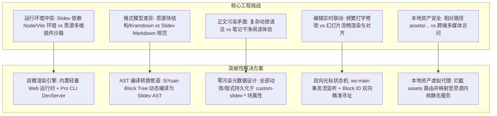
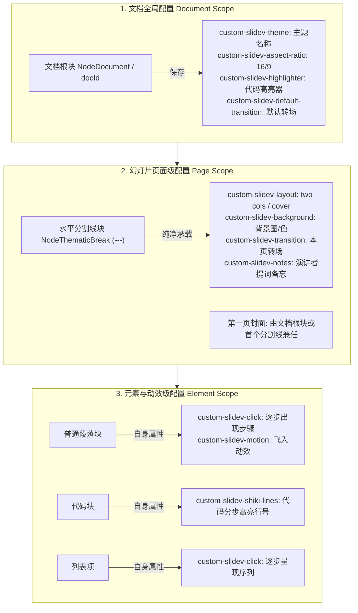
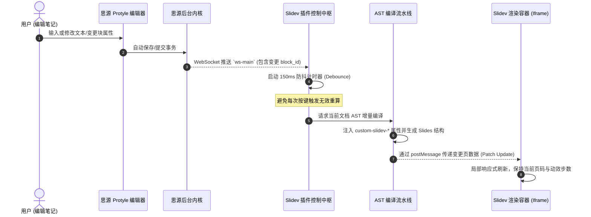

# 思源笔记 Slidev 插件核心可行性分析与总体架构方案

---

## 1. 技术可行性深入分析

### 1.1 为什么选择 Slidev？

在众多基于 Markdown 的现代演示工具中（如 Reveal.js、Marp、Marpit、Slippy 等），**Slidev** 是由 Vue 核心团队成员 Anthony Fu 发起的现代化演示文稿框架，代表了当前演示技术栈的最高水准：
- **现代前端全技术栈**：基于 Vue 3 + Vite，原生支持 Vue SFC（单文件组件），可直接在幻灯片中插入可交互图表、按钮与动态效果；
- **排版与样式极致自由**：内置 UnoCSS / Tailwind CSS 引擎，支持随心所欲的原子化样式调整；
- **极致的代码演示体验**：内置 Shiki 语法高亮引擎，支持单行/选区过渡高亮、行号聚焦与 Monaco 代码编辑器内嵌；
- **丰富的动效生态**：内置 `@vueuse/motion`，提供开箱即用的 `v-click`、`v-motion`、`v-mark` 等高阶渐进式动效；
- **专业演示功能闭环**：原生提供双屏演讲者视图（Presenter Mode）、交互画笔（Drawing）、摄像头画中画、录屏以及 SPA 静态网页/PDF/PPTX 导出。

### 1.2 核心工程瓶颈与技术攻关推演

将 Slidev 深度集成到思源笔记插件生态中，面临以下核心工程挑战：



#### 瓶颈 1：运行环境冲突（Node.js / Vite 依赖）
- **现象**：Slidev 官方推荐的工作模式是基于 Node.js 并在命令行运行 `slidev entry.md`，这在普通用户环境（或移动端、纯 Web 端）中难以保证具备 Node.js 环境。
- **破解方案：双模渲染引擎（Dual-Engine Architecture）**：
  1. **内置轻量 Web 引擎（Built-in Web Engine，默认主力）**：基于预编译的 Slidev Client 核心库，集成 `@slidev/parser`、Vue 3 独立运行时、UnoCSS 运行时与 Shiki Web Worker。插件打包后**零外部依赖**，无论在桌面端还是 Web 部署端，均可纯前端秒级加载。
  2. **Pro DevServer 引擎（专业极客引擎，进阶可选）**：面向前端开发者，提供对本地已运行的 Slidev Vite 服务的 WebSocket 桥接，支持自定义外部 npm 主题与高阶 Vue 组件生态。

#### 瓶颈 2：正文污染与知识沉淀的冲突
- **现象**：竞品为实现分步动画或分栏，通常强行插入 `<!-- .element ... -->` 或专用标记，污染笔记正文，严重破坏纯净笔记的阅读和归档价值。
- **破解方案：块属性零侵入（Zero-Pollution Metadata via Block Attributes）**：
  - 充分利用思源笔记的结构化特性，每个块都有唯一的 Block ID 和属性集（Inline Attribute List）。
  - 将所有版式（Layout）、动画序列（Click）、过渡特效（Transition）、演讲提词（Notes）以 `custom-slidev-*` 的命名空间存入块属性中；
  - 笔记正文保持 100% 原生纯净，日常阅读毫无杂质，进入演示时动态装配成 Slidev 规范。

#### 瓶颈 3：编辑时实时渲染与光标位置保持
- **现象**：每次击键若触发全屏重刷，会导致动画状态重置、屏幕闪烁、光标跳动。
- **破解方案：增量差异补丁 + 双向光标定位状态机**：
  - 结合思源内核 WebSocket 事件 `ws-main` 捕获保存事务，利用防抖（Debounce）更新对应页面的 Virtual DOM；
  - 建立 `Block ID <-> Slide Page Index & Step` 的双向索引表，确保主编辑器修改哪个段落，下方分屏与右侧面板精准跳转到对应幻灯片与动效步骤。

---

## 2. 系统总体架构设计

SiYuan Slidev 采用清晰的四层分层架构，确保高内聚、低耦合，具备极高的扩展性。

```mermaid
graph TD
    subgraph UI_Layer[1. 交互与表现层 Presentation & UI]
        ToolbarBtn[顶部栏一键演示按钮]
        BottomTab[下方分屏预览页签 (SlidevPreviewTab)]
        InspectorDock[右侧演示配置面板 (SlidevInspectorDockView)]
        PresenterWin[独立全屏/双屏演讲者窗口]
        AIAssistant[AI 智能演示编排助手面板]
    end

    subgraph Sync_Layer[2. 同步与交互中枢 Bi-Directional Controller]
        CursorSync[双向光标寻址跟踪器 (Cursor Sync)]
        WsObserver[WebSocket 事务监听与防抖分发]
        StateStore[Slidev 运行时状态仓库 (Pinia/Reactive)]
    end

    subgraph Compiler_Layer[3. 编译器与数据转换层 AST & Data Pipeline]
        BlockCrawler[思源块结构遍历器 (Block Tree)]
        AttrParser[块属性解析器 (custom-slidev-* Mapper)]
        SlidevAST[Slidev 虚拟 AST 生成器]
        ZeroConfigFallback[智能默认规则兜底 (H1/H2 自动断页)]
    end

    subgraph Engine_Layer[4. 核心渲染引擎层 Dual Presentation Engines]
        subgraph LightEngine[内置轻量 Web 引擎 (默认)]
            VueRuntime[预编译 Vue 3 + Slidev Client 核心]
            UnoRuntime[UnoCSS Browser Runtime]
            ShikiWorker[Shiki 高亮 Web Worker]
        end
        subgraph ProEngine[Pro 外部服务引擎 (可选)]
            ViteBridge[Vite DevServer WebSocket Bridge]
            CustomTheme[第三方主题与 npm 生态支持]
        end
    end

    subgraph Storage_Layer[5. 思源内核底座 SiYuan Kernel Core]
        KernelAPI[REST API (/api/block/*, /api/attr/*)]
        KernelWS[WebSocket (ws-main 事件流)]
        AssetsProxy[本地资产静态文件服务 (/assets/*)]
    end

    UI_Layer --> Sync_Layer
    Sync_Layer --> Compiler_Layer
    Compiler_Layer --> Engine_Layer
    Sync_Layer <--> Storage_Layer
    Compiler_Layer <--> Storage_Layer
    Engine_Layer <--> Storage_Layer
```

---

## 3. 基于块属性的“零污染”元数据规范设计

为了彻底避免对 Markdown 正文的任何侵入，本插件全面拥抱思源笔记规范的 `custom-` 自定义属性机制，将幻灯片编排参数与正文内容彻底解耦：

### 3.1 核心块属性字段定义

所有幻灯片相关配置均存储在思源块的属性中，属性名以 `custom-slidev-` 为前缀：

| 属性名称 (`Attribute Key`) | 作用级别 | 取值类型与范例 | 对应 Slidev 规范与行为 |
| :--- | :--- | :--- | :--- |
| `custom-slidev-slide` | 容器/标题块 | `"true"` / `"page"` | **标记当前块为一个新的幻灯片页（显式分页）** |
| `custom-slidev-layout` | 幻灯片起始块 | `"default" \| "cover" \| "two-cols" \| "center" \| "fact" \| "intro"` | 映射为该页 Frontmatter 中的 `layout: xxx` 页面布局 |
| `custom-slidev-transition` | 幻灯片起始块 | `"slide-left" \| "slide-up" \| "fade" \| "view-transition"` | 映射为 Frontmatter 中的 `transition: xxx` 转场动画 |
| `custom-slidev-background` | 幻灯片起始块 | `"assets/cover.png" \| "linear-gradient(...)"` | 映射为页面背景图或背景样式 |
| `custom-slidev-class` | 幻灯片起始块 | `"text-center p-8"` | 注入到该页根容器的 UnoCSS / CSS 样式类名 |
| `custom-slidev-clicks` | 列表/段落/代码块 | `""` / `"1"` / `"+1"` / `"2"` | **逐步出现动效**：包装为 `<v-click>` 或 `v-click="n"` |
| `custom-slidev-motion` | 任意叶子块 | JSON 字符串：`{"type":"fadeIn","delay":200}` | 映射为 `@vueuse/motion` 驱动的微动效指令 |
| `custom-slidev-notes` | 幻灯片起始块 | 纯文本提词字符串 | **演讲者私有备注**：映射为演讲者视图中可见的口播词 |
| `custom-slidev-slot` | 子块（分栏场景） | `"left"` / `"right"` / `"default"` | 多栏布局时指示当前块归属的插槽容器（Slot） |

### 3.2 智能兜底机制（Zero-Configuration Fallback）

用户在日常快速记录笔记时，**完全不需要手动为每一个块添加属性**。插件内置自适应解析规则：
1. **自动分页识别**：
   - 规则 A（默认）：文档大标题作为封面页（`layout: cover`）；
   - 规则 B：遇到一级标题（`NodeHeading` 级别 1）或二级标题（级别 2），自动判定为新幻灯片起点；
   - 规则 C：遇到原生水平分割线（`NodeThematicBreak`，即 `---`），自动作为切页标识。
2. **列表项渐进呈现识别**：
   - 在插件全局设置中开启“列表项自动渐进出现”后，有序/无序列表无需任何标记，渲染时自动为每项赋予递增的 `v-click` 序列。

---

### 3.3 核心设计决策：页面级与文档级配置存储位置演进

用户的直觉非常敏锐：**如果将整页配置强行挂在“首块内容”上，不仅容易与首块自身的元素动效发生冲突，更会在交互和心智模型上带来严重混乱**。

经过深入的工程推演，插件确立了以**“水平分割线（`---`）承载页面配置，文档根块承载全局配置，普通内容块纯粹承载元素动效”**的清晰三层解耦体系。



#### 1. 为什么“首块集中式”存在隐患？
- **心智与 UI 冲突（UX Ambiguity）**：若第一块是个大标题或代码块，当用户点击块标呼出配置时，菜单到底是在配置“整页幻灯片的背景”，还是在配置“这个标题块自身的文字背景”？当该块自身也需要配置 `v-click` 渐进显示或 `v-motion` 动效时，整页属性与元素属性混在一个面板，用户认知极其割裂。
- **误删连带灾难**：日常编辑笔记时，修改、剪切或删除段落极其常见。如果首块被删，这一页辛苦写好的演讲提词（Notes）、精心挑选的背景与转场将一并化为乌有。

#### 2. 为什么“水平分割线（`---`）块”是页面配置的最优载体？
在思源笔记中，用户输入 `---` 回车即可生成一条优雅细微的水平分割线（AST 中对应 `NodeThematicBreak`）。它作为页面配置载体具备无可比拟的优势：
1. **纯粹的“零内容元数据容器”**：
   分割线块在思源中拥有完全独立的 `Block ID` 和 IAL 属性字典，但它**没有任何实质性正文文本**。因此，它**永远不需要配置元素级动画（绝不需要 click、motion、代码高亮）**！其属性字典 **100% 纯粹属于整页页面级配置**，职责单一干净，零冲突。
2. **与 Slidev 官方生态 100% 契合**：
   Slidev 原生正是使用 `---` 划分幻灯片并在下方声明 Frontmatter。思源中的 `---` 块及其属性，在逻辑上与 Slidev 语法完全等价映射，导出为原生 Slidev Markdown 时可以做到无缝 1:1 双向序列化。
3. **内容修改与页面生命周期解耦**：
   页内的正文段落、代码块、引用块可以随意增删重排，只要作为“分水岭”的水平分割线未被删除，整页的幻灯片配置（版式、背景、转场、演讲备忘）永不丢失。
4. **针对第 1 页（封面页）的处理**：
   - 方式 A：文档正文第 1 行之前如果不需要分割线，第 1 页的整页配置直接由**文档根块（`NodeDocument`）**继承兼任；
   - 方式 B：用户也可以在文档开头输入一个 `---`，明确作为第 1 页的配置载体。

---

#### 3. 整个文档的全局配置写在哪里？（Document Scope）

对于影响整篇演示文稿的全局设定（如主题、宽高比、代码高亮引擎、默认转场风格等），系统采用**“文档根块优先 + 插件全局偏好兜底”**的分层持久化架构：

##### (1) 文档级演示配置（跟随文档分发）—— 保存在文档根块（`NodeDocument`）
思源中的每一个文档其根节点本身就是一个独立的块（Block），其 `Block ID` 即是该文档的 `docId`。
- **配置位置**：直接写入该文档根块的属性字典（可通过思源大标题菜单或插件顶部“文档演示设置”直接修改，调用 `/api/attr/setBlockAttrs`）。
- **属性字段规范**：
  - `custom-slidev-theme`：演示主题包名称（如 `"default"`、`"seriph"`、`"apple-basic"` 等）；
  - `custom-slidev-aspect-ratio`：幻灯片画面宽高比（如 `"16/9"`、`"4/3"`）；
  - `custom-slidev-highlighter`：代码高亮引擎（如 `"shiki"` 或 `"prism"`）；
  - `custom-slidev-default-transition`：未单独指定转场时整套幻灯片的默认切换效果（如 `"slide-left"`）；
  - `custom-slidev-color-schema`：颜色模式偏好（`"auto"` \| `"dark"` \| `"light"`）。
- **核心价值**：**属性内聚于文档**！当该笔记被导出、同步、备份或分享给他人时，演示主题与配置完全不丢，具备 100% 的可移植性。

##### (2) 插件全局用户偏好（全局默认）—— 保存在插件 `config.json`
- **配置位置**：通过思源插件标准 API `this.saveData("config.json", data)` 保存在插件数据空间。
- **内容包括**：新建演示时的默认主题、自动断页判定敏感度、防抖渲染延迟（默认 150ms）、外置 Slidev DevServer 的连接端口等。
- **生效规则**：文档根块属性拥有最高优先级；未显式声明的字段，自动回退继承插件的全局用户偏好。

---

## 4. 实时双向联动与状态同步核心设计

### 4.1 单向数据流与增量渲染机制

为保证打字流畅，数据从思源编辑器到 Slidev 视图的更新遵循如下流水线：



### 4.2 双向光标定位与页面聚焦（Bi-Directional Cursor Sync）

为了在演示准备阶段实现“所见即所演”的沉浸式体验，插件提供毫秒级双向光标跟随：

1. **正文编辑 -> 幻灯片定位（Editor to Slide）**：
   - 插件通过监听 `protyle.wysiwyg.element` 的选择与点击事件，获取当前光标所在 DOM 块的 `data-node-id`；
   - 在编译映射表中匹配该 `data-node-id` 属于第几页幻灯片（Page Index）及内部第几个动画步骤（Step Index）；
   - 调度 Slidev 客户端 API `nav.go(pageIndex)` 平滑滑动至对应页面，并在该元素上给予短暂的呼吸光晕指示。
2. **幻灯片演示 -> 正文高亮（Slide to Editor）**：
   - 在 Slidev 演示预览窗口中点击幻灯片页或按住特定组合键（如 `Alt + Click`）；
   - Slidev 客户端向插件主进程回传当前页根节点的 `sourceBlockId`；
   - 插件调用思源内核定位方法，使主编辑器自动滚动到对应块，并施加选中聚焦动效。

---

## 5. 本地资产虚拟代理与离线安全方案

思源笔记遵循严格的**本地优先（Local-First）**架构，多媒体资产均集中存放在笔记本工作区的 `data/assets/` 路径下，格式为 `assets/20261003120000-xxxx.png`。

### 5.1 资产解析流水线
1. **内置轻量引擎中**：
   - 编译器在将 Block Tree 转换为 Slidev 视图时，利用正则表达式或 AST 遍历检测所有 `src="assets/..."` 或 Markdown 图片 ``；
   - 自动将其替换为思源内核当前正在运行的本地 HTTP 静态服务绝对路径：
     `http://127.0.0.1:{kernelPort}/assets/{fileName}`；
   - 若系统启用了 API Token 认证，插件会在图片请求 Header 或 Query 参数中自动附加合法认证鉴权。
2. **独立导出包中（Standalone Bundle）**：
   - 导出单文件静态演示包时，插件调用思源内核接口读取资产二进制数据，将相对路径资产一键转化为内嵌 Base64 数据或相对打包的 `assets/` 资源目录，确保在无网络或脱离思源环境时均可独立离线播放。

---

## 6. 与「属性管家」（siyuan-property-manager）的协同联动架构

用户已开发了优秀的属性全生命周期管理插件——[属性管家（siyuan-property-manager）](file:///D:/MyCodingProjects/siyuan-property-manager)。针对“为了降低演示配置难度，向用户提供直观 UI，是借助现有属性管家插件联动，还是直接在本插件内置能力”这一核心命题，我们进行了深度架构推演：

### 6.1 三大实现方案利弊权衡矩阵

| 评估维度 | 方案一：纯插件联动模式 | 方案二：纯插件内置独立模式 | 方案三：分层双轨协同模式（推荐最佳） |
| :--- | :--- | :--- | :--- |
| **实现机制** | Slidev 插件自身不写配置 UI，完全依赖并唤起“属性管家”来修改块属性。 | Slidev 插件完全独立开发专属配置面板，不与属性管家发生任何交集。 | **内置专精演示 UI 保底 + 开放生态桥接属性管家**。轻量专精交互内置，全库宏观治理交给属性管家。 |
| **开箱即用性** | ❌ **差**。强依赖外部插件；未安装属性管家的用户无法图形化配置演示，破坏独立分发体验。 | ✅ **极好**。零外部依赖，安装即用。 | ✅ **极好**。未安装管家时体验完整；安装管家时自动激活高级协同特性。 |
| **演示专精交互体验** | ❌ **弱**。属性管家定位为“通用键值对管理”；无法提供九宫格布局缩略图、实时动效预览、行高亮滑块等深度交互。 | ✅ **极强**。量身定做针对 `layout`、`transition`、`v-click` 的可视化微交互。 | ✅ **极强**。内置微交互组件提供极致的即时编辑与所见即所得体验。 |
| **全库宏观治理能力** | ❌ 仅局限在属性管家自身。 | ❌ **无**。无法统计全库有哪些幻灯片，无法批量替换全库动画。 | ✅ **极强**。借助属性管家的**全库统计、批量重命名、模板库**成为强大的后台治理中心。 |
| **架构耦合与稳定性** | ⚠️ 高耦合，受跨插件通讯接口变动影响。 | ✅ 零外部耦合，高内聚。 | ✅ **松耦合**。基于思源内核通用 `custom-slidev-*` 块属性作为协议数据载体，无硬编码强绑定。 |

---

### 6.2 推荐架构：分层双轨协同模型（Domain UI + Governance Bridge）

```mermaid
graph TD
    subgraph SlidevPlugin[SiYuan Slidev 演示插件]
        subgraph BuiltinUI[内置演示专精 UI (微观/即时)]
            InspectorDock[右侧 Dock 演示配置面板: 动态情境卡片与快捷操作]
            BottomPreview[下方独立分屏预览页签: 宽屏沙箱与 Pin 锁定]
        end
        RenderEngine[Slidev 渲染与实时预览引擎]
    end

    subgraph KernelData[思源内核块属性系统 (公共中枢数据载体)]
        DocBlock[文档根块: custom-slidev-theme ...]
        DividerBlock[分割线块: custom-slidev-layout / transition ...]
        ContentBlock[内容块: custom-slidev-click ...]
    end

    subgraph PropertyManager[属性管家插件 siyuan-property-manager]
        subgraph MacroGov[宏观资产治理与批量运维 (宏观/批量)]
            TemplateLib[Slidev 预置模板库: 一键套用整套演示版式]
            GlobalStats[全库/当前文档 custom-slidev-* 属性分布统计]
            BatchOps[批量重命名与重构: 一键全局替换转场/主题]
            AVBuilder[智能建库: 将特定幻灯片聚合为属性视图]
        end
    end

    BuiltinUI <-->|就地读写当前块属性| KernelData
    RenderEngine <-->|响应式监听渲染| KernelData
    MacroGov <-->|全库扫描与批量重写| KernelData
    SlidevPlugin -.->|生态互认: 检测安装并提供跳转入口| PropertyManager
```

#### 1. 轨道一：Slidev 插件内置“面向演示场景的专精微交互 UI”（确保独立性与极致体验）
- **定位**：解决“单页/单个块即时演示微调与大屏放映”的刚需；
- **核心组件**：
  - **下方分屏独立预览页签（Slidev Preview Tab）**：在文档下方以宽屏原生页签渲染，支持 📌 Pin 图钉锁定当前文档与大纲缩略抽屉；
  - **右侧演示配置面板（Slidev Inspector Dock）**：随光标动态识别普通内容块、分页符与全局文档，直接通过可视化芯片和快捷动作完成版式、动效、双栏插槽等设置，无需气泡遮挡与层层菜单。

#### 2. 轨道二：深度桥接“属性管家”（赋予宏观批量运维与知识沉淀的顶级超能力）
- **定位**：解决“全库元数据治理、标准化模板批量分发与全局批量重构”的高阶场景；
- **具体协同特性落地**：
  1. **开箱即用模板预设（Preset Templates）**：
     - 在“属性管家”中，当检测到安装了 Slidev 插件，或内置提供一套标准 **Slidev 模板集合**：
       - `[模板] 幻灯片-标准演讲正文页`（预设 `layout: default`, `transition: slide-left`）；
       - `[模板] 幻灯片-左右双栏对比页`（预设 `layout: two-cols`, `transition: fade`）；
       - `[模板] 幻灯片-数据事实大字报`（预设 `layout: fact`）；
     - 用户在使用“属性管家”时，点击模板直接一键灌注整套属性。
  2. **全库幻灯片资产全景统计与批量运维（Global Stats & Batch Refactor）**：
     - 用户可直接在“属性管家”的统计面板中，查阅全笔记本中到底有多少块被标记为了幻灯片（检索 `custom-slidev-slide`）；
     - 当用户希望将整库数十篇演示文稿的默认转场从 `"fade"` 统一改成 `"slide-left"` 时，直接利用属性管家的**“批量重命名”**功能，10 秒内完成全库批量重构！
  3. **生态互相引流与快速联动（Bridge & Deep Link）**：
     - 在 Slidev 插件设置中显示：“已检测到【属性管家】，支持在属性管家中进行全库幻灯片属性批量统计与重构”，点击直达；
     - 在属性管家中识别到 `custom-slidev-*` 前缀属性时，提供“在 Slidev 中演示”的快捷动作按钮。
