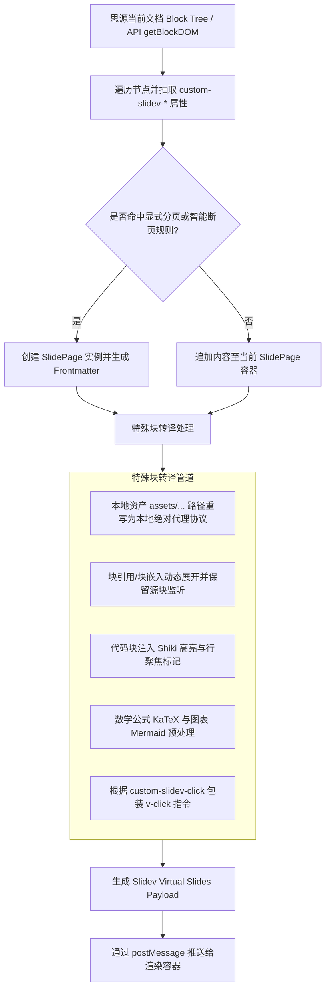
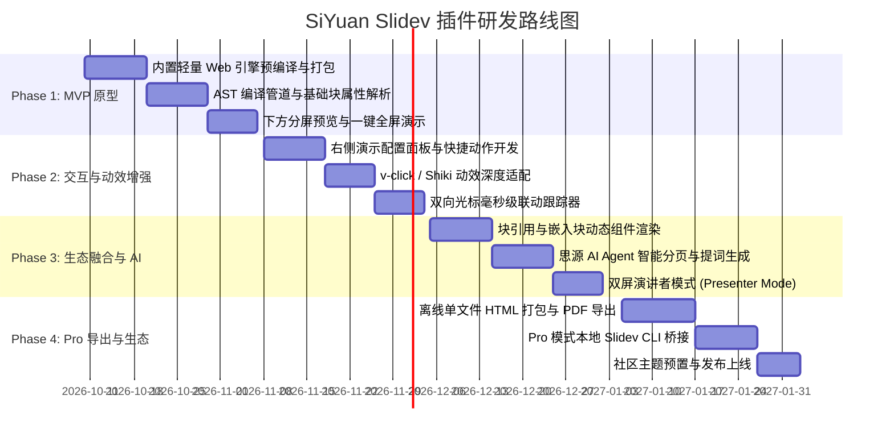

# 技术规格定义、属性协议与实施路线图

---

## 1. 块属性协议字典（Block Attribute Protocol）

为了规范元数据的持久化与解析，本插件统一采用具有命名空间隔离的 `custom-slidev-*` 块属性字典，按作用域清晰划分为**文档全局级**、**幻灯片页面级（水平分割线承载）**与**元素动效级**三层，完全符合思源笔记内核的 Inline Attribute List (IAL) 存储规范。

### 1.1 文档全局级属性（Document Scope）
存储载体：**文档根节点块（`NodeDocument`，块 ID 即 `docId`）**。属性内聚于文档本体，随文档同步与导出。

| 字段名 (`Attribute Key`) | 取值类型与范例 | 中文说明 |
| :--- | :--- | :--- |
| `custom-slidev-theme` | `"default"` \| `"seriph"` \| `"apple-basic"` 等 | **全局演示主题**。映射为 Slidev 根配置中的 `theme`。 |
| `custom-slidev-aspect-ratio` | `"16/9"` \| `"4/3"` \| `"16/10"` | **幻灯片画面比例**。映射为全局 `aspectRatio` 配置。 |
| `custom-slidev-highlighter` | `"shiki"` \| `"prism"` | **代码高亮引擎**。默认使用 Shiki。 |
| `custom-slidev-default-transition` | `"slide-left"` \| `"fade"` 等 | **默认转场效果**。未单独配置转场的页面默认继承此值。 |
| `custom-slidev-color-schema` | `"auto"` \| `"dark"` \| `"light"` | **颜色模式偏好**。 |

### 1.2 幻灯片页面级属性（Page Scope）
存储载体：**水平分割线块（`NodeThematicBreak`，即 `---`）**，封面页默认可直接挂在文档根块。

| 字段名 (`Attribute Key`) | 取值类型与范例 | 中文说明 |
| :--- | :--- | :--- |
| `custom-slidev-slide` | `"true"` \| `"cover"` \| `"end"` | **幻灯片分页标记**。声明该分割线开启新一页幻灯片。 |
| `custom-slidev-layout` | `"default"` \| `"cover"` \| `"two-cols"` \| `"fact"` \| `"intro"` | **页面版式**。映射为 Slidev 的 `layout` Frontmatter。 |
| `custom-slidev-transition` | `"slide-left"` \| `"slide-right"` \| `"fade"` \| `"view-transition"` | **本页切换转场动画**。映射为本页 Frontmatter 的 `transition`。 |
| `custom-slidev-background` | `"assets/bg.jpg"` 或 `"#1e1e2e"` | **页面背景配置**。支持本地相对路径资产或 CSS 背景值。 |
| `custom-slidev-notes` | 纯文本口播词 | **演讲者私有备注**。仅在演讲者视图中呈现给讲师，不投影到大屏。 |
| `custom-slidev-class` | `"text-center p-8"` 等 UnoCSS 类 | **页面根容器样式类**。附加于当前幻灯片根容器。 |

### 1.3 元素与动效级属性（Element Scope）
存储载体：**具体叶子内容块（段落、列表项、代码块等）**，严格跟随元素本身，不发生任何语义混淆。

| 字段名 (`Attribute Key`) | 作用对象 | 取值类型与范例 | 中文说明 |
| :--- | :--- | :--- | :--- |
| `custom-slidev-click` | 叶子内容块 | `""` \| `"1"` \| `"+1"` \| `"2"` \| `"hide"` | **渐进出现步骤动效 (v-click)**。控制内容在演讲时按翻页键逐步出现。 |
| `custom-slidev-motion` | 任意叶子块 | JSON 字符串：<br>`{"preset":"fade-in","duration":300}` | **微动效与位移参数**。映射为 `@vueuse/motion` 驱动的进入动画。 |
| `custom-slidev-shiki-lines` | 代码块 (`NodeCodeBlock`) | 行号区间字符串：<br>`"1-3\|5\|7-10"` | **代码逐行分步聚光高亮**。映射为 Slidev 的 `{1-3\|5\|7-10}` 语法。 |
| `custom-slidev-slot` | 多栏子块 | `"left"` \| `"right"` \| `"default"` | **分栏插槽归属**。当父级布局为 `two-cols` 时，标识当前块属于哪一栏。 |

---

## 2. AST 编译转换管线设计（Compiler Pipeline）

AST 转换管线是插件的核心桥梁，负责将思源笔记的结构化块树无损转译为符合 Slidev 运行时的数据载荷：



### 2.1 特殊块处理技术细节
1. **块引用与块嵌入（Block Reference & Block Embed）**：
   - 遇到 `NodeBlockRef` 或 `NodeBlockQueryEmbed` 时，编译器调用思源内核 API `/api/block/getBlockKramdown` 递归提取目标块内容；
   - 在生成的 Slidev AST 中将其标记为带有 `data-ref-id="xxxx"` 的动态子组件，保留其数据溯源能力。
2. **代码块逐行渐进高亮（Code Spotlight）**：
   - 读取代码块属性 `custom-slidev-shiki-lines`；
   - 组装为标准 Slidev 代码块语法：
     ````markdown
     ```ts {1-2|3-4|all}
     // 源代码...
     ```
     ````

---

## 3. 跨进程/跨容器通信协议规范（IPC & Messaging）

思源插件主上下文（Plugin Host）与内嵌的 Slidev 演示沙箱（Iframe Sandbox）通过标准的 `postMessage` 事件通道通信：

### 3.1 主进程 -> 渲染容器 (Host to Sandboxed Slidev)

```ts
interface IHostToSlidevMessage {
  action: "UPDATE_SLIDES" | "NAVIGATE_PAGE" | "HIGHLIGHT_ELEMENT" | "CONFIG_UPDATE";
  payload: {
    // 全量或增量幻灯片数据载荷
    slides?: ISlidevVirtualPage[];
    // 目标跳转页码 (1-based)
    pageIndex?: number;
    // 目标高亮聚焦的块 ID
    targetBlockId?: string;
    // 全局演示配置 (主题、字体、宽高比)
    config?: ISlidevPluginConfig;
  };
}
```

### 3.2 渲染容器 -> 主进程 (Sandboxed Slidev to Host)

```ts
interface ISlidevToHostMessage {
  action: "SLIDE_CHANGED" | "BLOCK_CLICKED" | "REQUEST_SAVE_ATTRS" | "EXPORT_TRIGGER";
  payload: {
    // 当前激活页码
    currentPage: number;
    // 当前幻灯片绑定的思源起始 Block ID
    currentBlockId: string;
    // 用户在演示中点击的特定 Block ID (用于编辑器精准对齐)
    clickedBlockId?: string;
    // 快捷修改属性请求 (如演示中修改了备注)
    updatedAttrs?: Record<string, string>;
  };
}
```

---

## 4. UI 扩展注入点与交互设计

```mermaid
graph LR
    subgraph TopBar[顶部工具栏]
        TB1[一键演示: 在文档下方开启分屏预览]
    end
    subgraph BottomTab[下方独立分屏预览页签]
        BT1[宽屏实时跟随渲染沙箱]
        BT2[📌 Pin 图钉锁定文档]
        BT3[大纲缩略抽屉 / 翻页 / 全屏 / 导出]
    end
    subgraph SideDock[右侧 Dock 演示配置面板]
        SD1[动态识别当前块: 内容块 / 分页符 / 全局文档]
        SD2[版式 / 转场 / 逐步出现 / 双栏插槽可视化芯片]
        SD3[情境快捷操作: 插入分页符 / 双栏对比 / 提词]
    end
    subgraph PresenterWindow[演讲者视窗]
        PW1[双屏外接投屏控制器]
        PW2[提词器与计时器面板]
    end
```



1. **下方分屏独立预览页签（`SlidevPreviewTab`）**：
   - 基于思源 `addTab` 与 `openTab({ position: "bottom" })` 原生分屏系统实现；
   - 包含 📌 Pin 图钉锁定当前文档机制、幻灯片缩略卡片抽屉与全套放映/导出控制栏。
2. **右侧演示配置面板（`SlidevInspectorDockView`）**：
   - 随光标所在块类型自动切换：普通内容块（`v-click`、`slot`、`shiki-lines` 与快捷动作）、分页符（版式选择、转场动效、页面背景、Notes 提词、删除/后插页）、全局文档（主题、画幅比例、默认转场与全局操作）；
   - 彻底移除了侵入思源原生块菜单的多级子菜单与悬浮遮挡气泡，所有设置即时点击即生效。

---

## 5. 四阶段研发路线图与里程碑（Roadmap）



### 里程碑交付物说明

- **Phase 1: MVP 原型（核心可行性验证）**
  - 完成内置轻量 Vue 3 + Slidev Client 沙箱搭建；
  - 实现从文档 H1/H2 或 `---` 分割线自动断页并在下方分屏预览页签实时渲染；
  - 保证本地图片资源正常代理访问。
- **Phase 2: 交互与动效增强（零污染体验成型）**
  - 交付右侧 Dock 演示配置面板，动态切换内容块、分页符、文档根卡片；
  - 支持列表项/段落的逐步出现（`v-click`）与代码逐行聚光高亮（`shiki-lines`）；
  - 实现上方打字/移动光标，下方预览与右侧面板平滑跟随定位与联动。
- **Phase 3: 思源深度融合与 AI 赋能（差异化壁垒确立）**
  - 支持思源块引用、块嵌入动态拉取源内容；
  - 接入思源 AI，一键将长文笔记智能转换为带有动画与提词的完整演示稿；
  - 实现双屏专业演讲者视图。
- **Phase 4: Pro 模式与交付生态（专业生产力闭环）**
  - 支持打包导出无外部依赖的独立离线 HTML / PDF；
  - 为极客用户提供直连本地 Slidev DevServer 的选项，支持自定义 Vue 组件与主题。
