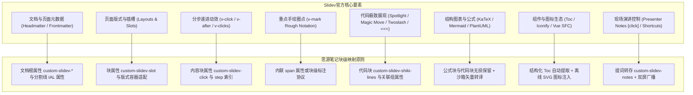
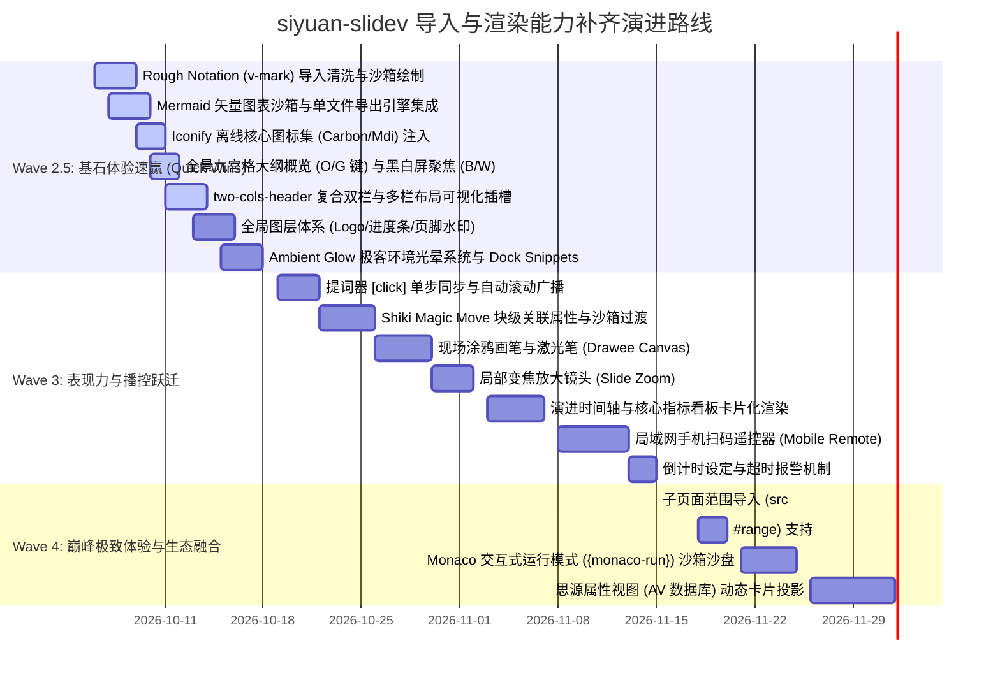

# 基于 Slidev 与 Slidev-Templates 源码生态的演示能力差距分析与高频特性集成演进指南

---

## 1. 执行摘要与背景梳理 (Executive Summary)

### 1.1 评测基准与分析目标
本分析立足于三大核心开源源码资产与规范体系，为思源笔记演示插件 **`siyuan-slidev`** 确立完备的演进基线：
1. **`D:\MyCodingProjects\slidev` 核心仓库**：
   - **`skills/slidev` 语法参考规范**：包含 50+ 个专题 Markdown 说明文档，系统定义了 Slidev 的核心语法、Headmatter/Frontmatter 配置体系、动画与转场模型、Shiki 代码高亮与 Magic Move、LaTeX/Mermaid 图表支持、以及双屏演讲者控制协议等。
   - **`demo/starter/slides.md` 官方全功能示范样板**：作为 Slidev 官方首推的“大满贯”演示样板，该文件串联了从主题配置、封面到动画、代码、图表、组件、拖拽、子页面导入、Monaco 交互等共计 16 张幻灯片的全量语法形态。
2. **`D:\MyCodingProjects\slidev-templates` 模版生态库**：
   - 包含 `neko-style` 深度打磨的高水准技术演讲系统、`paper-lab` 学术研究模版、`editorial-grid` 叙事提案模版、`terminal-ink` 终端系统模版及组件目录 `COMPONENT-CATALOG.md`、页面范式 `PAGE-PATTERNS.md`、片段集 `snippets/`。
3. **对照标的：思源笔记插件项目 (`d:\MyCodingProjects\siyuan-slidev`)**：
   - **导入功能管线**：`src/compiler/slidev-importer.ts`、`src/compiler/html-cleaner.ts`、`src/compiler/asset-importer.ts`。
   - **编译与数据模型**：`src/compiler/document-compiler.ts`、`src/compiler/slidev-ast-builder.ts`。
   - **预览与渲染管线**：`src/engine/web-sandbox-bridge.ts`、`src/export/markdown-renderer.ts`、`public/slidev-client/index.html`、`src/export/single-html-exporter.ts`、`src/ui/tab/SlidevPreviewTab.vue`。

目标是精准识别**要实现专业、惊艳、高说服力的优秀演示效果，本插件的导入功能以及预览展示时的渲染功能还需要补齐哪些关键缺失**，并给出具体使用场景和工程级落地开发建议。

---

### 1.2 当前插件项目的开发进展基线
截至当前版本，`siyuan-slidev` 已经构建了非常坚实的技术底座与架构雏形：
- ✅ **基于思源 IAL 的零污染元数据架构**：将所有版式、动画、备注、高亮等元数据解耦存储于思源块属性（`custom-slidev-*`）与水平分割线中，保障 Markdown 正文纯净。
- ✅ **现代化双重视图交互**：
  - **下方独立分屏预览页签 (`SlidevPreviewTab`)**：支持 📌 Pin 图钉锁定文档、缩略图抽屉、全屏放映、快捷导出与双向光标跟随联动。
  - **右侧演示配置面板 (`SlidevInspectorDockView`)**：情境感知切换内容块、分页符、文档全局根属性，支持一键配置 `v-click`、`layout`、`shikiLines` 等。
- ✅ **AST 编译管道与双模渲染引擎**：
  - 编译器支持分割线切页、思源本地资源代理路径重写（`assets-rewriter.ts`）、块引用深度递归解析（`block-ref-resolver.ts`）。
  - 双模引擎：0 依赖内置轻量 Web 沙箱 + 极客 Pro 模式本地 Slidev CLI (端口 3030) 桥接。
- ✅ **双屏演讲者视窗与离线导出**：
  - 独立双屏讲师视窗（`presenter.html`），基于 `BroadcastChannel` 毫秒级广播同步。
  - 单文件独立 HTML SPA 与高分辨率 PDF 讲义导出。
- ✅ **健壮的导入基础管线**：
  - 词法状态机切分（`splitSlidevMarkdownChunks`）可安全跳过代码块和 HTML 注释内的 `---` 分割线。
  - 健壮 YAML Frontmatter 解析器支持多行管道符（`|`, `>`）、嵌套字典对象及行内 `#` 注释剥离。
  - 支持外部代码切片展开（`<<< @/snippets/...`）与单层外部页面子导入（`src: ./pages/*.md`）。

---

### 1.3 核心问题诊断：为什么仍有“演示表现力与操作体验”差距？
虽然底层管线已跑通，但从**真实演讲者（Presenter）与听众（Audience）的体验视角**审视，当前版本在导入解析与分屏渲染两端仍存在明显断层：
1. **导入清洗存在“过度清洗”与“元数据断链”**：
   - 官方语法中的行内手绘标注（`v-mark`）、公式渐进修饰符（`$$ {1|3|all}`）、代码块执行模式（`{monaco-run}`）在导入清洗时被直接剥离；
   - 核心语法容器如 ````md magic-move` 在导入时被拆解为互不相干的普通代码块，丢失了同一动画组的关联元数据。
2. **预览沙箱缺乏关键动态表现层引擎**：
   - 内置 Web 沙箱目前仅引入了 Vue 3 和 UnoCSS attributify，缺少 **Rough Notation 手绘圈点引擎**、**Mermaid 动态矢量渲染引擎** 以及 **Iconify 常用矢量图标库**，导致官方 Starter 示例中的核心图表与图标无法呈现；
   - 代码切换仅支持静态步骤跳转，缺少类似 **Shiki Magic Move 的平滑飞行动画**。
3. **高频复合版式与业务表达组件仍显单一**：
   - 生产级演示高频刚需如 `two-cols-header`（带表头的双栏）、`cols-3`（三栏对比）、`image-left/right`（沉浸式图文）在思源侧尚未形成可视化插槽切换机制；
   - `slidev-templates` 中的演进路线图（Roadmap）、核心指标卡片（Stats Row）、问题对冲对比（Problem vs Solution）尚未在思源中沉淀为“一键套用片段”。
4. **现场播控与演讲互动能力未充分释放**：
   - 双屏提词器尚未实现按 `[click]` 标记随单步点击进行高亮与平滑滚动；
   - 缺少演讲时至关重要的**全景大纲平铺跳转（Grid Overview / `O` 键）**与**黑屏/白屏静音聚焦（`B`/`W` 键）**。

---

## 2. Slidev 核心语法要素与思源使用场景映射

通过对 `skills/slidev`（50+ 项专题）及 `starter/slides.md` 的系统性梳理，筛选出与思源笔记个人知识库、技术分享、会议汇报、学术演讲**最相关、最通用**的八大语法维度，并确立其在思源笔记块级生态中的设计映射：



### 2.1 核心通用语法在思源中的映射规范表

| 核心维度 | Slidev 语法范式 (`skills` / `starter`) | 思源笔记使用场景价值 | 思源推荐实现机制 (零污染原则) |
| :--- | :--- | :--- | :--- |
| **元数据管理** | 首块 Headmatter（`theme`, `aspectRatio`, `transition`, `title`）；各页 Frontmatter（`layout`, `background`, `class`, `image`） | 决定整篇演示文稿的视觉风格与单页版式，完全不应污染 Markdown 正文。 | 首块写入文档根 Block 属性；单页写入分页符 `---`（`tb` 块）的 IAL 属性。 |
| **版式与插槽** | `layout: cover \| default \| two-cols \| two-cols-header \| image-right \| fact`；插槽语法糖 `::right::`, `::left::` | 满足“标题+双栏对比”、“左图右文”等 90% 汇报需求。 | 页面属性指定 `custom-slidev-layout`，块属性标记 `custom-slidev-slot="right"`。 |
| **递进动画** | `<div v-click>`、`<v-clicks>` 列表逐项显现、`v-after` 同步出现、`v-click="[2,5]"` 范围控制 | 演讲时逐行引导观众注意力，避免信息一次性过载。 | 内容块属性 `custom-slidev-click="1"`、`custom-slidev-clicks="true"`。 |
| **手绘重点圈点** | `<span v-mark.underline>`、`<span v-mark.circle.orange="8">` (Rough Notation) | 在同一段落或标题内强调关键字、核心指标或结论。 | 行内标记保留或转存属性，沙箱动态渲染手绘图形。 |
| **代码渐进高亮** | ```` ```ts {all|4|6|6-7|9|all} ````、`[filename]`、`<<< @/snippets/file.ts#region` | 程序员演说核心：逐步突出逻辑重点，免去手动贴多段重复代码。 | 代码块属性 `custom-slidev-shiki-lines`，导入期展开切片引用。 |
| **代码变形流动** | ````md magic-move 包裹多个代码块平滑过渡 | 架构重构、API 升级对比时的杀手级视觉动画。 | 代码块属性记录 `custom-slidev-magic-move="group-id:step"`。 |
| **图表与公式** | `$$ {1|3|all}` 渐显数学公式；```` ```mermaid ```` 流程图、时序图、思维导图 | 学术分享、系统架构设计、业务流程图解。 | 思源原生公式块与代码块无缝保留，预览沙箱内联引擎直接渲染 SVG。 |
| **提词与现场播控** | 末尾注释 `<!-- [click] 备注 -->`；快捷键 `Space`/`O`/`B`/`W` | 讲师双屏提示、限时掌控、全景大纲平铺跳页、黑屏聚焦。 | 提词存入 `custom-slidev-notes`，广播通道传递当前点击步数。 |

---

## 3. 核心差距全景矩阵与雷达评估 (Comprehensive Capability Matrix)

下表全面对照 Slidev 核心语法、`slidev-templates` 模版实践与当前插件进展，明确优先级与影响度：

| 评估维度 | 核心功能 / 设置项 | Slidev / 模版现状 | siyuan-slidev 现状 | 用户痛点与影响 | 建议优先级 |
| :--- | :--- | :--- | :--- | :--- | :---: |
| **动效表现力** | **Rough Notation** 手绘风圈点高亮 | 内置 `<v-mark>`，支持圈出、下划线、荧光笔 | 导入清洗抹除属性，沙箱无绘制引擎 | 无法在段落内精准强调某个关键词、数据或图表局部 | **P0** |
| **动效表现力** | **Mermaid 图表矢量渲染** | 原生支持 Mermaid，可配 `v-click` 渐进演进 | 沙箱未挂载引擎，仅显示为纯文本代码块 | 复杂架构图、流程图无法图形化展示 | **P0** |
| **动效表现力** | **Shiki Magic Move** 代码平滑形变 | 官方内置 `<ShikiMagicMove>`，跨步平滑飞行动画 | 导入丢失组关联，沙箱仅支持单块静态行高亮 | 代码重构与演进讲解时生硬跳变，缺乏视觉冲击力 | **P1** |
| **动效表现力** | **Ambient Glow 极客环境光晕** | `neko-style` 核心设计语言，动态渐变光晕与噪点 | 仅纯色或静态单张图片背景 | 暗色演讲页面死黑沉闷，缺少科技发布会级的高级质感 | **P0** |
| **动效表现力** | **现场涂鸦画笔与激光笔** | 内置 Drawee Canvas，快捷键唤出画笔/光斑 | 无涂鸦图层 | 现场互动无法随手勾画演算，缺少引导听众视线的激光笔 | **P1** |
| **动效表现力** | **局部变焦放大镜头 (Zoom)** | 官方支持 `Alt+Click` 局部放大居中 | 仅等比视口缩放 | 架构图、复杂流程图细节无法临时放大给观众看清 | **P2** |
| **版式与栅格** | **高阶复合双栏与多栏布局** | 原生 `two-cols-header`, `cols-3`, `grid` | 仅支持无表头的两栏左右切分 | 极为高频的“上方标题说明 + 下方左右对照”无法直接排版 | **P0** |
| **版式与栅格** | **沉浸式全屏图文排版** | 原生 `image-left`, `image-right`, `image` | 需手动在正文插图片 | 案例介绍、产品截图缺乏大画幅无边框沉浸感 | **P1** |
| **版式与栅格** | **全局图层体系 (Global Layers)** | 原生 `global-top`, `global-bottom` 挂载页眉页脚 | 页面各自孤立，无全局图层 | 缺少全局常驻 Logo、章节导航、总进度条、机密水印 | **P0** |
| **图标与生态** | **Iconify 常用矢量图标库** | `<carbon:*>`、`<mdi:*>` 任意使用 | 沙箱缺少图标资源库，标签显示为空白 | 现代幻灯片的按钮、箭头与外链指示丢失 | **P0** |
| **业务表达组件** | **演进路线图与管道流程** | `neko-style` 的 `StackedFlowPipeline` 等 | 无对应组件映射 | 架构演进、业务发布 Roadmap 只能排成普通列表 | **P1** |
| **业务表达组件** | **核心指标与数据大字报** | `neko-style` 的 `StatsRow`, `FeatureIconGrid` | 仅有 `fact` 大字报版式 | 无法整齐排列多个带量级标签的关键指标与图标卡片 | **P1** |
| **业务表达组件** | **问题 vs 方案对比模式** | `ProblemSolutionSplit`, `Bad-vs-Good` | 依赖用户自行写文字 | 架构方案选型或复盘会缺少左右视觉对冲结构 | **P1** |
| **业务表达组件** | **Dock 面板片段库 (Snippets Hub)** | `neko-style/snippets` 丰富 Markdown 模版 | 仅能插入单个空分割线 | 用户不知道如何组合块属性搭出高级页面，上手门槛高 | **P0** |
| **播控与演讲** | **全景九宫格大纲概览 (`O`/`G` 键)** | 原生网格平铺视图，键盘挑选跳页 | 仅有侧边/抽屉缩略图 | 答疑时无法一秒在全屏视野找到对应幻灯片并跳回 | **P0** |
| **播控与演讲** | **黑屏 / 白屏静音聚焦 (`B`/`W` 键)** | 国际演讲标准快捷键，一键切黑/切白 | 未监听快捷键 | 演讲中途脱稿互动或黑板演算时，无法切断大屏干扰 | **P0** |
| **播控与演讲** | **提词器 [click] 单步同步** | 提词行随点击高亮并自动滚动 | 提词为静态单段展示 | 无法从提词器中直观获知当前讲到了哪句话 | **P1** |
| **播控与演讲** | **局域网手机扫码遥控器** | 原生 `--remote` 扫码遥控 | 仅支持同一机器双屏 | 演讲者必须站在电脑前敲键盘，无法拿手机全场走动巡回 | **P1** |
| **播控与演讲** | **限时演说倒计时与超时报警** | 演讲者视图支持目标时长与颜色预警 | 仅简单正向累加计时器 | 会议严格限时时容易超时，缺乏剩余时间感知 | **P1** |
| **思源原生融合** | **属性视图 (AV 数据库) 投影** | N/A (思源独有) | 未转译 AV 块，显示简陋 | 思源强大的数据库表格与看板无法直接呈现在幻灯片中 | **P1** |

---

## 4. 导入功能关键缺失与深度差距分析 (Import Pipeline Gaps)

虽然当前导入功能已能跑通官方 Starter 示例的基本骨架，但若要达到**生产级、无损互转（Round-trip Lossless）**的标准，在导入解析管线中仍存在以下六大关键缺失：

```
Slidev Markdown 源码 (含高阶语法)
   │
   ├── [Gap 1] <span> 带有 v-mark ──► 被 html-cleaner 解包/剥离 ──► 丢失手绘圈点信息
   ├── [Gap 2] ````md magic-move ───► 被当做普通代码块拆分 ────► 丢失代码块间的变形链
   ├── [Gap 3] $$ {1|3|all} ────────► 正则暴力剥离花括号 ─────► 丢失公式逐步显现步数
   ├── [Gap 4] ```ts {monaco-run} ──► 选项参数被丢弃 ────────► 丢失交互式执行属性
   ├── [Gap 5] v-drag & dragPos ────► 缺乏坐标到绝对布局映射 ──► 元素位置脱位
   └── [Gap 6] src: file.md#2-5 ────► 仅支持整文件导入 ────────► 无法导入特定切片页
```

### 4.1 Gap 1: Rough Notation (`v-mark`) 行内标注信息被冲刷
- **Slidev 语法表现**：
  ```html
  <span v-mark.red="7"><code>v-mark</code> directive</span>
  <span v-mark.circle.orange="8">inline marks</span>
  <span v-mark.underline.orange>inline markers</span>
  ```
- **当前插件问题**：
  在 `src/compiler/html-cleaner.ts` 的 `convertHtmlToCleanMarkdown` 中，规则 22 将非白名单的 `<span>` 标签统一替换为空（`text.replace(/<\/?span\b[^>]*>/gi, "")`）。虽然文字得到了保留，但标签上的修饰符（`.underline`, `.circle`, `.red`）及步数（`="7"`）被完全抹除。导入到思源后，变成毫无标识的纯文本。
- **补齐方案**：
  在 `html-cleaner.ts` 的保护阶段（规则 1.3）新增针对 `v-mark` 属性的识别提取：
  将 `<span v-mark.circle.orange="8">文字</span>` 转换为思源友好的安全 HTML 或保留特定自定义属性的标记：
  `<span class="slidev-v-mark" data-mark-type="circle" data-mark-color="orange" data-mark-step="8">文字</span>`，并在思源块属性或内联 HTML 块中完整留存。

### 4.2 Gap 2: Shiki Magic Move 代码流动包裹层断链
- **Slidev 语法表现**：
  ````md
  ````md magic-move {lines: true}
  ```ts
  // step 1
  ```
  ```ts
  // step 2
  ```
  ````
  ````
- **当前插件问题**：
  在导入思源笔记时，外层的 ````md magic-move` 容器被思源 Lute 引擎或插件分块逻辑解析为多段互相孤立的普通代码块（`c` 块）。每个代码块在思源文档树中没有任何属性能够证明“它们属于同一个 Magic Move 演示序列”，导致在预览渲染时无法将其重构为一个动画容器。
- **补齐方案**：
  在 `slidev-importer.ts` 解析阶段，识别四反引号 ````md magic-move` 结构，为该区间内的每一个代码块注入关联元属性：
  - 块 1：`custom-slidev-magic-move="group-1:1:total-2"`
  - 块 2：`custom-slidev-magic-move="group-1:2:total-2"`
  这样即使在思源主编辑区被视为独立代码块，在渲染引擎中也能通过 `group-1` 重新聚合。

### 4.3 Gap 3: 数学公式渐进点击修饰符 `{1|3|all}` 丢失
- **Slidev 语法表现**：
  ```latex
  $$ {1|3|all}
  \begin{aligned}
  \nabla \cdot \vec{E} &= \frac{\rho}{\varepsilon_0} \\
  ...
  \end{aligned}
  $$
  ```
- **当前插件问题**：
  在 `slidev-importer.ts` 第 746 行：
  ```typescript
  body = body.replace(/^\$\$\s+\{[^}]+\}/gm, () => "$$")
  ```
  该逻辑直接将 `{1|3|all}` 替换为普通的 `$$`，直接丢弃了高亮步进信息。
- **补齐方案**：
  在清洗前提取修饰符内容，将其转化为对应思源数学公式块的块属性：
  `custom-slidev-math-click="1|3|all"`。在沙箱渲染时据此高亮对应公式行。

### 4.4 Gap 4: 代码块高级执行修饰符 `{monaco}` / `{monaco-run}` 被简单剥离
- **Slidev 语法表现**：
  ````md
  ```ts {monaco}
  ```ts {monaco-run}
  ```ts {monaco} {height:'300px'}
  ````
- **当前插件问题**：
  在 `slidev-importer.ts` 第 744 行：
  ```typescript
  body = body.replace(/(^```\w+(?:[ \t]+\[[^\]]*\])?)[ \t]+\{[^}]+\}(?:[ \t]+\w+)?/gm, "$1")
  ```
  将所有花括号内容直接抹去。导致导入后无法区分普通代码块、Monaco 编辑器代码块、以及可直接运行控制台代码块。
- **补齐方案**：
  在清洗前检测花括号内是否包含 `monaco`、`monaco-run`、`monaco-diff`，若存在，则分别写入块属性：
  `custom-slidev-editor="monaco-run"`，以便后续在预览视窗中激活对应交互运行时。

### 4.5 Gap 5: 绝对定位与拖拽容器 (`v-drag` / `dragPos`) 无法沉淀为块级布局
- **Slidev 语法表现**：
  ```yaml
  ---
  dragPos:
    square: 548,306,167,_,252
  ---
  
  <v-drag pos="663,206,261,_,-15">内容</v-drag>
  ```
- **当前插件问题**：
  当前 `dragPos` 虽被以 JSON 格式保存在 `custom-slidev-dragPos` 中，但对于正文中的 `v-drag="'square'"`，导入器未将其解析为块级相对/绝对坐标属性；用户在思源笔记中看到的是无法拖动的普通图片或文本。
- **补齐方案**：
  将匹配到的定位坐标直接转换为思源块级 CSS 变量或属性：
  `custom-slidev-pos="548,306,167,_,252"`，并在沙箱中映射为绝对定位样式。

### 4.6 Gap 6: 外部子页面切片导入 (`src: ./other.md#range`) 未支持
- **Slidev 语法表现**：
  `skills/slidev/references/syntax-importing-slides.md` 明确支持：
  ```yaml
  ---
  src: ./other.md#2       # 仅导入第 2 页
  ---
  ---
  src: ./other.md#3-5     # 导入第 3 至第 5 页
  ---
  ```
- **当前插件问题**：
  当前 `slidev-importer.ts` 仅按文件路径全量导入子页面，若 `src` 中带有 `#2` 或 `#3-5`，解析器会因找不到该文件名而直接失败或作为占位块处理。
- **补齐方案**：
  在 `slidev-importer.ts` 的 `srcVal` 解析中解析 `#` 之后的页面范围参数（`pageRange`），解析子文档后通过切片数组 `subParsed.slides.slice(start, end)` 进行定向提取。

---

## 5. 预览展示与渲染功能关键缺失分析 (Preview & Sandbox Gaps)

针对 `siyuan-slidev` 的分屏预览（`SlidevPreviewTab.vue`）、离线单文件导出（`single-html-exporter.ts`）以及 Web 沙箱运行时（`public/slidev-client/index.html`），对照官方 Starter 运行效果，存在以下关键差距：

```
Slidev 官方 Starter 实际放映表现
   │
   ├── [Gap 1] 真实 Rough Notation 动态画笔 ──► 本地沙箱无 rough-notation 运行时 ──► 静态或无效果
   ├── [Gap 2] Mermaid / PlantUML 矢量渲染 ──► 本地沙箱无 mermaid.js 运行时 ────► 仅显示为纯文本代码块
   ├── [Gap 3] Iconify 图标 (<carbon:arrow>) ──► 沙箱缺少图标资源库 ──────────► 标签空白不显示
   ├── [Gap 4] Shiki Magic Move 流畅形变 ────► 沙箱缺乏 token 差异变形引擎 ─────► 变成生硬跳变
   ├── [Gap 5] 提词器 [click] 单步同步 ───────► 演讲者视窗静态单段展示 ────────► 无法随点击高亮/滚动
   ├── [Gap 6] 播控全景大纲 (O) 与黑白屏 (B/W) ─► 快捷键未捕获 ───────────────► 现场互动能力受限
   └── [Gap 7] 氛围光晕与全局图层 ────────────► 缺少渐变光晕与常驻页眉页脚 ───► 页面沉闷单调
```

### 5.1 Gap 1: 缺少 Rough Notation 手绘圈点动态渲染引擎
- **差距现状**：
  Slidev 官方 Starter 第 9 页展示了：
  `The <span v-mark.red="7">v-mark directive</span> also allows you to add <span v-mark.circle.orange="8">inline marks</span>`。
  当切换到第 7 步和第 8 步点击时，屏幕上会以手绘铅笔质感动态画出红线下划线和橙色圆圈。
  在当前的 Web 沙箱 (`index.html`) 中，仅引入了 Vue 3 和 UnoCSS，并没有引入 `rough-notation` 运行时，使得该效果在沙箱中完全处于缺失状态。
- **影响**：
  用户在制作专业技术汇报时，无法通过手绘下划线和圆圈聚焦重点，视觉冲击力大幅折损。

### 5.2 Gap 2: Mermaid 与 PlantUML 图表未在沙箱中动态渲染为 SVG
- **差距现状**：
  Slidev Starter 第 12 页包含了四个代表性图表：
  1. ```` ```mermaid ```` 时序图 (`sequenceDiagram`)
  2. ```` ```mermaid ```` 决策图 (`graph TD`)
  3. ```` ```mermaid ```` 思维导图 (`mindmap`)
  4. ```` ```plantuml ```` 架构图
  当前沙箱中，```` ```mermaid ```` 块被当作标准代码块处理，被加上行号和语法高亮，并没有被 `mermaid.render()` 转译为矢量 SVG 图形。
- **影响**：
  架构图、业务流程图和思维导图无法图形化展示，严重背离了技术演讲的直观表达需求。

### 5.3 Gap 3: Iconify 图标库与图标组件未挂载
- **差距现状**：
  Slidev 官方极度依赖 `<carbon:arrow-right />`、`<carbon:edit />`、`<carbon:logo-github />` 等现代化矢量图标。
  在当前沙箱中，UnoCSS 仅加载了 `unocss.attributify.global.js`，缺少对应图标集（`@iconify-json/carbon`）的 SVG 定义。沙箱中解析该元素时，浏览器将其当作未注册的普通自定义 HTML 标签，导致界面上图标位置全为空白。
- **影响**：
  页面按钮、操作指引、外链指示图标大量丢失，页面显得粗糙残缺。

### 5.4 Gap 4: 缺少 Shiki Magic Move 平滑形变过渡
- **差距现状**：
  Starter 第 6 页展示了 4 步代码重构演进（从普通对象到 Vue 2 Options API，再到 Vue 3 Composition API）。在 Slidev 原版中，代码跨步演进时，相同的变量名（如 `author`、`books`）会流畅“飞”到新位置，改动的行渐变交替。
  当前沙箱内没有引入类似 `@shiki/magic-move` 的微观 diff-morph 渲染逻辑，多步代码只能像翻页一样瞬间生硬切换。
- **影响**：
  无法展现 Slidev 最具标志性的代码重构动画效果。

### 5.5 Gap 5: 双屏演讲者视图缺乏 `[click]` 步进同步与自动滚动
- **差距现状**：
  `skills/slidev/references/animation-click-marker.md` 明确定义了提词语法：
  ```markdown
  <!--
  [click] 第一步说明
  [click] 第二步说明：解释 count = ref(0)
  [click:3] 最后一步
  -->
  ```
  在 Slidev 官方演讲者视图中，提词行会伴随当前幻灯片的点击步数同步加粗高亮，并自动平滑滚动到当前视角。
  当前插件的 `presenter.html` 仅能显示静态提词文本，无法感知当前步数的推进。
- **影响**：
  演讲者在进行多步动效演说时，无法从提词器中直观获知当前讲到了哪句话。

### 5.6 Gap 6: 现场播控大纲全景图 (`O`/`G`) 与黑白屏聚焦 (`B`/`W`) 缺失
- **差距现状**：
  在 Slidev 官方全屏放映时：
  - 按 `O` 或 `G` 键：立即呼出全景 16 宫格缩略图平铺视图，支持用键盘方向键选择并回车即刻跳页；
  - 按 `B` 键：全屏变黑（Blackout），按 `W` 键：全屏变白（Whiteout），用于讲师脱稿互动或黑板板书。
  当前沙箱仅支持 `Space`、`ArrowLeft`、`ArrowRight` 翻页，缺失了这两个高频演讲功能。

### 5.7 Gap 7: Ambient Glow 极客环境光晕与质感系统缺失
- **差距现状**：
  `slidev-templates/neko-style` 的核心设计语言拥有极细腻的动态渐变环境光晕（`glow: top|center|radial`）与微噪点暗纹。
  当前沙箱仅支持纯色或单张图片背景，暗色演讲页面容易死黑沉闷。

### 5.8 Gap 8: 全局图层体系 (Global Layers) 缺失
- **差距现状**：
  官方的 `global-top.vue` 与 `global-bottom.vue` 允许在所有幻灯片上叠加常驻 Logo、章节导航、总进度条（Progress bar）与机密水印。当前沙箱各页面完全孤立，无全局图层容器。

---

## 6. 高频业务演说组件库（借鉴 slidev-templates 设计精髓）

在 `slidev-templates`（尤其是 `neko-style/docs/COMPONENT-CATALOG.md` 与 `PAGE-PATTERNS.md`）中，沉淀了 20+ 个极其成熟的高频表达组件。**插件的最佳解法是：提供现成的“排版片段模板（Snippets）”与专用渲染器，用户在思源中插入原生结构块，插件自动在幻灯片中升华为高级组件！**

### 6.1 演进路线图与时间轴卡片 (Roadmap Progression Pipeline)
- **原生对标**：`neko-style` 的 `RouteProgressionLane` 与 `StackedFlowPipeline`。
- **思源使用场景与痛点**：
  项目立项汇报与年度复盘中必有“演进时间线（Q1 调研 -> Q2 研发 -> Q3 上线 -> Q4 规模化）”。用户在思源中写无序列表显得干瘪单调。
- **思源原生映射与落地**：
  - 用户写一个普通的 3~5 项带编号列表，为父列表块标记属性 `custom-slidev-widget="timeline"`。
  - 客户端渲染为横向卡片队列，卡片间带呼吸动效箭头 `→`，自动随 `v-click` 逐个“点亮”。

### 6.2 特性网格与核心数据指标看板 (FeatureIconGrid & StatsRow)
- **原生对标**：`neko-style` 的 `FeatureIconGrid`（图标网格）与 `StatsRow`（核心业务指标行，如 `99.99%`、`10x`、`500ms`）。
- **思源使用场景与痛点**：
  做产品发布或性能总结时，需要展示超大数字指标卡片，文字陈述缺乏视觉冲击力。
- **思源原生映射与落地**：
  - 用户创建 3 列的表格或特定段落，标记属性 `custom-slidev-widget="stats"`。
  - 客户端渲染为大号渐变粗体字（`font-size: 3.5rem`）搭配灰色大写标签，卡片带磨砂玻璃背景。

### 6.3 问题对冲与优劣对比模式 (Problem vs Solution Split / Bad vs Good)
- **原生对标**：`neko-style` 的 `ProblemSolutionSplit`、`bad-vs-good.md`。
- **思源使用场景与痛点**：
  架构评审、方案选型中必有“现状痛点 vs 解决方案”对冲分析。
- **思源原生映射与落地**：
  - 用户使用 `two-cols` 版式，左栏设置属性 `custom-slidev-tone="danger"`，右栏设置 `custom-slidev-tone="success"`。
  - 客户端左栏渲染红粉色柔光与警告图标 ⚠️，右栏渲染翠绿色柔光与对勾图标 ✅，并支持随空格先后弹出。

### 6.4 右侧 Dock 面板内置“演说排版片段库 (Snippets Hub)”
- **设计初衷**：
  普通笔记用户不是前端专家，记不住复杂的插槽或属性。
- **落地设计**：
  1. 在右侧 Dock 面板底部增加 **「🧩 常用幻灯片片段库 (Snippets)」**。
  2. 预置精选高频片段（路线图、指标看板、方案对冲、分层架构图、金句大字报、致谢结束页）。
  3. 用户点击任一片段按钮，插件调用思源内核 API `insertBlock`，直接将打好 `custom-slidev-*` 属性的一组纯净思源块插入到光标处，用户只需像填空题一样替换文字！

### 6.5 思源属性视图 (AV 数据库) 动态投影为幻灯片表格/看板卡片
- **思源独特价值**：
  思源笔记 3.8+ 推出的“属性视图（Attribute View / AV 数据库）”是用户的核心生产力工具，沉淀了任务清单、里程碑等结构化数据。
- **落地设计**：
  编译器拦截 `NodeAttributeView` 块节点，调用思源 API 获取过滤排序后的数据，自动转译为 Slidev 现代化无边框自适应表格或多列看板卡片网格。

---

## 7. 现场演讲与专业播控体验进阶 (Presenter Mastery)

### 7.1 局域网移动端远程遥控器 (Remote Control via QR Code)
- **原生对标**：Slidev 的 `--remote` 模式。
- **思源独特优势**：
  思源笔记自带常驻本地的 Go 后端服务器（含 HTTP 与 WebSocket）。演讲者完全可以脱离电脑，手持手机在讲台上走动巡回翻页。
- **落地设计**：
  - 演讲者视窗右上角弹出「📱 手机遥控」二维码；
  - 手机扫码打开轻量移动端页面：上半部分大字号展示口播提词 Notes，下半部分两个巨大无障碍触控按钮（`[◀ 上一步]` 与 `[下一步 ▶]`），点击带有震动反馈（`navigator.vibrate(40)`）。

### 7.2 限时演说倒计时与超时报警机制 (Countdown & Overtime Warning)
- **原生对标**：Slidev 演讲者模式 Timer 倒计时模块。
- **落地设计**：
  - 在 `presenter.html` 中输入目标时长（如 `20min`）；
  - 正计时与倒计时双行呈现；剩余时间 < 20% 显示黄色警示，超时后显示醒目的红色闪烁负数（如 `-01:23 OVERTIME`）。

### 7.3 现场涂鸦画笔、发光激光笔与白板 (Drawee Canvas / Drawing)
- **原生对标**：Slidev 内置 Drawee 画笔系统。
- **落地设计**：
  - 视口最上层叠加绝对定位的 `<canvas>`；
  - 按快捷键 `Ctrl+D` 激活绘图模式，弹出调色盘；
  - 按 `L` 键激活**激光笔模式**，光标变为带红色发光拖尾的光斑。

---

## 8. 系统性补齐技术方案与分阶段演进路线图 (Technical Roadmap)

为彻底抹平上述差距，制定以下分阶段演进实施路线图：



### 8.1 P0 级即刻落地设计细节

#### 1. Rough Notation 手绘圈点支持
- **资源挂载**：在 `public/slidev-client/assets/` 下引入体积仅 ~3KB 的 `rough-notation.iife.js`。
- **导入器适配 (`html-cleaner.ts`)**：
  重构规则 1.3，对带有 `v-mark` 属性的行内标签进行结构化转义：
  ```typescript
  text = text.replace(/<([a-z0-9_-]+)\b([^>]*\bv-mark[^>]*)>([\s\S]*?)<\/\1>/gi, (match, tag, attrs, inner) => {
    const typeMatch = attrs.match(/\bv-mark\.([a-z-]+)/i)
    const type = typeMatch ? typeMatch[1] : "underline"
    const colorMatch = attrs.match(/\bv-mark\.[^.]*\.([a-z0-9#]+)/i) || attrs.match(/color=["']([^"']+)["']/)
    const color = colorMatch ? colorMatch[1] : "#ef4444"
    const stepMatch = attrs.match(/v-mark[^=]*=["']?(\d+)["']?/)
    const step = stepMatch ? stepMatch[1] : ""
    return `<span class="slidev-v-mark" data-mark-type="${type}" data-mark-color="${color}" data-mark-step="${step}">${inner}</span>`
  })
  ```
- **沙箱运行时 (`index.html`)**：
  在 Vue 步进监听中，当 `currentStep` 到达 `data-mark-step` 时调用 `RoughNotation.annotate` 触发流畅的手绘标注动画。

#### 2. Mermaid 图表矢量渲染
- **资源挂载**：在沙箱中引入轻量化离线 `mermaid.min.js`。
- **渲染器改造 (`markdown-renderer.ts` & `index.html`)**：
  识别语言为 `mermaid` 的代码块，输出为专属容器：
  `<div class="mermaid-diagram-container" data-mermaid-code="..."></div>`。
- **沙箱运行时执行**：
  页面载入或切换时，调用 `mermaid.run()` 自动将图表容器转为原生高保真 SVG，自适应暗黑模式主题背景。

#### 3. Iconify 常用图标离线挂载
- **提取高频图标集**：提取官方 Starter 示范中使用的 Carbon 图标（`arrow-right`, `arrow-left`, `arrow-up`, `logo-github`, `edit`）为内联 SVG Map。
- **全局注册组件**：在沙箱的 Vue 根实例中注册 `<carbon:arrow-right>` 等同名轻量组件，当解析到对应标签时直接渲染高质量内联 SVG，彻底消除空白占位。

#### 4. Shiki Magic Move 关联组还原
- **数据协议扩展**：
  在 `src/types/slidev-protocol.ts` 中增加：`ATTR_BLOCK_MAGIC_MOVE = "custom-slidev-magic-move"`。
- **导入器解析**：
  当检测到 ````md magic-move 包裹层时，自动为区间内的每个子代码块打上：
  `custom-slidev-magic-move="<uuid>:<step>"`。
- **沙箱重构**：
  沙箱在渲染时将具备相同 `<uuid>` 的代码块组合为一个动态容器，利用 CSS opacity/transform 配合高亮行聚焦，模拟出近似 Magic Move 的渐变飞行动效。

#### 5. 演讲者视窗 `[click]` 同步与快捷键全景
- **提词器解析**：在提词提取逻辑中按 `[click]` 或 `[click:n]` 将提词切分为带有 step 标识的段落数组。
- **IPC 广播扩展**：每次点击前进触发 `SLIDE_STEP_CHANGED` 事件，将当前页码及当前 `currentClick` 广播给 `presenter.html`。
- **视窗联动**：`presenter.html` 监听步数，为当前匹配的提词行附加高亮样式（`.note-active`），并触发 `scrollIntoView({ behavior: 'smooth' })`。
- **快捷键补充**：在沙箱主窗口及预览页签中监听 `O` 键切换大纲平铺、`B` 键切换 `#app` 纯黑蒙层、`W` 键切换纯白蒙层。

---

## 9. 架构演进决策守则与工程风险防范

在集成上述高频高级特性时，必须始终恪守本插件的核心原则与边界：

1. **“正文绝对零污染”原则不动摇**：
   无论添加手绘圈点、多栏插槽还是环境光晕，**所有配置必须严格保存在思源块属性（IAL）或页面分割线中**，绝不允许在用户的 Markdown 正文中硬编码侵入式注释或脏标记。当用户导出纯 Markdown 或在手机端阅读时，正文必须依旧纯净完整。
2. **“轻量开箱即用”性能红线**：
   内置沙箱必须维持极速启动（渲染延迟 < 100ms）。对于较为庞大的特性（如完整的 Shiki Magic Move AST 解析、Monaco Editor 运行沙箱），应当采取**分级策略**：沙箱内使用轻量级 CSS 补间/轻量库，而将全功能 AST 级计算委托给本地 Slidev CLI Pro 模式。
3. **向后兼容与平滑降级**：
   新增的块属性（如 `custom-slidev-glow`, `custom-slidev-widget`）在旧版本或不认识该属性的导出器中应当优雅降级（例如 `widget="timeline"` 在不支持的环境下安全回退为标准有序列表），确保用户知识资产永不过期、永不损坏。
