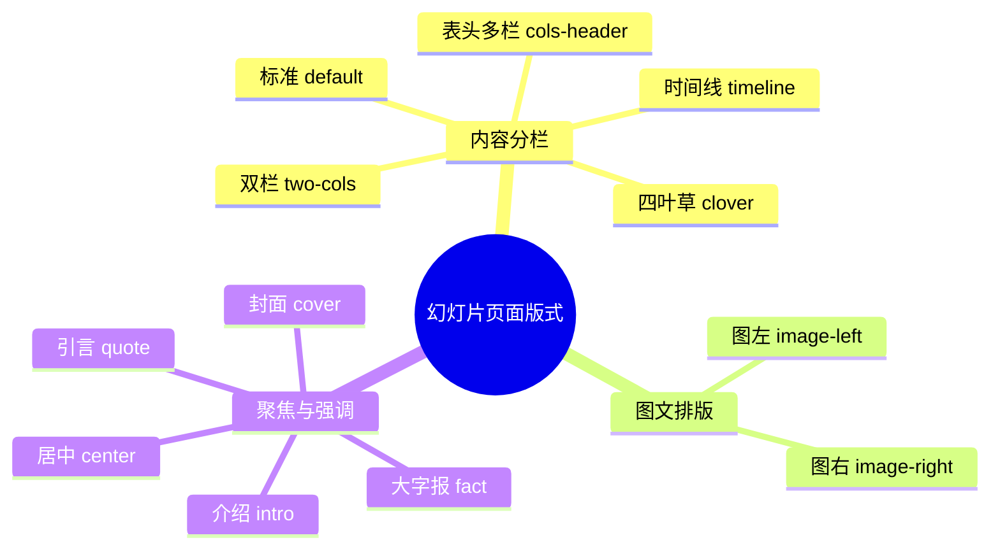

# 幻灯片页面版式使用指南

`siyuan-live-slides` 完美融合了 Slidev 的现代前端演示引擎与思源笔记块级生态。所有的页面版式排版、栅格分栏与图文布局均通过思源笔记原生 IAL 块属性（`custom-slides-layout`）进行存储与调度，对思源文档的原生 Markdown 内容零污染。

本文档详细说明插件支持的 **11 种页面版式**、应用场景、思源笔记排版推荐书写方式以及高级联动技巧。

---

## 一、 版式分类总览

在演示配置面板的【幻灯片页面设置】中，版式按使用场景分为三大类别：



| 场景分组 | 版式标识 (`layout`) | 中文名称 | 骨架特征 | 典型适用场景 |
| :--- | :--- | :--- | :--- | :--- |
| **内容分栏** | `default` | **标准** | 顶部主标题 + 下方自适应流式内容 | 常规演讲、要点罗列、长文档段落 |
| | `two-cols` | **双栏** | 左右 1:1 或自定义比例两列栅格 | 左右对比、优势对比、问题与方案 |
| | `cols-header` | **表头多栏** | 顶部通栏页题 + 下方 2~N 列栅格卡片 | 业务支柱、产品矩阵、多项方案陈述 |
| | `clover` | **四叶草** | 顶部通栏页题 + 下方 2×2 田字四象限 | SWOT 分析、商业画布、四要素矩阵 |
| | `timeline` | **时间线** | 顶部通栏页题 + 水平圆圈步骤节点与连接线 | 流程步骤、里程碑演进、历史发展时间轴 |
| **图文排版** | `image-right` | **图右** | 左侧正文内容 + 右侧半屏全高配图 | 案例分享、产品展示、图文并重页 |
| | `image-left` | **图左** | 左侧半屏全高配图 + 右侧正文内容 | 视觉引导、场景重现、品牌故事 |
| **聚焦与强调** | `cover` | **封面** | 视口绝对居中 + 艺术渐变特大标题 + 副标题 | 演示大封面、章节过渡页、致谢页 |
| | `fact` | **大字报** | 震撼巨型发光数字（8rem）+ 径向微光 + 短下划线说明 | 财务战报、关键 KPI、核心指标破局 |
| | `quote` | **引言** | 水印巨型双引号 + 斜体衬线金句 + 右对齐作者 | 名人名言、客户评价、行业洞察、誓言 |
| | `intro` | **介绍** | 左侧圆形讲师头像 + 右侧姓名职位与要点 | 演讲者简介、团队核心成员、特邀嘉宾 |
| | `center` | **居中** | 视口绝对水平垂直居中 + 适宜阅读字号 | 关键结论、核心命题、短段落沉思 |

---

## 二、 各类排版样式使用说明

### 1. 内容分栏类 (Columns & Grids)

#### 1.1 标准 (`default`)
- **适用场景**：最通用的一级排版，适合传统的自上而下阅读页面。
- **思源书写规范**：
  ```markdown
  # 数字化转型的三个阶段
  - 基础信息化：搭建数字基础设施与数据沉淀
  - 业务在线化：核心业务流程上云与协同协同
  - 数据智能化：基于大模型与算法的智能决策
  ```
- **排版亮点**：自动格式化首个标题与正文间距，智能处理列表行距与排版间隙。

#### 1.2 双栏 (`two-cols`)
- **适用场景**：左侧与右侧的直观对比，如“传统模式 vs AI 时代”、“竞品分析”、“问题 vs 对策”。
- **思源书写规范**（两种支持模式）：
  - **模式 A（自动对半拆分）**：当前页拥有偶数个块时，渲染器自动折半，前一半在左栏，后一半在右栏；
  - **模式 B（显式插槽）**：给右侧块设置属性 `custom-slides-slot="right"`，精准指定分栏位置；
  - **模式 C（思源横向超级块）**：直接在思源正文中将两个块并排拖拽成超级块，插件自动读取。
- **高级联动**：支持在配置面板中设置【分栏比例】（如 `1:2`、`30:70` 等），左右两栏将即时响应宽度伸缩。

#### 1.3 表头多栏 (`cols-header`)
- **适用场景**：汇报演示的黄金版式。顶部展示全页核心观点/结论，下方展开 2~4 列详情卡片。
- **思源书写规范**：
  ```markdown
  # 核心业务三大支撑支柱
  
  ### 敏捷研发
  持续集成、自动化测试与高频高质量交付体系。
  
  ### 客户成功
  全生命周期陪伴式服务，确保系统真正用好、发挥业务价值。
  
  ### 安全合规
  金融级数据隔离、端到端国密加密与合规审计保障。
  ```
- **排版亮点**：首个 H1 自动提取为通栏表头；下方的各同级子块或超级块自动分配到对应列。

#### 1.4 四叶草 (`clover`)
- **适用场景**：田字型 2×2 四象限布局。常用于 SWOT 分析、商业模式四要素、风险与收益矩阵等。
- **思源书写规范**：
  - 顶部可放置一个主标题（如 `# SWOT 商业战略分析`）；
  - 下方放置 4 个块（段落、列表或引述块），自动进入：
    - 第 1 块：左上象限
    - 第 2 块：右上象限
    - 第 3 块：左下象限
    - 第 4 块：右下象限

#### 1.5 时间线 / 步骤流程 (`timeline` / `steps`)
- **适用场景**：项目推进里程碑、架构演进阶段、操作指引步骤、历史发展沿革。
- **思源书写规范**（两种支持模式）：
  - **模式 A（列表驱动）**：直接在思源中书写普通的无序或有序列表，每个列表项自动解析为一个步骤节点：
    ```markdown
    # 平台架构演进路线图
    - 第一阶段：基础设施云原生化与容器编排
    - 第二阶段：微服务拆分与全局可观测性体系
    - 第三阶段：大模型赋能与自主 Agent 闭环
    ```
  - **模式 B（独立块驱动）**：顶部一个 H1 标题，下方书写 2~6 个独立的段落、引述块或卡片块，自动横向排列成时间轴。
- **排版亮点**：
  - 自动渲染漂亮的带数字序号的圆圈节点（`1`, `2`, `3`...）；
  - 节点之间自动生成渐变连接线（Connector Line）；
  - 步骤卡片采用微磨砂玻璃拟物背景与圆角边框，自适应 1~6 步横向展开。

---

### 2. 图文排版类 (Split Visuals)

#### 2.1 图右 (`image-right`) & 图左 (`image-left`)
- **适用场景**：图文各占半屏，视觉冲击力极强。适合产品软硬件展示、架构图解说、场景化案例。
- **思源书写规范**：
  - **配图来源**（满足其一即可）：
    1. 在面板的【页面图片】输入框中粘贴图片 URL 或思源资源路径（如 `assets/cover.png`）；
    2. 或在当前页正文中直接插入图片，超级块扫描器会自动将其识别为配图；
  - **文字区域**：编写正常的标题、列表或说明文字，自动居中或靠边排列在文字半屏中。
- **高级联动**：同样支持【分栏比例】调节（如 `40:60` 让图片占据更大视口）。若图片暂时缺失，系统会自动展示精致的占位卡片，杜绝页面破面。

---

### 3. 聚焦与强调类 (Focus & Emphasize)

#### 3.1 封面 (`cover`)
- **适用场景**：演示文档首页、章节大转场、结尾致谢页。
- **思源书写规范**：
  ```markdown
  # 2026 年度技术战略峰会
  ## 构建智能原生时代的研发效能引擎
  演讲人：张三 · 首席架构师
  ```
- **排版亮点**：文字垂直水平完全居中。H1 具备超大字号（3.8rem），在 Tech 科技主题下自动启用高雅的双色镂空渐变文字；H2 与正文自动形成鲜明字阶梯度。

#### 3.2 大字报 (`fact`)
- **适用场景**：发布会级别震撼数据展示、年度战报破局、重磅 KPI 宣告、多指标数据看板（支持 1~4 个核心指标并列）。
- **思源书写规范**：
  - **单指标看板（经典模式）**：
    ```markdown
    99.99%
    核心服务高可用性保障 SLA
    ```
  - **多指标数据看板（列表模式，强烈推荐 ⭐⭐⭐⭐⭐）**：
    每个列表项代表一个指标卡片，**数字与描述文字通过中文或英文冒号隔开**：
    ```markdown
    # 核心技术与业务成果战报
    * 99.99%：核心服务高可用性保障 SLA
    * 45%: 测试性能优化提升
    * 100W+：累计企业级服务用户
    ```
    *(引擎将自动识别冒号前半部为放大数值，冒号后半部为正常字号的说明文字)*
- **排版亮点**：
  - **多指标自适应栅格**：1 个指标单居中聚焦；2 个指标双列并排；3 个指标三列对称；4 个指标四列优雅网格；
  - **严格字号隔离（仅数字放大）**：仅冒号前数值享受 `clamp(3.8rem~8.5rem)` 渐变与霓虹发光；描述文字强制为标准阅读字号（1.25rem），即使在思源中不小心输入了标题块也绝对不会被误放大；
  - **科技双色渐变与发光**：自动采用 Accent 强调色与高光渐变（`-webkit-background-clip: text`），并附带柔和霓虹文字阴影（Drop-shadow）；
  - **环境微光氛围（Ambient Glow）**：屏幕中心自带半透明径向渐变光晕，极大消除大屏幕黑边空旷感；
  - **精致视觉间隔**：数字与下方说明文字之间自动点缀 Accent 强调色短下划线。

#### 3.3 引言 (`quote`)
- **适用场景**：引用先贤名言、领袖寄语、客户口碑好评、重磅行业箴言。
- **思源书写规范**：
  ```markdown
  简单是终极的复杂。
  
  —— 列奥纳多·达·芬奇
  ```
- **排版亮点**：
  - 自动在视口左上方渲染雅致的巨型半透明水印双引号（`“`）；
  - 引言正文自动采用古典衬线字体（Serif）、大字号与斜体；
  - 末尾以 `—`、`--`、`——` 开头的行会被自动识别为出处作者，并靠右排版对齐。

#### 3.4 介绍 (`intro`)
- **适用场景**：主讲人个人介绍、团队核心 Leader 亮相、嘉宾背景展台。
- **思源书写规范**：
  - **头像设置**：在面板中选中“介绍”版式，面板将自动展开【头像与配图】输入框，填入个人头像 URL 或选择思源本地资源；
  - **个人信息编写**：
    ```markdown
    # 李华
    ## 全栈架构师 / 技术布道师
    - 10 年分布式高并发架构经验
    - 主导多个千万级 DAU 核心系统重构
    - 知名开源社区核心维护者
    ```
- **排版亮点**：左侧自动呈现带有柔和阴影与品牌边框的圆形头像（未设头像时显示优雅的人像剪影插画）；右侧规整展示姓名、头衔与个人履历。

#### 3.5 居中 (`center`)
- **适用场景**：展示一句核心命题、一个提问、或者引发全场思考的关键短语。
- **排版亮点**：保持标准的层级字号，整体内容在 16:9 画幅内实现精准的绝对水平与垂直居中，四周留白开阔，视觉呼吸感极佳。

---

## 三、 多端导出与渲染一致性保障

所有 11 种版式均通过同一套排版规格实现了**像素级全端对齐**：

1. **工作区实时分屏预览（Web Sandbox）**：通过内置沙箱实时无缝响应，拖动思源笔记即可瞬间重排；
2. **演播室演讲者视图（Presenter Tab）**：包含当前页与下一页高保真预览，讲稿提示词与版式联动同步；
3. **独立单页 HTML 导出（Single HTML）**：离线可播，内嵌所有版式 CSS 样式与 Base64 资产，脱离思源笔记亦可完美放映；
4. **PDF 打印导出（Landscape PDF）**：专门为 16:9 纸张优化分页与打印样式（`@page`），各版式内容不溢出、不裁切、不重叠。

---

## 四、 常见问题与技巧 (FAQ)

- **Q: 为什么我选了“四叶草”，页面看起来像一栏？**
  - **A**：四叶草版式需要当前页有足够的块（推荐 4 个子块）。如果页面只有 1 个超长段落，建议按 Enter 拆分成 4 个小段或采用列表形式书写。
- **Q: 如何在思源中为双栏版式自由调节左右比例？**
  - **A**：选择“双栏”后，在右侧面板的【分栏比例】中可直接点击预设芯片（`1:1`、`1:2`、`2:1`），或在输入框中填入 `30:70`、`2:3` 等任意自定义比例。
- **Q: 引言版式的作者出处一定要写破折号吗？**
  - **A**：建议以 `—`、`--` 或 `——` 开头，或者在思源中给该块添加属性 `custom-slides-role="author"`，插件即可精准识别为右下角署名。
