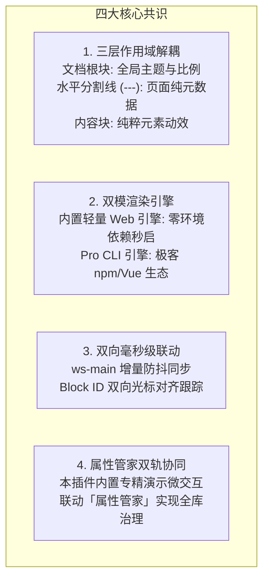
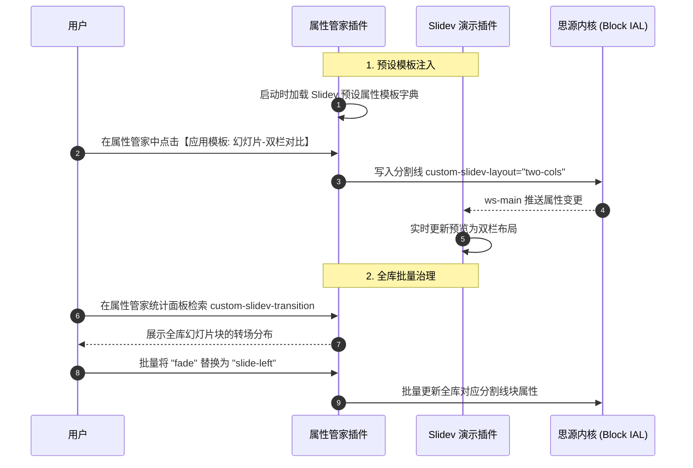

# 思源笔记 Slidev 演示插件详细方案、实施进展与下一步研发计划

---

## 1. 项目定位与核心设计共识

基于前期充分的可行性论证、Joplin/Obsidian 竞品调研及架构沟通，本项目确立了**“正文零污染、现代前端动效、毫秒级双向联动、分层双轨协同”**的终极设计共识：



---

## 2. 块属性协议字典与架构设计

插件统一采用具有命名空间隔离的 `custom-slidev-*` 块属性字典，按作用域划分为：
1. **文档全局级（Document Scope）**：挂载于文档根块，包含 `custom-slidev-theme`、`custom-slidev-aspect-ratio`、`custom-slidev-default-transition`、`custom-slidev-highlighter`、`custom-slidev-color-schema`；
2. **幻灯片页面级（Page Scope）**：挂载于水平分割线（`---`），包含 `custom-slidev-slide`、`custom-slidev-layout`、`custom-slidev-transition`、`custom-slidev-background`、`custom-slidev-notes`、`custom-slidev-class`；
3. **元素动效级（Element Scope）**：挂载于具体叶子内容块，包含 `custom-slidev-click`、`custom-slidev-slot`、`custom-slidev-shiki-lines`、`custom-slidev-motion`。

### 与「属性管家」（siyuan-property-manager）的协同架构（`src/synergy/`）



- **松耦合契约**：双方完全依托思源原生块属性 `custom-slidev-*`，即使属性管家未安装或版本更新，Slidev 插件功能不受任何影响；
- **生态共赢**：为同时安装两款插件的用户提供“全库幻灯片全景资产盘点”与“一键批量重构”的能力。

---

## 3. 四阶段实施进展真实评估（基于代码库现状实测）

状态标识定义：
- `[x]` **已完成并集成**：核心逻辑已实现且与思源插件主生命周期/UI/数据流完成集成打通并通过测试验证；
- `[-]` **部分实现 / 残缺项**：已有基础逻辑或静态代码，但缺少核心渲染运行时或缺少配置 UI；
- `[ ]` **未实施 / 待开发**：代码仅为类型占位、未被主流程调用、未接入真实能力。

### 3.1 各阶段交付清单进展核查

#### Phase 3：生态协同、块引用与 AI 智能赋能
- **核心目标**：打通与属性管家的生态协同，接入思源块引用与内置 AI 能力，交付双屏演讲者控制台。
- **任务清单**：
  - [x] **与「属性管家」协同桥接 (`property-manager-bridge.ts`)**：
    - 预设属性模板字典 (`preset-templates.ts`) 支持一键复制导入；
    - 支持全库转场分布统计与批量重构命令（`slidevBatchTransitions` / `slidevBatchReplaceTransition`）；
  - [x] **块引用 (`((block-id))`) 动态展开**：`block-ref-resolver.ts` 批量通过 SQL 检索被引用块内容，并动态展开为内联带样式卡片，在沙箱及导出端保留引用标识；
  - [-] **块嵌入与递归块引用展开**：目前尚未支持嵌入块 `NodeBlockQueryEmbed`（`{{select ...}}`），且块引用未调用 `/api/block/getBlockKramdown` 进行深度递归展开；
  - [x] **思源内核 AI 赋能**：
    - `notes-generator.ts` 接入 `chatAI`，自动为幻灯片提炼口播提词卡（Notes），失败自动平滑降级到启发式规则；
    - `auto-splitter.ts` 分析 H1/H2 章节及页面容量阈值，提供智能大纲断页建议；
  - [x] **专业双屏演讲者视图 (Presenter Mode)**：独立 `presenter.html` 视窗，支持快捷键 `⌥M` 呼出，具备双向 BroadcastChannel 实时翻页同步、演讲计时器、字号增减、双栏对比与提词卡。
- **阶段结论**：**85% 完成**，AI 赋能、演讲者视图与属性管家协同均已交付；块嵌入与递归块展开仍需完善。

#### Phase 4：离线导出、Pro 极客模式与发布
- **核心目标**：全渠道交付能力与生态闭环。
- **任务清单**：
  - [x] **离线单文件独立 HTML 打包器 (`single-html-exporter.ts`)**：一键导出无外部依赖的单文件 `.html`，内置 Base64 资产、全套版式与键盘翻页；
  - [x] **高保真 PDF 讲义导出 (`pdf-exporter.ts`)**：支持 16:9 / 4:3 / A4 纸张规范，精确控制 `@page` 打印样式，富文本排版保真；
  - [x] **Pro 模式本地 Slidev CLI 桥接框架**：
    - 支持一键导出/下载标准 `slides.md` 并在本地直接通过 `npx @slidev/cli` 运行；
    - 支持一键同步 `slides.md` 至思源工作空间存储目录；
    - 提供了本地 DevServer 状态探测命令（检测 3030 端口）；
  - [-] **Pro 模式内置子进程自动拉起**：由于思源插件运行于客户端沙箱环境，在纯浏览器/移动端无法直接执行 `node:child_process`（已具备检测与降级提醒）；
  - [x] **用户手册与国际化**：完善中英文国际化字典（`en_US.json` / `zh_CN.json`），提供完整命令与使用文档。
- **阶段结论**：**80% 完成**，单文件 HTML 与 PDF 导出完整交付，Pro 极客模式已有文件导出与端口探测支撑。

---

## 4. 真实差距与未完成项剖析（Gap Analysis）

严格按现状审查，当前代码库存在以下 5 项具体差距：

| 序号 | 差距领域 | 规格书要求 | 代码库实际现状 | 影响面与严重度 |
| :---: | :--- | :--- | :--- | :--- |
| **1** | **KaTeX 公式与 Mermaid 图表真实渲染** | 规格书 Transform 阶段要求对 KaTeX 公式与 Mermaid 图表进行预处理与呈现 | 仅将 `$formula$` 包装为 `<em>` 斜体文本，**未引入 KaTeX JS 排版**；**Mermaid 完全未做识别与渲染** | **中高**：包含复杂数学公式或流程图的文档无法正常展示图形。 |
| **2** | **`custom-slidev-motion` 动效闭环** | 映射为 `@vueuse/motion` 驱动的进入动画 | 协议已定义并在 scope 中解析，但 **UI 缺少配置输入，沙箱未接入动效运行时** | **中**：元素无法配置平滑位移与渐入微动效。 |
| **3** | **块嵌入 (`{{select}}`) 与递归展开** | 遇到 `NodeBlockQueryEmbed` 展开，并递归获取复杂子块树 | 仅通过 SQL 检索了 `((id))` 块引用第一层文本，**未处理嵌入块，且未递归展开** | **中**：嵌入查询块和复杂多层嵌套块内容缺失。 |
| **4** | **部分辅助属性缺少 Inspector 配置 UI** | 支持配置代码高亮引擎、明暗偏好、UnoCSS 样式类 | `custom-slidev-class`、`highlighter`、`color-schema` 在 Inspector 面板缺少可视化输入组件 | **低**：高级样式与偏好需手动在思源原生属性面板填写。 |
| **5** | **Pro 模式本地 DevServer 的纯前端环境限制** | 双轨切换，一键在下方拉起官方 DevServer | 在纯浏览器/移动端环境无法 spawn 子进程，需依赖用户本地预先启动 Slidev CLI | **低**：已具备端口探测与文件导出，但尚需更友好的引导 UI。 |

---

## 5. 下一步开发实施计划与排期（Sprints & Milestones）

结合上述差距，规划后续迭代冲刺，重点完成核心渲染补齐与高级特性闭环：

### Sprint 5：核心渲染与排版闭环（P0 级，1 ~ 2 周）

- [ ] **Task 5.1：集成 KaTeX 轻量公式渲染引擎**
  - 在内置沙箱 `index.html` 与导出渲染器 `markdown-renderer.ts` 中引入轻量 KaTeX（或 KaTeX min 预编译 bundle）；
  - 解析行内 `$formula$` 与独立块 `$$formula$$`，生成高保真数学矢量排版；
  - 导出单文件 HTML 与 PDF 时同步内联 KaTeX 样式与字体。
- [ ] **Task 5.2：集成 Mermaid 流程图与时序图渲染**
  - 在编译器中识别 ```` ```mermaid ```` 代码块，并将其标记为图表渲染节点；
  - 内置沙箱加载 Mermaid.js，实现流程图、序列图、架构图在幻灯片上的即时矢量渲染。
- [ ] **Task 5.3：补齐 Inspector Dock 缺失的属性配置项**
  - 在 `PageInspectorSection.vue` 增加“页面样式类 (`custom-slidev-class`)”输入框；
  - 在 `DocInspectorSection.vue` 增加“明暗模式偏好 (`custom-slidev-color-schema`)”三态切换器；
  - 在 `DocInspectorSection.vue` 增加“代码高亮引擎 (`custom-slidev-highlighter`)”选择器。

### Sprint 6：高级动效与深层数据融合（P1 级，2 ~ 3 周）

- [ ] **Task 6.2：支持块嵌入与递归块引用展开**
  - 在 `block-ref-resolver.ts` 中增加对 `{{select ...}}` 嵌入块语法的识别；
  - 接入思源内核 API `/api/block/getBlockKramdown`，对深层复杂块结构进行递归无损展开；
  - 增加嵌入块数据溯源与刷新监听机制。

### Sprint 7：生态交付与极客 Pro 体验强化（P2 级，1 ~ 2 周）

- [ ] **Task 7.1：PPTX 可编辑幻灯片导出**
  - 调研并接入 `pptxgenjs`，基于现有的 `ISlidevVirtualPage` 虚拟页面模型，实现一键生成可编辑的 `.pptx` 文档，彻底打通与 Office 生态互通。
- [ ] **Task 7.2：优化 Pro 模式本地 DevServer 引导向导**
  - 在 `SlidevPreviewTab.vue` 中增强 Pro 模式的向导界面；
  - 提供“一键复制终端运行命令（`npx @slidev/cli ...`）”和“实时探测端口并自动连入”的友好交互，消除非 Node 环境下的错误迷惑。
- [ ] **Task 7.3：社区精选主题预置与集市上架**
  - 增加对热门开源 Slidev 主题样式的预置与内嵌支持；
  - 更新版本号至 v1.0.0 正式版，打包提交思源官方集市。

