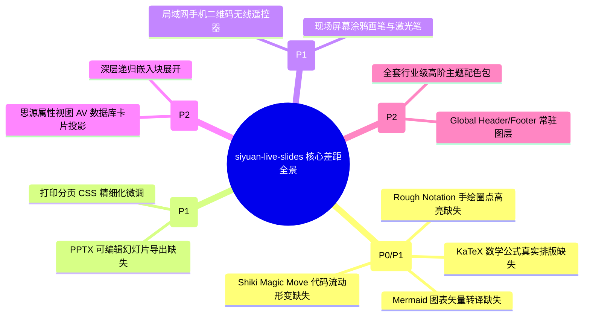
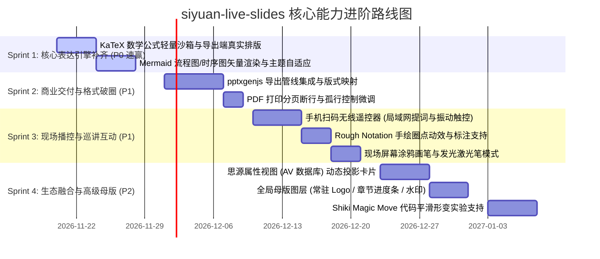

# 思源笔记即现演示插件能力差距分析与演进规划

> 文档状态：现行有效（对齐当前 v1.3.0 架构与 830+ 测试工程基线，全面取代过时的 2026-10 早期参考文档）  
> 核心基准：自研内置轻量 Web 沙箱、11 种页面版式、siyuan-api-switch AI 统一调度网关、思源原生横向超级块与 IAL 零污染元数据架构

---

## 1. 执行摘要与背景演进 (Executive Summary)

### 1.1 历史参考文档的局限与过时原因
在此前归档的两篇早期文档（《基于 Slidev 与 Slidev-Templates 源码生态的演示能力差距分析与高频特性集成演进指南》与《思源笔记即现演示插件详细方案、实施进展与下一步研发计划》）中，分析视角主要受限于插件早期（v0.8.0~v0.9.0 阶段）的技术摸索：
1. **过度依赖外部运行时的“双模假设”已破除**：早期文档将“Pro CLI 模式（本地 Node 子进程、npm 安装、Slidev CLI 3030 端口）”视为高级演进目标，而将内置沙箱视为临时降级。在实际落地中，外部 CLI 带来了极高的运行环境门槛、跨平台启动失败率以及与思源内核通信割裂。**当前代码库已果断完成重构（`refactor(engine): 移除 Pro 模式及多余 Slidev 兼容设置并收敛至内置沙盒`），确立了以自研零依赖内置 Web 沙箱为绝对核心的架构路线**。
2. **版式匮乏的历史痛点已被系统性解决**：旧文档中大篇幅讨论的“缺少表头双栏、三栏、四象限、路线图时间轴、大字报”等问题，在当前版本已全面落地为包含 **11 种高品质场景化版式** 的完备排版体系，并配齐了直观的可视化选择器（`LayoutPicker.vue`）和横向超级块快速转换机制。
3. **AI 能力已从单点启发式原型迈入统一调度网关**：早期文档仅设想了简单的断页规则，目前已深度整合思源生态标杆插件 `siyuan-api-switch`，实现了多模型统一调度、流式响应、加载动画与设置面板零刷新联动，打造了从“智能大纲断页建议”到“逐页口播提词卡生成”的完整闭环。

### 1.2 当前代码库实际开发基线 (v1.3.0)
截至目前，`siyuan-live-slides` 的实际能力矩阵与工程成熟度如下：
- **工程基线**：86 个测试套件，832+ 项自动化测试用例全绿；`npm run build` 产物纯净打包；
- **元数据契约**：严格遵循 `custom-slides-*` 30 项 IAL 块属性规范，正文 Markdown 保持 100% 纯净（零注释、零内嵌 HTML 污染）；
- **版式系统**：支持三大分组 11 种页面版式（内容分栏类：标准、双栏、表头多栏、四叶草、时间线；图文排版类：图右、图左；聚焦强调类：封面、大字报、引言、介绍、居中），支持比例微调与超级块宽度智能识别；
- **交互与播控**：下方分屏预览页签（`SlidesPreviewTab`）支持双向光标跟随、数字键+回车直接跳页、`O` 键全景缩略图总览、黑屏/白屏静音聚焦、独立双屏演讲者视窗（毫秒级 `BroadcastChannel` 同步，含倒计时与字号动态缩放）；
- **离线交付**：支持单文件独立 HTML SPA 导出（完整内置手势、键盘、总览与图片灯箱）及高保真 16:9 / 4:3 / A4 PDF 导出；
- **生态协同**：深度集成 `siyuan-api-switch`（AI 统一调度）与 `siyuan-property-manager`（全库幻灯片属性批量治理）。

---

## 2. 同类演示软件全景竞品分析 (Competitive Landscape)

在“文档即演示（Document-as-a-Presentation）”与现代交互演示领域，当前业界已经分化出四大主流流派。通过横向解构竞品的优势与软肋，有助于确立 `siyuan-live-slides` 独一无二的护城河。

```mermaid
quadrantChart
    title 演示工具生态象限分布
    x-axis 低正文侵入 (纯净度高) --> 高正文侵入 (语法专用)
    y-axis 静态排版展示 --> 现代交互与深度集成
    quadrant-1 极客定制流 (Slidev, Reveal.js)
    quadrant-2 本插件生态位 (SiYuan Live Slides)
    quadrant-3 严谨静态流 (Marp, Quarto)
    quadrant-4 纯注释插件 (Obsidian Adv Slides)
    "Slidev": [0.82, 0.88]
    "Reveal.js": [0.89, 0.72]
    "Obsidian Adv Slides": [0.85, 0.45]
    "Marp": [0.38, 0.28]
    "Quarto": [0.45, 0.35]
    "Gamma / Tome": [0.15, 0.82]
    "SiYuan Live Slides": [0.12, 0.90]
```

### 2.1 四大流派代表产品剖析

#### 1. 开发者极客派：Slidev 与 Reveal.js
- **Slidev (Anthony Fu)**：
  - **核心优势**：基于 Vue 3 + UnoCSS + Vite，支持 Shiki Magic Move（代码平滑形变动画）、Rough Notation（手绘圈点）、Vue SFC 组件嵌套、Drawee 画笔涂鸦。是目前前端开发者公认表现力最强的幻灯片工具。
  - **致命短板**：本质是前端工程项目，使用者必须具备 Node.js、命令行与前端构建常识；内容组织依赖单个庞大的 `.md` 文件或多文件分散管理，缺乏知识管理系统的双链与反向链接能力。
- **Reveal.js**：
  - **核心优势**：历史最悠久的 HTML5 演示框架，插件生态极其丰富，支持 3D 转换与网格视窗。
  - **致命短板**：设计理念陈旧，高度依赖侵入性 HTML 容器或嵌套注释；现代原子化 CSS 与响应式排版适配困难。

#### 2. 学术与出版排版派：Marp 与 Quarto
- **Marp / Marpit**：
  - **核心优势**：严格基于标准 CommonMark，通过 CSS Pagination 机制完成精准分页与打印，样式规范优雅，PDF 导出质量极高。
  - **致命短板**：设计哲学偏向“静态文档分页打印”，动画能力极弱（无渐进步骤展开与元素微动效），无法承载现代科技演讲的动态演示与交互式组件。
- **Quarto Presentations**：
  - **核心优势**：面向数据科学与学术界，深度结合 Python/R/Julia 计算内核，LaTeX 公式与学术引用支持完善。
  - **致命短板**：面向学术出版报告，缺乏面向个人知识沉淀与日常敏捷分享的轻量化双向编辑体验。

#### 3. PKM 笔记深度集成派：Obsidian Advanced Slides 与 Joplin Slides
- **Obsidian Advanced Slides**：
  - **核心优势**：Obsidian 社区最成熟的演示插件，基于 Reveal.js 二次封装，支持 Obsidian 内部双链与图片解析。
  - **致命短板（严重正文污染）**：为了实现分栏、背景和动画，正文中充斥着大量专用注释（如 `<!-- .element: class="fragment" -->`、`::: split` 等）。笔记一旦脱离该插件，正文可读性遭到毁灭性破坏；编辑大文档时刷新常导致画面剧烈闪烁。
- **Joplin Slides**：
  - **核心优势**：开箱即用，弹窗全屏。
  - **致命短板**：仅提供最基础的分页渲染，无法定制版式与动效，已基本停滞演进。

#### 4. 现代卡片与 AI 交互派：Gamma 与 Tome
- **Gamma / Tome**：
  - **核心优势**：打破传统 16:9 固定幻灯片画幅，采用“流式卡片”排版；AI 深度参与内容生成、结构重组与视觉配图，用户无需操心网格对齐。
  - **致命短板**：纯闭源商业 SaaS，高度依赖网络与订阅付费；数据存储在厂商云端，无法融入私有化知识库与本地离线工作流。

### 2.2 核心竞品横向能力对照矩阵

| 评估维度 | Slidev 官方 | Marp | Obsidian Adv Slides | Gamma (AI SaaS) | **SiYuan Live Slides (当前现状)** |
| :--- | :--- | :--- | :--- | :--- | :--- |
| **底层引擎架构** | Vue 3 + Vite CLI | Marpit CSS 分页 | Reveal.js + 本地服务 | 闭源卡片流渲染引擎 | **自研零依赖 Web 沙箱** |
| **正文纯净度 (零污染)** | ⚠️ 需维护 YAML 头 | ⚠️ Frontmatter + 注释 | ❌ 极差 (充斥专用注释) | ⭕ 专有云端格式 | **✅ 极致 (100% 块属性驱动，正文 0 污染)** |
| **运行环境与门槛** | ❌ 需 Node/npm/CLI | ✅ VS Code 插件即用 | ✅ 插件市场一键安装 | ✅ 网页直接打开 | **✅ 思源一键启用，0 外部环境依赖** |
| **版式丰富度与易用性** | ⚠️ 需手写 CSS/UnoCSS | ⚠️ 依赖 CSS 模板微调 | ⚠️ 依赖 `::: split` 宏 | ✅ AI 自动卡片栅格化 | **✅ 11 种场景化版式 + 横向超级块一键转换** |
| **双向光标跟随联动** | ❌ 仅外部浏览器单向刷新 | ❌ 粗粒度滚动 | ⚠️ 单向定位，大文档易闪烁 | ❌ 无双向编辑概念 | **✅ 毫秒级 Block ID 双向定位跟随** |
| **代码与技术演讲能力** | **✅ 顶尖 (Magic Move / Shiki)** | ⚠️ 静态高亮 | ⚠️ 基础代码高亮 | ❌ 极弱 (仅普通文本块) | ⚠️ **单块行高亮 (Shiki)，尚无平滑形变** |
| **数学公式与矢量图表** | ✅ KaTeX + Mermaid | ✅ KaTeX / MathJax | ✅ MathJax + Mermaid | ⚠️ 基础图表生成 | ⚠️ **待真实引擎接入 (当前仍为代码块)** |
| **AI 赋能深度** | ❌ 官方无 AI 集成 | ❌ 无 | ❌ 无 | ✅ 核心主打 AI 生成 | **✅ 集成 siyuan-api-switch，支持智能断页与提词** |
| **演讲播控与辅助** | ✅ 双屏 + 涂鸦 + 遥控器 | ❌ 仅简单翻页 | ✅ 双屏演讲者视图 | ⚠️ 基础演示模式 | **✅ 双屏视窗 + 倒计时 + 总览 + 快捷静音** |
| **导出交付通道** | ✅ HTML / PDF / PNG | ✅ 高精度 PDF / PPTX | ✅ HTML / PDF | ⚠️ 导出需高级会员 | ⚠️ **支持单文件 HTML + PDF，尚缺 PPTX** |

### 2.3 思源笔记即现插件的独特定位与护城河 (Moat)
1. **零污染与知识资产沉淀**：依托思源原生块 IAL 体系，演示属性完全附着在块元数据中，不改变日常笔记的阅读形态，做到了“平时看是清爽结构化笔记，放映时是专业发布会级幻灯片”；
2. **知识网络原生态联动**：深度调用思源本地 Go 内核，可直接引用双链块、展开图片音视频资产、联动属性管家批量治理，后续可进一步将属性视图（AV 数据库）直接投影为幻灯片表格；
3. **极速私密、开箱即用**：无需任何编译构建环境，完全离线运行于本地，确保企业与个人隐私数据安全；
4. **思源生态 AI 大模型协同**：通过 `siyuan-api-switch` 连接用户自选的各类主流大模型（DeepSeek、Claude、OpenAI、Ollama 等），按需定制讲稿与断页建议，成本低且自主可控。

---

## 3. 最新能力差距多维全景评估 (Gap Analysis 2026 最新版)

通过系统性对比 Slidev、Obsidian Advanced Slides 以及 Gamma 的最佳体验，识别出当前版本在“专业表达表现力”、“办公格式交付”与“现场演讲交互”三大核心维度上的真实差距：



### 3.1 差距一：专业表达与技术演示表现力缺失（最关键瓶颈）

#### 1. KaTeX 数学公式未挂载真实矢量排版引擎 (优先级：P0)
- **现状剖析**：
  在当前沙箱和单文件 HTML 导出中，`markdown-renderer.ts` 仅将行内 `$formula$` 降级处理为 `<em>` 斜体标签，块级公式未接入 KaTeX 进行符号拆解与排版。
- **用户痛点**：
  学术论文分享、高校教学、算法与AI前沿汇报中，复杂的矩阵、分式、上标下标无法正确排版，破坏了严谨性。
- **破局路径**：
  在 Web 沙箱与导出模板中轻量引入 KaTeX 预编译库（~200KB），在渲染管线中拦截数学节点，生成标准 MathML / 矢量 HTML 结构。

#### 2. Mermaid 图表未转译为交互式/自适应 SVG (优先级：P0)
- **现状剖析**：
  当前 ```` ```mermaid ```` 代码块在编译后仍被当作纯文本代码块处理，被加上行号和语法高亮，并没有被 `mermaid.render()` 实时渲染为矢量流程图、时序图或架构图。
- **用户痛点**：
  技术架构演进、业务流程重构汇报中，无法利用 Markdown 快速生成可视化图表，背离了技术演讲的直观表达诉求。
- **破局路径**：
  沙箱与离线导出模板内联挂载轻量化 `mermaid.min.js`，沙箱在渲染完成后异步执行 DOM 替换，支持自适应暗色/亮色主题。

#### 3. Rough Notation (`v-mark`) 手绘圈点与动效缺失 (优先级：P1)
- **现状剖析**：
  Slidev 中极其亮眼的 `<span v-mark.circle.orange="2">` 圈出效果（随点击步骤手绘下划线、圆圈、荧光笔）在当前插件的导入清洗阶段被作为普通标签解包，沙箱内也缺少 `rough-notation` 渲染支持。
- **用户痛点**：
  无法在段落内精准抓取听众注意力，无法对关键数据、结论进行动态下划线强调。

#### 4. Shiki Magic Move 代码平滑形变流动 (优先级：P1)
- **现状剖析**：
  当前插件已支持代码块的静态行高亮（`custom-slides-shiki-lines="1,3-5"`），但在讲解多步骤代码重构或 API 演进时，各步骤代码块只能像翻页一样生硬跳变，缺少 Slidev 标志性的变量平滑飞行过渡效果。

---

### 3.2 差距二：商业协同与交付渠道缺失（办公环境刚需）

#### 1. PPTX 可编辑幻灯片导出缺失 (优先级：P1)
- **现状剖析**：
  目前插件仅支持单文件 HTML（交互式播放器）和高分辨率 PDF 导出。
- **用户痛点**：
  在真实的政企与商务汇报中，领导或跨部门协作方通常强制要求提交 `.pptx` 格式进行归档或二次合并调整。当前无法直接生成 PowerPoint 文件，成为插件向非技术人群普及的最大卡点。
- **破局路径**：
  引入成熟且经过实战检验的 `pptxgenjs` 库，基于插件内成熟的 `ISlidesVirtualPage` 虚拟页面模型，将 11 种版式、文本块、表格、图片映射为标准的 PPTX 幻灯片母版与形状元素，实现一键生成可编辑演示文档。

---

### 3.3 差距三：现场演讲与专业播控体验进阶

#### 1. 局域网手机扫码无线遥控器 (优先级：P1)
- **现状剖析**：
  目前双屏演讲者视窗基于浏览器的 `BroadcastChannel` 同步，仅支持同一台电脑外接两台显示器。
- **用户痛点**：
  演讲者在大型会议室或讲台上走动巡回时，必须手持无线翻页笔或频繁走回电脑前敲击键盘，且无法手持查看口播提词卡。
- **破局路径**：
  利用思源笔记自带常驻本地的 Go 后端服务与 WebSocket/HTTP 端口，演讲者视窗生成本地局域网二维码；手机扫码即可打开自适应触控 Web 页面（大字号提词卡 + 触控震动反馈翻页按钮），彻底解放讲台走位。

#### 2. 现场涂鸦画笔与激光笔 (优先级：P1)
- **现状剖析**：
  当前演示视窗仅支持内容浏览，无交互式绘图图层。
- **用户痛点**：
  面对听众提问或脱稿演算时，无法在屏幕上圈画重点或随手画图；大屏投影时光标太小，听众难以跟上演讲视线。
- **破局路径**：
  在沙箱上层挂载绝对定位 Canvas 图层，快捷键（`Ctrl+D`）唤起调色盘与画笔；按住 `L` 键激活发光激光笔拖尾光斑。

---

### 3.4 差距四：思源生态与知识资产纵深融合

#### 1. 属性视图 (AV 数据库) 投影为幻灯片表格/看板 (优先级：P2)
- **现状剖析**：
  思源笔记 3.8+ 引入了强大的属性视图（AV 数据库），用户沉淀了大量任务跟踪、竞品对比、数据指标库，但在幻灯片中无法优雅展示。
- **破局路径**：
  编译层识别 `NodeAttributeView` 块，获取视图数据模型，在幻灯片中自动转译为美观的自适应卡片矩阵或无边框表格。

#### 2. 深层嵌套块引用与动态嵌入块 (`{{select ...}}`) 展开 (优先级：P2)
- **现状剖析**：
  目前 `block-ref-resolver.ts` 仅对单个 `((id))` 文本块引用进行解析，对于 SQL 查询嵌入块尚未完全展开为子 DOM 树。

---

## 4. 下一步功能特性开发建议与演进路线图 (Technical Roadmap)

为确保工程质量与交付体验的平衡，建议将后续研发划分为四个迭代里程碑（Sprints）：



### 4.1 Sprint 1：核心表达引擎补齐（P0 级速赢项，预计 8 工作日）
**目标**：彻底抹平学术公式与架构图表的视觉断层，使插件能够胜任高水准的技术与学术分享。
1. **Task 1.1：集成 KaTeX 渲染管线**
   - 在内置 Web 沙箱中引入 `katex.min.js` 与 `katex.min.css`；
   - 优化 `markdown-renderer.ts`，精准区分行内 `$...$` 与块级 `$$...$$`，并在离线单文件 HTML 与 PDF 导出模板中内联 KaTeX 字体与样式规则；
   - 编写针对复杂矩阵、分式、上标下标的专项渲染测试套件。
2. **Task 1.2：集成 Mermaid 矢量图表渲染**
   - 编译器扫描并标记 ```` ```mermaid ```` 代码块为图表节点；
   - 沙箱运行时加载轻量化 `mermaid.js`，实现流程图、时序图、类图、甘特图等自动转译为 SVG；
   - 建立跟随当前演示主题（深色/浅色）的 Mermaid 主题自动适配器。

### 4.2 Sprint 2：商业交付与格式破圈（P1 级刚需，预计 8 工作日）
**目标**：打破非思源用户的交付壁垒，支持输出通用可编辑的 PowerPoint 文件。
1. **Task 2.1：基于 `pptxgenjs` 构建 PPTX 导出服务**
   - 新增 `src/export/pptx-exporter.ts`；
   - 将 11 种虚拟页面版式模型逐一映射为 PowerPoint 的原生母版与 Shape 布局；
   - 支持文字分级标题、列表符号、背景色/背景图、多栏栅格在 PPTX 中可再次选中编辑；
   - 在预览窗口工具栏与侧栏导出区新增「导出为 PPTX」入口。

### 4.3 Sprint 3：现场播控与巡讲互动（P1 级跃迁，预计 11 工作日）
**目标**：赋予演讲者从电脑前解放、在全场自由走动的专业气场。
1. **Task 3.1：局域网手机二维码无线遥控器**
   - 在演讲者视窗右上角提供「📱 手机遥控」弹窗，展示当前思源服务局域网 IP 二维码；
   - 移动端页面无需任何认证，大字号跟随展示当前页口播提词 Notes；
   - 底部提供大尺寸高对比度 `[上一步]` 与 `[下一步]` 触控面板，带有短震动反馈；
   - 基于思源 WebSocket 或 HTTP 轮询广播指令。
2. **Task 3.2：Rough Notation 手绘圈点支持**
   - 在导入清洗逻辑中安全保留 `v-mark` 元属性，并在沙箱中按需激活 `rough-notation` 渲染。
3. **Task 3.3：现场激光笔与屏幕涂鸦 Canvas**
   - 按快捷键 `L` 切换为激光笔高亮视线，`Ctrl+D` 激活涂鸦板与橡皮擦。

### 4.4 Sprint 4：生态融合与高级母版（P2 级沉淀，预计 14 工作日）
**目标**：进一步发挥思源块级笔记的独特资产价值，提升演示视觉整体感。
1. **Task 4.1：属性视图 (AV 数据库) 投影**：拦截 `NodeAttributeView` 块并转译为精致的自适应卡片网格。
2. **Task 4.2：全局图层体系 (Global Layers)**：支持文档根设置全局常驻 Logo、章节导航条、演说总进度条与机密水印。
3. **Task 4.3：Shiki Magic Move 平滑代码形变**：探索轻量化 Token Diff 算法，让代码重构过程实现流畅动画。

---

## 5. 工程实施原则与设计红线

在推进后续特性开发时，必须坚守以下四条铁律：
1. **坚守自研内置沙箱纯净路线，绝不倒退**：不得以任何理由重新引入对外部 Node.js 进程、npm CLI 或端口托管的依赖，确保开箱即用与跨平台一致性。
2. **坚守思源 IAL 零污染原则**：所有新增功能（如激光笔状态、手绘标记参数、图层配置等）必须收敛于 `custom-slides-*` 命名空间属性或纯前端状态管理器，严禁在用户 Markdown 正文中插入任何侵入性语法或注释。
3. **测试先行与零回归（TDD）**：任何渲染器、编译器或导出逻辑改动，必须同步补齐 Vitest 测试用例，确保 830+ 自动化测试套件持续全绿。
4. **性能保护门闩**：新增的 KaTeX、Mermaid 或 PPTX 依赖必须严格按需动态加载或采用轻量构建，严禁拖慢思源笔记主界面的启动速度与内存占用。
