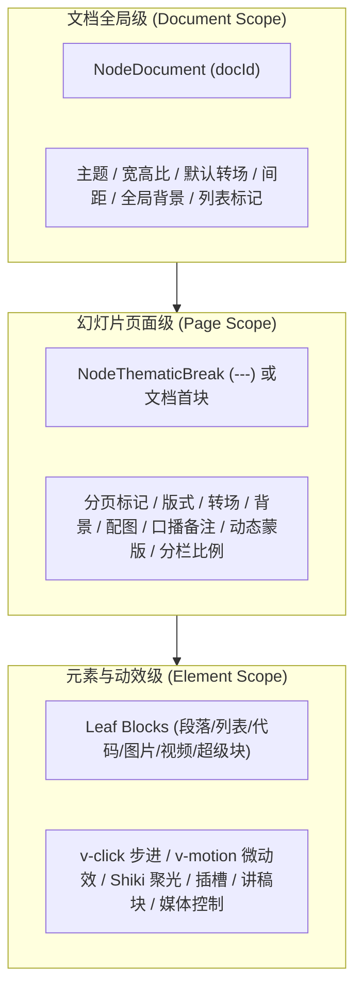
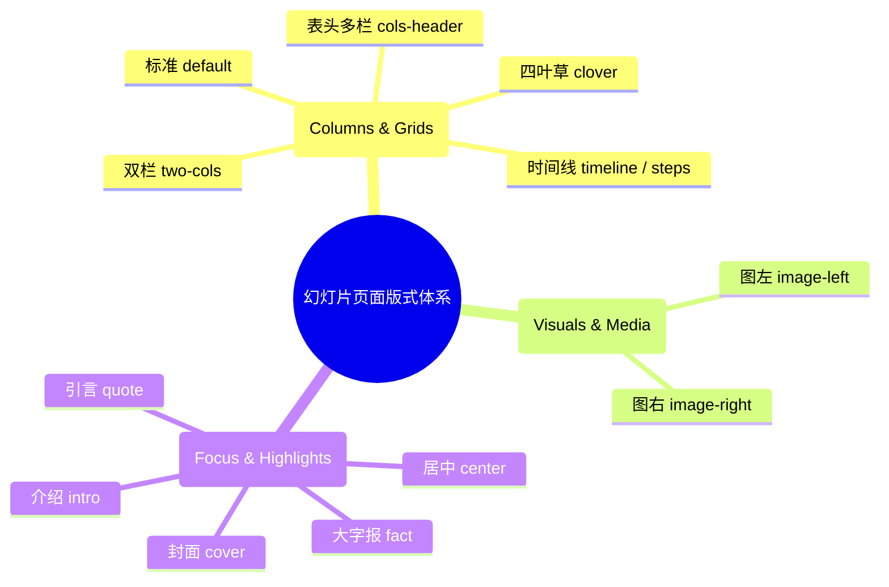

# 技术规格定义：`custom-slides-*` 块属性协议字典与运行时契约

> 最近刷新：2026-11-14，与 `src/types/slides-protocol.ts`（32 个属性常量）及最新代码进展逐一对齐。  
> 相关架构与使用指南：[项目架构与目录结构说明](./project-structure.md) | [幻灯片页面版式使用指南](./幻灯片页面版式使用指南.md) | [用户使用指南 (中文)](./USER-GUIDE.zh-CN.md)。

---

## 1. 块属性协议字典（Block Attribute Protocol）

为了规范演示元数据的持久化、解析与导出，`siyuan-live-slides` 统一采用具有命名空间隔离的 `custom-slides-*` 块属性协议字典，按作用域清晰划分为**文档全局级**、**幻灯片页面级（水平分割线承载）**与**元素动效级**三层，完全符合思源笔记内核的 Inline Attribute List (IAL) 存储规范。所有演示布局、动画步进、高亮与口播词均以元数据形式沉淀，对思源文档的原生 Markdown 内容保持零污染。



### 1.1 文档全局级属性（Document Scope）

存储载体：**文档根节点块（`NodeDocument`，块 ID 即 `docId`）**。属性内聚于文档本体，随文档同步、备份与导出。

| 字段名 (`Attribute Key`) | 常量标识符 | 取值类型与范例 | 中文说明 |
| :--- | :--- | :--- | :--- |
| `custom-slides-theme` | `ATTR_DOC_THEME` | `"default"` \| `"seriph"` \| `"apple-basic"` 等 | **全局演示主题**。决定演示的基础调色板、字体排印与封面艺术样式。 |
| `custom-slides-aspect-ratio` | `ATTR_DOC_ASPECT_RATIO` | `"16/9"` \| `"4/3"` \| `"16/10"` | **幻灯片画面比例**。画布渲染与 PDF 导出的标准几何画幅。 |
| `custom-slides-default-transition` | `ATTR_DOC_DEFAULT_TRANSITION` | `"slide-left"` \| `"fade"` \| `"slide-right"` \| `"none"` | **全局默认转场**。未单独配置转场的页面默认继承此切换动效。 |
| `custom-slides-color-schema` | `ATTR_DOC_COLOR_SCHEMA` | `"auto"` \| `"dark"` \| `"light"` | **颜色模式偏好**。`auto` 自动与思源当前明暗主题联动。 |
| `custom-slides-spacing` | `ATTR_DOC_SPACING` | `"compact"` \| `"normal"` \| `"loose"` | **全局间距风格**。紧凑 / 标准 / 宽松三档，自适应控制页面容器留白。 |
| `custom-slides-background` | `ATTR_DOC_BACKGROUND` | `"#1e1e2e"` \| `"linear-gradient(...)"` \| `"assets/bg.jpg"` | **全局演示背景**。全篇未单独指定背景的页面默认继承此颜色或资产图。 |
| `custom-slides-show-unordered-list-markers` | `ATTR_DOC_SHOW_UNORDERED_LIST_MARKERS` | `"true"` \| `"false"` | **无序列表标记显隐**。控制演示放映时是否呈现无序列表前置小圆点。 |
| `custom-slides-show-ordered-list-markers` | `ATTR_DOC_SHOW_ORDERED_LIST_MARKERS` | `"true"` \| `"false"` | **有序列表序号显隐**。控制演示放映时是否保留有序列表原生数字标号。 |

> [!NOTE]
> 1. 原历史草案中的 `custom-slides-highlighter` 字段已在引擎收敛中移除，代码高亮统一由内置 Shiki 引擎与语言标记接管。
> 2. 另有插件级全局配置（非文档块属性，存储于思源插件配置 `settings.json`）：`normalizeHeadingSizes`（标题字号规范化开关）、`enableWebServeJump` 与 `webServeUrl`（沉浸速览的本地网络伺服预览地址）、`aiConfig`（大模型调用配置与 `siyuan-api-switch` 接管绑定）。

### 1.2 幻灯片页面级属性（Page Scope）

存储载体：**水平分割线块（`NodeThematicBreak`，即 Markdown 中的 `---`）**；文档首页（通常为封面页）可直接承载于文档根块。

| 字段名 (`Attribute Key`) | 常量标识符 | 取值类型与范例 | 中文说明 |
| :--- | :--- | :--- | :--- |
| `custom-slides-slide` | `ATTR_PAGE_SLIDE` | `"true"` \| `"cover"` \| `"end"` | **幻灯片分页标记**。声明该分割线开启新一页幻灯片。 |
| `custom-slides-layout` | `ATTR_PAGE_LAYOUT` | 见 §2 页面版式枚举 | **页面版式**。决定当前幻灯片的栅格结构、多栏排版与视觉容器。 |
| `custom-slides-transition` | `ATTR_PAGE_TRANSITION` | `"slide-left"` \| `"slide-right"` \| `"fade"` \| `"view-transition"` \| `"none"` | **本页切换转场动画**。仅作用于当前页面的切入切出转场。 |
| `custom-slides-background` | `ATTR_PAGE_BACKGROUND` | `"assets/bg.png"` 或 `"#111827"` | **页面背景配置**。支持思源本地资产路径、纯色或 CSS 渐变背景。 |
| `custom-slides-image` | `ATTR_PAGE_IMAGE` | `"assets/photo.jpg"` 或 HTTP URL | **页面配图 / 头像**。供 `image-left` / `image-right` 图文版式或 `intro` 讲师头像引用。 |
| `custom-slides-notes` | `ATTR_PAGE_NOTES` | 纯文本口播词 | **演讲者私有备注**。仅在独立演讲者视图中呈现，不投影到大屏。 |
| `custom-slides-class` | `ATTR_PAGE_CLASS` | `"text-center p-8"` 等 UnoCSS / CSS 类 | **页面根容器样式类**。直接附加于当前幻灯片根容器 DOM。 |
| `custom-slides-spacing` | `ATTR_PAGE_SPACING` | `"compact"` \| `"normal"` \| `"loose"` | **本页间距风格**。单页优先级高于全局间距设定。 |
| `custom-slides-layout-ratio` | `ATTR_PAGE_LAYOUT_RATIO` | `"1:2"` \| `"1:1:1"` \| `"30:70"` | **分栏/网格自定义比例**。支持双栏、图文与多栏的列宽权重与尺寸调节。 |
| `custom-slides-mask` | `ATTR_PAGE_MASK` | `"down"` \| `"right"` \| `"clockwise"` (`"cw"`) \| `"counter-clockwise"` (`"ccw"`) | **动态蒙版方向**。支持垂直、水平及顺/逆时针时钟旋转蒙版。 |
| `custom-slides-mask-ratio` | `ATTR_PAGE_MASK_RATIO` | `"1:1:1"`（权重）或 `"25:75:100"`（累计断点） | **蒙版分段比例**。解析规则详见 §3，放映时随 `v-click` 步进逐段揭示。 |
| `custom-slides-mask-style` | `ATTR_PAGE_MASK_STYLE` | `"solid"` \| `"blur"` | **蒙版样式**。实色遮罩 / 毛玻璃效果（GPU 一体化合成层）。 |
| `custom-slides-mask-initial` | `ATTR_PAGE_MASK_INITIAL` | `"hidden"` \| `"revealed"` | **蒙版初始态**。`hidden` 初始遮盖逐步揭示；`revealed` 初始全露逐步遮蔽。 |

### 1.3 元素与动效级属性（Element Scope）

存储载体：**具体叶子内容块（段落、列表项、代码块、媒体块、超级块等）**，严格跟随元素本身，不改变正文文本。

| 字段名 (`Attribute Key`) | 常量标识符 | 作用对象 | 取值类型与范例 | 中文说明 |
| :--- | :--- | :--- | :--- | :--- |
| `custom-slides-click` | `ATTR_ELEM_CLICK` | 任意叶子内容块 | `""` \| `"1"` \| `"+1"` \| `"2"` \| `"hide"` | **渐进出现步骤动效 (v-click)**。控制内容在演讲时随翻页键或空格键分步渐进展现。 |
| `custom-slides-motion` | `ATTR_ELEM_MOTION` | 任意叶子块 | JSON：`{"preset":"fade-in","duration":300}` | **入场微动效 (v-motion)**。预设 `slide-up` / `fade-in` / `zoom-in` / `bounce`，可配置延时与时长。 |
| `custom-slides-shiki-lines` | `ATTR_ELEM_SHIKI_LINES` | 代码块 (`NodeCodeBlock`) | 行号区间：`"1-3\|5\|7-10"` | **代码逐行分步聚光高亮**。演示时高亮聚焦特定代码行，其余代码淡化弱化。 |
| `custom-slides-slot` | `ATTR_ELEM_SLOT` | 多栏子块 | `"header"` \| `"left"` \| `"right"` \| `"col-1"` ~ `"col-3"` \| `"default"` | **分栏插槽归属**。双栏版式用 left/right，表头多栏版式用 header 与 col-1~3。 |
| `custom-slides-note` | `ATTR_ELEM_NOTE` | 任意块 | 标记存在（如 `"true"`）即生效 | **单块讲稿标记**。声明该块为讲稿备注块，编译时随页面自动汇聚为口播词。 |
| `custom-slides-role` | `ATTR_ELEM_ROLE` | 超级块/媒体块 | `"background"` \| `"image-left"` \| `"image-right"` \| `"author"` | **块角色推断**。声明图片在图文版式中的角色（全屏背景 / 左图 / 右图）或引言作者。 |
| `custom-slides-max-height` | `ATTR_ELEM_MAX_HEIGHT` | 媒体块 / 代码块 | CSS 尺寸：`"320px"` \| `"50%"` | **媒体/容器最大高度**。输入百分比（如 `50%`）时，编译器自动规范化映射为容器查询单位 `50cqh`。 |
| `custom-slides-autoplay` | `ATTR_VIDEO_AUTOPLAY` | 视频块 | `"true"` \| `"false"` | **视频自动播放**。幻灯片切入该页时视频是否自动起播。 |
| `custom-slides-loop` | `ATTR_VIDEO_LOOP` | 视频块 | `"true"` \| `"false"` | **视频循环播放**。视频播放结束时是否自动从头循环播放。 |
| `custom-slides-muted` | `ATTR_VIDEO_MUTED` | 视频块 | `"true"` \| `"false"` | **视频静音播放**。演示时是否默认静音避免意外声音干扰。 |
| `custom-slides-controls` | `ATTR_VIDEO_CONTROLS` | 视频块 | `"true"` \| `"false"` | **视频控制条显隐**。是否在放映时显示视频进度条与播放控件。 |

---

## 2. 页面版式枚举体系（`TSlideLayout`）

在最新演进中，幻灯片页面版式收敛为三大应用场景、共 11 种现代核心版式，并提供向后兼容别名体系。



### 2.1 核心版式规格表

| 场景分组 | 版式标识 (`layout`) | 面板显示 | 结构骨架特征 | 适用场景与正文推断规则 |
| :--- | :--- | :--- | :--- | :--- |
| **内容分栏** | `default` | **标准** | 顶部主标题 + 下方自适应流式内容 | 最通用的标准正文页，段落、要点列表、代码块自然流式排版。 |
| | `two-cols` | **双栏** | 左右 1:1 或自定义比例两列栅格 | 左右对比、问题与对策；支持显式插槽 `left`/`right` 或横向超级块推断。 |
| | `cols-header` | **表头多栏** | 顶部通栏标题 + 下方 2~N 列栅格卡片 | 核心业务支柱、产品矩阵；首个 H1 自动提取为表头，下方子块均分到各列。 |
| | `clover` | **四叶草** | 顶部通栏标题 + 下方 2×2 田字四象限 | SWOT 分析、商业画布、四要素矩阵；下方 4 个块自动进入四个象限。 |
| | `timeline` | **时间线** | 顶部通栏标题 + 水平步骤节点与连接线 | 流程步骤、里程碑演进、发展时间轴；`steps` 为等价别名。 |
| **图文排版** | `image-right` | **图右** | 左侧正文内容 + 右侧半屏全高配图 | 案例分享、产品展示；配图读取 `custom-slides-image` 或块内图片。 |
| | `image-left` | **图左** | 左侧半屏全高配图 + 右侧正文内容 | 视觉引导、场景重现、品牌故事；左侧全高视觉冲击。 |
| **聚焦与强调** | `cover` | **封面** | 视口绝对居中 + 艺术渐变大标题 + 副标题 | 演示大封面、章节过渡大标题页、致谢与 Q&A。 |
| | `fact` | **大字报** | 震撼巨型发光数字（8rem）+ 指标说明 | 核心 KPI 战报、关键指标破局；第一块为数字核心值，后续块为下划线标签。 |
| | `quote` | **引言** | 水印巨型双引号 + 斜体金句 + 右对齐作者 | 金句与洞察；末尾以破折号开头的段落或 `role="author"` 自动识别为出处。 |
| | `intro` | **介绍** | 左侧圆形讲师头像 + 右侧姓名职位要点 | 演讲者简介、团队核心成员；头像读取 `custom-slides-image` 资产。 |
| | `center` | **居中** | 视口绝对水平垂直居中 + 精炼正文字号 | 核心结论发布、短命题强调、启发性留白。 |

### 2.2 兼容别名与判定契约

- **表头多栏体系归一**：`two-cols-header` 与 `three-cols-header` 在编译器与渲染器中通过 `isColsHeaderLayout()` 判定统一归一为 `cols-header` 规范；
- **时间线步骤别名**：`steps` 别名在渲染时完全等价于 `timeline` 版式；
- **大字标语兼容**：`statement` 兼容映射到居中聚焦版式。

---

## 3. 动态蒙版系统与分段解析规则（`parseMaskRatio`）

动态蒙版用于在演讲过程中按部就班展露重要内容（如四象限逐一揭晓、时间轴分段展露或对比图按序展示），与放映翻页及 `v-click` 步进状态机深度联动。

### 3.1 蒙版方向与辅助判定函数

| 蒙版标识 (`custom-slides-mask`) | 运动轨迹 | 适用版式 | 辅助判定函数 |
| :--- | :--- | :--- | :--- |
| `"down"` | 自上而下垂直展露 | 标准、大字报、引言、多行列表 | — |
| `"right"` | 自左而右水平展露 | 双栏、图文排版、时间线演进 | — |
| `"clockwise"` (`"cw"`) | 顺时针旋转扇形展露 | 四叶草 (clover) 四象限、循环流程图 | `isClockwiseMask(mask)` |
| `"counter-clockwise"` (`"ccw"`) | 逆时针旋转扇形展露 | 逆向推演、反向循环矩阵 | `isCounterClockwiseMask(mask)` |

> 导出判定函数 `isClockMask(mask)`：当蒙版为任意顺/逆时针时钟蒙版时返回 `true`。

### 3.2 分段断点解析策略 (`parseMaskRatio`)

函数签名：`parseMaskRatio(ratioStr?: string, defaultSteps = 2): { steps: number; breakpoints: number[] }`

解析规则按以下优先级执行：

1. **绝对累计百分比断点**：各段均为单调递增数值且末段为 100（或包含 >10 的绝对数值）时，直接解析为累计断点：
   - `"25:75:100"` → `[25, 75, 100]`（3 步）
   - `"30:80"` → `[30, 80, 100]`（末位自动补 100，3 步）
2. **权重比例累加归一**：其余情形均按权重累加归一为百分比：
   - `"1:1"` → `[50, 100]`（2 步）
   - `"1:2:1"` → `[25, 75, 100]`（3 步）
   - `"1:1:1"` → `[33.33, 66.67, 100]`（3 步）
   - `"1:1:1:1"` → `[25, 50, 75, 100]`（4 步，四叶草标准权重）
3. **缺省回退处理**：
   - 输入为空或非法字符串时，默认回退为两步 `[50, 100]`；
   - 若传入 `defaultSteps = 4`（如时钟旋转蒙版适配四象限），则自动默认回退为四步 `[25, 50, 75, 100]`；
   - 单一数值输入（如 `"60"`）解析为首段断点 `[60, 100]`。

### 3.3 蒙版视觉呈现与状态控制

- **渲染层级**：采用 GPU 硬件加速的合成层遮罩，杜绝重排抖动；
- **材质样式 (`custom-slides-mask-style`)**：
  - `solid`：纯色高对比遮罩，彻底隐藏未解锁区域；
  - `blur`：毛玻璃磨砂质感（`backdrop-filter: blur(16px)`），隐约透出轮廓，营造悬念与科技感；
- **初始展现态 (`custom-slides-mask-initial`)**：
  - `hidden`（默认）：初始完全遮挡，每次翻页步进展开一段；
  - `revealed`：初始全量展现，每次翻页步进聚焦遮盖一段（排除法演示）。

---

## 4. 编译与运行时核心契约

### 4.1 纯内置沙盒引擎架构收敛

在最新架构重构中，插件移除了外部 Pro 模式引擎（`CliDevServerBridge`、`ProcessManager`、`EnvDetector`、`WorkspaceScaffolder`）及其所附带的外部 Slidev CLI 进程维护开销，全面收敛至**思源内置高性能 Web 沙箱与离线单文件运行时**：
1. **纯净 AST 输出**：编译器（`src/compiler/`）纯化为直接输出结构化 JSON 演示文档模型（`ISlidesDocument`），彻底摒弃历史在 Markdown 中混杂 `<v-click>`、`v-motion` 文本标记的脆弱方案；
2. **零依赖秒级热更**：沙箱与 Protyle 编辑器保持毫秒级双向通信，无需安装 Node.js、无需构建本地端口，开箱即用。

### 4.2 虚拟演示文档模型（`ISlidesDocument`）

文档编译管道将思源块树转化为标准演示模型：

```typescript
export interface ISlidesDocument {
  docId: string
  config: ISlidesPluginConfig
  slides: ISlidesVirtualPage[]
  customThemeCss?: string
}

export interface ISlidesVirtualPage {
  pageIndex: number           // 1-based 页码
  startBlockId: string        // 当前页起始块 ID (分割线 ID 或根块 ID)
  frontmatter: ISlidePageFrontmatter
  notes: string               // 口播备注汇总
  noteBlocks?: ISlidesBlockItem[]
  blocks: ISlidesBlockItem[]  // 结构化正文内容块
  rawMarkdown: string
  allBlockIds?: string[]      // 当前页包含的全部思源块 ID 索引
}
```

### 4.3 激活块情境反查与三级属性解析体系

检查器状态机（`IActiveBlockInfo`）建立在 Protyle 选区实时探测之上：

```typescript
export interface IActiveBlockInfo {
  id: string
  rootId?: string
  type: string
  subType?: string
  attrs: Record<string, string>
  isDivider?: boolean
  pageDividerId?: string
  pageDividerLayout?: string
  pageDividerLayoutRatio?: string
  parentContainerId?: string
  parentContainerSlot?: string
  parentContainerClicks?: string
}
```

配置面板读写属性时严格遵循**三级属性解析优先级**：
$$\text{块直接属性 (DOM / IAL)} \succ \text{临时覆写层 (setBlockAttrOverride)} \succ \text{页面 Frontmatter / 全局继承}$$

> [!CAUTION]
> **破坏性操作安全防御**：配置面板在触发「清除分页标记」、「清除全篇讲稿块」、「清除全篇动效」或「清除当前块属性」等破坏性改动时，强制唤起思源原生确认警告对话框，只有用户主动确认后才执行批量清理与重编，杜绝误触。

### 4.4 宿主与沙箱进程间通信（IPC）协议

宿主与嵌入式演示沙箱通过标准 postMessage 通道通信：

#### 宿主到沙箱 (`THostToSlidesAction`)

| Action 指令 | 说明 | 载荷参数 |
| :--- | :--- | :--- |
| `UPDATE_SLIDES` | 全量或增量推送最新幻灯片数据 | `slides`, `config`, `customThemeCss` |
| `NAVIGATE_PAGE` | 精准跳转指定页与指定步进 | `pageIndex` (1-based), `step` (0-based) |
| `HIGHLIGHT_ELEMENT` | 演示大屏中聚焦高亮思源块 | `targetBlockId` |
| `CONFIG_UPDATE` | 演示全局外观与主题更新 | `config` |
| `NEXT_STEP` / `PREV_STEP` | 单步步进翻页与动效控制 | — |
| `FREEZE_KEYBOARD_NAV` | 临时冻结沙箱键盘响应（避免打字串键） | `frozen: boolean` |
| `FULLSCREEN_CHANGED` | 全屏状态变更通知 | `isFullscreen: boolean` |
| `TOGGLE_OVERVIEW` | 切换九宫格缩略图总览大纲 | — |
| `START_IMAGE_EXPORT` | 启动沙箱逐页高质量快照抓取 | `captureOptions` (png/jpeg, scale) |
| `CANCEL_IMAGE_EXPORT` | 取消正在执行的快照导出任务 | — |

#### 沙箱到宿主 (`TSlidesToHostAction`)

| Action 指令 | 说明 | 回调载荷 |
| :--- | :--- | :--- |
| `CLIENT_READY` | 沙箱初始化就绪握手信号 | — |
| `SLIDE_CHANGED` | 演示翻页或步进变更同步给宿主 | `currentPage`, `totalPages`, `currentStep`, `maxStep`, `currentBlockId` |
| `BLOCK_CLICKED` / `OPEN_IN_EDITOR` | 点击大屏元素，反向滚动并高亮思源编辑器对应块 | `blockId` / `clickedBlockId` |
| `OPEN_PEEK_DRAWER` | 请求原位沉浸式速览（外链或双链引用块） | `peekType: "siyuan" \| "web"`, `url`, `title` |
| `REQUEST_TOGGLE_FULLSCREEN` | 请求宿主切换或退出全屏状态 | — |
| `OPEN_PRESENTER` | 请求打开独立双屏演讲者提词窗口 | — |
| `CAPTURE_PROGRESS` | 快照导出进度通知 | `captureProgress: { current, total, pageIndex }` |
| `CAPTURE_PAGE_DONE` | 单页快照生成完毕回传 | `captureResult: { pageIndex, dataUrl, total }` |
| `CAPTURE_COMPLETE` / `CAPTURE_ERROR` | 全量快照完成或异常报错 | `captureError` |

### 4.5 AI 智能服务与第三方生态拓展协议

`siyuan-live-slides` 原生拥抱思源开放生态，全面支持 `siyuan-api-switch`（API 旋钮）第三方集成：

1. **跨插件无缝共享**：
   - 优先通过 `window.siyuanApiSwitch` 动态接管全局大模型 Provider 配置（支持 DeepSeek、OpenAI、SiliconFlow 等）；
   - 支持多槽位注册与零刷新动态响应，在 API 旋钮中切换模型即刻生效；
2. **多梯队网络探针保障**：
   - 第一梯队：优先调用思源内核原生模型探活接口 `/api/ai/testModel`；
   - 第二梯队：通过内核正向代理 `/api/network/forwardProxy` 发起最小化 Token 握手探针；
   - 精准诊断 HTTP 401/403（密钥错误）、404（地址失效）、429（限流欠费）、400（模型不存在）并输出中文诊断；
3. **AI 能力全景**：
   - **智能讲稿提炼 (`notes-generator.ts`)**：递归解析超级块与复合列表，按页精炼口播词并写回 `custom-slides-notes`；
   - **长文智能分页 (`auto-splitter.ts`)**：依据大纲层级与语义密度自动插入 `---` 分割线并推荐契合版式；
   - **动效自动注入 (`auto-animator.ts`)**：为段落和列表项智能批注 `custom-slides-click` 步进序号。

### 4.6 导出管线与多端呈现规范

| 导出形态 | 核心模块 | 技术规格与实现特征 |
| :--- | :--- | :--- |
| **独立离线 HTML** | `single-html-exporter.ts` | 1. **资产全量内联**：图片/音视频全自动转为 Base64，离线零网络依赖开箱即映；<br>2. **自包含运行时**：集成按功能解耦的分节播放器（跳页角标、全屏、激光笔、画笔标注、总览层、动态蒙版引擎）。 |
| **16:9 横版 PDF** | `pdf-exporter.ts` | 1. **高精度打印**：利用 `@page` 严格限定 16:9 纸张几何与背景打印；<br>2. **最终态自适应展开**：动效展开为最终完成态，保证打印阅读完整性。 |
| **双屏演讲者视图** | `SlidesPresenterTab.vue` | 1. **主副屏双向联动**：主屏投影内容，副屏呈现计时器、大字提词器、当前步进与下一页缩略图；<br>2. **暗色护眼布局**：高对比度排版，专注口播节奏。 |
