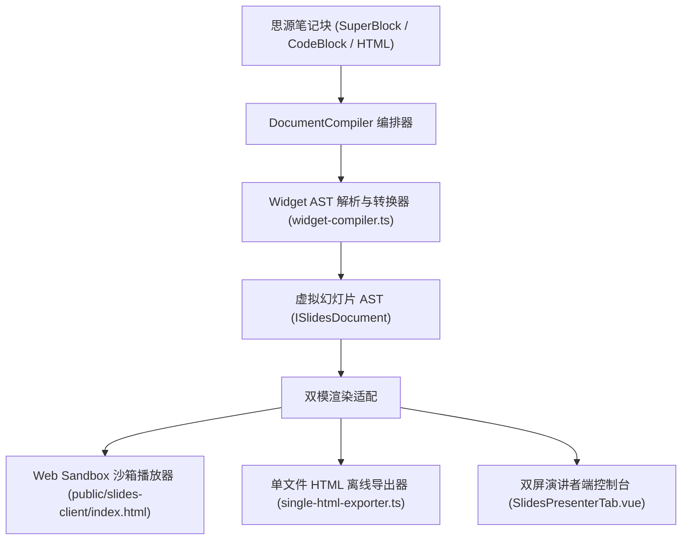

# 演示交互组件系统设计方案（Interactive Components System）

## 1. 概述与设计背景

### 1.1 核心愿景
传统的幻灯片演示通常是讲者到观众的**单向静态信息灌输**。而在现代技术分享、产品发布、教学培训以及述职汇报场景中，演讲者迫切需要**“可实时演示的动态对象”**：
- 能够向观众现场演示可操作的交互逻辑（如：算法参数滑动演算、Tab 多语言代码切换、知识点翻牌问答）；
- 能够在放映时实时控制演示进程（如：倒计时、局部展开/折叠、动态过滤）；
- 保持对思源笔记生态的**零内容污染**与**离线单文件全兼容**。

本方案旨在利用本插件已内置的 **Vue 3 运行时编译引擎** 与 **UnoCSS** 基础设施，构建一套开箱即用、低心智负担的**即现演示交互组件系统（Live Slides Interactive Components）**。

---

## 2. 典型交互组件族与演示效果

| 组件名称 | 视觉与交互效果 | 典型业务场景 |
| :--- | :--- | :--- |
| **1. 3D 翻转问答卡 (`<FlipCard>`)** | 正面展示问题/悬念，点击或按翻页键触发 3D 翻牌动效，平滑翻转至背面呈现核心答案、代码或深度剖析。 | 课堂教学随堂测验、发布会技术难点悬念揭晓、常见 Q&A 问答答疑。 |
| **2. 多标签页切换器 (`<SlideTabs>`)** | 单页幻灯片内部横向多 Tab 联动，点击 Tab 切换内部渲染区域，无需为不同操作系统或编程语言复制多张页面。 | 跨平台安装配置（macOS / Windows / Linux）、多语言同一算法实现（TS / Rust / Go）、方案 A/B 对比。 |
| **3. 实时参数演算沙盒 (`<ParamSandbox>`)** | 提供可视化的数字调节滑块 (`<input type="range">`) 或开关，拖动滑块时，关联的计算公式数值或几何图形实时响应重绘。 | 算法复杂度演算、商业金融 ROI 敏感度分析、工程性能估算模型展示。 |
| **4. 轻量交互微图表 (`<SlideChart>`)** | 零外部依赖的纯 SVG 柱状图、折线图与环形图。鼠标悬停呈现 Tooltip 数据指示，支持点击图例动态高亮或过滤系列。 | 性能基准对比评测、业务营收占比分析、系统吞吐量压测结果呈现。 |
| **5. 演讲互动计时器 (`<Countdown>`)** | 醒目的倒计时圆环或数字翻牌器，提供一键开始、暂停、重置，支持到时微震动/颜色警示。 | 现场头脑风暴讨论限时、学员实操演练倒计时、会议中场休息 5 分钟倒计时。 |
| **6. 现场投票/调研展示条 (`<PollBar>`)** | 包含 2~4 个选项的可视化进度占比条，讲者现场询问观众举手表决，点击按钮实时增减票数并以弹性动画调整宽度百分比。 | 现场观众背景调研（如“用过 Vue 3 的请举手”）、技术选型方案倾向即席表决。 |

---

## 3. 在思源笔记中的配置方式

为符合《即现演示》“Markdown 内容零污染、优先利用原生块属性”的设计哲学，本系统提供**从零代码到高阶自由编写的三层配置阶梯**：

```
[极简层] 思源原生超级块一键转换（右侧 Inspector 面板下拉选择，零心智门槛）
   ↓
[快捷层] Markdown 扩展代码块语法（如 ```slide-chart / ```slide-tabs）
   ↓
[极客层] 原生 HTML / Vue 模板语法（直接写 <FlipCard>，自由灵活度最高）
```

### 3.1 极简层：思源原生超级块一键转组件（无侵入 IAL 标注）
思源笔记原生支持超级块（SuperBlock `{{{row` 或 `{{{col`）。用户无需编写任何代码：
1. **超级块转 `<FlipCard>`**：
   - 用户在思源中创建一个包含 2 个子块的超级块（第 1 个子块为正面问题，第 2 个子块为背面答案）；
   - 在右侧「演示配置 (Dock)」面板中，该超级块的版式下拉列表新增一项：`翻转卡片 (Flip Card)`；
   - 插件自动为该超级块写入思源原生 IAL 属性：`custom-slides-widget="flip-card"`。
2. **超级块转 `<SlideTabs>`**：
   - 超级块内包含多个子块（或多个二级超级块），每个子块的首行标题即为 Tab 标签名；
   - 侧边栏一键切换为 `多标签切换 (Tabs)`，自动写入 `custom-slides-widget="tabs"`。

### 3.2 快捷层：代码块语法（适合图表与参数模型）
对于图表与实时计算模型，用户可在思源中直接插入一个代码块，指定语言为 `slide-chart` 或 `slide-calc`：

````markdown
```slide-chart
type: bar
title: 编译性能对比 (毫秒，越低越好)
data:
  - label: Webpack 5
    value: 3820
    color: "#f59e0b"
  - label: Vite 6
    value: 420
    color: "#3b82f6"
  - label: Siyuan Live Slides
    value: 68
    color: "#10b981"
```
````

编译器在解析到语言为 `slide-chart` 的代码块时，会自动将其包装为带交互的高保真微图表组件。

### 3.3 极客层：原生 Vue 模板标签（无缝复用沙箱编译器）
由于内置沙箱已集成 Vue 3 模板编译器，高级用户可直接书写声明式标签：
```html
<FlipCard>
  <template #front>
    <h3>❓ 为什么选型采用 IAL 属性而非污染 Markdown？</h3>
    <p class="text-sm opacity-60">点击卡片或按翻页键揭晓</p>
  </template>
  <template #back>
    <h3>💡 保持思源文档生态纯洁性</h3>
    <p>任何其他插件或阅读器打开时均保持标准 Markdown，绝不破坏文档原始语义。</p>
  </template>
</FlipCard>
```

---

## 4. 架构改动与代码实现方案



### 4.1 协议层扩展 (`src/types/slides-protocol.ts`)
新增组件级协议常量定义：
```typescript
/** 块级交互组件类型定义 */
export const ATTR_ELEM_WIDGET = "custom-slides-widget"
export type TSlidesWidgetType = "flip-card" | "tabs" | "countdown" | "poll" | "param-sandbox"

/** 扩展块级虚拟模型 */
export interface ISlidesBlockItem {
  // ... 既有字段 ...
  widgetType?: TSlidesWidgetType
  widgetProps?: Record<string, any>
}
```

### 4.2 编译器层转换器 (`src/compiler/widget-transformer.ts`)
在 AST 编译阶段识别 `custom-slides-widget` 或特定的标记代码块：
1. **超级块解包**：当超级块标记为 `flip-card` 时，将第 1 个子块标记为 slot `front`，第 2 个子块标记为 slot `back`，包装为 `<FlipCard>` 容器结构；
2. **代码块转换**：当遇到 `slide-chart` 时，快速将其 YAML 提取并转换为 `<SlideChart :config="..."/>` 内联结构。

### 4.3 Web 沙箱播放器组件注册 (`public/slides-client/index.html`)
在沙箱的 Vue 应用初始化时，注册全套内置演示组件：
```javascript
// 1. 注册 3D 翻转卡片
app.component('FlipCard', {
  props: { trigger: { type: String, default: 'click' } },
  setup(props, { slots }) {
    const isFlipped = ref(false)
    const toggle = () => { isFlipped.value = !isFlipped.value }
    return () => h('div', {
      class: ['slides-flip-card', { 'is-flipped': isFlipped.value }],
      onClick: toggle
    }, [
      h('div', { class: 'flip-card-inner' }, [
        h('div', { class: 'flip-card-front' }, slots.front ? slots.front() : slots.default?.()),
        h('div', { class: 'flip-card-back' }, slots.back?.())
      ])
    ])
  }
})

// 2. 注册多标签页切换组件
app.component('SlideTabs', SlideTabsComponent)

// 3. 注册轻量微图表组件
app.component('SlideChart', SlideChartComponent)
```

### 4.4 样式层与 GPU 3D 硬件加速 (`public/slides-client/index.html` & `standalone-template-styles.ts`)
为交互组件注入无外部依赖的原生 CSS：
```css
.slides-flip-card {
  perspective: 1000px;
  cursor: pointer;
  width: 100%;
}
.flip-card-inner {
  position: relative;
  width: 100%;
  transition: transform 0.6s cubic-bezier(0.4, 0, 0.2, 1);
  transform-style: preserve-3d;
}
.slides-flip-card.is-flipped .flip-card-inner {
  transform: rotateY(180deg);
}
.flip-card-front, .flip-card-back {
  position: absolute;
  width: 100%;
  backface-visibility: hidden;
  border-radius: 12px;
  padding: 1.5rem;
}
.flip-card-back {
  transform: rotateY(180deg);
}
```

### 4.5 离线单文件 HTML 导出集成 (`src/export/single-html-exporter.ts`)
- 运行时与样式模板同步内联进导出的独立 HTML 文件；
- 保证观众脱机下载后，在**任何无网络环境的浏览器中均可 100% 完整体验所有交互操作**。

---

## 5. 关键讨论点与权衡建议（Trade-offs）

1. **按键冲突防穿透问题**：
   - *问题*：当观众在演讲中操作 `<input type="range">` 滑块、或者在 Tab 切换中点击时，键盘左右键可能会误触发“切换幻灯片”。
   - *方案*：沙箱内置全局事件拦截器，当 `activeElement` 处于 `input`、`button`、`select` 或标记了 `data-prevent-slide-nav="true"` 的交互容器内部时，阻止事件冒泡到全局幻灯片切页调度器。
2. **图表库依赖体积抉择**：
   - *考量*：引入完整 ECharts 会使插件与单文件导出包体积增加 800KB~1MB。
   - *建议*：第一期自研轻量级 **Mini-SVG Chart 引擎**（仅 15KB，纯原生 SVG 绘制柱状/折线/环形，具备基础 Tooltip 与入场动画），满足 90% 的演讲对比演示；若用户明确需要超复杂数据可视化，第二期以按需动态加载（Async Chunk）方式引入 ECharts。
3. **打印与 PDF 导出兼容**：
   - *考量*：在导出 PDF 讲义时，翻牌卡背面或第二 Tab 的内容默认会被盖住。
   - *方案*：在 `@media print` 打印媒体查询与 PDF 导出管道中，将 `FlipCard` 与 `SlideTabs` 自动降级为“纵向平铺（Unpacked Block Stack）”，确保打印出的 PDF 包含全部内容而无遮挡丢失。
