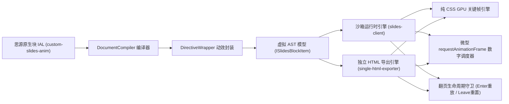

# 灵活演示动效与微动画系统设计方案（Motion & Micro-animation System）

## 1. 概述与设计背景

### 1.1 核心愿景
在高质量的演示文稿中，**视觉节奏与动效呈现是抓住观众注意力、强化观点说服力的灵魂**。
传统的 PPT 动画往往存在两大痛点：
1. **过于生硬或陈旧**：简单的硬切换或千篇一律的淡入，缺乏现代软件与发布会级别的弹性与质感；
2. **代码化框架配置成本高**：如果每次都要手写 `@keyframes` 或 CSS 样式，普通笔记用户心智负担极重。

本方案旨在依托思源笔记原生 IAL 块属性与本插件的渲染管道，构建一个**轻量、丝滑、开箱即用且支持在侧边栏一键可视化配置的「灵活演示动效与微动画系统」**。

---

## 2. 核心动画族与视觉效果

| 动效类型 | 视觉呈现效果 | 典型应用场景 |
| :--- | :--- | :--- |
| **1. 动态数字翻滚器 (`CountUp`)** | 翻到该页或按翻页步进时，数字从 0 按照指数缓动曲线（Ease-Out）平滑翻滚递增至目标数值，支持带前缀（如 `¥`/`$`）、后缀（如 `%`/`ms`/`k`）与千分位分割符。 | 关键量化指标展示（如“性能提升 98.5%”、“处理耗时降至 16ms”、“月活突破 1,000,000”）。 |
| **2. 终端打字机效果 (`Typewriter`)** | 文字或命令逐字打印出现，末尾跟随闪烁的光标。可配置字打速度与光标保留时长。 | 技术演讲命令行敲击演练、金句名言亮相、核心标题重磅登场。 |
| **3. 呼吸发光强调 (`Pulse Glow`)** | 目标元素（如卡片、关键结论、标签）周围周期性散发柔和的主题色微光晕，像呼吸般起伏。 | 引导观众视线聚焦于核心结论、架构图中最核心的中枢节点。 |
| **4. 3D 浮动悬浮 (`Floating Float`)** | 元素在垂直方向上以平滑正弦曲线轻微漂浮（±6px 上下浮动），配合轻微投影变化。 | 产品配图、架构图立体卡片、荣誉勋章或核心徽标。 |
| **5. 弹性入场 (`Bounce In`)** | 相比现有的简单滑动，元素入场时带自然的物理弹簧回弹阻尼（Spring Physics），活泼而不失沉稳。 | 列表要点逐步亮相、对比卡片弹入。 |
| **6. 流光扫过 (`Shimmer Sweep`)** | 类似骨架屏或高级徽标的金属流光，一道半透明反光条从左至右划过文字或卡片表面。 | VIP 特性发布、重大突破展示、高亮推荐方案。 |
| **7. 代码平滑聚焦流动 (`Smooth Code Spotlight`)** | 当 Shiki 代码块随着演进切换高亮行（如第 1~3 行 -> 第 6~8 行）时，背景高亮条平滑滑动到位，而非生硬跳闪。 | 代码行级递进讲解、算法多步骤追踪。 |

---

## 3. 在思源笔记中的配置方式

遵循**“零污染、所见即所得、低心智负担”**的理念，支持以下三种配置入口：

### 3.1 方式一：右侧 Dock 面板「动效工坊」可视化一键点选（推荐日常使用）
在现有的 `BlockInspectorSection.vue` 中，在「入场微动效 (v-motion)」下方扩充全新的【微动效与强调】卡片：
1. **动画类型下拉菜单**：
   - `无`
   - `🔢 数字滚动递增 (CountUp)`
   - `⌨️ 终端打字机 (Typewriter)`
   - `✨ 呼吸光晕 (Pulse Glow)`
   - `🎈 悬浮微浮动 (Floating)`
   - `💫 弹性弹入 (Bounce In)`
   - `🌊 流光掠过 (Shimmer)`
2. **微调控制项**：
   - **播放时机**：`进页自动播放 (On Slide Enter)` 或 `随翻页步进出现 (With v-click)`
   - **持续时长 (Duration)**：预设滑块（`0.5s`、`1.0s`、`1.5s`、`2.0s`）
   - **数字专用参数**（当选中 CountUp 时自适应展现）：前缀、后缀、小数位数
3. **零侵入 IAL 存储**：
   配置变更后，系统自动持久化写入原生块属性：
   ```html
   custom-slides-anim="countup"
   custom-slides-anim-props="duration:1500;decimals:1;suffix:%"
   ```

### 3.2 方式二：Protyle 浮动微工具条（ElementAnimBar）高频快捷操作
当在思源编辑区鼠标悬停或选中文本块时，呼出的 `ElementAnimBar` 浮动条新增「动效魔棒」图标：
- 点击即弹出 6 个高频动效图标，点击一键附加，无需将焦点移至右侧侧边栏。

### 3.3 方式三：内联富文本扩展标记（针对行内局部文字/数字）
若要在普通段落的一句话中仅对局部数字开启递增动画，支持思源标准行内属性语法或内联标签：
```markdown
本次迭代实现首屏加载时间从 3.2s 缩短至 <CountUp to="0.4" suffix="s" />，性能提升 <CountUp to="800" suffix="%" />。
```

---

## 4. 架构改动与代码实现方案



### 4.1 协议层扩展 (`src/types/slides-protocol.ts`)
```typescript
/** 块级动效属性与配置常量 */
export const ATTR_ELEM_ANIM = "custom-slides-anim"
export const ATTR_ELEM_ANIM_PROPS = "custom-slides-anim-props"

export type TSlideAnimType =
  | "countup"
  | "typewriter"
  | "pulse"
  | "float"
  | "bounce-in"
  | "shimmer"

export interface ISlideAnimConfig {
  type: TSlideAnimType
  duration?: number // 毫秒
  delay?: number // 毫秒
  trigger?: "auto" | "click" // 进页自动或点击步进
  // 数字滚动专有参数
  from?: number
  to?: number
  decimals?: number
  prefix?: string
  suffix?: string
}
```

### 4.2 零外部依赖的纯 CSS GPU 关键帧动画库 (`standalone-template-styles.ts`)
所有循环与微动效均采用合成器层（Compositor Layer）属性实现，杜绝主线程重排卡顿：

```css
/* 1. 呼吸发光动效 */
@keyframes slides-pulse-glow {
  0%, 100% {
    box-shadow: 0 0 0 0 rgba(var(--slide-accent-rgb, 59, 130, 246), 0.4);
    transform: scale(1);
  }
  50% {
    box-shadow: 0 0 24px 6px rgba(var(--slide-accent-rgb, 59, 130, 246), 0.7);
    transform: scale(1.015);
  }
}
.anim-pulse {
  animation: slides-pulse-glow 2.4s ease-in-out infinite;
}

/* 2. 3D 浮动悬浮动效 */
@keyframes slides-float {
  0%, 100% { transform: translateY(0); }
  50% { transform: translateY(-8px); }
}
.anim-float {
  animation: slides-float 3.6s ease-in-out infinite;
}

/* 3. 流光掠过动效 */
@keyframes slides-shimmer-sweep {
  0% { transform: translateX(-150%) skewX(-20deg); }
  100% { transform: translateX(150%) skewX(-20deg); }
}
.anim-shimmer {
  position: relative;
  overflow: hidden;
}
.anim-shimmer::after {
  content: "";
  position: absolute;
  top: 0; left: 0; width: 100%; height: 100%;
  background: linear-gradient(90deg, transparent, rgba(255, 255, 255, 0.35), transparent);
  animation: slides-shimmer-sweep 2.8s ease-in-out infinite;
}

/* 4. 弹性弹入动效 */
@keyframes slides-bounce-in {
  0% { opacity: 0; transform: scale(0.6) translateY(20px); }
  60% { opacity: 1; transform: scale(1.04) translateY(-4px); }
  100% { opacity: 1; transform: scale(1) translateY(0); }
}
.anim-bounce-in {
  animation: slides-bounce-in 0.75s cubic-bezier(0.175, 0.885, 0.32, 1.275) forwards;
}
```

### 4.3 超轻量数字递增引擎 (`CountUp` 组件实现，仅 ~35 行原生 TS)
无需安装笨重的三方库，沙箱直接内置高性能调度器：
```typescript
function startCountUp(el: HTMLElement, targetVal: number, options: any = {}) {
  const duration = options.duration || 1500
  const decimals = options.decimals || 0
  const prefix = options.prefix || ""
  const suffix = options.suffix || ""
  const startTime = performance.now()

  // 经典三次 Ease-Out 指数曲线
  const easeOutExpo = (t: number) => (t === 1 ? 1 : 1 - Math.pow(2, -10 * t))

  function update(now: number) {
    const elapsed = now - startTime
    const progress = Math.min(1, elapsed / duration)
    const current = targetVal * easeOutExpo(progress)

    el.textContent = `${prefix}${current.toFixed(decimals)}${suffix}`
    if (progress < 1) {
      requestAnimationFrame(update)
    }
  }
  requestAnimationFrame(update)
}
```

### 4.4 页面生命周期监听与状态重置（Replay on Re-enter）
放映时最常见的痛点是：讲者切换上一页/下一页演练时，动画只播放了一次就不再播放。
- **守卫机制**：沙箱监听 `currentPageIndex` 与 `currentStep` 的变更事件；
- 当离开页面时，将带动画的 DOM 节点的 `animation` 设为 `none` 并清空文本；
- 重新进入该页面或激活到对应步进时，`void el.offsetWidth` 强制重流触发重放，确保现场放映每次翻至该页都能完美呈现动效。

---

## 5. 关键讨论点与权衡建议（Trade-offs）

1. **渲染性能与功耗控制**：
   - *原则*：所有微动效优先限制在 GPU 合成器层属性（`transform`, `opacity`），避免触发布局重排（Reflow）；
   - *优化*：页面切换到后台、或用户打开「全览大纲 (Overview)」时，自动给视口加上 `animation-play-state: paused`，彻底杜绝后台 CPU 空转。
2. **适度性原则（避免视觉干扰）**：
   - *建议*：持续循环类动画（如 Pulse、Float）单页仅建议应用在 1 个焦点卡片或按钮上，Dock 界面增加温和提示，避免整页过度晃动造成观众眩晕。
3. **打印与单文件离线 HTML 完美导出**：
   - *单文件 HTML*：将 ~35 行轻量调度器和 CSS 直接内联，脱机文件依然享有完整流畅动画；
   - *PDF / 静态图片导出*：在导出样式中统一注入 `@media print { * { animation: none !important; } }`，直接锁定最终完成态帧，杜绝导出空白或初始隐藏态。
