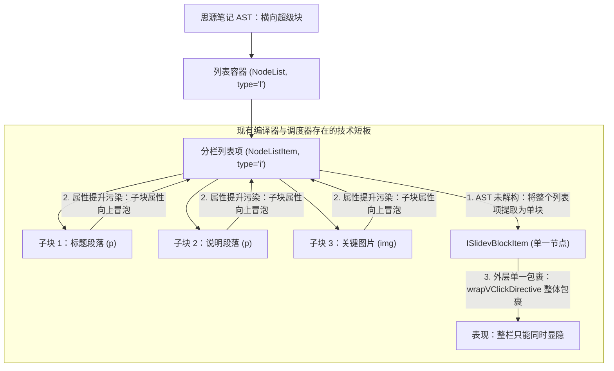
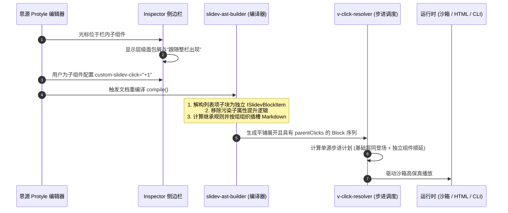

# 表头多栏内组件级逐步呈现与级联调度方案设计

## 1. 概述与背景

在思源笔记与 Slidev 深度融合的演示生态中，**表头多栏**（`cols-header` / `two-cols-header` / `three-cols-header`）是用户制作结构化并列论点、产品特性对比、卡片化并列清单的核心排版布局。

### 1.1 现状痛点
在现有实现中：
1. 每一栏通常由包含列表项（`NodeListItem`，即 `type: "i"`）的横向超级块承载，列表项内部包含卡片标题段落、正文说明段落、图片、代码块等多个子组件（思源块）；
2. 当用户在演示配置面板（Inspector）为该栏配置**逐步呈现（v-click）**时，放映时**只能整栏/整组作为一个整体同时出现**；
3. 即使针对列表项内部的某个子组件（如某段核心文字或图片）设置了独立的逐步呈现，实际放映时子组件的独立控制也会失效，无法做到“未配置逐步呈现的组件随栏目一起出场，而单独配置了逐步呈现的组件按步长逐个呈现”。

### 1.2 目标定位
打通分栏主容器与栏内子组件之间的**层级继承与独立覆盖机制（Inheritance & Override）**：
- **主容器决定子组件基线**：主容器（分栏列表项）控制整个分栏卡片的基础步进；若内部子组件未单独配置逐步呈现，则随主容器在同一步骤同时出现；
- **子组件独立配置优先覆盖**：若分栏内部某个子组件单独开启了 `v-click`，该组件脱离基础层，在主容器入场之后（或其指定的绝对步数）逐个步进呈现；
- **全链路保真协同**：保证思源编辑区、侧边栏演示配置面板、Web 预览沙箱、Slidev 官方 CLI 放映（Markdown 输出）以及离线单文件 HTML/PDF 导出的一致性体验。

---

## 2. 源码层根因分析

经过对 `src/compiler/slidev-ast-builder.ts`、`src/compiler/list-column-scanner.ts` 以及 `src/engine/v-click-resolver.ts` 的深入排查，导致“只能整组同时显示”的根本原因包含以下三层：

1. **AST 未解构**（`slidev-ast-builder.ts`）：
   在编译生成 `ISlidevBlockItem[]` 虚拟块列表时，代码仅对超级块（`s`）和列表容器（`l`）做了子节点遍历，而对具体列表项（`i`）直接调用 `extractBlockMarkdown(itemNode)`，将其作为一个不可拆分的整体打包为单块，子块丢失了独立节点地位。
2. **属性向上冒泡污染**（`slidev-ast-builder.ts#L243-L259`）：
   旧有逻辑使用 `collectAttrsFromTree` 将所有后代子块的 `custom-slidev-*` 属性强行合并到了列表项外层容器上，使得子块独立的 `custom-slidev-click` 被父容器直接吸收冒泡，遮蔽了子块的个性化配置。
3. **分栏插槽渲染未做分层调度**（`slidev-ast-builder.ts#L570-L660` 与 `v-click-resolver.ts`）：
   Slidev 原生 Markdown 插槽生成器只对整个列表项应用了外层包装；沙箱调度引擎在缺乏容器层级映射的情况下，只能将整个列表项按单一 step 进行显隐。

---

## 3. 核心设计原则与业务规则

经前期深入论证，确立以下核心规则：

### 规则 1：步进时序流向（主容器 N 步入场，子组件顺延步进）
- **主容器未开启逐步呈现（第 0 步 / 默认加载即显示）**：
  - 未单独开启逐步呈现的子组件：作为卡片基础内容，幻灯片载入时**立即可见**；
  - 单独配置了 `+1` 的子组件：在幻灯片播放第 1 步、第 2 步...按页面自然流式**逐个出现**。
- **主容器开启逐步呈现（第 N 步入场）**：
  - 未单独开启逐步呈现的子组件：跟随主容器**在第 N 步同时呈现**（不额外消耗步数）；
  - 单独配置了 `+1` 的子组件：在主容器出现之后，从第 `N+1`、`N+2`... 步开始**顺延逐个出现**。

### 规则 2：严格独立配置原则（基础层聚合与防倒置保障）
所有未单独开启逐步呈现的子组件均归属于**“基础层（Base Layer）”**。
若一栏内包含多个组件（例如：组件 1 标题、组件 2 段落、组件 3 图片、组件 4 总结）：
- 即使仅有组件 3 单独配置了 `v-click`，组件 1、组件 2、组件 4 均在基础层同时就位；
- 仅组件 3 在后续独立步骤呈现，杜绝未显式配置组件意外产生步进或出现跳变。
- **列表主容器主文本归一化（防倒置机制）**：
  在思源笔记列表项结构中，首行有效子块代表主容器自身的主文本。当主容器配置了逐步呈现（无论是用户配置在外层 `NodeListItem`，还是在首行文本光标处配置）：
  - 编译器提取容器 clicks 并提升为 `containerClicks`，同时清除首行文本自身独立的 clicks，使其纯粹作为基础层继承 `parentClicks: containerClicks`；
  - 栏内未显式配置的子组件（如图片、描述）同样归入基础层继承 `parentClicks`，严格在同一步长（第 N 步）同时呈现；
  - 彻底杜绝“子组件（图片）因无 clicks 被判定为 always 在第 0 步翻页即先出现，而主容器文本在第 1 步后出现”的时序倒置 Bug。

### 规则 3：演示配置 (Inspector) 界面交互增强
- **层级感知面包屑**：当光标位于分栏内的子组件时，侧边栏顶部清晰标明层级路径（如：`第 1 栏 › 段落块`）；
- **主容器视觉权威与继承状态明确提示**：
  - 若光标在首行主文本且自身未显式设置属性，自动展示父容器的 clicks（主容器状态权威）；
  - 当光标聚焦在其他子组件（图片）且未单独开启逐步呈现时，开关关闭，下方显示弱化提示文案：`未单独开启逐步呈现：当前跟随整栏同时出现`；开启独立开关后展示步长选择 Chips；
- **同步写入父容器**：在首行主文本配置逐步呈现时，自动向父级列表项容器同步写入 `custom-slidev-click`，保证思源原生 IAL 与容器模型完全对齐。

---

## 4. 系统架构与模块改造设计

### 4.1 编译器层改造（`src/compiler/slidev-ast-builder.ts`）

1. **消除属性冒泡与大纲大盘污染**：
   - 重构 `collectAttrsFromTree`，仅允许向上传递特定多媒体配置（如视频属性），严禁将子节点的 `custom-slidev-click`、`custom-slidev-motion` 提升并覆盖到父级容器；
   - **大纲作用域隔离**：当块处于分栏容器或列表项上下文时（`inheritedContext` 存在），严禁继承外部页面大纲栈（`headingStack`）的 `clicks`；列表项内部子标题亦不压入全局大纲栈，杜绝子组件被错误赋予 `clicks`。
2. **列表项平铺解构、clicks 提升与首行主文本归一化**：
   - 在表头多栏版式下，顶层列表容器（`NodeList`，`type: 'l'`）自动展开其包含的所有列表项（`NodeListItem`，`type: 'i'`）；
   - **容器 clicks 提取与提升**：优先采用列表项容器自身 `elemAttrs.clicks`；若容器未设置但多子块结构中首行有效子块配置了 clicks，提升为 `containerClicks`；
   - **首行主文本归一化**：多子块结构中，首行有效子块清除自身独立 clicks，仅继承 `parentClicks: containerClicks` 归入基础层；
   - 若列表项包含多个子块（`children`），将子块依次展开为属于该分栏 slot（如 `col-1`）的独立 `ISlidevBlockItem`；
   - 第一个子块自动剥离首行列表前缀（`- `、`1. ` 等），转换为卡片标题或首行内容；
   - 每个展开的子块携带 `parentClicks: containerClicks` 标记，便于调度器计算级联关系。
3. **分栏插槽原生 Markdown 生成**：
   在为 Slidev 原生语法输出 `::col-X::` 块时：
   - 将该分栏中**未单独配置 clicks 的基础层块**（首行文本 + 未配置的图片）聚合并统一包裹在同一个 `<v-click>` 标签内输出；
   - 将**单独配置了 clicks 的独立层块**分别包装为其各自的 `<v-click>` 标签。

### 4.2 步进调度器改造（`src/engine/v-click-resolver.ts`）

在 `computeSlideClicksPlan` 中增强对分栏与容器级联的步进计算：
1. 识别具有 `parentClicks` 继承关系的子块；
2. 若子块未显式配置 `clicks`：
   - 若主容器配置了步进（如第 `N` 步），子块步进直接对齐为主容器的第 `N` 步（同登场，不自增 `stepCounter`）；
   - 若主容器未配置步进，子块标记为 `type: "always"`；
3. 若子块显式配置了 `clicks`（如 `+1`）：
   - 在主容器当前步进的基础上触发自增并分配步进，确保时序后置且平滑递增。

### 4.3 演示配置面板增强（`src/ui/`）

1. **`src/ui/dock/SlidevInspectorDockView.vue`**：
   - **权威状态流绑定**：`elemClick` 以当前激活块自身的 `activeBlockAttrs` 为第一权威源；子组件未显式定义 `ATTR_ELEM_CLICK` 时严格返回空字符串，杜绝回退到未重新编译的 `matched.clicks` 导致开关状态跳变和无法关闭的问题；
   - **首行主文本展示容器 clicks**：若光标聚焦在列表项首行主文本且自身未单独配置 clicks 时，展示父容器的 clicks；
   - 从当前激活块向上追溯 Protyle DOM 节点，检测其是否嵌套在 `NodeListItem` 内；
   - 输出清晰的层级面包屑标签（如 `第 1 栏 › 段落块` 或 `分栏容器 › 段落块`）。
2. **`src/ui/components/BlockInspectorSection.vue`**：
   - 支持 `parentElemClick` 属性；
   - 当 `elemClick` 为空但父容器配置了逐步呈现时，展示继承提示：`未单独开启逐步呈现：当前跟随整栏同时出现`；开启独立开关后展示步长选择 Chips。

### 4.4 导出端与沙箱运行时对齐

- **`src/export/slide-layout-renderer.ts`**：
  直接渲染解构展开后的多栏块列表，并确保各块保留正确的 `data-block-id` 和 `slide-block` 结构。
- **`src/export/standalone-client-runtime.ts`**：
  离线单文件播放器运行时同步引入级联步进计算逻辑，确保导出的离线 HTML 表现与内置 Web 沙箱完全一致。

---

## 5. 场景推演与验证矩阵

设某一多栏幻灯片第 1 栏包含：子块 1（标题）、子块 2（说明段落）、子块 3（架构图）。

| 场景 | 列表项 (主容器) | 子块 1 (标题) | 子块 2 (说明) | 子块 3 (架构图) | 放映显隐实际行为 |
| :--- | :---: | :---: | :---: | :---: | :--- |
| **场景 1：全未配置** | 关 | 关 | 关 | 关 | 翻到本页时，整栏所有内容**直接全部显示**。 |
| **场景 2：仅子组件逐步** | 关 | 关 | 关 | **开 (+1)** | 载入本页时：标题与说明**立即可见**； 点击第 1 下：架构图**单独淡入呈现**。 |
| **场景 3：整栏顺延 + 图片未配置 (防倒置)** | **开 (+1)** | 关 | 关 | 关 | 载入本页时：整栏隐藏； 点击第 1 下：标题、说明与架构图**同拍同时出现**，杜绝倒置。 |
| **场景 4：整栏逐步 + 子组件细化** | **开 (+1)** | 关 | 关 | **开 (+1)** | 载入本页时：整栏空白； 点击第 1 下：标题与说明**同时呈现**； 点击第 2 下：架构图**继续单独淡入呈现**。 |
| **场景 5：多子组件连续顺延** | **开 (+1)** | 关 | **开 (+1)** | **开 (+1)** | 点击第 1 下：标题**出现**； 点击第 2 下：说明**出现**； 点击第 3 下：架构图**出现**。 |

---

## 6. 实施步骤规划

1. **第 1 阶段：测试驱动先行（TDD）**
   - 编写 `tests/column-component-vclick.test.ts`，覆盖上述场景 1 ~ 场景 4 的编译器 AST、生成的 Markdown 片段以及 `computeSlideClicksPlan` 步进规划。
2. **第 2 阶段：编译器 AST 解构与 Markdown 生成重构**
   - 改造 `src/compiler/slidev-ast-builder.ts`：阻止属性递归污染，实现列表项子块平铺展开与分组聚合输出。
3. **第 3 阶段：步进调度器增强与导出运行时同步**
   - 完善 `src/engine/v-click-resolver.ts` 支持级联继承步进；
   - 同步 `src/export/standalone-client-runtime.ts`。
4. **第 4 阶段：Inspector 侧边栏面包屑与继承状态联动**
   - 更新 `SlidevInspectorDockView.vue` 与 `BlockInspectorSection.vue`。
5. **第 5 阶段：全量回归验证与构建打包**
   - 运行全部 Vitest 测试套件确保 0 regression；
   - 运行 `npm run build` 验证打包通过。
